# Ohpe

*designed by groovex* · [English](README.md)

**[⬇ Ohpe herunterladen (macOS · Windows)](https://github.com/thegroovex/Ohpe/releases)**

**Ohpe** ist eine kompakte, verspielte Synthesizer-Workstation für deinen Computer: acht
Klangerzeuger auf vier Parts, ein Drum-Kit, vier Sequencer, eine Achtspur-Bandmaschine, ein
Achtkanal-Mixer mit Dynamik und Effekten und eine ruhige, minimalistische Oberfläche rund um vier
Drehregler und eine Klaviatur. Ohpe läuft als
**Standalone-App** (macOS, Windows, Linux) und als **VST3**- und **Audio-Unit**-Plug-in.

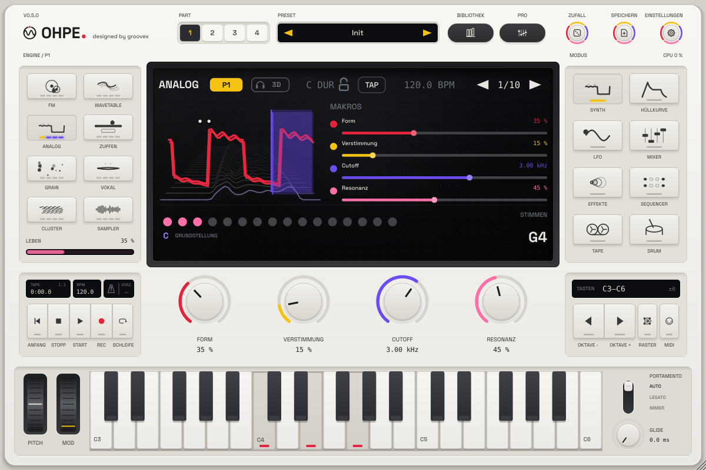

> **Stand: Phase 4 (0.4).** Acht Engines, vier Parts, Drum-Kit, Step-, Euklid-, Arpeggiator- und
> Orbit-Sequencer, Bandmaschine, Mixer-Dynamik, FX-Slot, MPE und MIDI-Clock-Sync, Preset-Bibliothek,
> Profiansicht und direkte Bedienung – jetzt mit den **Werksklängen**: 120 Part-Presets, 7
> Demo-Projekte, fünf Drum-Kits und zehn aufgenommene Instrumente. Erste Vorabversion: unsignierte Builds
> auf der [Release-Seite](https://github.com/thegroovex/Ohpe/releases).

## Funktionen

| | |
|---|---|
| **Analog-Engine** | zwei bandbegrenzte Oszillatoren (Wellenform-Morph, Verstimmung, Oktave, Mischung), Sub, Rauschen, Ladder- und State-Variable-Filter (TP / BP / HP), Drive, Keytracking |
| **FM-Engine** | sechs Operatoren, acht Algorithmen mit weichem Überblenden zwischen Nachbarn, Feedback, Verhältnis und Pegel je Operator |
| **Wavetable-Engine** | sechs eingebaute Tabellen mit je acht Frames, weiches Morphing, Warp-Modi, Unisono, Sub-Oszillator; eigene Tabellen aus jedem Klang (Klang zu Wavetable: periodensynchrone Analyse, 8–256 Frames), Single-Cycle-Sätze und eine eigene Bibliothek |
| **Zupf-Engine (Pluck)** | Waveguide-Saite und gestimmte Mallet-Resonatoren für gezupfte und angeschlagene Klänge |
| **Cluster-Engine** | bis zu sieben verstimmte Oszillatoren je Taste als Unisono oder Akkordform, langsamer Drift, resonanter Tiefpass |
| **Grain-Engine** | Granularsynthese aus einem geladenen Sample, dem Band oder einer eingebauten Textur |
| **Vokal-Engine** | Formant-Stimme mit Vokalen, Atem, Vibrato und Jitter; Formantspuren aus eigenen Klängen |
| **Sampler-Engine** | Tastenzonen oder automatische Slices aus WAV-, AIFF- und FLAC-Dateien, Loop-Modi, eingebauter Keys-Klang und zehn aufgenommene Werksinstrumente (Kalimba, Marimba, Vibrafon, Harfe, Cembalo, Blockflöte …) |
| **Drum-Kit** | 24 Pads auf MIDI-Kanal 10: fünf aufgenommene Werks-Kits (Studio, Trocken, Raum, Lo-Fi, Hybrid – CC0), eigene Samples oder Synth-Modelle, Choke-Gruppen |
| **Werksklänge** | 120 Part-Presets über alle Engines und Kategorien, im Pegel angeglichen; 7 Demo-Projekte mit allen vier Parts, den Sequenzern und dem Drum-Kit – siehe [Werksklänge](docs/de/FACTORY-SOUNDS.md) |
| **Vier Parts** | jeder mit eigener Engine, Hüllkurven, LFO, MIDI-Kanal, Skalen-/Akkord-Modus und MPE |
| **Je Stimme** | Lautstärke- und Modulationshüllkurve, LFO mit mehreren Zielen, Glide, 16 Stimmen |
| **Sequencer** | Step-Sequencer (bis zu 64 Schritte, Wahrscheinlichkeit, Ratchets, Parameter-Locks, 16 Pattern, Song-Modus), Euklid, Arpeggiator und Orbit (Polymetrik), jeweils mit Ziel-Part – Step, Euklid und Orbit können auch das Drum-Kit spielen |
| **Bandmaschine** | acht Stereospuren: Aufnahme / Overdub / Punch vom Eingang, von Parts oder Drums, Varispeed, rückwärts, Loop (Start / Ende von Hand am Abspielkopf setzen, im Takt- oder Schlagraster, Kanten ziehbar – [Schleife setzen](docs/de/BAND-MISCHER-FX.md#schleife-setzen-p42)), Bandcharakter, Rückgängig, Export als WAV-Master und Stems; Vorzähler von ein oder zwei Takten (die Aufnahme beginnt genau auf der Eins) und eingebautes Metronom; das Tempo wird direkt im Display gezogen, eingetippt oder getippt – siehe [Tempo, Metronom und Vorzähler](docs/de/BEDIENUNG.md#tempo-metronom-und-vorzähler-p39) |
| **Mixer** | acht Kanäle mit EQ, Kompressor, Lautstärke, Panorama, Mute / Solo, zwei Sends (A: Delay, B: Hall), Master-Kompressor, Bandsättigung und Limiter |
| **FX-Racks** | sechs Slots in Reihe pro Part und vier im Master: Hyper (Unisono-Verbreiterer), Verzerrung (acht Modi), Flanger, Kompressor, Multiband, EQ, Filter, Echo, Raum, Chorus, Phaser, Bitcrush, Filter-Drive, Delay, Hall, Mitte/Seite-Stereo, 3D-Raum – Reihenfolge per Ziehen, jeder mit Mischung und Bypass – siehe [FX-Rack](docs/de/BAND-MISCHER-FX.md#fx-rack-07) |
| **3D-Raum** | jeder Part kann sich um deinen Kopf bewegen – vorn, seitlich, hinten, oben, nah und fern – auf tempo-synchronen Bewegungspfaden (Kreis, Acht, Vorbeiflug mit Doppler, Zufallsorbit, Pendel, Spirale); binaural über Kopfhörer mit Ohpes eigenem parametrischem Kopfmodell (kein gemessener Datensatz), monokompatibel über Lautsprecher; auch als Rack-Effekt *3D-Raum*; 13 „3D“-Presets – siehe [3D-Raum](docs/de/RAUM.md) |
| **Leben** | ein LEBEN-Regler pro Part lässt gehaltene Töne weiterleben: jede Stimme driftet für sich (wenige Cent Tonhöhe, atmender Filter, wandernde Engine-Farbe, Grain-Streuung) – 0 = statisch, auf jeder Engine, ein Modulationsziel – siehe [Leben](docs/de/BEDIENUNG.md#leben) |
| **Resonanzkörper** | jeder Part kann durch einen physikalisch modellierten Körper spielen – gekoppelte Saiten mit Resonanzsaiten, gestimmt auf die Note oder den gehaltenen Akkord, eine modale Platte, ein offenes oder gedacktes Rohr; er folgt Tastatur, Pitchbend und MPE (Druck lässt ihn klingen, Slide verschiebt den Anregungspunkt); auch als Rack-Effekt *Resonanzkörper*; 7 Presets – siehe [Resonanzkörper](docs/de/RESONANZKOERPER.md) |
| **Morph-Raum** | ein XY-Pad je Part zwischen vier vollständigen Klängen – auch über verschiedene Engines: Parameter morphen, wo die Klänge gleich aufgebaut sind, sonst spielen die Klänge parallel und werden gleich laut überblendet; spielbar mit Maus, Automation, MIDI, Modulationsmatrix, Modulationsrad oder MPE-Druck / -Slide; 4 Morph-Presets – siehe [Morph-Raum](docs/de/MORPH-RAUM.md) |
| **Stimmsteuerung** | in einen Eingang singen, summen oder sprechen, und die Stimme bewegt den Klang (kein Vocoder – sie moduliert nur): Pegel, Vokal (A-E-I-O-U-Karte), Helligkeit, Konsonanten, Tonhöhe und Silbeneinsätze als Modulationsquellen, mit einem Druck *Vokal → Filter + Morph* – siehe [Stimmsteuerung](docs/de/STIMMSTEUERUNG.md) |
| **Bewegungs-Recorder** | an den Reglern eines Parts drehen, während die Musik läuft, und bis zu vier Bewegungen je Part laufen als Schleifen-Spuren mit eigener Länge (1 – 64 Sechzehntel, polymetrisch zum Pattern); Überspielen durch erneutes Anfassen, Tiefe regelbar, auch Modulationsquellen – siehe [Bewegungs-Recorder](docs/de/BEWEGUNG.md) |
| **Performance-Pads** | vier Pads werfen Effekte auf die Hauptsumme für Live-Sets – ein quantisiertes **Stottern** (1/4 … 1/32, Triolen), ein **Bandstopp** über 1/8 … 2 Takte, ein resonanter **Filter-Sweep** (Tiefpass nach unten / Hochpass nach oben) und ein **Hall-Freeze**, der den Moment endlos hält; halten = kurz, Umschalt-Klick = einrasten, per MIDI lernbar, Matrix-Quellen – siehe [Performance-Pads](docs/de/PERFORMANCE-PADS.md) |
| **Harmonie-Hirn** | Ohpe merkt sich Tonart und Akkorde, die du auf einem Part spielst; andere Parts folgen (rasten auf die Tonart, die Akkordtöne oder den Grundton), das Gedächtnis speist drei Modulationsquellen, und eine isomorphe Raster-Tastatur mit MPE (vier Anordnungen, ein Finger je Mitgliedskanal) spielt es vom Bildschirm – siehe [Harmonie-Hirn](docs/de/HARMONIE.md) |
| **SUB-Ebene** | jeder Part bekommt einen Suboszillator eine oder zwei Oktaven unter jeder Stimme – Sinus, Rund oder Rechteck, ins Filter der Engine oder direkt, an die Tonhöhe der Stimme gekoppelt (Glide, Bend), bandbegrenzt und mono, Pegel 0 = unveränderter Klang – siehe [SUB-Ebene](docs/de/SUB-EBENE.md) |
| **Tonart-Gravitation** | eine Spektral-Stufe pro Part nach den Engines zieht jeden Teilton zur Tonart und zum gehaltenen Akkord – Skala, Akkord oder Akkord+Skala, Glide bei Akkordwechseln, Formant-Erhalt; bei hohen Werten werden Rauschen und Drums zu tonalen Texturen in der Tonart; 0 = unveränderter Klang – siehe [Tonart-Gravitation](docs/de/TONART-GRAVITATION.md) |
| **Ausdrucksstark spielen** | Pro Part steuern Anschlag und Aftertouch (Kanal-, Poly- und MPE-Druck) je zwei musikalische Funktionen – Cutoff, Vibrato, Glide-Zeit, Attack, FM-Menge, Position, Drive und mehr – mit Menge und Kurve; die Werksklänge mit Glide gleiten unter Druck länger – siehe [Ausdrucksstark spielen](docs/de/AUSDRUCK.md) |
| **Updates in der App** | neue Versionen direkt in der Standalone-App oder im Plug-in finden (von Hand oder, wenn eingeschaltet, einmal am Tag – nie während der Wiedergabe), ihre Hinweise auf Deutsch oder Englisch lesen, im Hintergrund mit Fortsetzen und SHA-256-Prüfung laden, dann den Installer öffnen; Kanal Stabil / Vorschau, überspringen oder später erinnern, vorige Version zum Zurücksetzen, Inhaltspakete ohne Neuinstallation; keine Telemetrie – siehe [Aktualisierung](docs/de/AKTUALISIERUNG.md) |
| **Inhaltspakete** | Preset-Pakete aus `.ohpepack`-Dateien installieren (Dateidialog oder auf das Fenster ziehen): SHA-256 jeder Datei geprüft, bevor sich etwas ändert, ein Schritt zurück, Größengrenzen; Paketverwaltung mit Version, Größe, Lizenz / Signatur (angezeigt) und Entfernen; Bibliothek nach Paket filtern; Presets zeigen mit `"<Paket>/<Element>"` auf Paketinhalte und sagen, welches Paket fehlt – siehe [Inhaltspakete](docs/de/INHALTSPAKETE.md) |
| **Einstellungen und Nachtmodus** | eine Einstellungsansicht hinter der Zahnrad-Taste: Sprache (DE / EN), Tooltips und ein Hilfe-Overlay, Hilfeseiten, eine blendarme dunkle Erscheinung (oder auto mit dem System), Display-Helligkeit, Animationen, UI-Größe 75 – 200 %, MIDI-Einrichtung (Kanäle, MPE, Bend-Bereiche, Eingänge, Clock / Sync) und eine MIDI-Learn-Liste zum Bearbeiten oder Löschen von Zuweisungen, Updates und Über – pro Benutzer gespeichert, nie im Projekt – siehe [Einstellungen](docs/de/EINSTELLUNGEN.md) |
| **Barrierefreiheit und UI-Größe** | UI-Größen 75 – 200 % (Rechtsklick aufs Gehäuse), volle Bedienung per Tastatur mit Fokusring (Tab, F6, Pfeile, Enter / Leertaste), Screenreader-Namen und -Werte auf DE / EN, WCAG-AA-Kontrast in beiden Erscheinungen – siehe [Barrierefreiheit](docs/de/BARRIEREFREIHEIT.md) |
| **Preset-Zucht** | zwei Klänge kreuzen (auch über Engines hinweg – ein Hybrid behält die andere Engine als Layer) mit wählbarer Mutation, sechs Kinder mit Wellenform- / Helligkeits-Bildchen in der Lautstärke ihrer Eltern hören, die besten behalten und weitere Generationen mit Rückgängig züchten; Kinder landen als Favoriten in der Bibliothek – siehe [Preset-Zucht](docs/de/ZUCHT.md) |
| **Bounce ins Instrument** | eine BOUNCE-Taste bringt eine Tape-Spur, den Tape-Mix, den Schleifenbereich oder ein paar Takte vom Live-Eingang in die Grain- oder Sampler-Engine eines Parts – als nahtlose Endlosschleife (Körner kreisen über die Naht, gehaltene Sampler-Noten halten sie) oder als One-Shot; Bounces werden als WAV gespeichert und kommen mit der Session zurück – siehe [Bounce ins Instrument](docs/de/BOUNCE-INS-INSTRUMENT.md) |
| **Tape-Memory** | Ohpe merkt sich immer die letzten 30 s seines eigenen Ausgangs; eine MERKEN-Taste (MIDI-zuweisbar, auch am Grid-Controller) macht daraus ein spielbares Sampler-Instrument – chromatisch (Tonhöhe erkannt und gestimmt, Grundton gesetzt) oder nach Einsätzen geschnitten – in der Session gespeichert, als WAV exportierbar – siehe [Tape-Memory](docs/de/TAPE-MEMORY.md) |
| **Modulationsmatrix** | 16 Verbindungen pro Part aus 20 Quellen (drei LFOs, drei Hüllkurven, Anschlag, MPE, Makros, eine Sequencer-Spur …) auf Tonhöhe, Pegel, Panorama, 24 Engine-Parameter, die LFOs und jeden Rack-Slot; Ringe an den Drehreglern zeigen, was sich bewegt – siehe [Modulation](docs/de/MODULATION.md) |
| **Sync** | Host-Transport im Plug-in; MIDI-Clock ein / aus und Netzwerk-Tempo-Sync (Link) in der Standalone-App |
| **Multi-Out** | jeder Kanal geht auf den Hauptausgang oder auf einen eigenen Stereoausgang (8 Zusatzausgänge) – im Plug-in und in der Standalone-App |
| **MIDI** | Kanal je Part, MPE, jeder Regler ist per MIDI-Learn zuweisbar (Rechtsklick → MIDI-Learn), Zuweisungen lassen sich exportieren / importieren; alle Parameter sind automatisierbar |
| **Standalone-App** | Audiosystem, Gerät, Samplerate und Puffergröße wählen, Latenzanzeige, Multi-Out-Routing auf Gerätekanäle, MIDI-Eingänge |
| **Preset-Bibliothek** | eine Taste BIBLIOTHEK: Kategorien (Bass, Tasten, Flächen, Leads, Zupfer, Drums, FX, Arp, Texturen, Vokal), Engine-Filter, Suche, Favoriten, Sterne-Bewertung, Sortierung, Werks- und eigene Bank, Vorhören durch Auswählen, Part- und Projekt-Presets, voriges / nächstes per MIDI |
| **Display** | ein tiefes Display in Ebenen mit Parallaxe; Stereobild (Goniometer, Korrelation, M-/S-Pegel) eine bewegte 3D-Spektrum-Landschaft, die kopfbezogene 3D-Raum-Ansicht und das lebende Display – der Klang als 3D-Objekt, das mit der Hüllkurve atmet, sich mit den LFOs beult und mit der Stereobreite streckt – siehe [Lebendes Display](docs/de/LEBENDES-DISPLAY.md) |
| **Direkte Bedienung** | Wertebalken im Display ziehen, Shift / Cmd / Strg für Feinregelung, Doppelklick setzt zurück; Profiansicht mit allen Parametern eines Modus auf einmal – als bedienbare Bilder (Hüllkurven, Filter, LFO, FM-Graph, Wavetable, Grains, 3D) mit violetten Modulationsbereichen, dazu Entdecken: HELL / HART / LEBENDIG / WEIT, Variieren, Kreuzen, Würfel, Verlauf |
| **Sprachen** | Deutsch und Englisch, jederzeit umschaltbar |

## Bilder

| | |
|---|---|
| 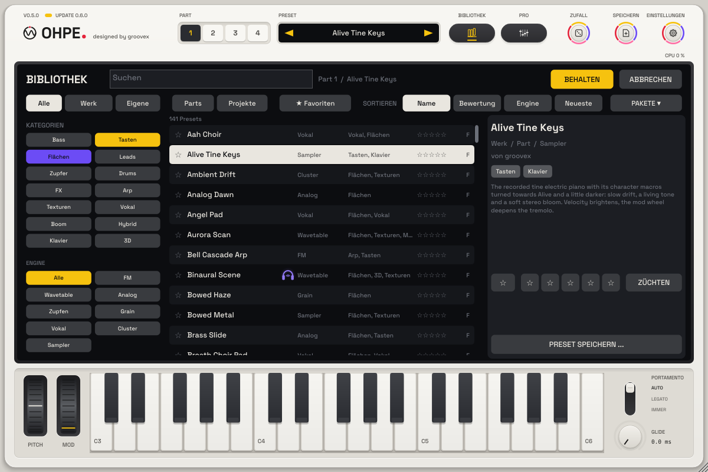 | 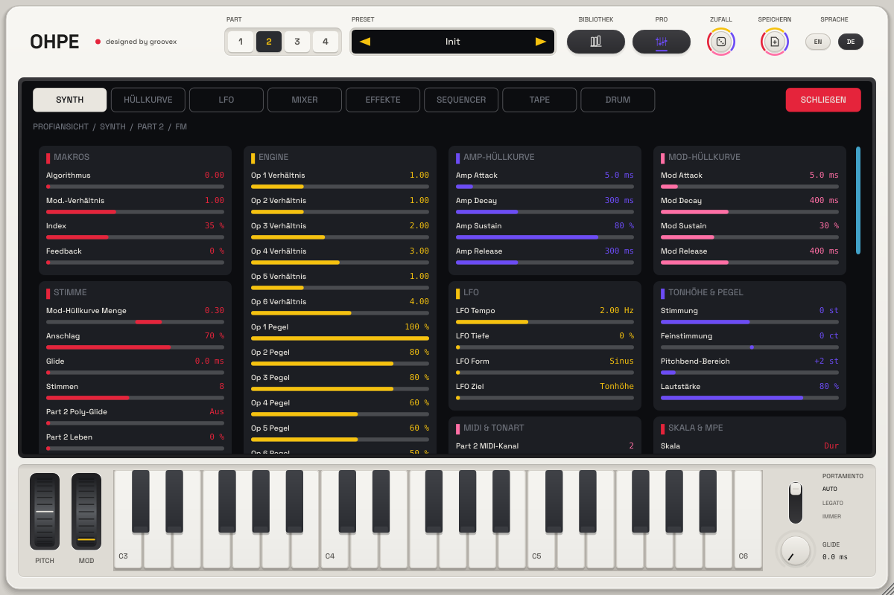 |
| Preset-Bibliothek | Profiansicht (FM-Engine, Part 2) |
| 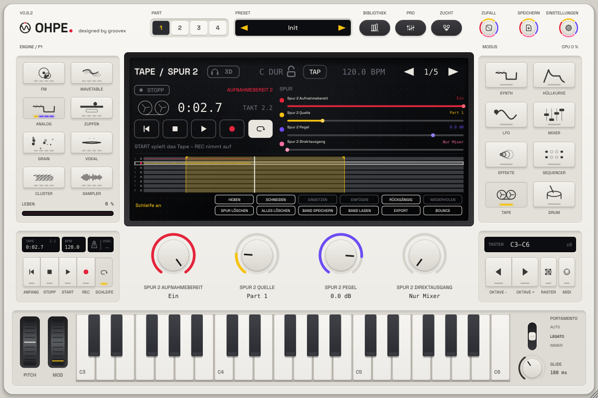 | 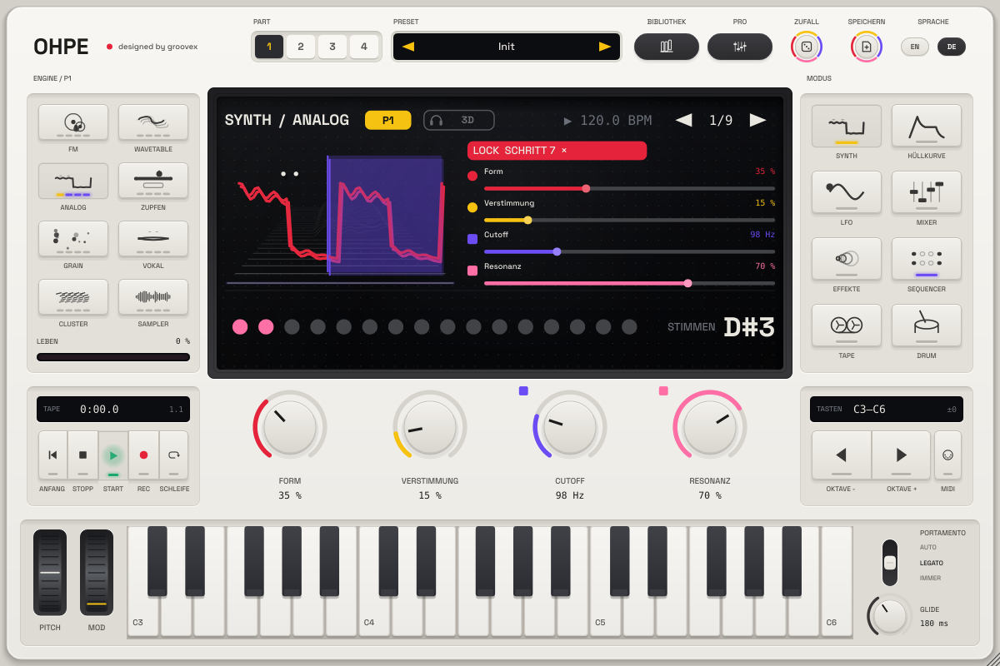 |
| Tape-Seite | Parameter-Locks auf einem Schritt |
| 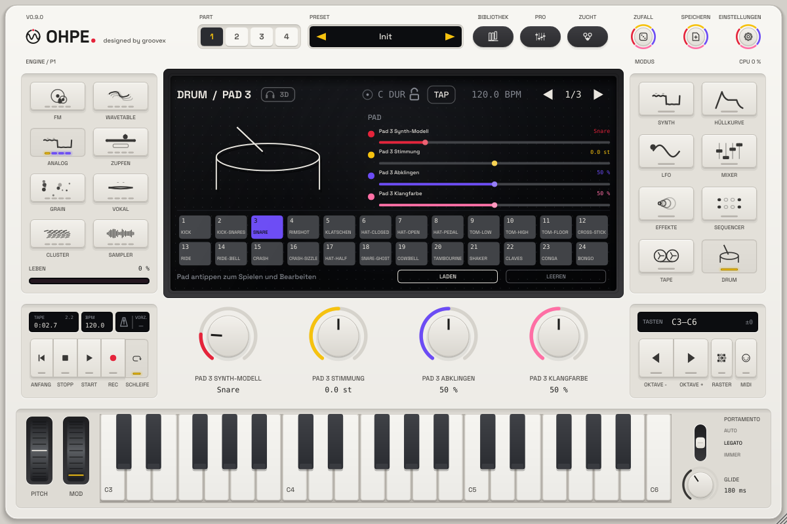 | 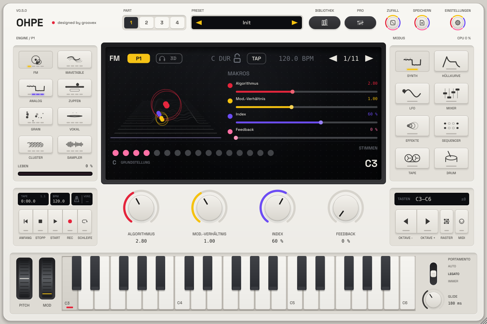 |
| Drum-Kit-Seite | FM-Engine |
| 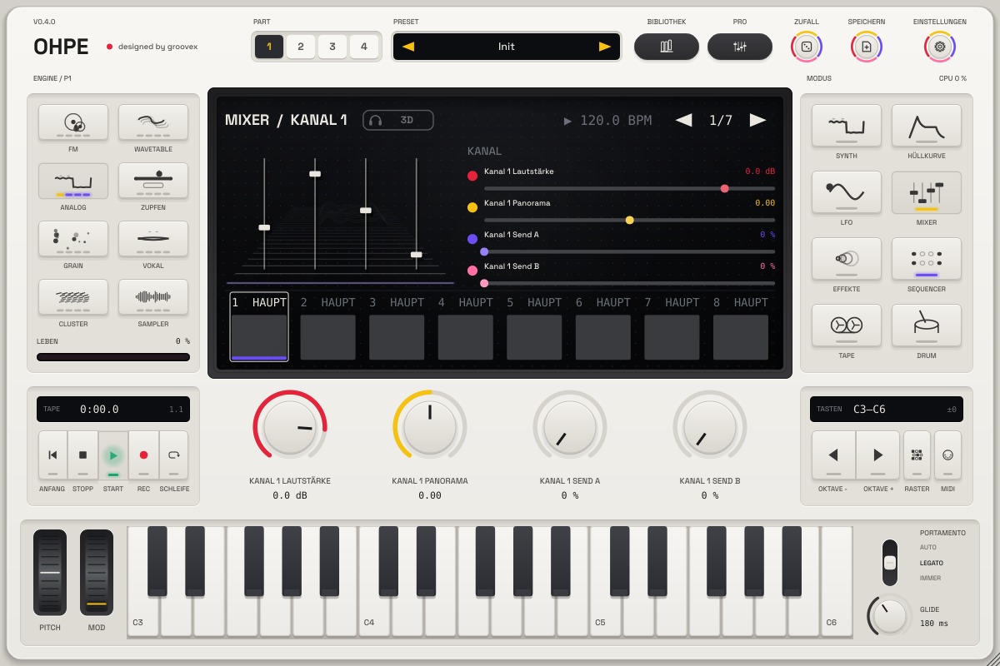 | 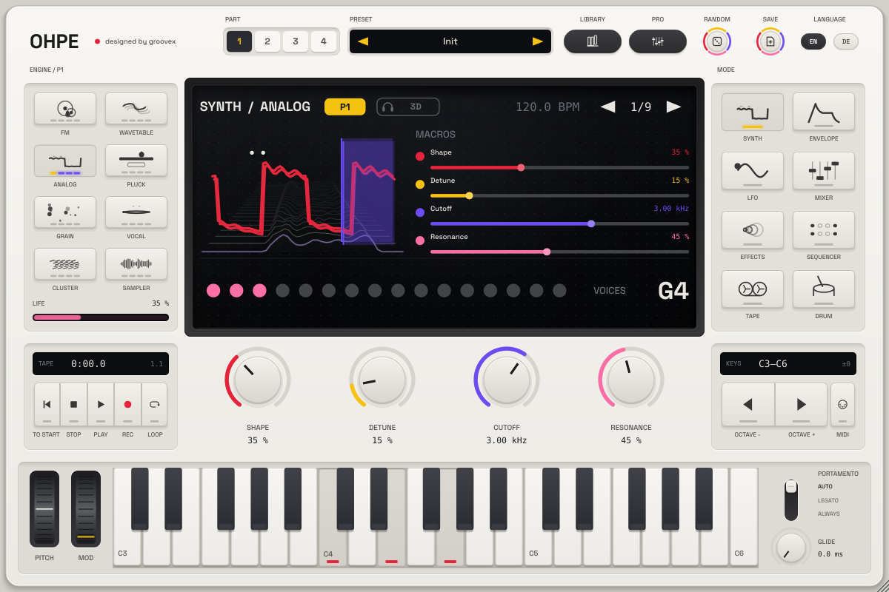 |
| Mixer | Englische Oberfläche |
| 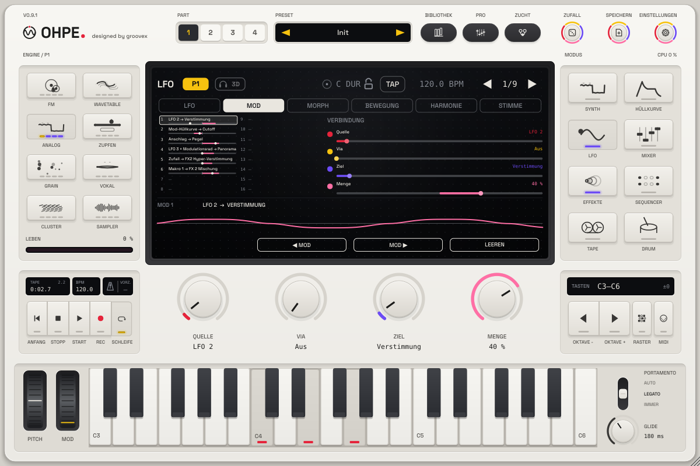 | 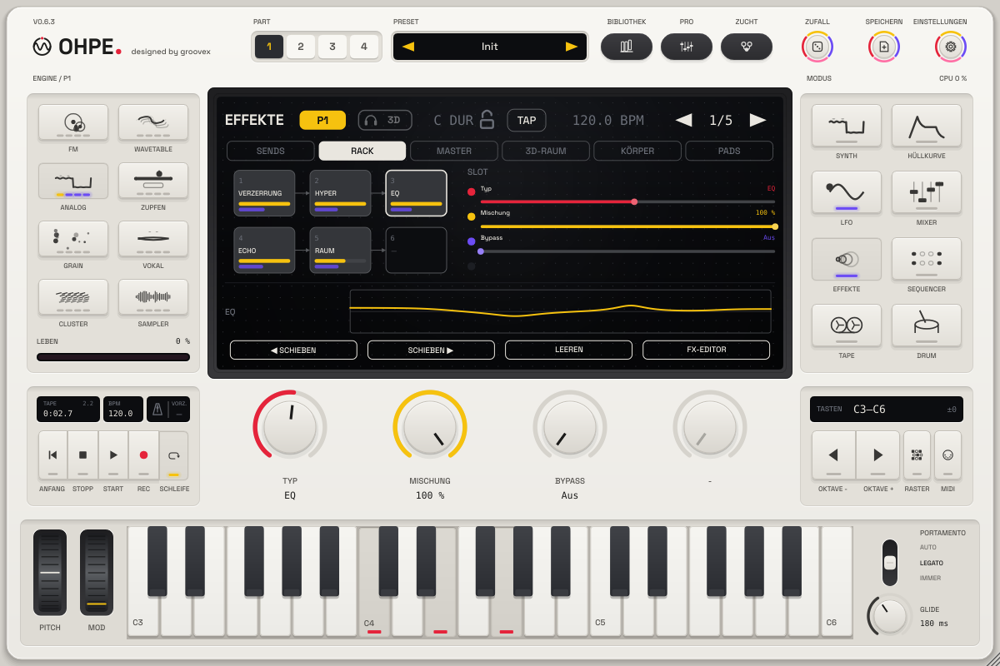 |
| Mod-Ansicht (Modulationsmatrix) | FX-Rack eines Parts |
| 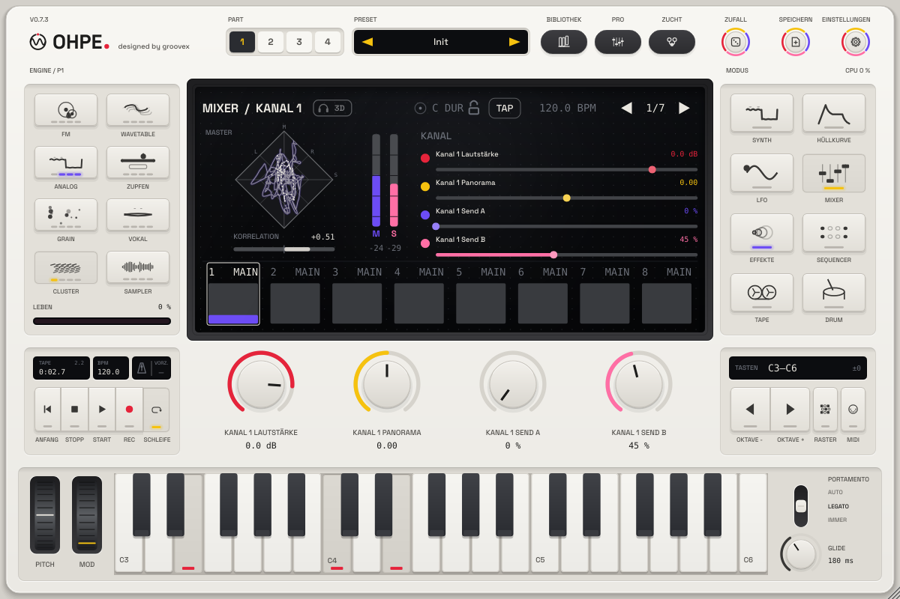 | 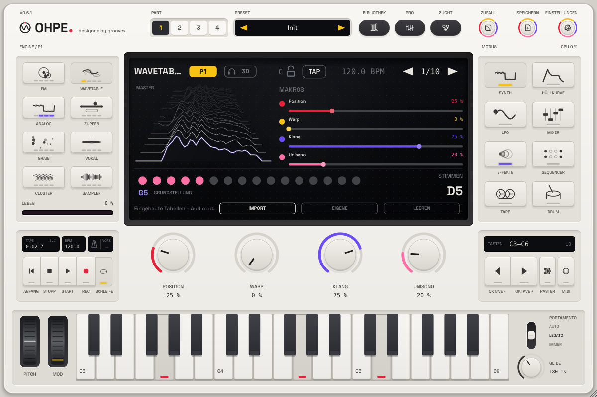 |
| Master-Stereobild (Mitte/Seite im Master-Rack) | Spektrum-Landschaft |
| 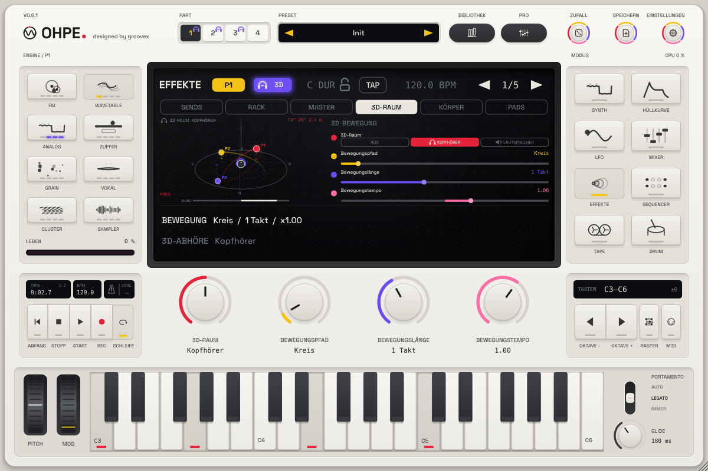 | 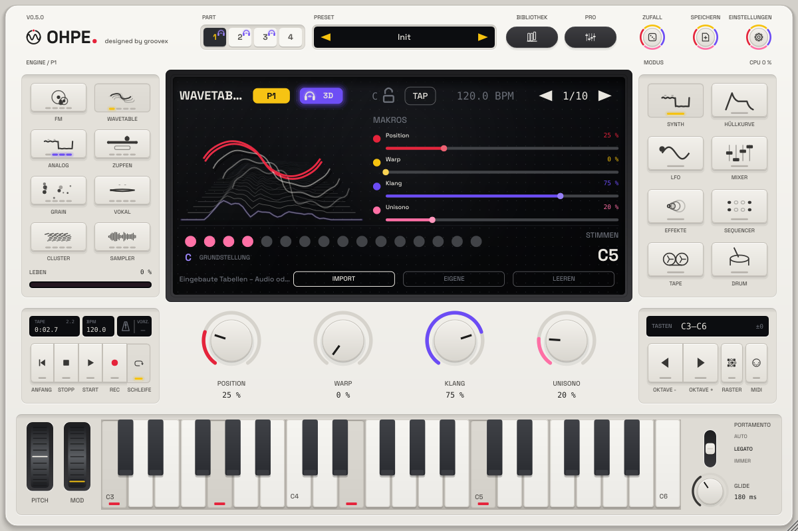 |
| 3D-Raum-Ansicht (binaurale Bewegung) | 3D-Abzeichen: binaurales 3D – am besten mit Kopfhörern |

## So spielst du Ohpe

* Die **Part-Auswahl** (1–4, oben) wählt den Part, den du bearbeitest und spielst; die
  **Engine-Tasten** (links) wählen seinen Klangerzeuger.
* **Modus-Tasten** (rechts) schalten zwischen Synth, Hüllkurve, LFO, Mixer, Effekte, Sequencer,
  Tape und Drum.
* Die **vier Drehregler** steuern immer das, was das Display zeigt; im Synth-Modus sind es die
  vier Makros der Engine. Die **Balken im Display** lassen sich direkt ziehen (Shift / Cmd / Strg
  = fein). Doppelklick setzt einen Wert zurück, Rechtsklick öffnet MIDI-Learn.
* **LFO → Mod** zeigt die Modulationsmatrix, **Effekte → Rack / Master** die FX-Racks: eine
  Verbindung oder einen Slot anklicken zum Bearbeiten, Slots ziehen zum Umsortieren.
* **BIBLIOTHEK** öffnet die Preset-Bibliothek, **PRO** zeigt alle Parameter des Modus auf einmal.
* **Klaviatur**: mit der Maus oder einem MIDI-Keyboard spielen; die Oktavtasten verschieben sie.
* **Sequencer**: Schritte antippen zum Einschalten, Shift-Tippen wählt einen Schritt zum
  Bearbeiten und für Parameter-Locks, Start drücken (im Host folgt der Sequencer dem Transport des
  Hosts, solange Start an ist).
* **Transport** (unten links): **REC** nimmt sofort aufs Band auf (ist keine Spur aufnahmebereit,
  wird die gewählte bereit geschaltet), **START** lässt Sequencer und Band laufen, **STOPP** hält an
  (zweimal = zurück zum Anfang), **|◀** und **SCHLEIFE**. Standalone: Leertaste, R, Enter, L. Siehe
  [erste Aufnahme in 30 Sekunden](docs/de/BAND-MISCHER-FX.md#erste-aufnahme-in-30-sekunden).
* Eine Audiodatei auf das Instrument ziehen lädt sie in Sampler / Grain oder auf ein Drum-Pad.

Ausführlich: [Bedienung](docs/de/BEDIENUNG.md).

## Installation auf dem Mac

Jeder Push auf main, jeder manuelle CI-Lauf und jeder Pull Request mit dem Label `installer` baut
einen macOS-Installer – Artefakt
**Ohpe-macOS-Installer** am Lauf (*Actions → CI*). Das Disk-Image enthält `Ohpe-Installer.pkg`
(Standalone-App, VST3 und Audio Unit, einzeln wählbar; universell für Apple Silicon und Intel,
ab macOS 11), ein Gatekeeper-Fix-Skript, ein Deinstallations-Skript und Hinweise auf Deutsch und
Englisch. Die pkg ist nicht von Apple signiert: per **Rechtsklick → Öffnen** starten (oder
*Systemeinstellungen → Datenschutz & Sicherheit → Dennoch öffnen*). Der Installer entfernt danach
das Quarantäne-Attribut von App und Plug-ins und signiert sie ad hoc, damit Apple Silicon sie
ausführt. Ausführlich: [Installation auf dem Mac](docs/de/INSTALLATION.md).

## Bauen

Voraussetzungen: CMake ≥ 3.22, ein C++17-Compiler (Xcode 15+, Visual Studio 2022, GCC 11+ /
Clang 14+), unter Linux die JUCE-Abhängigkeiten (ALSA, FreeType, fontconfig, X11, Mesa). JUCE
8.0.15 wird automatisch geladen, oder du gibst mit `-DOHPE_JUCE_PATH=/pfad/zu/JUCE` eine lokale
Kopie an.

```sh
cmake -S . -B build -DCMAKE_BUILD_TYPE=Release
cmake --build build --config Release
```

App und Plug-ins liegen in `build/Ohpe_artefacts/Release/` (`Standalone`, `VST3`, `AU` unter
macOS). Für einen Universal-Build unter macOS `"-DCMAKE_OSX_ARCHITECTURES=arm64;x86_64"`
ergänzen; mit `-DOHPE_COPY_PLUGIN=ON` werden die Plug-ins nach dem Bauen in die Systemordner
kopiert.

Alle Tests laufen mit `scripts/test-all.sh` – siehe [Mitwirken](docs/de/MITWIRKEN.md).

## Dokumentation

* Engines: [Wavetable](docs/de/engines/wavetable.md), [Zupfen](docs/de/engines/pluck.md),
  [Cluster](docs/de/engines/cluster.md), [Grain, Vokal, Sampler und Drum-Kit](docs/de/GRAIN-VOKAL-SAMPLER-DRUM.md)
* [Installation auf dem Mac](docs/de/INSTALLATION.md) – Installer, Gatekeeper-Fix, Deinstallation, Signieren
* [Bedienung](docs/de/BEDIENUNG.md) – Display, Parts, Profiansicht, Schritt-Locks, Tape- und Drum-Seite, Mod- und Rack-Ansicht
* [Werksklänge](docs/de/FACTORY-SOUNDS.md) – alle Presets nach Kategorie, Drum-Kits, aufgenommene Instrumente
* [Preset-Bibliothek](docs/de/PRESETS.md) – Stöbern, Speichern, MIDI, Dateiformat
* [Sequencer, Parts und Skalen-Modus](docs/de/SEQUENZER.md)
* [MIDI-Leitfaden](docs/de/MIDI.md) – Kanäle, MPE, Clock, Sync
* [Bandmaschine, Mixer-Dynamik und FX-Rack](docs/de/BAND-MISCHER-FX.md) – Effekttypen des Racks, Slot-Reihenfolge, Master-Rack
* [3D-Raum](docs/de/RAUM.md) – binaurale Bewegung, Pfade, Abhöre, 3D-Ansicht und Abzeichen
* [Morph-Raum](docs/de/MORPH-RAUM.md) – das XY-Pad zwischen vier vollständigen Klängen je Part
* [Resonanzkörper](docs/de/RESONANZKOERPER.md) – Saiten, Platten und Rohre, die der Klang anregt, Resonanzsaiten
* [Bewegungs-Recorder](docs/de/BEWEGUNG.md) – Reglerbewegungen je Part als polymetrische Schleifen-Spuren
* [Stimmsteuerung](docs/de/STIMMSTEUERUNG.md) – die Stimme als Modulationsquellen (Vokal, Pegel, Helligkeit, Einsätze)
* [Performance-Pads](docs/de/PERFORMANCE-PADS.md) – quantisiertes Stottern, Bandstopp, Filter-Sweep und Hall-Freeze
* [Lebendes Display](docs/de/LEBENDES-DISPLAY.md) – der Klang als 3D-Objekt, das auf Hüllkurven, Modulation und Stereobreite reagiert
* [Harmonie-Hirn](docs/de/HARMONIE.md) – Skalen- und Akkord-Gedächtnis aller Parts, Folgen, die isomorphe MPE-Raster-Tastatur
* [SUB-Ebene](docs/de/SUB-EBENE.md) – ein Suboszillator pro Part, eine oder zwei Oktaven unter jeder Stimme (Sinus / Rund / Rechteck, ins Filter oder direkt)
* [Tonart-Gravitation](docs/de/TONART-GRAVITATION.md) – pro Part, zieht jeden Teilton zur Tonart / zum gehaltenen Akkord (Rauschen und Drums werden tonal)
* [Ausdrucksstark spielen](docs/de/AUSDRUCK.md) – Anschlag und Aftertouch auf je zwei Funktionen, Kurven, Aftertouch → Glide-Zeit
* [Aktualisierung](docs/de/AKTUALISIERUNG.md) – Update-Prüfung in der App, geprüfter Download, Kanäle, Inhaltspakete, Zurücksetzen
* [Grid-Controller](docs/de/CONTROLLER.md) – Grid-Controller (Profil 1): ein 8 × 8-Pad-Controller mit Display spielt die Raster-Tastatur und bedient die gezeigte Seite (Standalone-App und Plug-in)
* [Einstellungen](docs/de/EINSTELLUNGEN.md) – Sprache, Hilfe, helle / dunkle Erscheinung, Anzeige, MIDI-Einrichtung und Learn-Liste, Über
* [Inhaltspakete](docs/de/INHALTSPAKETE.md) – `.ohpepack`-Dateien installieren (Dialog oder Drag & Drop), Prüfsummen, Paketverwaltung, Bibliotheksfilter; [Format](packaging/content/README.de.md)
* [Preset-Zucht](docs/de/ZUCHT.md) – zwei Klänge kreuzen, die besten Kinder behalten, Generationen züchten
* [Bounce ins Instrument](docs/de/BOUNCE-INS-INSTRUMENT.md) – Tape oder Live-Eingang in Grain / Sampler, Endlosschleifen
* [Tape-Memory](docs/de/TAPE-MEMORY.md) – die letzten 30 s des Ausgangs werden mit einer Taste zum Instrument
* [Modulationsmatrix](docs/de/MODULATION.md) – Verbindungen, Quellen, Ziele, LFO 2 / 3, Hüllkurve 3, Makros
* [Leistung](docs/de/LEISTUNG.md) – CPU-Anzeige, schlafende stille Parts, Benchmark-Zahlen, `ohpe_bench`
* [Robustheits- und Dauertests](docs/de/DAUERTEST.md) – Tests mit beschädigten Dateien und Audio-Stresstests in der CI, der manuelle 8-Stunden-Dauertest, der absturzsichere Start
* [Parameter](docs/PARAMETERS.md) – alle Host-Parameter-IDs
* [Architektur](docs/de/ARCHITEKTUR.md) – Kurzfassung; ausführlich auf Englisch in [ARCHITECTURE.md](docs/ARCHITECTURE.md)
* [Gestaltung](docs/de/DESIGN.md) – Farben, Figuren, Bedienelemente
* [Mitwirken](docs/de/MITWIRKEN.md) – Tests, Regeln, Ablauf

## Lizenz

Ohpe ist freie Software unter der [GNU Affero General Public License v3.0 oder neuer](LICENSE).
Gebaut mit [JUCE](https://juce.com) (AGPLv3), [nlohmann/json](https://github.com/nlohmann/json)
(MIT) und [doctest](https://github.com/doctest/doctest) (MIT); die Standalone-App kann die
Link-Bibliothek (GPL-2.0-or-later) für Netzwerk-Tempo-Sync enthalten. Werksaufnahmen des Drum-Kits:
CC0. Schrift: Space Grotesk (SIL OFL 1.1). Einzelheiten in [THIRD-PARTY.md](THIRD-PARTY.md).
