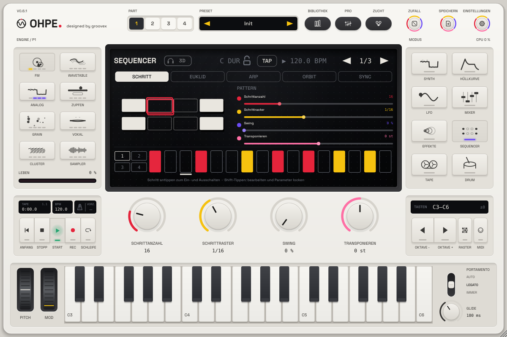

# Ohpe

*designed by groovex* · [English](README.md)

**Ohpe** ist eine kompakte, verspielte Synthesizer-Workstation für deinen Computer: acht
Klangerzeuger auf vier Parts, ein Drum-Kit, vier Sequencer, eine Achtspur-Bandmaschine, ein
Achtkanal-Mixer mit Dynamik und Effekten und eine ruhige, minimalistische Oberfläche rund um vier
Drehregler und eine Klaviatur. Ohpe läuft als
**Standalone-App** (macOS, Windows, Linux) und als **VST3**- und **Audio-Unit**-Plug-in.


> **Stand: Phase 2 (0.2).** Acht Engines, vier Parts, Drum-Kit, Step-, Euklid-, Arpeggiator- und
> Orbit-Sequencer, Bandmaschine, Mixer-Dynamik, FX-Slot, MPE und MIDI-Clock-Sync. Noch kein
> Release: selbst bauen oder die unsignierten Builds aus einem manuellen CI-Lauf laden.

## Funktionen

| | |
|---|---|
| **Analog-Engine** | zwei bandbegrenzte Oszillatoren (Wellenform-Morph, Verstimmung, Oktave, Mischung), Sub, Rauschen, Ladder- und State-Variable-Filter (TP / BP / HP), Drive, Keytracking |
| **FM-Engine** | sechs Operatoren, acht Algorithmen mit weichem Überblenden zwischen Nachbarn, Feedback, Verhältnis und Pegel je Operator |
| **Wavetable-Engine** | sechs eingebaute Tabellen mit je acht Frames, weiches Morphing, Warp-Modi, Unisono, Sub-Oszillator |
| **Zupf-Engine (Pluck)** | Waveguide-Saite und gestimmte Mallet-Resonatoren für gezupfte und angeschlagene Klänge |
| **Cluster-Engine** | bis zu sieben verstimmte Oszillatoren je Taste als Unisono oder Akkordform, langsamer Drift, resonanter Tiefpass |
| **Grain-Engine** | Granularsynthese aus einem geladenen Sample, dem Band oder einer eingebauten Textur |
| **Vokal-Engine** | Formant-Stimme mit Vokalen, Atem, Vibrato und Jitter |
| **Sampler-Engine** | Tastenzonen oder automatische Slices aus WAV-, AIFF- und FLAC-Dateien, Loop-Modi, eingebauter Keys-Klang |
| **Drum-Kit** | 24 Pads auf MIDI-Kanal 10: Werksaufnahmen (CC0), eigene Samples oder Synth-Modelle, Choke-Gruppen |
| **Vier Parts** | jeder mit eigener Engine, Hüllkurven, LFO, MIDI-Kanal, Skalen-/Akkord-Modus und MPE |
| **Je Stimme** | Lautstärke- und Modulationshüllkurve, LFO mit mehreren Zielen, Glide, 16 Stimmen |
| **Sequencer** | Step-Sequencer (bis zu 64 Schritte, Wahrscheinlichkeit, Ratchets, Parameter-Locks, 16 Pattern, Song-Modus), Euklid, Arpeggiator und Orbit (Polymetrik), jeweils mit Ziel-Part |
| **Bandmaschine** | acht Stereospuren: Aufnahme / Overdub / Punch vom Eingang, von Parts oder Drums, Varispeed, rückwärts, Loop, Bandcharakter, Rückgängig, Export als WAV-Master und Stems |
| **Mixer** | acht Kanäle mit EQ, Kompressor, Lautstärke, Panorama, Mute / Solo, zwei Sends (A: Delay, B: Hall), Master-Kompressor, Bandsättigung und Limiter; FX-Slot auf Part 1 (Chorus, Phaser, Bitcrush, Filter-Drive, Delay, Hall) |
| **Sync** | Host-Transport im Plug-in; MIDI-Clock ein / aus und Netzwerk-Tempo-Sync (Link) in der Standalone-App |
| **Multi-Out** | jeder Kanal geht auf den Hauptausgang oder auf einen eigenen Stereoausgang (8 Zusatzausgänge) – im Plug-in und in der Standalone-App |
| **MIDI** | Kanal je Part, MPE, jeder Regler ist per MIDI-Learn zuweisbar (Rechtsklick → MIDI-Learn), Zuweisungen lassen sich exportieren / importieren; alle Parameter sind automatisierbar |
| **Standalone-App** | Audiosystem, Gerät, Samplerate und Puffergröße wählen, Latenzanzeige, Multi-Out-Routing auf Gerätekanäle, MIDI-Eingänge |
| **Sprachen** | Deutsch und Englisch, jederzeit umschaltbar |

## Bilder

| | |
|---|---|
|  |  |
| FM-Engine | Step-Sequencer |
|  |  |
| Mixer | Englische Oberfläche |

## So spielst du Ohpe

* **Engine-Tasten** (links) wählen den Klangerzeuger des Parts.
* **Modus-Tasten** (rechts) schalten zwischen Synth, Hüllkurve, LFO, Mixer, Effekte und Sequencer.
* Die **vier Drehregler** steuern immer das, was das Display zeigt; im Synth-Modus sind es die
  vier Makros der Engine. Doppelklick setzt einen Wert zurück, Rechtsklick öffnet MIDI-Learn.
* **Klaviatur**: mit der Maus oder einem MIDI-Keyboard spielen; die Oktavtasten verschieben sie.
* **Sequencer**: Schritte antippen zum Einschalten, Start drücken (im Host folgt der Sequencer
  dem Transport des Hosts, solange Start an ist).

## Bauen

Voraussetzungen: CMake ≥ 3.22, ein C++17-Compiler (Xcode 15+, Visual Studio 2022, GCC 11+ /
Clang 14+), unter Linux die JUCE-Abhängigkeiten (ALSA, FreeType, fontconfig, X11, Mesa). JUCE
8.0.15 wird automatisch geladen, oder du gibst mit `-DOHPE_JUCE_PATH=/pfad/zu/JUCE` eine lokale
Kopie an.

```sh
cmake -S . -B build -DCMAKE_BUILD_TYPE=Release
cmake --build build --config Release
```

App und Plug-ins liegen in `build/Ohpe_artefacts/Release/` (`Standalone`, `VST3`, `AU` unter
macOS). Für einen Universal-Build unter macOS `"-DCMAKE_OSX_ARCHITECTURES=arm64;x86_64"`
ergänzen; mit `-DOHPE_COPY_PLUGIN=ON` werden die Plug-ins nach dem Bauen in die Systemordner
kopiert.

Alle Tests laufen mit `scripts/test-all.sh` – siehe [Mitwirken](docs/de/MITWIRKEN.md).

## Dokumentation

* Engines: [Wavetable](docs/de/engines/wavetable.md), [Zupfen](docs/de/engines/pluck.md),
  [Cluster](docs/de/engines/cluster.md), [Grain, Vokal, Sampler und Drum-Kit](docs/de/GRAIN-VOKAL-SAMPLER-DRUM.md)
* [Sequencer, Parts und Skalen-Modus](docs/de/SEQUENZER.md)
* [MIDI-Leitfaden](docs/de/MIDI.md) – Kanäle, MPE, Clock, Sync
* [Bandmaschine, Mixer-Dynamik und FX-Slot](docs/de/BAND-MISCHER-FX.md)
* [Parameter](docs/PARAMETERS.md) – alle Host-Parameter-IDs
* [Architektur](docs/de/ARCHITEKTUR.md) – Kurzfassung; ausführlich auf Englisch in [ARCHITECTURE.md](docs/ARCHITECTURE.md)
* [Mitwirken](docs/de/MITWIRKEN.md) – Tests, Regeln, Ablauf

## Lizenz

Ohpe ist freie Software unter der [GNU Affero General Public License v3.0 oder neuer](LICENSE).
Gebaut mit [JUCE](https://juce.com) (AGPLv3), [nlohmann/json](https://github.com/nlohmann/json)
(MIT) und [doctest](https://github.com/doctest/doctest) (MIT); die Standalone-App kann die
Link-Bibliothek (GPL-2.0-or-later) für Netzwerk-Tempo-Sync enthalten. Werksaufnahmen des Drum-Kits:
CC0. Schrift: Space Grotesk (SIL OFL 1.1). Einzelheiten in [THIRD-PARTY.md](THIRD-PARTY.md).
