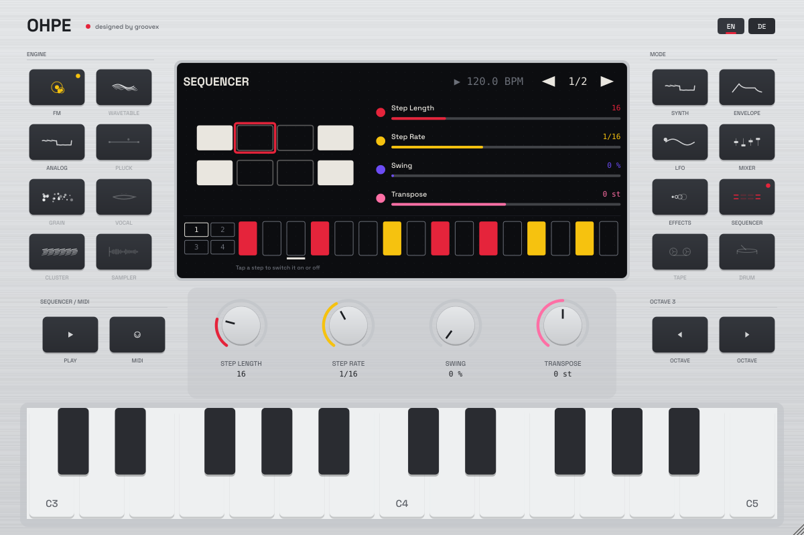

# Ohpe

*designed by groovex* · [Deutsch](README.de.md)

**Ohpe** is a compact, playful synthesizer workstation for your computer: two synth engines, a
step sequencer, an eight-channel mixer with delay and reverb, and a calm, minimalist interface
built around four encoders and a keyboard. It runs as a **standalone app** (macOS, Windows,
Linux) and as a **VST3** and **Audio Unit** plug-in.


> **Status: phase 1 (0.1).** The foundation is in place – two engines, sequencer, mixer, effects,
> MIDI learn, multi-out. More engines, sequencers, drum sampler and a tape machine follow in
> phase 2. Not released yet: build it yourself or grab the unsigned builds from a manual CI run.

## Features

| | |
|---|---|
| **Analog engine** | two band-limited oscillators (shape morph, detune, octave, mix), sub, noise, ladder and state-variable filters (LP / BP / HP), drive, key tracking |
| **FM engine** | six operators, eight algorithms with smooth morphing between neighbours, feedback, per-operator ratio and level |
| **Shared per voice** | amp and modulation envelopes, LFO with several destinations, glide, 16-voice polyphony |
| **Step sequencer** | up to 64 steps, per-step note, velocity, gate, probability and ratchets, up to four parameter locks per step, follows the host transport |
| **Mixer** | eight channels with EQ, volume, pan, mute / solo, two sends (A: delay, B: reverb), master with limiter |
| **Multi-out** | every channel can go to the main output or its own stereo output (8 aux outputs) – in the plug-in and in the standalone app |
| **MIDI** | every control is MIDI-learnable (right-click → MIDI Learn), maps can be exported / imported; all parameters are automatable |
| **Standalone app** | choose audio system, device, sample rate and buffer size, latency display, multi-out routing to device channels, MIDI inputs |
| **Languages** | English and German, switchable at any time |

## Screenshots

| | |
|---|---|
|  |  |
| FM engine | Step sequencer |
|  |  |
| Mixer | German interface |

## Playing Ohpe

* **Engine keys** (left) pick the sound engine of the part; engines that are not built yet are dimmed.
* **Mode keys** (right) switch between Synth, Envelope, LFO, Mixer, Effects and Sequencer.
* The **four encoders** always control what the display shows; in Synth mode they are the
  engine's four macros. Double-click resets a value, right-click opens MIDI learn.
* **Keyboard**: play with the mouse or any MIDI keyboard; the octave keys shift it.
* **Sequencer**: tap steps to switch them on, press Play (in a host, the sequencer follows the
  host transport while Play is on).

## Building

Requirements: CMake ≥ 3.22, a C++17 compiler (Xcode 15+, Visual Studio 2022, GCC 11+ / Clang 14+),
on Linux the JUCE dependencies (ALSA, FreeType, fontconfig, X11, Mesa). JUCE 8.0.15 is downloaded
automatically, or pass a local checkout with `-DOHPE_JUCE_PATH=/path/to/JUCE`.

```sh
cmake -S . -B build -DCMAKE_BUILD_TYPE=Release
cmake --build build --config Release
```

The app and plug-ins are in `build/Ohpe_artefacts/Release/` (`Standalone`, `VST3`, `AU` on macOS).
For a universal macOS build add `"-DCMAKE_OSX_ARCHITECTURES=arm64;x86_64"`; to copy the plug-ins
into the system folders after building add `-DOHPE_COPY_PLUGIN=ON`.

Run all tests with `scripts/test-all.sh` – see [CONTRIBUTING.md](CONTRIBUTING.md).

## Documentation

* [Architecture](docs/ARCHITECTURE.md) – core, plug-in shell, threading, parameters, extension points
* [Contributing](CONTRIBUTING.md) – tests, rules, workflow

## License

Ohpe is free software under the [GNU Affero General Public License v3.0 or later](LICENSE).
Built with [JUCE](https://juce.com) (AGPLv3), [nlohmann/json](https://github.com/nlohmann/json)
(MIT) and [doctest](https://github.com/doctest/doctest) (MIT). Font: Space Grotesk (SIL OFL 1.1).
