# Ohpe

*designed by groovex* · [Deutsch](README.de.md)

**[⬇ Download Ohpe (macOS · Windows)](https://github.com/thegroovex/Ohpe/releases)**

**Ohpe** is a compact, playful synthesizer workstation for your computer: eight synth engines on
four parts, a drum kit, four sequencers, an eight-track tape machine, an eight-channel mixer with
dynamics and effects, and a calm, minimalist interface built around four encoders and a keyboard. It runs as a **standalone app** (macOS, Windows,
Linux) and as a **VST3** and **Audio Unit** plug-in.


> **Status: 0.9.1 – stable release on the way to 1.0.** Eight engines, four parts, drum kit, step / Euclid /
> arpeggiator / Orbit sequencers, tape machine, mixer with dynamics and FX racks, 3D space, MPE and MIDI
> clock sync, preset library, pro view and direct manipulation – with **430 factory presets** (412 part
> presets and 18 projects), six drum kits and fourteen sampled instruments. Preview builds (macOS installer
> ad-hoc signed, Windows unsigned) are on the [releases page](https://github.com/thegroovex/Ohpe/releases);
> the complete manual as PDF (English and German) is in [docs/manual](docs/manual/).

## Features

| | |
|---|---|
| **Analog engine** | two band-limited oscillators (shape morph, detune, octave, mix), sub, noise, ladder and state-variable filters (LP / BP / HP), drive, key tracking |
| **FM engine** | six operators, eight algorithms with smooth morphing between neighbours, feedback, per-operator ratio and level |
| **Wavetable engine** | six built-in tables of eight frames with smooth morphing, warp modes, unison, sub oscillator; own tables from any sound (audio to wavetable: pitch-synchronous analysis, 8–256 frames), single-cycle sets and a user library |
| **Pluck engine** | waveguide string and tuned mallet resonators for plucked and struck sounds |
| **Cluster engine** | up to seven detuned oscillators per key as unison or chord shapes, slow drift, resonant low-pass |
| **Grain engine** | granular synthesis from a loaded sample, the tape or a built-in texture |
| **Vocal engine** | formant voice with vowels, breath, vibrato and jitter; formant tracks analysed from your own sounds |
| **Sampler engine** | key zones or automatic slices from WAV / AIFF / FLAC files, loop modes, built-in keys sound and ten recorded factory instruments (kalimba, marimba, vibraphone, harp, harpsichord, recorder …) |
| **Drum kit** | 24 pads on MIDI channel 10: five recorded factory kits (Studio, Tight, Room, Lo-Fi, Hybrid – CC0), own samples or synth models, choke groups |
| **Factory sounds** | 412 part presets across all engines and categories, level-matched; 18 project presets using all four parts, the sequencers and the drum kit; six drum kits, ten recorded instruments and four keyboard instruments – see [Factory sounds](docs/en/FACTORY-SOUNDS.md) |
| **Four parts** | each with its own engine, envelopes, LFO, MIDI channel, scale / chord mode and MPE |
| **Shared per voice** | amp and modulation envelopes, LFO with several destinations, glide, 16-voice polyphony |
| **Sequencers** | step sequencer (up to 64 steps, probability, ratchets, parameter locks, 16 patterns, song mode), Euclid, arpeggiator and Orbit (polymeter), each with a target part – step, Euclid and Orbit can also play the drum kit |
| **Tape machine** | eight stereo tracks: record / overdub / punch from the input, parts or drums, varispeed, reverse, loop (set in / out by hand at the playhead, snapped to bar or beat, edges draggable – [Setting the loop](docs/en/TAPE-MIXER-FX.md#setting-the-loop-p42)), tape character, undo, export as WAV master and stems; count-in of one or two bars (recording starts exactly on the bar) and a built-in metronome; the tempo is dragged, typed or tapped right on the display – see [Tempo, metronome and count-in](docs/en/USER-INTERFACE.md#tempo-metronome-and-count-in-p39) |
| **Mixer** | eight channels with EQ, compressor, volume, pan, mute / solo, two sends (A: delay, B: reverb), master compressor, tape saturation and limiter |
| **FX racks** | six serial slots per part and four on the master: hyper (unison widener), distortion (eight modes), flanger, compressor, multiband, EQ, filter, echo, hall, chorus, phaser, bitcrush, filter drive, delay, reverb, mid / side stereo, space 3D – reorder by dragging, each with mix and bypass – see [FX rack](docs/en/TAPE-MIXER-FX.md#fx-rack-07) |
| **3D space** | every part can move around your head – front, sides, behind, above, near and far – on tempo-synced motion paths (circle, figure-8, fly-by with Doppler, random orbit, pendulum, spiral); binaural on headphones with Ohpe's own parametric head model (no measured data set), mono-compatible on speakers; also as rack effect *Space 3D*; 75 "3D" presets (72 part presets, three projects) – see [3D Space](docs/en/SPACE.md) |
| **Life** | one LIFE control per part keeps held notes evolving: every voice drifts on its own (a few cents of pitch, breathing filter, wandering engine colour, grain scatter) – 0 = static, on every engine, a modulation target – see [Life](docs/en/USER-INTERFACE.md#life) |
| **Resonator body** | every part can play through a physically modelled body – coupled strings with sympathetic strings tuned to the note or the held chord, a modal plate, an open or closed tube; it follows the keyboard, pitch bend and MPE (pressure rings it, slide moves the excitation point); also as rack effect *Resonator*; 22 factory presets use it – see [Resonator](docs/en/RESONATOR.md) |
| **Morph space** | an XY pad per part between four complete sounds – also across different engines: parameters morph where the sounds share their structure, otherwise the sounds play in parallel and cross-fade at even loudness; play it by mouse, automation, MIDI, the modulation matrix, mod wheel or MPE pressure / slide; 7 morph presets – see [Morph space](docs/en/MORPH.md) |
| **Voice Control** | sing, hum or talk into an input and your voice moves the sound (not a vocoder – it only modulates): level, vowel (A-E-I-O-U map), brightness, consonants, pitch and syllable onsets as modulation sources, one-press *Vowel → Filter + Morph* – see [Voice Control](docs/en/VOICE-CONTROL.md) |
| **Motion recorder** | turn a part's knobs while the music runs and up to four movements per part loop as lanes with their own length (1 – 64 sixteenths, polymetric to the pattern); overdub by touching again, depth control, also modulation sources – see [Motion recorder](docs/en/MOTION.md) |
| **Performance pads** | four pads throw effects on the main mix for live sets – a quantised **stutter** (1/4 … 1/32, triplets), a **tape stop** over 1/8 … 2 bars, a resonant **filter sweep** (low-pass down / high-pass up) and a **reverb freeze** that holds the moment endlessly; hold = momentary, shift-click = latch, MIDI-learnable, matrix sources – see [Performance pads](docs/en/PADS.md) |
| **Harmony brain** | Ohpe remembers the key and chords you play on any part; other parts follow (snap to the key, the chord tones or the root), the memory feeds three modulation sources, and an isomorphic grid keyboard with MPE (four layouts, one finger per member channel) plays it from the screen – see [Harmony brain](docs/en/HARMONY.md) |
| **SUB layer** | every part gets a sub oscillator one or two octaves under each voice – Sine, Round or Square, into the engine's filter or direct, locked to the voice's pitch (glide, bend), band-limited and mono, level 0 = untouched sound – see [SUB layer](docs/en/SUB.md) |
| **Key Gravity** | a spectral stage per part after the engines pulls every partial toward the key and the held chord – Scale, Chord or Chord+Scale, glide on chord changes, formant keep; at high amounts noise and drums become pitched texture in key; 0 = untouched sound – see [Key Gravity](docs/en/KEY-GRAVITY.md) |
| **Expressive playing** | Per part, velocity and aftertouch (channel, poly and MPE pressure) each drive two musical functions – cutoff, vibrato, glide time, attack, FM amount, position, drive and more – with amount and curve; the glide factory sounds stretch their glide under pressure – see [Expressive playing](docs/en/EXPRESSION.md) |
| **In-app updates** | check for a new version from inside the standalone or the plug-in (by hand or, opt-in, once a day – never while playing), read its notes in English or German, download it in the background with resume and SHA-256 verification, then open the installer; stable / preview channel, skip or remind later, previous version as rollback, content packs without reinstalling; no telemetry – see [Updates](docs/en/UPDATES.md) |
| **Content packs** | install preset packs from `.ohpepack` files (file dialog or drag & drop on the window): SHA-256 of every file checked before anything changes, one step of rollback, size limits; pack manager with version, size, license / signature (shown) and remove; filter the library by pack; presets point at pack content by `"<pack>/<item>"` and say which pack is missing – see [Content packs](docs/en/CONTENT-PACKS.md) |
| **Settings and night skin** | one settings view behind the gear key: language (EN / DE), tooltips and a help overlay, help pages, a low-glare dark skin (or auto with the system), display brightness, animations, UI size 75 – 200 %, MIDI setup (channels, MPE, bend ranges, inputs, clock / sync) and a MIDI learn list to edit or clear mappings, updates and about – saved per user, never in projects – see [Settings](docs/en/SETTINGS.md) |
| **Accessibility and UI size** | UI sizes 75 – 200 % (right-click on the housing), full keyboard operation with a focus ring (Tab, F6, arrows, Enter / Space), screen reader names and values in EN / DE, WCAG AA contrast in both skins – see [Accessibility](docs/en/ACCESSIBILITY.md) |
| **Preset breeding** | cross two sounds (also across engines – a hybrid keeps the other engine as its layer) with a chosen mutation, hear six children with waveform / brightness thumbnails at their parents' loudness, keep the best and breed further generations with undo; children save to the library as favourites – see [Preset breeding](docs/en/BREEDING.md) |
| **Bounce to engine** | one BOUNCE key moves a tape track, the tape mix, the loop range or a few bars of the live input into the Grain or Sampler engine of a part – as a seamless endless loop (grains wrap round the seam, held sampler notes sustain it) or a one-shot; bounces are saved as WAV and come back with the session – see [Bounce to engine](docs/en/BOUNCE.md) |
| **Tape memory** | Ohpe always remembers the last 30 s of its own output; one CAPTURE key (MIDI-mappable, also on the Grid-Controller) turns it into a playable Sampler instrument – chromatic (pitch detected and tuned, root set) or sliced by onsets – saved inside the session, exportable as WAV – see [Tape memory](docs/en/TAPE-MEMORY.md) |
| **Modulation matrix** | 16 routings per part from 20 sources (three LFOs, three envelopes, velocity, MPE, macros, a sequencer lane …) to pitch, level, pan, 24 engine parameters, the LFOs and every rack slot; rings on the encoders show what moves – see [Modulation](docs/en/MODULATION.md) |
| **Sync** | host transport in the plug-in; MIDI clock in / out and network tempo sync (Link) in the standalone app |
| **Multi-out** | every channel can go to the main output or its own stereo output (8 aux outputs) – in the plug-in and in the standalone app |
| **MIDI** | per-part channels, MPE, every control is MIDI-learnable (right-click → MIDI Learn), maps can be exported / imported; all parameters are automatable |
| **Standalone app** | choose audio system, device, sample rate and buffer size, latency display, multi-out routing to device channels, MIDI inputs |
| **Preset library** | one LIBRARY key: categories (Bass, Keys, Pads, Leads, Plucks, Drums, FX, Arp, Textures, Vocal), engine filter, search, favourites, star ratings, sorting, factory and user banks, preview by selecting, part and whole-project presets, previous / next from MIDI |
| **Display** | a deep, layered display with parallax; stereo scope (goniometer, correlation, M / S levels), a moving 3D spectrum terrain, the head-centred 3D space view and the living display – the sound as a 3D object that breathes with the envelope, bulges with the LFOs and stretches with the stereo width – see [Living display](docs/en/LIVING-DISPLAY.md) |
| **Direct manipulation** | drag the value bars on the display, Shift / Cmd / Ctrl for fine control, double-click to reset; pro view with every parameter of a mode at once – as editable pictures (envelopes, filter, LFO, FM graph, wavetable, grains, 3D) with violet modulation ranges, plus Discover: BRIGHT / HARD / ALIVE / WIDE, VARY, cross, dice, history |
| **Languages** | English and German, switchable at any time |

## Screenshots

| | |
|---|---|
| 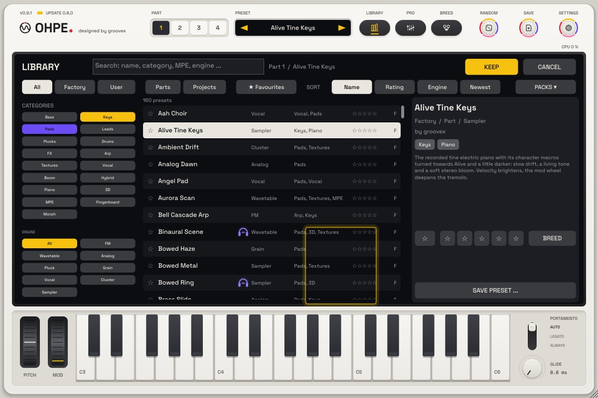 | 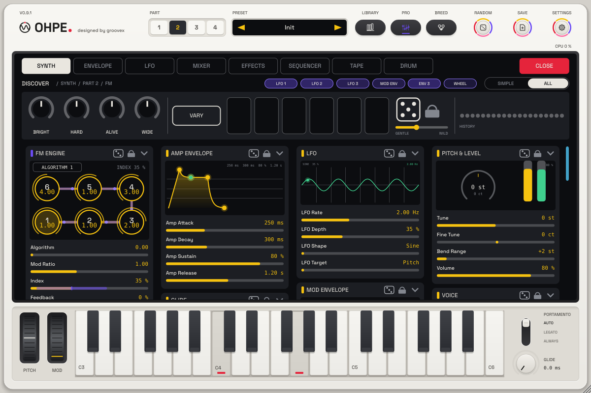 |
| Preset library | Pro view (FM engine, part 2) |
| 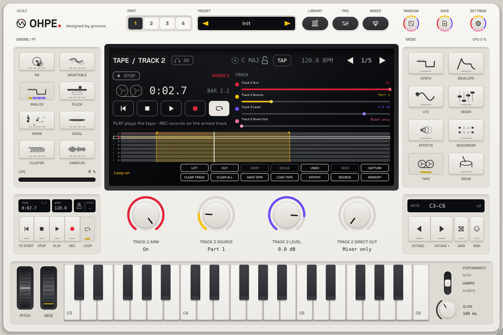 | 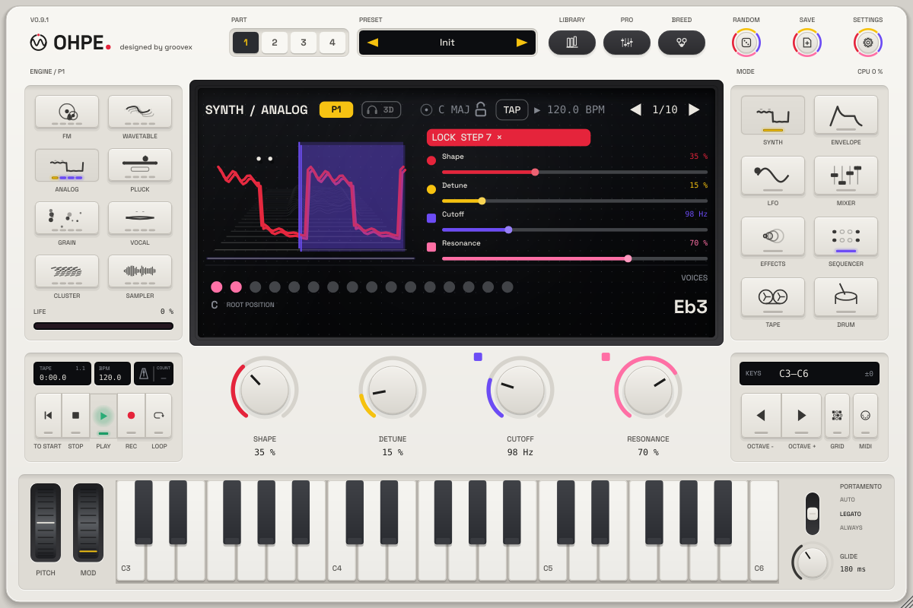 |
| Tape page | Step parameter locks |
| 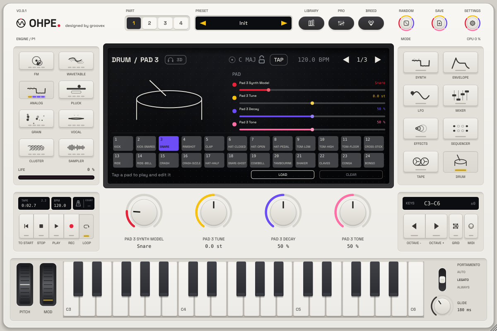 | 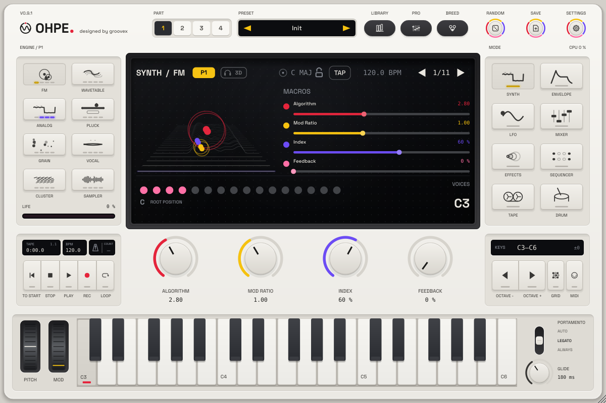 |
| Drum kit page | FM engine |
| 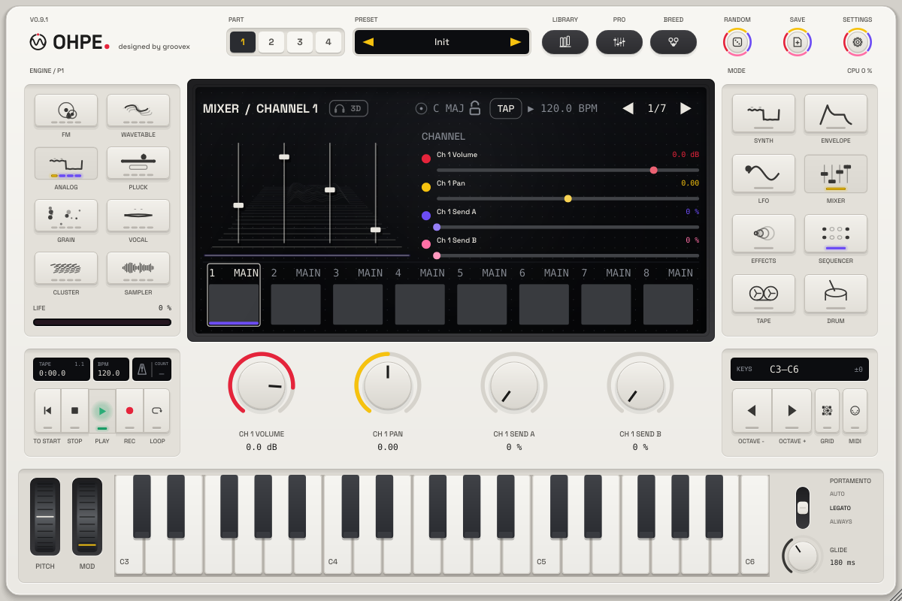 |  |
| Mixer | German interface |
| 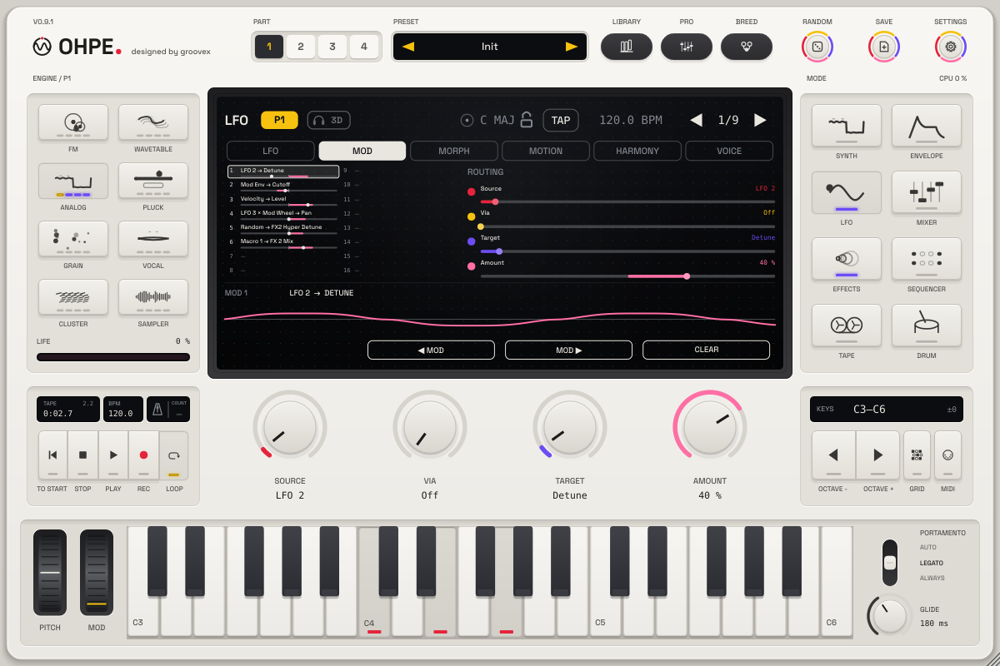 | 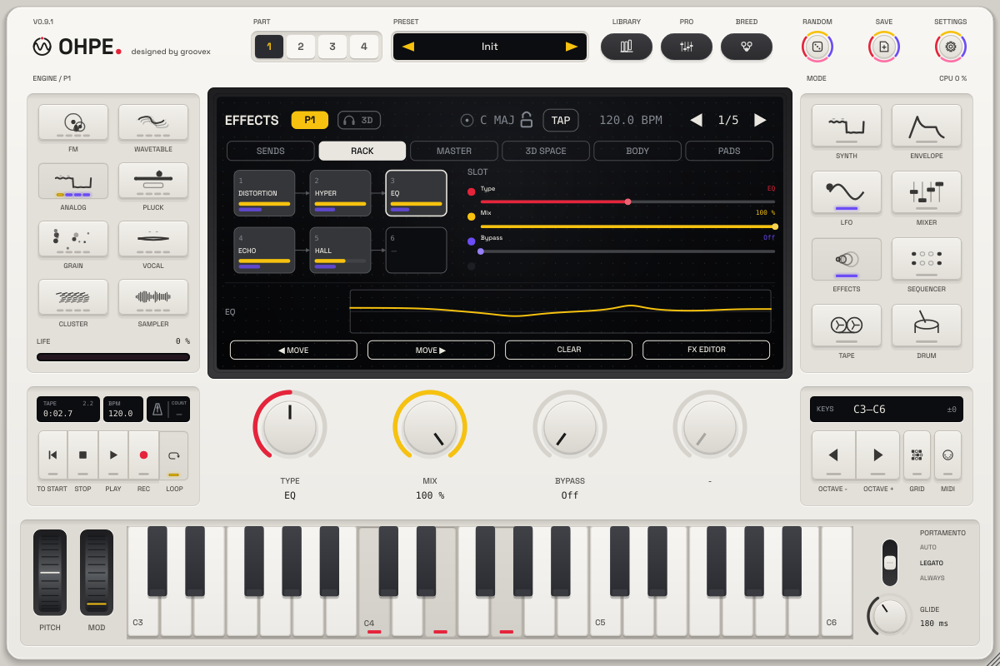 |
| Mod view (modulation matrix) | FX rack of a part |
| 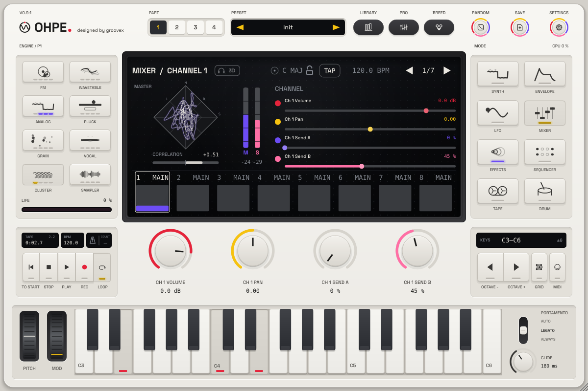 | 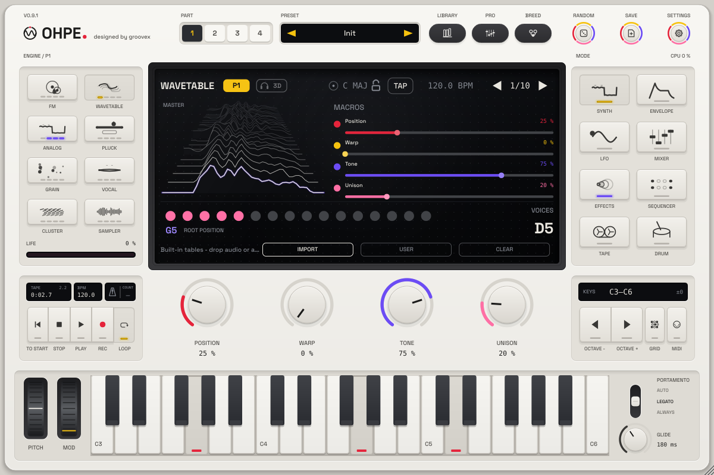 |
| Master stereo scope (mid / side in the master rack) | Spectrum terrain |
| 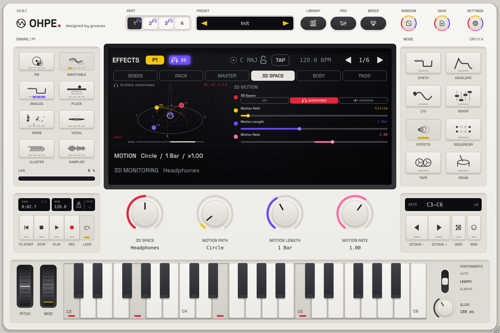 | 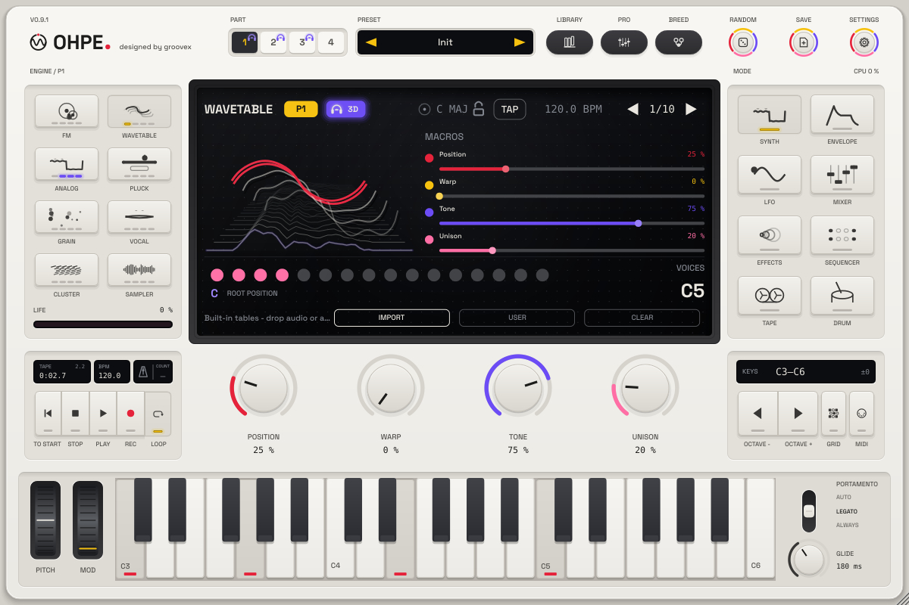 |
| 3D Space view (binaural motion) | 3D badge: binaural 3D – best with headphones |

## Playing Ohpe

* **Part selector** (1–4, top) chooses the part you edit and play; **engine keys** (left) pick its
  sound engine.
* **Mode keys** (right) switch between Synth, Envelope, LFO, Mixer, Effects, Sequencer, Tape and
  Drum.
* The **four encoders** always control what the display shows; in Synth mode they are the
  engine's four macros. The **bars on the display** can be dragged directly (Shift / Cmd / Ctrl =
  fine). Double-click resets a value, right-click opens MIDI learn.
* **LFO → Mod** shows the modulation matrix, **Effects → Rack / Master** the FX racks: click a
  routing or a slot to edit it, drag slots to reorder them.
* **LIBRARY** opens the preset library, **PRO** shows every parameter of the mode at once.
* **Keyboard**: play with the mouse or any MIDI keyboard; the octave keys shift it.
* **Sequencer**: tap steps to switch them on, Shift-tap a step to edit it and lock parameters on
  it, press Play (in a host, the sequencer follows the host transport while Play is on).
* **Transport** (bottom left): **REC** records on the tape at once (it arms the selected track when
  none is armed), **PLAY** runs the sequencer and the tape, **STOP** stops (twice = back to the
  start), **|◀** and **LOOP**. Standalone: Space, R, Enter, L. See
  [first recording in 30 seconds](docs/en/TAPE-MIXER-FX.md#first-recording-in-30-seconds).
* Drop an audio file on the instrument to load it into the Sampler / Grain engine or onto a drum pad.

Full guide: [playing the interface](docs/en/USER-INTERFACE.md).

## Installing

Download the macOS installer or the Windows zips from the
[releases page](https://github.com/thegroovex/Ohpe/releases) (Windows: unblock the zip, then *More info →
Run anyway* at the SmartScreen warning – see [Installing Ohpe](docs/en/INSTALL.md#5-windows)). Between
releases, every push to main, every manual CI run and every pull request labelled `installer` builds a macOS
installer – artifact **Ohpe-macOS-Installer**
on the run (*Actions → CI*). The disk image holds `Ohpe-Installer.pkg` (standalone app, VST3 and
Audio Unit, each selectable; universal for Apple Silicon and Intel, macOS 11+), a Gatekeeper fix
script, an uninstaller and a read-me in English and German. The pkg is not signed by Apple: after the first
blocked double-click open it with *System Settings → Privacy & Security → Open Anyway* (macOS 14 and older:
also **right-click → Open**). The installer
then removes the quarantine flag from the installed app and plug-ins and signs them ad hoc so
Apple Silicon runs them. Full guide: [Installing Ohpe](docs/en/INSTALL.md).

## Building

Requirements: CMake ≥ 3.22, a C++17 compiler (Xcode 15+, Visual Studio 2022, GCC 11+ / Clang 14+),
on Linux the JUCE dependencies (ALSA, FreeType, fontconfig, X11, Mesa). JUCE 8.0.15 is downloaded
automatically, or pass a local checkout with `-DOHPE_JUCE_PATH=/path/to/JUCE`.

```sh
cmake -S . -B build -DCMAKE_BUILD_TYPE=Release
cmake --build build --config Release
```

The app and plug-ins are in `build/Ohpe_artefacts/Release/` (`Standalone`, `VST3`, `AU` on macOS).
For a universal macOS build add `"-DCMAKE_OSX_ARCHITECTURES=arm64;x86_64"`; to copy the plug-ins
into the system folders after building add `-DOHPE_COPY_PLUGIN=ON`.

Run all tests with `scripts/test-all.sh` – see [CONTRIBUTING.md](CONTRIBUTING.md).

## Documentation

* **[Manual (PDF)](docs/manual/Ohpe-Manual-EN.pdf)** – everything below in one book: quick start, all features,
  MIDI and controllers, installation, parameter appendix ([German](docs/manual/Ohpe-Manual-DE.pdf));
  built by `tools/manual/build_manual.py`
* Engines: [Wavetable](docs/en/engines/wavetable.md), [Pluck](docs/en/engines/pluck.md),
  [Cluster](docs/en/engines/cluster.md), [Grain, Vocal, Sampler and drum kit](docs/en/GRAIN-VOCAL-SAMPLER-DRUM.md)
* [Installing Ohpe](docs/en/INSTALL.md) – macOS installer, Windows, Gatekeeper fix, uninstall, signing
* [Playing the interface](docs/en/USER-INTERFACE.md) – display, parts, pro view, step locks, tape and drum pages, Mod and Rack views
* [Factory sounds](docs/en/FACTORY-SOUNDS.md) – every preset by category, drum kits, recorded instruments
* [Preset library](docs/en/PRESETS.md) – browsing, saving, MIDI, file format
* [Sequencers, parts and scale mode](docs/en/SEQUENCERS.md)
* [MIDI guide](docs/en/MIDI.md) – channels, MPE, clock, sync
* [Tape machine, mixer dynamics and FX rack](docs/en/TAPE-MIXER-FX.md) – rack effect types, slot order, master rack
* [3D Space](docs/en/SPACE.md) – binaural motion, paths, monitoring, the 3D view and badge
* [Morph space](docs/en/MORPH.md) – the XY pad between four complete sounds per part
* [Resonator body](docs/en/RESONATOR.md) – strings, plates and tubes the sound excites, sympathetic strings
* [Motion recorder](docs/en/MOTION.md) – knob movements per part as looping, polymetric lanes
* [Voice Control](docs/en/VOICE-CONTROL.md) – your voice as modulation sources (vowel, level, brightness, onsets)
* [Performance pads](docs/en/PADS.md) – quantised stutter, tape stop, filter sweep and reverb freeze throws
* [Living display](docs/en/LIVING-DISPLAY.md) – the sound as a 3D object reacting to envelopes, modulation and stereo width
* [Harmony brain](docs/en/HARMONY.md) – scale and chord memory of all parts, follow modes, the isomorphic MPE grid keyboard
* [SUB layer](docs/en/SUB.md) – a sub oscillator per part, one or two octaves under every voice (Sine / Round / Square, into the filter or direct)
* [Key Gravity](docs/en/KEY-GRAVITY.md) – per part, pulls every partial to the key / held chord (noise and drums become pitched texture)
* [Expressive playing](docs/en/EXPRESSION.md) – velocity and aftertouch to two functions each, curves, aftertouch → glide time
* [Updates](docs/en/UPDATES.md) – in-app update check, verified download, channels, content packs, rollback
* [Grid controller](docs/en/CONTROLLER.md) – Grid controller profile 1: an 8 × 8 pad controller with display plays the grid keyboard and edits the shown page (standalone app and plug-in)
* [Settings](docs/en/SETTINGS.md) – language, help, light / dark skin, display, MIDI setup and learn list, about
* [Content packs](docs/en/CONTENT-PACKS.md) – install `.ohpepack` files (dialog or drag & drop), checksums, pack manager, library filter; [format](packaging/content/README.md)
* [Preset breeding](docs/en/BREEDING.md) – cross two sounds, keep the best children, breed generations
* [Bounce to engine](docs/en/BOUNCE.md) – tape or live input into Grain / Sampler, endless loops
* [Tape memory](docs/en/TAPE-MEMORY.md) – the last 30 s of the output become an instrument with one key
* [Modulation matrix](docs/en/MODULATION.md) – routings, sources, targets, LFO 2 / 3, envelope 3, macros
* [Performance](docs/en/PERFORMANCE.md) – the CPU meter, sleeping silent parts, benchmark numbers, `ohpe_bench`
* [Host testing](docs/en/HOST-TESTING.md) – the automated plug-in host matrix in CI (VST3 / AU) and the manual test plan for your DAW
* [Robustness and soak tests](docs/en/SOAK-TEST.md) – damaged-file and audio stress tests in CI, the manual 8-hour soak, the crash-safe start
* [Parameters](docs/PARAMETERS.md) – every host parameter ID
* [Architecture](docs/ARCHITECTURE.md) – core, plug-in shell, threading, parameters, extension points
* [Design language](docs/DESIGN.md) – colours, characters, components
* [Contributing](CONTRIBUTING.md) – tests, rules, workflow

## License

Ohpe is free software under the [GNU Affero General Public License v3.0 or later](LICENSE).
Built with [JUCE](https://juce.com) (AGPLv3), [nlohmann/json](https://github.com/nlohmann/json)
(MIT) and [doctest](https://github.com/doctest/doctest) (MIT); the standalone app can include the
Link library (GPL-2.0-or-later) for network tempo sync. Factory drum recordings: CC0. Font: Space
Grotesk (SIL OFL 1.1). Details in [THIRD-PARTY.md](THIRD-PARTY.md).
