# Bedienung

*Deutsch · English: [../en/USER-INTERFACE.md](../en/USER-INTERFACE.md)*

Die Oberfläche von Ohpe (p14): Engine-Tasten mit dem **LEBEN**-Balken (links), Display (Mitte), Modus-Tasten (rechts), vier
Encoder unter dem Display, die **TRANSPORT**-Tasten mit der Tape-Anzeige (unten links), die **OKTAVE**-Tasten,
**MIDI** und die Tastatur-Anzeige (unten rechts) und die Klaviaturzeile – **PITCH**- und **MOD**-Rad, drei Oktaven Klaviatur, **Glide**-Modus
und -Zeit. In der Kopfzeile liegen die **Part-Auswahl**, der **Preset-Streifen**, die Tasten
**BIBLIOTHEK** und **PRO**, **ZUFALL** und **SPEICHERN** sowie die **Einstellungen**-Taste (Zahnrad: Sprache DE / EN, Hilfe,
helle / dunkle Erscheinung, MIDI, Updates, Über). Jede Funktion ist mit der Maus und –
über MIDI Learn – vom Controller aus erreichbar.

## Klaviaturzeile: Räder, Klaviatur, Glide

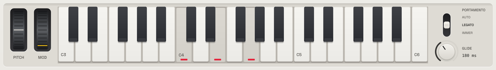

| Element | Wirkung |
|---|---|
| **PITCH**-Rad | Pitchbend für den bearbeiteten Part (auf seinem MIDI-Kanal, wie die Bildschirm-Klaviatur); Umfang = *Pitchbend-Bereich* des Parts. Nach oben / unten ziehen; beim Loslassen federt es zur Mitte zurück. |
| **MOD**-Rad | das Modulationsrad (CC 1): eine Quelle der [Modulationsmatrix](MODULATION.md); jedes Werks-Preset reagiert darauf ([Werksklänge](FACTORY-SOUNDS.md#modulationsrad-p29)). Bleibt stehen; Doppelklick = 0. |
| Klaviatur | drei Oktaven (ab Werk C3–C6); **OKTAVE −/+** verschiebt sie. **RASTER** (zwischen OKTAVE + und MIDI) tauscht sie gegen die isomorphe [Raster-Tastatur](HARMONIE.md#die-raster-tastatur) mit MPE (p24). |
| **PORTAMENTO**: AUTO / LEGATO / IMMER | Glide-Modus des bearbeiteten Parts: *Auto* gleitet, solange die vorige Note klingt, *Legato* nur bei gehaltener Taste, *Immer* von jeder vorigen Note. |
| **GLIDE** | Glide-Zeit des bearbeiteten Parts (0 = aus). |

Beide Räder sind Host-Parameter (*Pitch-Rad* `perf.bend`, *Mod-Rad* `perf.mod`): Rechtsklick = MIDI Learn,
Shift / Cmd / Strg = fein. Sie sind Spielhilfen und gehören nicht zu Presets.
Die Räder auf dem Bildschirm **folgen auch deinem Controller**: Pitch Bend und Modulationsrad (CC 1) vom Host oder
einem MIDI-Gerät auf dem Kanal des bearbeiteten Parts (Omni-Part: jeder Kanal außer dem Drum-Kanal; MPE-Part: Kanal 1)
bewegen sie, ebenso Host-Automation und MIDI Learn von `perf.bend` / `perf.mod` – angezeigt wird, was sich zuletzt
bewegt hat.

## Leben

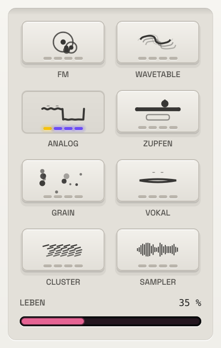

**LEBEN** (p15) am Fuß der Engine-Spalte lässt gehaltene Töne des bearbeiteten Parts weiterleben – so wie
ein gespieltes Instrument nie zweimal genau gleich klingt. Bei **0** ist der Klang statisch und genau wie
ohne den Regler; dreht man auf, bewegt sich jede Stimme für sich:

* eine langsame **Tonhöhen-Drift** von wenigen Cent (höchstens etwa ±12 Cent bei 100 %; die Stimmen eines Akkords laufen auseinander),
* **atmender Filter** – die Helligkeit hebt und senkt sich langsam (Filter-Engines: Cutoff; FM: Index; Vokal: Vokal; Zupfen: Klang),
* **Engine-Farbe** – Wavetable-Position und -Warp, FM-Index, Formant, Grain-Dichte wandern ein wenig,
* **Grain-Streuung** – die Körner der Grain-Engine starten an leicht gestreuten Stellen,
* ein Hauch **Panorama**- und **Pegel**-Bewegung (etwa ±0,25 dB – Atmen, nie ein Sprung).

Die Bewegung entsteht aus langsamen Zufalls-Drifts und frei laufenden „Chaos“-LFOs mit ungeraden Raten,
für jede Stimme anders (je Part, Stimme und Note geseedet – ein Bounce klingt jedes Mal gleich). Etwa
15 – 35 % machen Flächen und Keys lebendig, ohne verstimmt zu wirken; höhere Werte ergeben üppige,
treibende Texturen. Änderungen gleiten über etwa 60 ms – man kann den Regler fahren, während Töne klingen.

Balken ziehen (Shift / Cmd / Strg = fein), Doppelklick = 0, Rechtsklick = MIDI Learn. Während der Part
spielt, schimmert der leuchtende Balken langsam – schneller mit mehr Leben; ein feiner heller Strich zeigt,
wohin die Modulationsmatrix ihn bewegt (Ziel **Leben**, [MODULATION.md](MODULATION.md)). LEBEN liegt auch auf
den Hüllkurven-Seiten (nach Poly-Glide) und gehört zu Part-Presets (`pN.life`,
[PARAMETERS.md](../PARAMETERS.md#life-per-part-p15)).

## Leuchtbalken

Engine-, Modus-, Transport-, Oktav- und MIDI-Tasten tragen am unteren Rand der Taste, unter dem
Piktogramm, einen kurzen **Leuchtbalken**. Eine Farbsprache: **Gelb** = was du bearbeitest,
**Violett** = läuft oder anderswo in Benutzung, **Grün** = spielt, **Rot** = Aufnahme. Ein Licht für
„spielt“ oder „nimmt auf“ **atmet** sanft (ein weicher Puls von etwa 1,8 s, nie ganz aus).

| Tasten | Leuchtbalken |
|---|---|
| Engine | vier Segmente, eines je Part (1 – 4, von links): ein Segment leuchtet, wenn dieser Part die Engine spielt – **gelb** für den bearbeiteten Part, **violett** für einen anderen Part. |
| Modus | **Gelb** = die Seite auf dem Display. **Violett**: SEQUENCER = der Sequencer läuft; EFFEKTE = ein Platz eines Effekt-Racks (Part oder Master) ist an; DRUM = ein laufender Sequencer spielt das Drum-Kit; LFO = der LFO eines Parts hat Tiefe oder eine Modulation ist geroutet. **Grün** auf TAPE = das Tape spielt, **rot** auf TAPE = Aufnahme (beide atmend). Die Statusfarbe hat Vorrang; die angezeigte Seite bleibt als eingesunkene Taste sichtbar. |
| Transport | START **grün**, solange es läuft (auch das Dreieck glüht), REC **rot** (stetig = bereit; der Kreis glüht), SCHLEIFE **gelb**, solange sie an ist. Solange START spielt und REC aufnimmt, atmen Balken und Zeichen. |
| OKTAVE − / + · MIDI · RASTER | OKTAVE **gelb**, solange die Klaviatur in diese Richtung verschoben ist; MIDI **rot** während MIDI-Learn; RASTER **gelb**, solange die Raster-Tastatur zu sehen ist. |

Der Tooltip einer Taste sagt, was ihr Balken bedeutet (Engine-Tasten nennen auch die Parts, die sie benutzen).

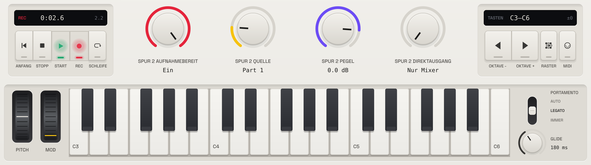

Die **Anzeigen** neben den Tasten (p39: Die Tape-Anzeige teilt ihre Zeile mit dem einstellbaren Tempo, dem Metronom und dem
Vorzähler, siehe [Tempo, Metronom und Vorzähler](#tempo-metronom-und-vorzähler-p39)): Die Tape-Anzeige über den Transport-Tasten zeigt den Zustand (**REC**
rot, **START** grün – beide atmend, solange sie laufen – *TAPE*), die Bandzeit (m:ss.z) und Takt.Schlag; die Tastatur-Anzeige im Oktavfeld
zeigt den Umfang der Klaviatur (C3–C6) und ihre Oktavlage, und **MIDI-LEARN** in Rot, solange ein Regler
auf eine MIDI-Nachricht wartet.

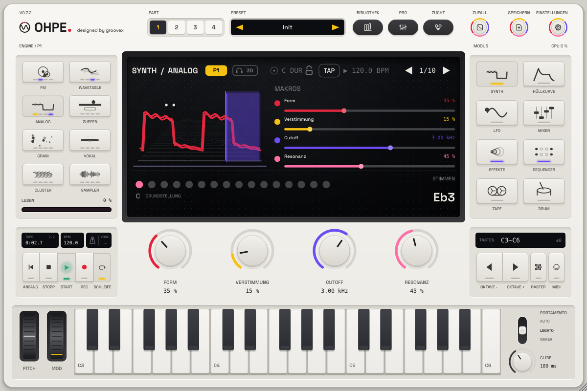

## ZUFALL und SPEICHERN

**ZUFALL** gibt der Engine des bearbeiteten Parts neue Klangwerte (ihre Synth-Seiten; Pegel, Stimmung,
Stimmen, Sample, Hüllkurven, Effekte und Modulation bleiben). **SPEICHERN** öffnet das Speicherfeld der
Bibliothek für den bearbeiteten Part.

Jeder gewürfelte Klang soll sofort spielbar sein:

* **Musikalische Bereiche**: Jeder Engine-Parameter wird in einem Bereich gewürfelt, in dem die Engine noch
  wie ein Instrument klingt – das Filter schließt nie ganz, Resonanz, FM-Index / -Feedback, Drive und
  Grain-Streuung bleiben moderat, FM-Verhältnisse und Korn-Tonhöhen landen auf musikalischen Intervallen.
* **Wenig Rauschen**: Rauschen, Knistern und Atem sind meist aus und, wenn sie kommen, leise; ein Wurf, der
  trotzdem nach Rauschen klingt, wird neu gewürfelt.
* **Kein Gleiten**: Portamento und Tonhöhen-Hüllkurve werden zurückgesetzt – Glide ist aus (nur in wenigen
  Würfen ein kurzes Legato-Glide, nie auf der ersten Note), ein kurzer Tonhöhen-Blip im Anschlag kommt etwa
  in jedem 25. Wurf; Glide-Druck ist neutral.
* **Pegelangepasst**: Ohpe spielt den neuen Klang offline an (C4 + G4), würfelt neu, wenn er stumm oder
  fehlerhaft ist, und stellt den Part-**Gain** so ein, dass er so laut spielt wie die Werks-Presets (Median ihres
  lautesten Moments, K-gewichtet – Plucks und Flächen werden danach verglichen, wie laut ein Ton klingt, nicht wie
  lange er dauert), mit einem True Peak von höchstens -1 dBTP. Die Part-Lautstärke bleibt
  unverändert. Halten die Effekte des Parts den Pegel unten (etwa ein Kompressor vorn im Rack), spielt der
  neue Klang ungefähr so laut wie der Klang, von dem aus gewürfelt wurde.

**ZUFALL halten** (oder rechts anklicken) öffnet die **[Zucht](ZUCHT.md)**: zwei Klänge kreuzen, sechs Kinder hören,
die besten behalten und weiterzüchten. Solange die Zucht-Ansicht offen ist, würfelt ZUFALL einen neuen
Elternteil B, und SPEICHERN legt das gewählte Kind als Favorit in der Bibliothek ab.

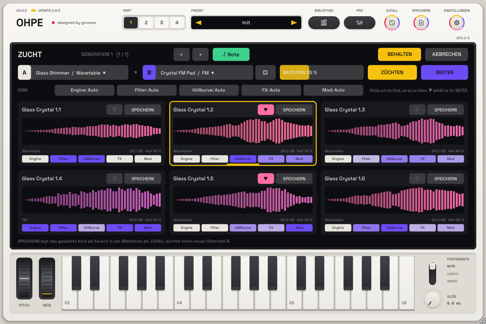

## Display: Balken ziehen

Die vier Zeilen im Display zeigen, was die vier Encoder steuern. Die Zeilen sind selbst Regler:

| Aktion | Ergebnis |
|---|---|
| Zeile ziehen (nach rechts oder oben = mehr) | ändert den Wert relativ zum bisherigen |
| Klick auf den Balken | springt an diese Stelle, dann weiterziehen |
| **Shift**, **Cmd** (macOS) oder **Strg** beim Ziehen | Feinregelung: ein Zehntel der Geschwindigkeit. Die Taste darf während des Ziehens gedrückt oder losgelassen werden; der Wert springt nie. |
| Doppelklick | zurück auf den Standardwert |
| Rechtsklick | MIDI Learn / Zuordnung löschen / Zurücksetzen |

Die Encoder verhalten sich genauso: ziehen (fein mit Shift / Cmd / Strg zu Beginn des Ziehens),
Doppelklick setzt zurück, Rechtsklick öffnet MIDI Learn. Die kleine Überschrift über den Zeilen
nennt die Seite (*Makros*, *Amp-Hüllkurve*, *Spur* …); die Pfeile in der Display-Kopfzeile blättern.

## Display-Ansichten: Figur, Stereobild, Spektrum-Landschaft, lebendes Objekt

Das Display ist in Ebenen gebaut wie ein echter Instrumentenbildschirm: Das Punktraster liegt hinter
dem tiefen Glas, die Werte schweben davor, die Figur wirft einen leichten Schatten und das Glas
selbst trägt einen weichen inneren Schatten und einen Glanz. Bewegst du die Maus über das Display,
verschieben sich die hinteren Ebenen ein wenig gegen die vorderen (Parallaxe).

Die linke Hälfte des Displays zeigt eine von fünf **Ansichten** – Klick wechselt, Rechtsklick öffnet
das Ansichtsmenü:

| Ansicht | Was sie zeigt |
|---|---|
| **Figur** (Standard) | die animierte Figur der Engine / des Modus. Auf den Synth- und Mixer-Seiten steht sie auf einer langsam bewegten **Spektrum-Landschaft** ihres Klangs (Bearbeitungs-Part, Master). |
| **Stereobild** | der Master-Ausgang: Goniometer (Mitte nach oben, Seite quer, L oben links, R oben rechts), Korrelationsanzeige (−1 … +1; rot = gegenphasig) und die Pegelbalken **M** / **S**. |
| **Spektrum-Landschaft** | das Master-Spektrum als perspektivische Landschaft: Neue Reihen steigen vorn auf und wandern zum Horizont. Wenn der Klang endet, kommt sie zur Ruhe. |
| **3D-Raum** (1.0) | die kopfbezogene Ansicht der [3D-Stufe](RAUM.md): jeder Part, der den Raum nutzt, als Punkt mit Spur um den Kopf des Hörers, der Bearbeitungs-Part beschriftet. |
| **Lebendes Objekt** (p26) | der Klang als 3D-Objekt: Es atmet mit der Lautstärke-Hüllkurve, beult sich mit den LFOs, wellt sich mit Modulationshüllkurve und Matrix, streckt sich mit der Stereobreite und teilt sich, wenn die Kanäle gegenphasig werden. Der Bearbeitungs-Part (auf der Mixer-Seite der Master); wenn der Klang endet, kommt es zur Ruhe – siehe [Lebendes Display](LEBENDES-DISPLAY.md). |

Das **Stereobild erscheint von selbst**, sobald die Encoder einen Effekt **Mitte/Seite** in einem
Slot des FX-Racks zeigen: im Rack eines Parts das Stereobild dieses Parts nach seinem Rack
(beschriftet *P1*–*P4*), im Master-Rack (*MFX 1*–*MFX 4*) den Master-Ausgang (beschriftet *Master*).
Die Balken M und S tragen die Farben der Encoder *Mitte-Pegel* und *Seite-Pegel*. In der Rack-Ansicht
der FX-Seite zeigt der Streifen unter der Effektkette das Stereobild, wenn dort ein Slot mit
Mitte/Seite gewählt ist.

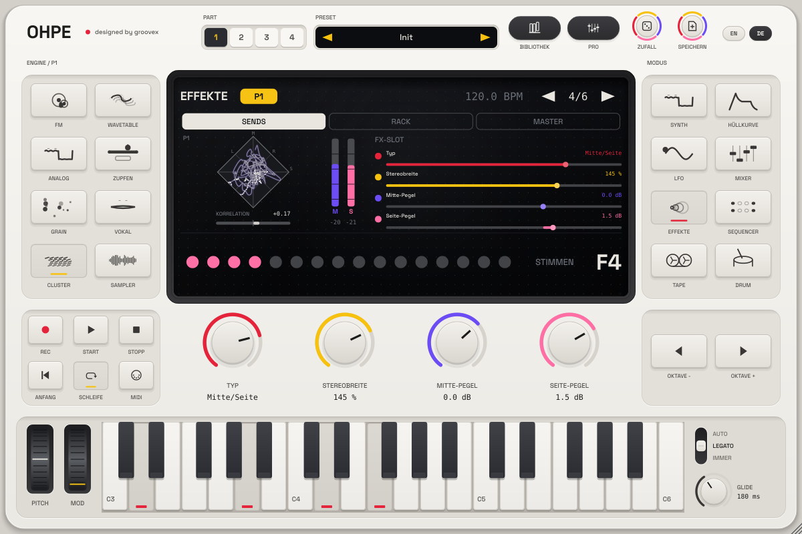

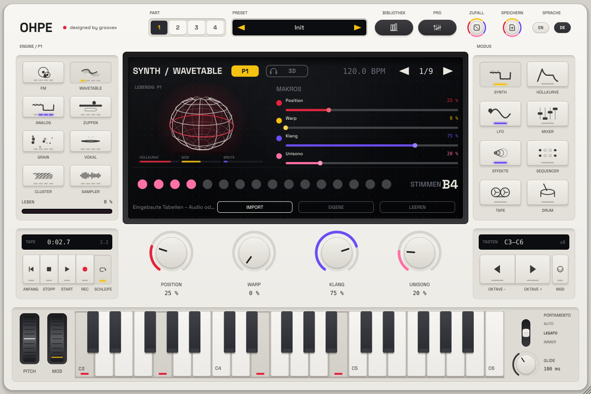

**Animierte 3D-Ansichten** (Ansichtsmenü) schaltet Landschaft und Parallaxe ab – das Display steht
dann still, das Stereobild arbeitet weiter. Die Einstellung gehört zum Rechner (gilt für alle
Projekte); die gewählte Ansicht wird mit dem Projekt gespeichert. Die Anzeigen lesen den Klang über
einen lock-freien Puffer: Auf dem Audio-Thread wartet und alloziert nichts, die Analyse läuft im
Bildschirm mit 30 Bildern pro Sekunde.

## Parts

Ohpe hat vier Parts, jeder mit eigener Engine und eigenem Klang. Die **Part-Auswahl** (1–4,
Kopfzeile) wählt den **bearbeiteten Part**: Engine-Tasten, die Seiten Synth, Hüllkurve, LFO und
FX-Slot, die Bibliothek (Part-Presets laden dorthin) und die Bildschirm-Klaviatur (sie spielt auf
dem MIDI-Kanal des Parts) folgen ihr. Das Display zeigt den Part als gelbes Schild (P1–P4).
MIDI: *Bearbeiteter Part* (`ui.part`).

**Synth-Modus** (0.6): nach den Seiten der Engine folgen zwei Seiten, die alle Engines teilen –
**Glide** (Zeit, Modus, Timing, Poly-Glide) und **Tonhöhen-Hüllkurve** (Menge, Zeit, Kurve, Stimmen).
Siehe [SEQUENZER.md](SEQUENZER.md#portamento-und-tonhöhen-hüllkurve-06). Danach die Seite **Sub** (p31: Pegel,
Oktave, Form, Direkt) – die [SUB-Ebene](SUB-EBENE.md) des Parts, ein Suboszillator eine oder zwei Oktaven unter jeder
Stimme für mehr Tiefe.

**Hüllkurven-Modus** (p33): nach den Hüllkurven und den Stimmen-Seiten folgen die **Ausdrucks**-Seiten – **Anschlag**
(Ziel 1, Menge 1, Ziel 2, Menge 2), **Aftertouch** (ebenso, für Kanal-, Poly- und MPE-Druck) und **Ausdruckskurven**.
Das Display zeichnet das Ansprechen jedes Slots mit einem Punkt, der deinem Spiel folgt; die Profi-Ansicht (Synth)
zeigt sie als Gruppe *Ausdruck*. Siehe [Ausdrucksstark spielen](AUSDRUCK.md).

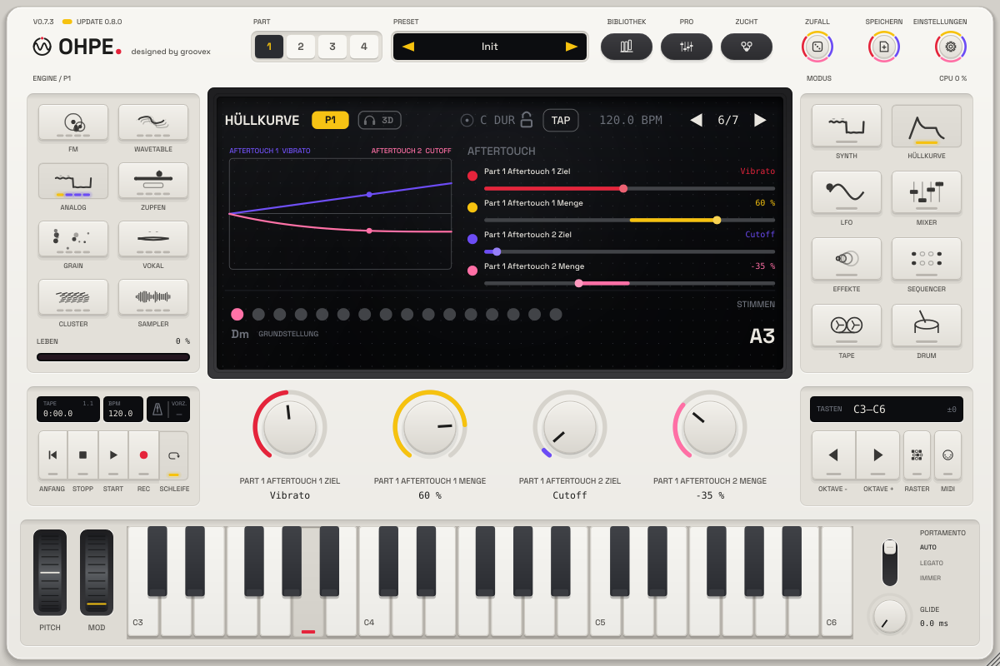

## Samples für Sampler und Grain

Ist auf dem bearbeiteten Part die Sampler- oder Grain-Engine gewählt, zeigt das Display
**Sample laden** und **Leeren** sowie den Namen der geladenen Datei. Eine **Audiodatei** (WAV, AIFF,
FLAC, Ogg) kann auch aus dem Dateimanager auf das Instrument **gezogen** werden: Sie geht an die
Grain-Engine des Parts, wenn Grain gewählt ist, sonst an seinen Sampler (der Part wechselt zum
Sampler). Jeder Part hat eigene Samples. Die Pfade werden mit dem Projekt gespeichert.

**BOUNCE** (dritte Taste, p23) bringt Tape- oder Live-Eingangs-Audio in die angezeigte Engine: Ein Menü bietet die
Bearbeitungsspur, Tape 1 … 8, den Tape-Mix und den Eingang (1–8 Takte) sowie *Endlosschleife* (standardmäßig an – der
Bounce schleift nahtlos). Siehe [Bounce ins Instrument](BOUNCE-INS-INSTRUMENT.md).

## Eigene Wavetables und Formanten (p20)

Mit der Wavetable- oder Vokal-Engine auf dem bearbeiteten Part zeigt die Synth-Seite **IMPORT**,
**EIGENE** und **LEEREN**. Einen Klang oder eine Wavetable-Datei auf das Instrument ziehen (oder IMPORT:
Datei, Tape-Spur, Live-Eingang, Bibliothek; Frames 8 … 256, Glättung): Der Klang wird im Hintergrund
analysiert – ein Fortschrittsbalken auf dem Display – und wird zur eigenen Wavetable (Wavetable-Engine)
oder zu Formantspuren (Vokal-Engine), in der eigenen Wavetable-Bibliothek gespeichert und
eingeschaltet. Das Display zeigt dann den Frame-Stapel (den Frame an der aktuellen Position gelb) oder
die fünf Formantspuren. **EIGENE** schaltet zwischen eigenem und eingebautem Material um
(`pN.usertable.wt` / `pN.usertable.vocal`), **LEEREN** entfernt es. Details:
[Wavetable-Engine](engines/wavetable.md#eigene-wavetables-klang-zu-wavetable-p20).

## Profiansicht

**PRO** öffnet die Profiansicht: **alle Parameter des aktuellen Modus auf einmal**, in Gruppen – im
Synth-Modus Engine, Filter, Hüllkurven, LFO, Tonhöhe & Pegel, Stimme, Glide (p32: mit *Glide-Druck*,
[MIDI.md](MIDI.md)), Tonhöhen-Hüllkurve, Sub, Layer und
MIDI des Parts; im Tape-Modus Transport, Schleife, Bandcharakter und alle acht Spuren; im Drum-Modus das Kit
und alle 24 Pads. Die Reiter oben wechseln den Modus. Die Ansicht nutzt eine bis vier Spalten, so viele, wie
das Fenster breit ist, und scrollt, wenn ein Modus mehr hat als passt.

**Sehen – greifen – hören (Profiansicht 2.0).** Jede Gruppenkarte mit einem Bild zeigt es zuerst, und das
Bild ist das Bedienelement:

| Karte | Bild | Greifen |
|---|---|---|
| Amp- / Mod-Hüllkurve, Hüllkurve 3 | ADSR-Kurve, ein grüner Punkt folgt der neuesten Note | die vier Griffe ziehen (Gipfel = Attack, Knick = Decay + Sustain, Sustain-Ende, Release-Ende) |
| Filter | Frequenzgang | X = Grenzfrequenz, Y = Resonanz, Mausrad = Drive |
| LFO, LFO 2 / 3 | die Welle auf einem Tempo-Raster, ein wandernder Punkt | hoch / runter = Tiefe, links / rechts = Tempo, schnelles Wischen oder Mausrad = Form |
| FM-Engine | Operator-Graph: Kreise = Operatoren (gefüllt = hörbar), Linien = Modulation, Stärke = Index | Kreis hoch / runter = sein Verhältnis, Mausrad auf einem Kreis = sein Pegel, freie Fläche = Index, das Schild = nächster Algorithmus |
| Wavetable-Engine | die Frames als Stapel, die leuchtende Ebene = Position | hoch / runter = Position, links / rechts = Warp, Mausrad = Tabelle |
| Grain / Sampler | die Wellenform; Grains als Wolke um die Position (grün, solange es spielt) | Grain: X = Position, Y = Größe, Mausrad = Streuung; Sampler: Start- / Loop-Marken ziehen |
| Analog / Pluck / Cluster / Vokal | Oszillator-Mischung / Saite / verstimmter Stapel / Formantkurve | X und Y bewegen die ersten beiden Makros der Engine |
| Tonhöhe & Pegel | Stimm-Ring und Pegelanzeige | hoch / runter am Ring = Stimmung, Mausrad = fein, am Fader = Pegel |
| Sub (p31) | die Stimme (grau) über ihrer Sub-Welle (gelb), Pegel-Fader | hoch / runter = Pegel, Wischen = Form, Klick auf Oktav- / Weg-Beschriftung, Mausrad = Pegel – siehe [SUB-Ebene](SUB-EBENE.md) |
| FX-Slots, Sends | die Kette als Karten mit einem Minibild jedes Effekts | X = Mischung, Y = erster Parameter des Effekts, Mausrad = Typ |
| 3D-Raum | der Kopf von oben, der Klang als Punkt | Punkt ziehen = Richtung und Entfernung, Mausrad = Höhe |

Shift (Cmd / Strg) für feine Schritte, Doppelklick setzt zurück, Rechtsklick öffnet MIDI Learn – im Bild wie
an den Balken. Die Balken bleiben unter jedem Bild als genaue Zeile; der Winkel im Kartenkopf klappt sie weg.
Über einem Balken oder Bild zeigt der Hinweis den Wert und einen Satz dazu, was er tut.

**Farben:** Gelb = was du bearbeitest, **Violett = Modulation** (jeder modulierte Parameter zeigt den Bereich,
den seine Routings bewegen, als violetten Bogen, Streifen oder Schatten, auf den Balken als violettes Band um den Wert – das Filter zeigt den ganzen
überstrichenen Frequenzgang), Grün = spielt, Rot = nimmt auf.

**Modulation per Ziehen:** die Quellen-Chips in der ENTDECKEN-Zeile (LFO 1–3, Mod-Hüllkurve, Hüllkurve 3,
Mod-Rad) lassen sich auf jedes Bild ziehen: das Routing kommt in den nächsten freien Slot der
Modulationsmatrix des Parts (Menge 35 %), Ziel ist der Parameter unter dem Ablagepunkt.

**EINFACH | ALLES** (oben rechts): Einfach zeigt nur die Bilder und Entdecken, Alles zusätzlich alle Balken.
Modi ohne Bilder (Mixer, Sequencer, Tape, Drum) zeigen ihre Balken immer.

### Entdecken

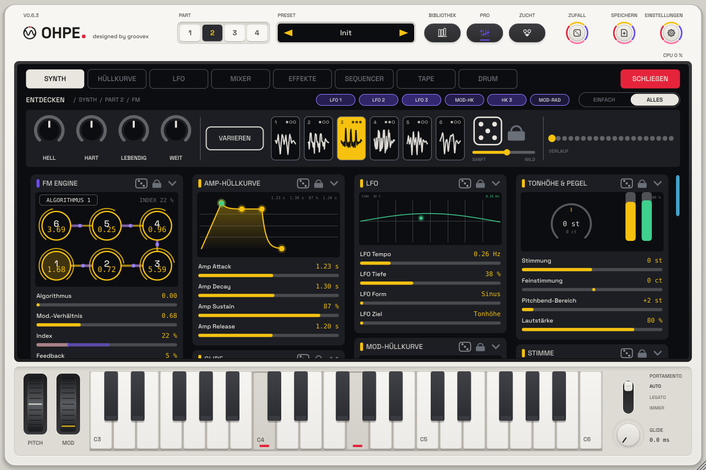

Der Streifen oben in der Profiansicht (Part-Modi) ist zum Finden von Klängen statt zum Einstellen:

- **HELL · HART · LEBENDIG · WEIT** – die Charakter-Makros des Parts (`pN.char.*`, −100 … +100 %, 0 =
  neutral). Jedes bewegt mehrere echte Parameter musikalisch: HELL öffnet Filter / Ton / FM-Index, HART gibt
  schnelleren Anstieg, Drive und Feedback, LEBENDIG treibt das [Leben](#leben) des Parts plus Drift und
  Jitter, WEIT verbreitert Unisono, Spreizung und Layer. Sie sind Host-Parameter (Automation, MIDI Learn)
  und Matrix-Ziele.
- **VARIIEREN** – sechs Verwandte des aktuellen Klangs erscheinen als nummerierte Kacheln. Die Welle jeder
  Kachel zeigt, wie sich dieser Verwandte vom Ausgangsklang entfernt hat (andere Änderungen = andere Welle,
  geformt von seiner Amp-Hüllkurve); die Punkte oben rechts zeigen, wie weit (1 = am nächsten der sechs,
  3 = am weitesten). Ändern sich die Parameter des Klangs (andere Engine), werden die Kacheln geleert. Kachel anklicken = **anhören** (der Klang wird gesetzt, eine kurze Note spielt),
  **halten oder doppelklicken** = **behalten**. Eine Kachel auf eine andere ziehen = beide **kreuzen** – das
  Kind ersetzt die Zielkachel. Erneutes VARIIEREN ohne Behalten kehrt zum Ausgangsklang zurück.
- **Würfel** – würfelt alle nicht gesperrten Gruppen auf einmal; der Regler darunter stellt die Stärke von
  **sanft** bis **wild** (auch, wie weit VARIIEREN geht). Jede Karte des Klangs hat einen eigenen **Würfel**
  (nur diese Gruppe) und ein **Schloss** (VARIIEREN und Würfel lassen sie in Ruhe); das Schloss im Streifen
  entsperrt alle.
- **Verlauf** – die letzten 20 Zustände als Punkte; einen anklicken, um dorthin zurückzukehren.

VARIIEREN, Würfel und Kreuzen nutzen denselben Zucht-Kern wie die [Zucht-Ansicht](ZUCHT.md) (Mutation je
Gen-Gruppe mit Sicherheitsgrenzen für Resonanz, Feedback und Drive; Kreuzung je Gruppe).

## Sequencer-Ansichten und Parameter-Locks

Im Sequencer-Modus wählen die Reiter im Display die Ansicht: **Schritt**, **Euklid**, **Arp**,
**Orbit** und **Sync**. Euklid und Orbit zeichnen ihre Ringe / Spuren; Arp und Sync zeigen eine
Zusammenfassung.

Schritt-Ansicht:

* **Klick** auf einen Schritt schaltet ihn an oder aus (die vier Reiter links wählen die Schritte
  1–16 … 49–64).
* **Shift-Klick** (oder Rechtsklick) auf einen Schritt **wählt ihn zum Bearbeiten**. Das Display
  zeigt *LOCK SCHRITT n*, die Encoder bearbeiten den Schritt: **Note, Anschlag, Gate,
  Wahrscheinlichkeit** (Seite 1) und **Ratchet** (Seite 2).
* Solange ein Schritt gewählt ist, in einen anderen Modus wechseln (Synth, Hüllkurve, LFO, Mixer,
  Effekte, Drum) und einen Encoder drehen oder einen Balken ziehen: der Wert wird **auf diesem
  Schritt gelockt**, statt den Parameter zu ändern. Gelockte Werte tragen eine eckige Marke im
  Display und am Encoder. Ein Schritt hält bis zu vier Locks; Doppelklick auf einen gelockten Wert
  entfernt diesen Lock.
* Schritte mit Locks tragen kleine Marken an der Oberkante (eine pro Lock); der gewählte Schritt
  ist umrandet.
* **Locks löschen** entfernt alle Locks des Schritts; **Fertig**, ein Klick auf das *LOCK*-Schild,
  Esc oder ein zweiter Shift-Klick beenden das Bearbeiten.

## Transport-Tasten

Die **TRANSPORT**-Tasten im Feld unten links (eine Reihe: ANFANG, STOPP, START, REC, SCHLEIFE unter der Tape-Anzeige) wirken auf jeder Seite:

| Taste | Aktion |
|---|---|
| **REC** (rot) | Aufnahme mit einem Druck: ist keine Spur aufnahmebereit, wird die gewählte bereit geschaltet; die Aufnahme geht an und das Band läuft los. Während der Aufnahme gedrückt: aussteigen (das Band läuft weiter). Leuchtet bei bereiter Aufnahme, atmet während der Aufnahme. |
| **START** | startet / stoppt Sequencer und Band zusammen (*Start startet Tape*, ab Werk an; aus: START lässt nur den Sequencer laufen) |
| **\|◀** | Band zurück zum Anfang |
| **STOPP** | hält Band, Aufnahme und Sequencer an; im Stillstand noch einmal gedrückt: zurück zum Anfang |
| **SCHLEIFE** | Band-Schleife an / aus; ohne Schleifenbereich schleift sie das Aufgenommene (oder vier Takte) |

Solange das Band läuft, zeigt jede Seite **● REC 0:12.3** (rot, atmend) oder **▶ TAPE 0:12.3** (grün) in der
Kopfzeile des Displays. In der Standalone-App: **Leertaste** = START, **R** = REC, **Enter / Pos1** =
zum Anfang, **L** = Schleife (im Plug-in behält der Host seine Tasten). Rechtsklick auf eine
Transport-Taste (oder eine Taste der Tape-Seite) öffnet MIDI-Learn – jede Transportfunktion hat einen
Trigger, siehe [MIDI](MIDI.md).

## Tempo, Metronom und Vorzähler (p39)

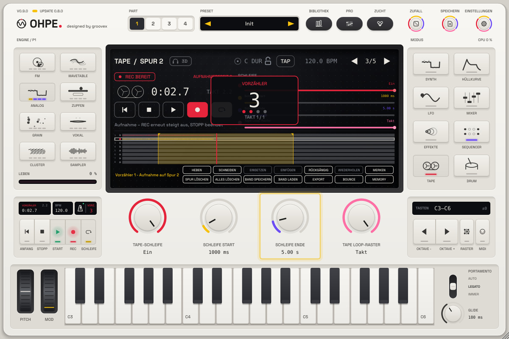

**Tempo einstellen.** Das Tempo ist überall dort ein Regler, wo es angezeigt wird – rechts in der Kopfzeile des
Displays (**120.0 BPM**, auf jeder Seite) und im Transportfeld (**BPM 120.0**, neben der Tape-Anzeige):

| Geste | Aktion |
|---|---|
| nach oben / unten ziehen | ± 1 BPM je 4 Pixel; mit **Shift** (oder Cmd / Strg) ± 0,1 BPM |
| Mausrad | ± 1 BPM (fein: ± 0,1) |
| Doppelklick | Wert eintippen (20–300, Komma geht auch), **Return** übernimmt, **Esc** bricht ab |
| **TAP** (Kopfzeile, links vom Tempo) | im Takt klicken: ab dem zweiten Tippen ist das Tempo der Mittelwert der letzten vier Abstände; eine Pause über 2 s beginnt neu. Standalone-Taste **T**. |
| Rechtsklick | MIDI-Learn / Zuweisung löschen / zurücksetzen von `tempo` (TAP: `metro.tap`) |

Kommt das Tempo von außen – vom Transport des Plug-in-Hosts oder von einer eingehenden **MIDI-Clock** (`sync.src`) –,
steht **HOST** bzw. **CLOCK** davor, und es lässt sich dort nicht ändern (TAP ist ausgeblendet); geändert wird es im
Host bzw. an der Clock-Quelle. Mit Netzwerk-Sync (Link, Standalone) bleibt Ohpes Tempo einstellbar und setzt das
Sitzungstempo. Die Sequencer-Seite behält ihren Tempo-Regler wie bisher.

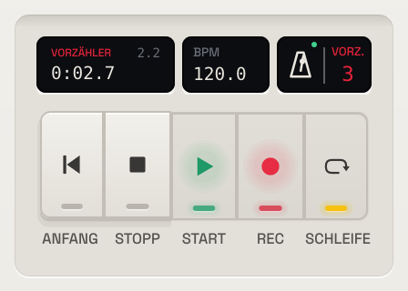

**Metronom.** Die Metronom-Taste (Pyramidenzeichen, rechts vom Tempo im Transportfeld) schaltet den **Klick** ein und
aus (`metro.on`, Standalone-Taste **K**). Er klickt auf jedem Schlag, solange **Sequencer oder Tape laufen** – nie im
Stillstand – und blinkt bei jedem Klick grün; die Eins des Takts ist betont (höher und lauter). Der Klick ist Ohpes
eigener, synthetisierter Klang (keine Samples), spielt nur auf dem **Hauptausgang** und wird **nie aufs Band
aufgenommen**. Rechtsklick auf die Taste: Klick-Lautstärke (25–100 %), Betonung auf der Eins, *Klick auch im Plug-in*,
MIDI-Learn. Im **Plug-in** bleibt der Klick stumm, außer *Klick auch im Plug-in* (`metro.plugin`) ist an – Hosts haben
ein eigenes Metronom; die Standalone-App klickt immer, wenn das Metronom an ist.

**Vorzähler.** Die Vorzähler-Taste (**VORZ.**, `metro.countin`) schaltet **– → 1 → 2** (aus, ein Takt, zwei Takte).
Beginnt eine Aufnahme aus dem Stillstand – **REC**, oder START mit bereiter Spur und eingeschalteter Aufnahme –, wartet
das Band: Das Display zeigt den Countdown (große Schlagzahl 4 – 3 – 2 – 1, den Takt *1 / 2*, rot), die Vorzähler-Taste
die verbleibenden Schläge, und der Klick spielt auch bei ausgeschaltetem Metronom (auch im Plug-in). Das Band nimmt
**genau ab dem ersten Sample des nächsten Takts** auf; ein mitgestarteter Sequencer (*Start startet Tape*) beginnt auf
demselben Sample. Läuft der Sequencer schon, zählt der Vorzähler in seinem Raster, und die Aufnahme beginnt auf einem
seiner Taktstriche (zwischen einem und der gewählten Zahl an Takten später). **REC** oder **STOPP** während des
Vorzählers bricht ihn ab – es wird nichts aufgenommen. Einsteigen (Punch-in) bei laufendem Band hat keinen Vorzähler.
Ohpe zählt im 4/4-Takt.

Die Einstellungen sind Host-Parameter (mit Session / Projekt gespeichert, automatisierbar, MIDI-zuweisbar) und gehören
dem Spieler: Presets tragen sie nicht. Parameter: [PARAMETERS.md](../PARAMETERS.md#p39--metronome-count-in-tap-tempo).

## Tape-Seite

Die linke Hälfte des Displays ist das **Transportfeld**: der Zustand (**● REC** atmend, *REC
BEREIT*, *START* in Grün, *STOPP*), die aufnahmebereiten Spuren, Zeit und Takt.Schlag, die Spulen (sie drehen
sich mit dem Band) und fünf Tasten – **|◀ · ■ · ▶ · ● · SCHLEIFE** – dazu eine Zeile, die sagt, was als
Nächstes zu tun ist (*Spur wählen, REC drücken*). Darunter: die acht Spuren mit ihrem Inhalt, die
Abspielposition (rot während der Aufnahme), der Schleifenbereich (gelb) und die **Bereit-Punkte** –
Klick auf einen Punkt schaltet die Spur aufnahmebereit oder wieder ab, Klick auf eine Spur wählt sie.

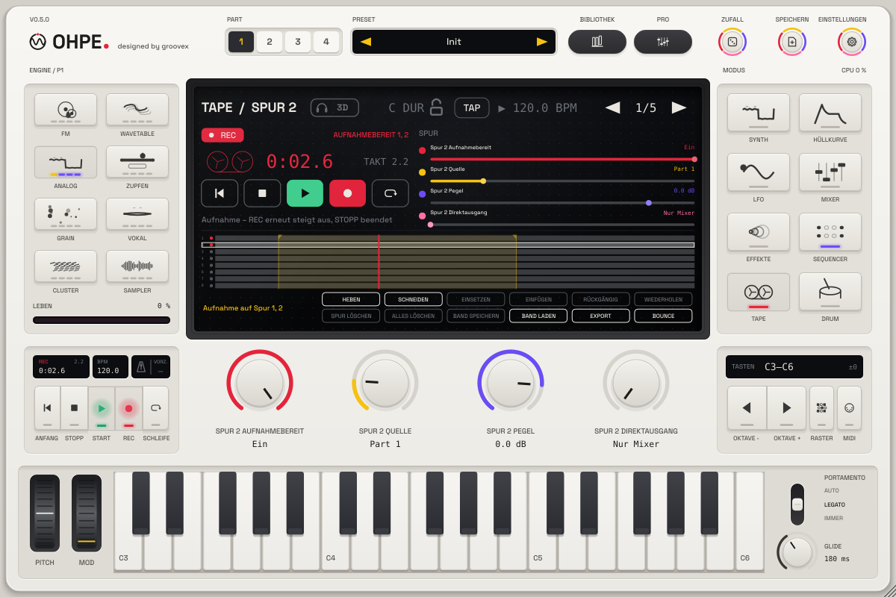

Encoder-Seiten:

| Seite | Encoder |
|---|---|
| Spur | Aufnahmebereit, Quelle (Eingang, Part 1–4, Drum), Pegel, Direktausgang der gewählten Spur |
| Transport | Overdub, Geschwindigkeit (Varispeed 0,5–2×), Rückwärts, Start startet Tape |
| Schleife | Schleife an/aus, Start, Ende, Raster (zum Setzen der Schleife: Takt, Schlag, Aus – p42) |
| Bandcharakter | Sättigung, Wow, Flutter, Rauschen |
| Bounce | Bounce-Quelle, Bounce-Ziel (Grain / Sampler), Endlosschleife, Eingangslänge (p23) |

Soft-Tasten im Display – zwei Reihen: oben die Schnitte der gewählten Spur, unten das ganze Band:

| Taste | Aktion |
|---|---|
| **Heben** | kopiert Schleifenstart … -ende der gewählten Spur in die Zwischenablage und lässt Stille |
| **Schneiden** | nimmt Schleifenstart … -ende der Spur in die Zwischenablage und schließt die Lücke (späteres rückt vor) |
| **Einsetzen** | legt die Zwischenablage an die Abspielposition (überschreibt) |
| **Einfügen** | fügt die Zwischenablage an der Abspielposition ein (späteres rückt nach hinten) |
| **Rückgängig / Wiederholen** | unbegrenztes Rückgängig für Aufnahmen und Schnitte |
| **Spur löschen** | leert die gewählte Spur sofort – ein Rückgängig-Schritt, **Rückgängig** holt sie zurück |
| **Alles löschen** | leert alle acht Spuren nach einer Rückfrage (*Gesamte Bandaufnahme löschen?* – **Abbrechen** ist vorgewählt, Eingabe und Esc brechen ab; **Löschen** in Rot leert). Ebenfalls rückgängig machbar |
| **Band speichern** | speichert den ganzen Recorder – alle acht Spuren, die Bandlänge, den Schleifenbereich und die Bearbeitungsspur – als eine **`.ohpetape`**-Datei, die sich später in jedem Projekt wieder laden lässt |
| **Band laden** | lädt eine `.ohpetape`-Datei (oder sie aufs Fenster ziehen). Enthält das Band schon Material, fragt Ohpe vorher (*Aufgenommenes Band ersetzen?*); das Laden ist ein Rückgängig-Schritt, **Rückgängig** holt das alte Band zurück. Ein Band mit anderer Abtastrate wird umgerechnet und behält seine Tonhöhe |
| **Export** | rendert Master + die acht Spuren als **24-Bit-WAV** in einen wählbaren Ordner (offline, schneller als Echtzeit; das laufende Audio wird nicht unterbrochen) |
| **Bounce** | bringt die Bearbeitungsspur (oder die Quelle der Bounce-Seite; bei eingeschalteter Schleife den Schleifenbereich) in die Grain- oder Sampler-Engine des bearbeiteten Parts, standardmäßig als Endlosschleife – [Bounce ins Instrument](BOUNCE-INS-INSTRUMENT.md) |

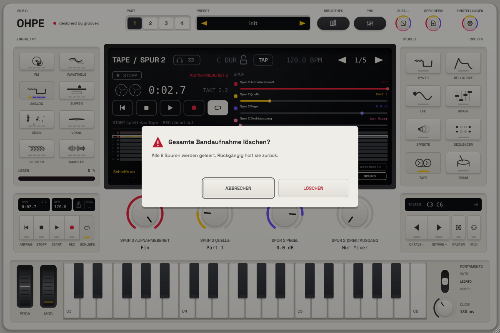

**Loop-Tasten (p42).** Die **Schleifen-Anzeige** links der Soft-Tasten zeigt den Schleifenbereich, mit dem Heben
und Schneiden arbeiten – in Bandzeit und in Takten, ein leuchtender Punkt, solange das Band schleift, und bei der
Aufnahme in der Schleife den Durchgang. Ein Klick darauf tauscht die Tasten gegen die Loop-Tasten (noch ein Klick oder
**Zurück** wechselt zurück); die Encoder springen zur Seite *Schleife* für die Feineinstellung:

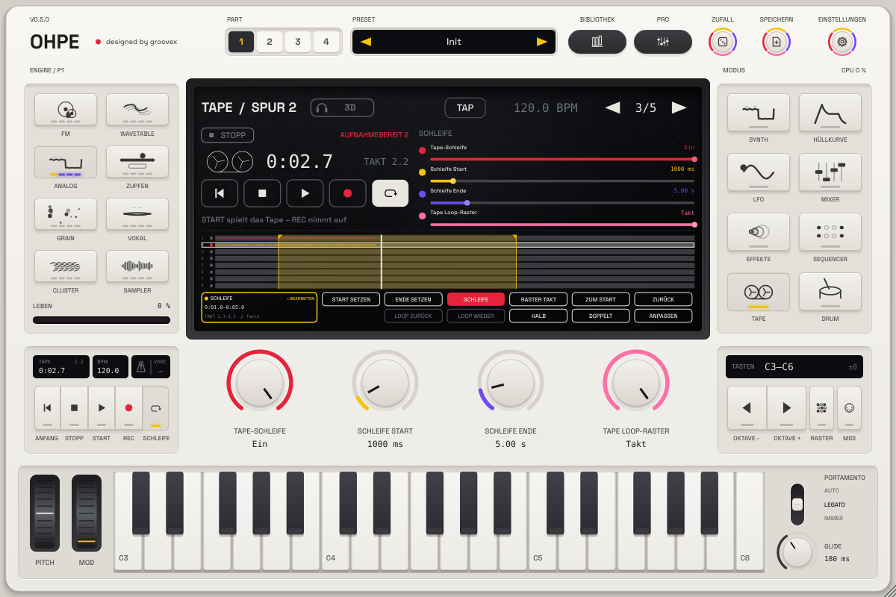

| Taste | Aktion |
|---|---|
| **Start setzen** / **Ende setzen** | Loop-Start / Loop-Ende am Abspielkopf – im Stillstand oder während das Band läuft – auf der nächsten Linie des Rasters; mit **Shift** genau am Abspielkopf. *Ende setzen* schaltet die Schleife sofort ein |
| **Schleife** | Schleife an / aus |
| **Raster Takt / Schlag / aus** | das Raster zum Setzen der Schleife (`tape.loopsnap`; 4/4 ab Bandanfang im Projekttempo) |
| **Zum Start** | Abspielkopf auf den Loop-Start |
| **Zurück** | zurück zu den Schnitt-Tasten |
| **Loop zurück** / **Loop wieder** | Rückgängig / Wiederherstellen des Schleifenbereichs (jeder Tastendruck, jedes Ziehen, jede Encoder-Drehung ist ein Schritt; das Rückgängig der Bandaufnahmen ist getrennt) |
| **Halb** / **Doppelt** | die Schleife halb / doppelt so lang ab Loop-Start |
| **Anpassen** | die Schleife vom Anfang um das aufgenommene Material (bis zur nächsten Rasterlinie) und an |

Auf den Spuren ist die Schleife ein gelbes Band mit einem Griff an jeder Kante: eine Kante ziehen verschiebt sie (im
Raster; Shift: frei). Der Loop-Start bleibt immer vor dem Loop-Ende. Eine Aufnahme in der Schleife schichtet jeden
Durchgang (Overdub an) oder ersetzt ihn (Overdub aus); die ganze Aufnahme ist ein Rückgängig-Schritt. Einzelheiten:
[Schleife setzen](BAND-MISCHER-FX.md#schleife-setzen-p42).

Die vier Band-Tasten der unteren Reihe sind während der Aufnahme gesperrt. Jede Bandbearbeitung ist per MIDI steuerbar:
*Tape-Bearbeitungsspur* (`tape.edit.track`), *Tape Heben / Schneiden / Einsetzen / Einfügen / Rückgängig /
Wiederholen / zum Anfang / Spur löschen / alles löschen* (`tape.edit.*`); *Tape alles löschen* vom Controller
öffnet dieselbe Rückfrage auf dem Bildschirm. Speichern und Laden laufen über den Dateidialog und haben keinen
MIDI-Trigger. Kurzanleitung:
[erste Aufnahme in 30 Sekunden](BAND-MISCHER-FX.md#erste-aufnahme-in-30-sekunden).

## Drum-Kit-Seite

Der Drum-Modus zeigt alle 24 Pads. Klick spielt und wählt ein Pad; die Encoder bearbeiten es –
Modell, Stimmung, Abklingen, Klangfarbe (Seite 1), Pegel, Panorama, Choke-Gruppe, Quelle (Seite 2)
und Lautstärke und Grundnote des Kits (Seite 3). **Laden** legt eine Audiodatei auf das gewählte Pad
(oder eine Datei auf ein Pad ziehen), **Leeren** gibt dem Pad seinen Werksklang zurück.

## Mod-Ansicht (Modulationsmatrix, 0.7)

Im **LFO**-Modus schalten die Reiter auf dem Display zwischen **LFO** (LFO 1, wie bisher),
**Mod**, der [Modulationsmatrix](MODULATION.md) des Edit-Parts, **Morph** (dem [Morph-Pad](#morph-ansicht-p16)), **Bewegung** (dem [Bewegungs-Recorder](#bewegungs-ansicht-p22)) und **Harmonie** (dem [Harmonie-Hirn](#harmonie-ansicht-p24)). Die Mod-Ansicht listet alle
**16 Verbindungen** in zwei Spalten: Quelle → Ziel, ein Balken für die Menge (nach rechts = positiv,
nach links = negativ) und der aktuelle Wert der Verbindung. Ziele auf einer Engine oder einem Effekt
zeigen den echten Parameternamen („Cutoff“, „FX2 Hyper-Verstimmung“) – man sieht, was sich bewegt,
ohne Slots zu zählen. Unter der Liste zeichnet eine **Spur** den Wert der gewählten Verbindung über
die letzten drei Sekunden.

| Aktion | Ergebnis |
|---|---|
| Klick auf eine Verbindung | wählt sie; die Encoder bearbeiten sie |
| **◀ Mod** / **Mod ▶** (Softkeys) | vorige / nächste Verbindung |
| **Leeren** (Softkey) | setzt die gewählte Verbindung auf Aus zurück (Quelle, Via, Ziel, Menge, Kurve) |
| Seitenpfeile | blättern die Encoder-Seiten |

Encoder-Seiten der Mod-Ansicht: **Quelle, Via, Ziel, Menge** der gewählten Verbindung · **Kurve**
und die **Sequencer-Spur** · **Makros 1–4** · **LFO 2** (Tempo, Sync, Form, Tiefe / Modus, Phase,
Einblenden) · **LFO 3** (ebenso) · **Hüllkurve 3** (Verzögerung, Attack, Halten, Decay / Sustain,
Release). Alles steht auch in der Profiansicht (Reiter LFO).

**Modulationsringe.** Wo immer ein Parameter Ziel einer Verbindung ist – an den Encodern und in den
Display-Zeilen jeder Seite –, zeigt ein dünner zweiter Ring (Encoder) bzw. eine Linie über dem Balken
(Display-Zeile) die **Reichweite** aller seiner Verbindungen um den eingestellten Wert, ein Punkt bzw.
Strich die **aktuelle Position**, solange Noten klingen. Drehen verschiebt die Mitte; die Reichweite
wandert mit.

## FX-Rack-Ansichten (0.7)

Im **Effekte**-Modus schalten die Reiter zwischen **Sends** (wie bisher), **Rack** – den sechs Slots
des [FX-Racks](BAND-MISCHER-FX.md#fx-rack-07) des Edit-Parts – und **Master**, den vier Slots des
Master-Racks. Die Kette zeigt jeden Slot als Block in Signalrichtung: Effektname, Mischungsbalken,
Ausgangspegel, **BYPASS** wenn umgangen; leere Slots sind abgedunkelt. Der gewählte Slot ist umrandet,
die untere Displayhälfte zeigt, **was sein Effekt tut**: die Kennlinie der Verzerrung, den Frequenzgang
von EQ und Filter, Kennlinie und aktuelle Pegelreduktion des Kompressors, die Verstärkung jedes Bands
des Multiband-Effekts, die Bewegung der modulierten Effekte.

| Aktion | Ergebnis |
|---|---|
| Klick auf einen Block | wählt den Slot; die Encoder bearbeiten ihn |
| Block auf einen anderen ziehen | verschiebt den Slot dorthin (die anderen rücken nach); rückgängig zu machen, Teil des Presets |
| **◀ Schieben** / **Schieben ▶** (Softkeys) | verschiebt den gewählten Slot um eine Stelle nach vorn / hinten |
| **Leeren** (Softkey) | leert den Slot (Typ Aus) |

Encoder-Seiten eines Slots: **Typ, Mischung, Bypass** · danach die Parameter seines Effekts, vier pro
Seite. Während ein zum ersten Mal gewählter Effekt vorbereitet wird, steht auf dem Display *Effekt
wird vorbereitet …* (einen Moment; der Slot reicht den Klang so lange trocken durch).

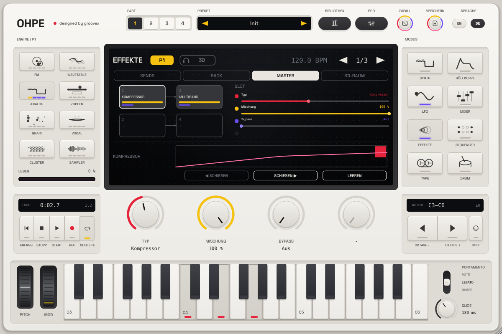

## 3D-Raum-Ansicht (1.0)

Der vierte Reiter des **Effekte**-Modus, **3D-Raum**, bearbeitet die [3D-Stufe](RAUM.md) des Edit-Parts:
Ein/Aus, Bewegungspfad, -länge und -tempo auf der ersten Seite, danach Position (Azimut, Elevation,
Entfernung, Quellenbreite), Form der Bewegung, Raum, Luft und Entfernung und auf der letzten Seite das
globale **3D-Abhöre** (Kopfhörer / Lautsprecher) und die **Mono-Prüfung**. Statt der Effektkette
zeigt das Display die kopfbezogene 3D-Ansicht aller vier Parts, mit dem Bewegungspfad des Edit-Parts als
gepunktete Kurve vor seinem Punkt und seinem Namen unten links; der Streifen darunter fasst Bewegung
und Abhöre zusammen. Die Rack-Softkeys (Schieben, Leeren) gehören nur zu den Reitern **Rack** und
**Master**.

Das **3D-Abzeichen** im Display-Kopf (Kopfhörer-Piktogramm + „3D“) leuchtet ultraviolett und pulsiert
sanft, solange der Edit-Part binaurales 3D spielt; steht die Abhöre auf Lautsprecher, ist es gelb umrandet
und zeigt zwei Lautsprecher, sonst ist es schwach. Ein Klick springt in diese Ansicht; der Tooltip
sagt *Binaurales 3D – am besten mit Kopfhörern*. Die Part-Auswahl zeigt dasselbe Piktogramm je Part,
die Bibliothek hinter dem Namen jedes Presets mit dem Schlagwort **3D**.

## Körper-Ansicht (p19)

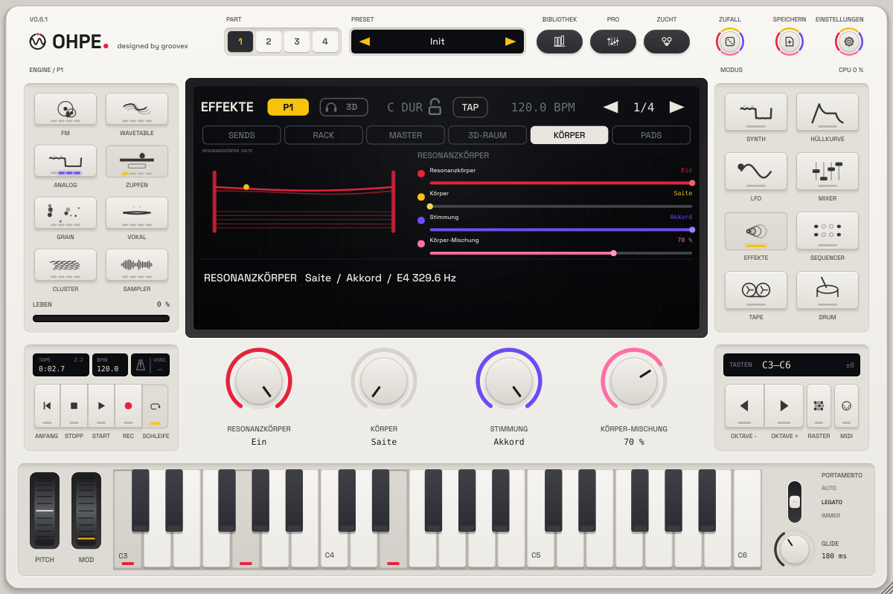

Der fünfte Reiter des **Effekte**-Modus, **Körper**, bearbeitet den [Resonanzkörper](RESONANZKOERPER.md) des
Edit-Parts: Ein/Aus, Körpermodell, Stimmung (Fest / Note / Akkord) und Mischung auf der ersten Seite, danach Stimmung,
Größe, Material und Ausklang, dann Position, Inharmonizität, Resonanzsaiten und Breite und auf der letzten Seite Drive
und die MPE-Mengen (Druck, Slide). Das Display zeichnet den Körper – das Saitenpaar mit seinen Resonanzsaiten, die
Platte mit ihrem bewegten Modenmuster oder die Bohrung mit ihrer stehenden Welle – mit dem Anregungspunkt als gelbem
Punkt; der Streifen darunter nennt Modell, Stimmung und die Tonhöhe, der der Körper folgt. Ein *Resonanzkörper*-Slot
im Rack zeigt denselben Körper in der Rack-Ansicht.

## Morph-Ansicht (p16)

Der dritte Reiter des **LFO**-Modus, **Morph**, zeigt das [Morph-Pad](MORPH-RAUM.md) des Edit-Parts: vier
Ecken-Schilder (A oben links, B oben rechts, C unten links, D unten rechts) in den Farben der Regler, das Pad mit der
geglätteten Position, ein weiches Leuchten aus jeder Ecke, so stark wie ihr Anteil, und die Kanten zwischen den Ecken
– durchgezogen, wo zwei Ecken ihre Parameter morphen (ein Klang), gepunktet, wo sie als parallele Klänge überblendet
werden (andere Engine oder anderer Effekt). Die Leiste darunter sagt, was das Pad gerade tut (ein Klang oder wie
viele Klänge parallel spielen).

| Aktion | Ergebnis |
|---|---|
| Auf dem Pad ziehen | bewegt die Position (X, Y); Rechtsklick = MIDI-Lernen |
| Ecken-Schild anklicken oder **A … D** (Softkeys) | Menü: **Aktueller Klang**, **Preset ▸** (jedes Part-Preset der Bibliothek), **Ecke leeren**, **Alle Ecken leeren** |
| Regler, Seite *Morph* | Morph ein, X, Y, Gleiten |
| Regler, Seite *Steuerung* | X- / Y-Steuerung (Aus, Druck, Slide, Modulationsrad), MPE, Ausdrucks-Glättung |

Wer eine Ecke belegt, schaltet den Morph ein. Eine leere Ecke steht für den eigenen Klang des Parts.

## Bewegungs-Ansicht (p22)

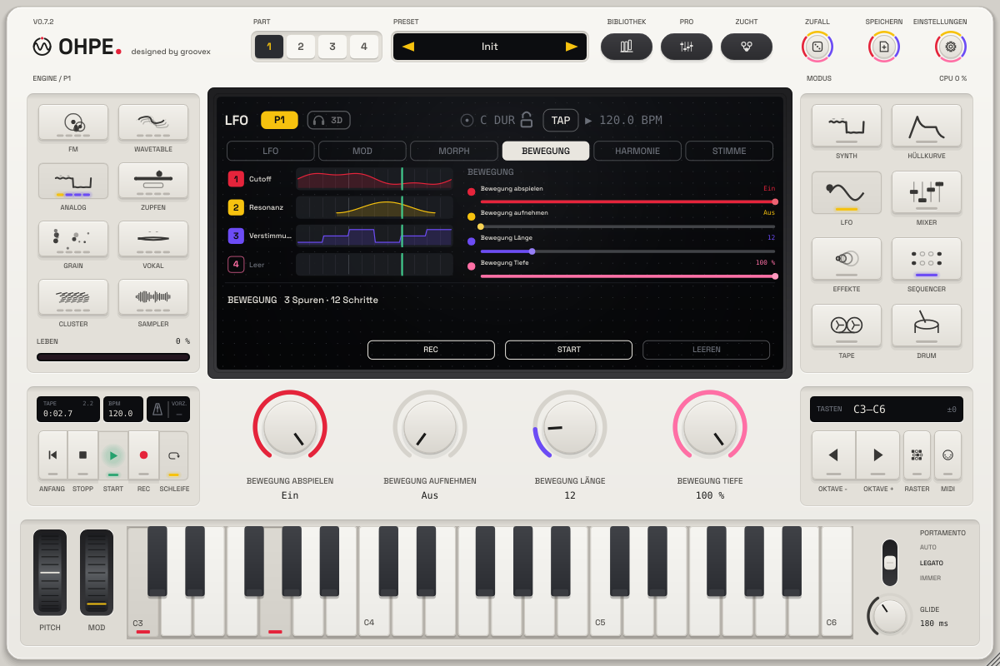

Der vierte Reiter des **LFO**-Modus, **Bewegung**, zeigt den [Bewegungs-Recorder](BEWEGUNG.md) des Edit-Parts: vier
Spur-Zeilen mit den aufgenommenen Reglerbewegungen in den Farben der Regler über einem Sechzehntel-Raster der
Schleife und den Abspielkopf – grün beim Abspielen, rot bei der Aufnahme. Eine gerade berührte Spur hat einen
atmenden roten Rand; die Leiste darunter sagt, was der Recorder gerade tut.

| Aktion | Ergebnis |
|---|---|
| **Rec** (Softkey) | aufnehmen: Bei laufendem Transport bekommen die Regler des Parts, die du berührst, Spuren (bis zu vier) |
| **Start** (Softkey) | die Spuren als Schleife mit dem Transport abspielen |
| **Leeren** (Softkey) | die Spuren des Parts leeren |
| Regler, Seite *Bewegung* | Start, Rec, Länge (1 – 64 Sechzehntel, polymetrisch), Tiefe |

Die Spuren sind auch die Matrix-Quellen **Bewegung 1 … 4**.

## Pads-Ansicht (p25)

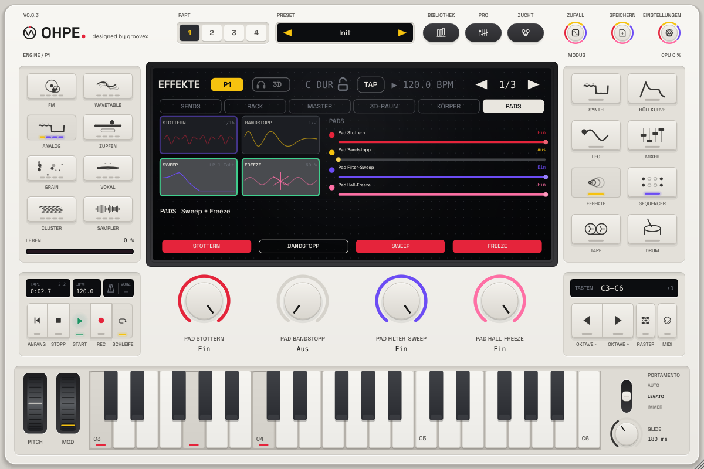

Der sechste Reiter des **Effekte**-Modus, **Pads**, enthält die vier [Performance-Pads](PERFORMANCE-PADS.md) – Effekt-Würfe
auf die Hauptsumme für Live-Sets: **Stottern**, **Bandstopp**, **Sweep** und **Freeze**. Jedes Pad zeigt ein kleines
Bild dessen, was es tut, und seine wichtigste Einstellung; ein Pad, das auf seine Rasterlinie wartet, blinkt violett,
ein aktives Pad leuchtet grün, eine ausklingende Freeze-Fahne bleibt gedimmt grün. Die Leiste darunter sagt, welche
Pads spielen.

| Aktion | Ergebnis |
|---|---|
| Pad drücken und halten | das Pad spielt, solange es gehalten wird (setzt auf der nächsten Linie der *Quantisierung* ein) |
| Umschalt-Klick auf ein Pad / Softkey | rastet das Pad ein oder aus |
| Rechtsklick auf ein Pad | MIDI-Lernen (ein Pad auf einen Taster-CC legen) |
| Regler, Seite *Pads* | die vier Pads (drehen = an / aus) |
| Regler, Seite *Pad-Timing* | Quantisierung (Aus, 1/16 … 1 Takt), Stotter-Länge, Bandstopp-Dauer, Sweep-Dauer |
| Regler, Seite *Sweep & Freeze* | Sweep-Filter (Tiefpass / Hochpass), Sweep-Resonanz, Freeze-Pegel |

Die Pads sind auch die Matrix-Quellen **Pad-Sweep** und **Pads gehalten**.

## Harmonie-Ansicht (p24)

Der fünfte Reiter des **LFO**-Modus, **Harmonie**, zeigt das [Harmonie-Hirn](HARMONIE.md): die gemerkte Tonart und den
Akkord, zwölf Balken für das Tonklassen-Gedächtnis (Tonart-Töne hell, Akkordtöne violett, gehaltene Töne grün, der
Grundton der Tonart gelb markiert) und die letzten acht Akkorde. Die Leiste sagt, was das Hirn tut und ob der
Edit-Part folgt.

| Aktion | Ergebnis |
|---|---|
| **Tonart übernehmen** (Softkey) | die gemerkte Tonart in die globale Tonart / Skala schreiben |
| **Halten** (Softkey) | das Gedächtnis einfrieren |
| **Vergessen** (Softkey) | Tonart, Akkord und Verlauf vergessen |
| Regler, Seite *Harmonie* | Folgen (Edit-Part: Aus / Skala / Akkord / Grundton), Gedächtnis (Takte), Halten, Raster-Anordnung |

Die Taste **RASTER** (zwischen OKTAVE + und MIDI) tauscht die Klaviertasten gegen die isomorphe Raster-Tastatur:
4 × 24 Felder in Quarten, Terzen, Ganztönen oder nur den Tönen der Tonart; Akkordtöne tragen einen violetten Balken.
Mit MPE für den Edit-Part hat jede Berührung ihren eigenen Kanal – seitlich schieben biegt, hoch / runter für Slide,
Druck von Touch oder Stift. Jeder Akkord hat in jeder Tonart dieselbe Form; das sagt auch der Tooltip der Taste,
und beim ersten Einschalten in einem Projekt zeigt die Tastatur-Anzeige ein paar Sekunden lang „Gleiche
Akkordform in jeder Tonart“ (p47).

## Updates (p27)

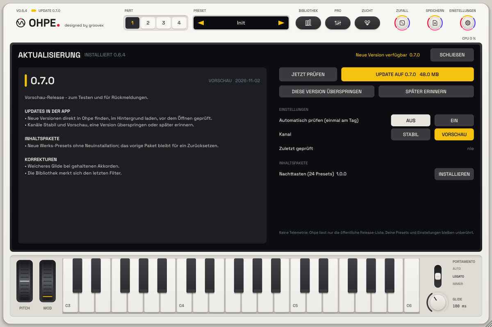

Ein Klick auf die **Versionsbeschriftung** über dem Schriftzug (oder den Schriftzug) öffnet die Update-Ansicht, wenn ein
Update angeboten wird, sonst die Seite **Über** der Einstellungen (p32). Ein
kleiner gelber Leuchtbalken und `UPDATE x.y.z` neben der Version zeigen, dass eine neuere Version angeboten wird. Die
Ansicht zeigt ihre Release-Hinweise in der UI-Sprache, **JETZT PRÜFEN**, **UPDATE** (Download im Hintergrund mit
violettem Fortschrittsbalken, **ABBRECHEN**), **INSTALLIEREN** nach der SHA-256-Prüfung, **DIESE VERSION ÜBERSPRINGEN**,
**SPÄTER ERINNERN**, die Einstellungen (tägliche automatische Prüfung – aus, bis eingeschaltet, nie während der
Wiedergabe –, Kanal Stabil / Vorschau), Inhaltspakete und **VORIGE VERSION**. Einzelheiten:
[Aktualisierung](AKTUALISIERUNG.md).

## Einstellungen (p32)

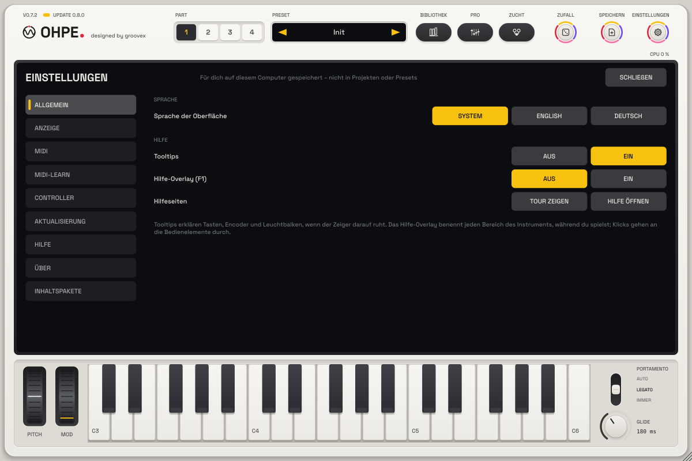

Die **Zahnrad-Taste** rechts in der Kopfzeile öffnet die Einstellungen (die Sprachumschaltung ist hierher umgezogen). Sie
werden für dich auf diesem Computer gespeichert – nicht in Projekten oder Presets – und gelten für jedes geöffnete Ohpe:
**Allgemein** (Sprache, Tooltips, Hilfe-Overlay, Hilfeseiten), **Anzeige** (Erscheinung hell / dunkel / auto,
Display-Helligkeit, Animationen, Fenstergröße), **MIDI** (Kanal, MPE und Bend-Bereiche der vier Parts, MIDI-Eingänge,
Clock und Sync), **MIDI-Learn** (alle Zuweisungen: bearbeiten, löschen, alle löschen, Map-Dateien), **Updates**,
**Hilfe** und **Über**. **F1** schaltet das Hilfe-Overlay ein und aus.

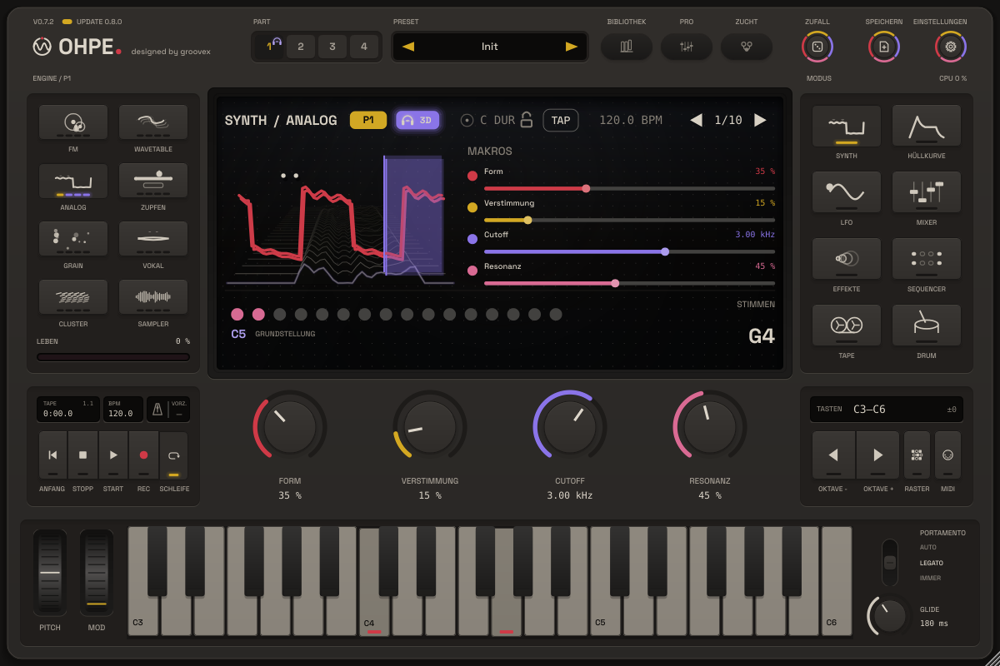

Einzelheiten: [Einstellungen](EINSTELLUNGEN.md).

## Inhaltspakete

`.ohpepack`-Dateien bringen Preset-Pakete: **PAKET INSTALLIEREN …** (Einstellungen › Aktualisierung, Einstellungen ›
Inhaltspakete, das Menü **PAKETE** der Bibliothek) oder die Datei auf das Fenster ziehen. Der Chip **PAKETE** der
Bibliothek filtert nach einem installierten Paket; Paket-Presets tragen ein **P**. Einzelheiten:
[Inhaltspakete](INHALTSPAKETE.md).

## CPU-Anzeige (p35)

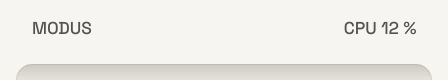

`CPU 12 %` auf der Beschriftungszeile der Modus-Spalte (rechts, neben MODUS) zeigt, wie viel der Zeit jedes
Audioblocks Ohpe braucht, um seinen Klang zu berechnen – gemittelt über etwa eine halbe Sekunde; 100 % wäre die ganze
Zeit (der Ton würde aussetzen). Der Tooltip nennt zusätzlich den langsamsten Block der letzten zwei Sekunden. Die
Beschriftung wird rot ab 80 % im Mittel oder wenn ein Block länger als seine eigene Zeit brauchte. Es ist nur eine
Anzeige (kein Parameter, wird nicht gespeichert). Parts, die einige Sekunden still waren, schlafen und kosten fast
nichts, bis sie wieder spielen. Einzelheiten: [Leistung](LEISTUNG.md).

## Tasten

| Taste | Aktion |
|---|---|
| Esc | schließt die Bibliothek (Abbrechen), die Profiansicht, die Update-Ansicht oder die Einstellungen oder beendet das Schritt-Bearbeiten |
| F1 | Hilfe-Overlay ein / aus |
| Leertaste (Standalone) | START / Stopp |
| R (Standalone) | REC: aufs Band aufnehmen / aussteigen |
| Enter oder Pos1 (Standalone) | Band zum Anfang |
| L (Standalone) | Band-Schleife an / aus |
| I / O (Standalone) | Loop-Start / Loop-Ende am Abspielkopf (im Raster; mit Shift: frei) |
| T (Standalone) | Tempo tippen |
| K (Standalone) | Metronom (Klick) an / aus |
| Enter (Bibliothek) | gewähltes Preset behalten und schließen |
| ↑ / ↓ (Bibliothek) | voriges / nächstes Preset der Liste |

Siehe auch: [Preset-Bibliothek](PRESETS.md) · [Sequencer](SEQUENZER.md) · [Band, Mixer und FX](BAND-MISCHER-FX.md) · [MIDI](MIDI.md).
