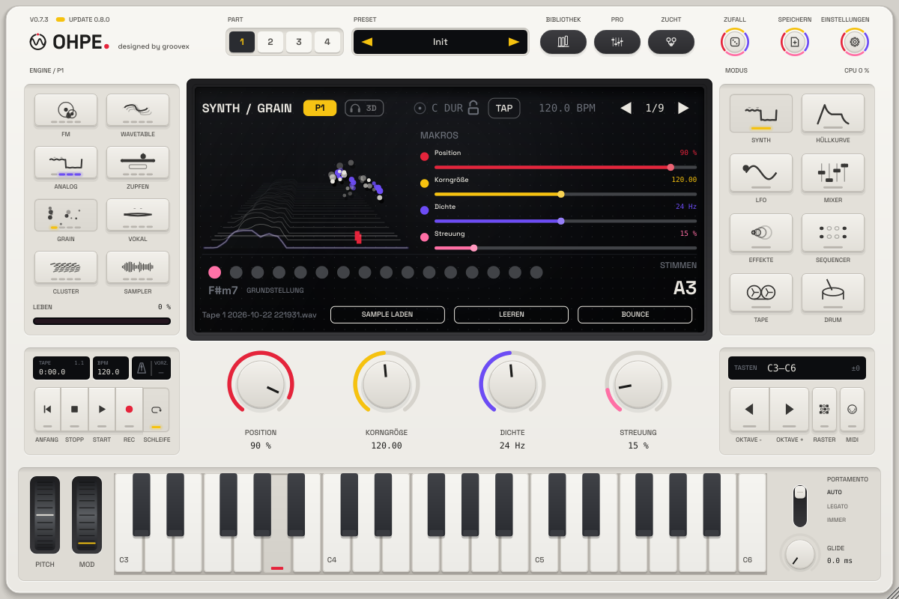

# Bounce ins Instrument

*Deutsch · English: [../en/BOUNCE.md](../en/BOUNCE.md)*

**Bounce** bringt Audio vom Tape oder vom Live-Eingang mit einem Knopf in die **Grain**- oder **Sampler**-Engine eines
Parts – eine Session resamplen, eine aufgenommene Phrase zum spielbaren Instrument machen oder ein paar Takte Gitarre
zu einer Granular-Fläche einfrieren. Standardmäßig wird der Bounce zur **Endlosschleife**: Sein Ende geht ohne Knacken
in den Anfang über, eine gehaltene Taste hält ihn beliebig lange.

## Ein Knopf

| Wo | Was passiert |
|---|---|
| **BOUNCE** auf der Tape-Seite (Softkey) | bounct sofort mit den Bounce-Einstellungen (Standard: die Bearbeitungsspur in die Grain-Engine des bearbeiteten Parts, Endlosschleife). Während der Eingang aufnimmt, leuchtet die Taste; ein zweiter Druck beendet die Aufnahme vorzeitig |
| **BOUNCE** auf der Grain- / Sampler-Seite | ein Menü: *Bearbeitungsspur*, *Tape 1 … 8* (leere Spuren grau), *Tape-Mix*, *Eingang (n Takte)*, die Eingangslänge und *Endlosschleife*. Die gewählte Quelle wird in die angezeigte Engine gebounct |
| MIDI / Automation: `bounce.go` | bounct mit den Bounce-Einstellungen in den bearbeiteten Part (MIDI-Lernen im MIDI-Menü, *Fernsteuerung*) |

Der Part wechselt auf die Ziel-Engine, der Bounce ersetzt ihr Sample (die Wahl des Werksinstruments bleibt und kommt
zurück, wenn das Sample gelöscht wird), und das Display meldet das Ergebnis, z. B. *In Grain gebounct: Tape 2 · 4.0 s ·
Endlosschleife*. Rückgängig ist einfach: **Leeren** auf der Engine-Seite holt den eingebauten Klang zurück, oder ein
anderes Sample laden.

## Quellen

| Quelle | Material |
|---|---|
| **Bearbeitungsspur** | die Bearbeitungsspur der Tape-Seite (*Spur* / `tape.edit.track`) |
| **Tape 1 … 8** | eine Spur |
| **Tape-Mix** | alle acht Spuren summiert (rohes Spur-Audio, vor dem Mischer) |
| **Eingang** | nimmt 1, 2, 4 oder 8 Takte vom Audioeingang im aktuellen Tempo auf (höchstens 60 s) und bounct dann |

Vom Tape nimmt ein Bounce den **bespielten Teil der Spur** (vom Anfang bis zum letzten Klang) – oder, solange die
Tape-**Schleife** an ist, genau den **Schleifenbereich** (*Loop In* … *Loop Out*). So kommt man am schnellsten zu einer
taktgenauen Endlosschleife: eine Schleife von ein oder zwei Takten setzen, Schleife einschalten, BOUNCE drücken.
Höchstens 60 Sekunden werden gebounct.

Der Live-Eingang braucht einen eingeschalteten Audioeingang (Standalone: *Audio-Einstellungen*; Plug-in: das
Eingangs-Routing des Hosts); bei Stille wird nichts gebounct, das Display sagt es.

## Endlosschleife oder One-Shot

| Modus (`bounce.loop`) | Vorbereitung | Grain | Sampler |
|---|---|---|---|
| **Endlosschleife** (Standard) | die letzten 50 ms (höchstens ein Viertel) werden mit gleicher Leistung in die ersten 50 ms überblendet und entfernt, das letzte Sample geht in das erste über. Normalisiert auf -1 dBFS | die Körner laufen über die Naht hinweg: Position, Scan und Streuung kreisen ohne Ende durch die Schleife | Vorwärts-Schleife über den ganzen Bounce (*Schleife* = Vorwärts, *Start* 0): eine gehaltene Note hält die Schleife, so lange die Taste gedrückt ist |
| **One-Shot** | Stille an beiden Enden entfernt, 3 ms Blenden, normalisiert auf -1 dBFS (höchstens +24 dB) | die Körner bleiben im Sample (wie bei jeder geladenen Datei) | keine Schleife: der Bounce spielt einmal |

Im Sampler spielt **C4** den Bounce in Originaltonhöhe und -tempo, andere Tasten transponieren ihn. In der
Grain-Engine transponiert die Note die Körner genauso um C4 herum.

## Wo die Bounces landen

Jeder Bounce wird als 24-Bit-WAV in der Bounce-Bibliothek gespeichert:

| System | Ordner |
|---|---|
| macOS | `~/Library/Application Support/groovex/Ohpe/Bounces` |
| Windows | `%APPDATA%\groovex\Ohpe\Bounces` |
| Linux | `~/.config/groovex/Ohpe/Bounces` |

Die Umgebungsvariable `OHPE_BOUNCE_DIR` ersetzt den Ordner. Dateinamen sind Quelle und Uhrzeit
(`Tape 2 2026-10-17 141502.wav`). Die Engines merken sich den Pfad, Session und Projekt-Presets laden den Bounce wie
jedes geladene Sample wieder. Eine Endlosschleife trägt einen Sample-Loop-Chunk: Ohpe erkennt ihn beim erneuten Laden
(auch über **Sample laden**), und andere Sampler können sie ebenfalls schleifen. Ist der Ordner nicht beschreibbar,
spielt der Bounce trotzdem – nur für diese Sitzung, das sagt die Meldung.

## Parameter

Angehängt nach den Zucht-Triggern (`lib.breed.next`), 5 IDs, nicht Teil von Presets. Siehe
[PARAMETERS.md](../PARAMETERS.md#bounce-to-engine-p23).

| ID | Name | Werte |
|---|---|---|
| `bounce.src` | Bounce-Quelle | Bearbeitungsspur, Tape 1 … 8, Tape-Mix, Eingang |
| `bounce.to` | Bounce-Ziel | Grain, Sampler |
| `bounce.loop` | Endlosschleife | an / aus (Standard an) |
| `bounce.len` | Eingangslänge | 1, 2, 4, 8 Takte (Standard 4) |
| `bounce.go` | Bounce | Trigger |

Die Einstellungen liegen auf der fünften Encoder-Seite der Tape-Seite (**Bounce**) und in der Profi-Ansicht des
Tape-Modus. Bouncen ist eine einmalige Aktion und hat deshalb keine Ziele in der Modulationsmatrix; das gebouncte
Material wird über die Ziele der Engines moduliert (Korn-Position, Scan, Sampler-Start …).
