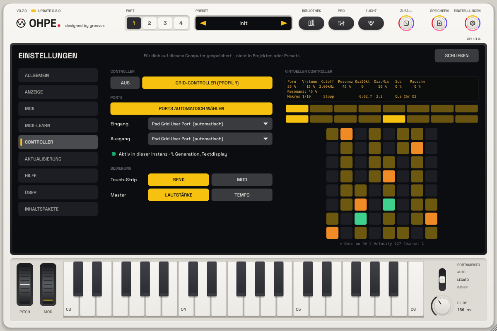
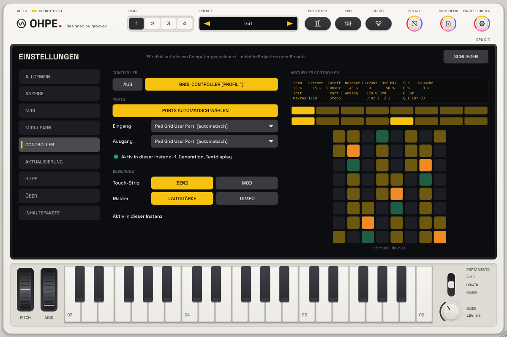

# Grid-Controller (Profil 1)

Ohpe (die Standalone-App und seit p49 das Plug-in) lässt sich mit einem externen **8 × 8-Pad-Raster-Controller mit vierzeiligem
Zeichendisplay** spielen und bedienen: 64 Pads mit Anschlag und Druck, 8 berührungsempfindliche Drehregler und ein
Master-Regler, zwei Reihen mit je 8 Tasten unter dem Display, Transport- und Navigationstasten und ein Touch-Strip.
In Ohpe heißt er **Grid-Controller (Profil 1)**.

Die Pads spielen genau wie die [Raster-Tastatur](HARMONIE.md#die-raster-tastatur) auf dem Bildschirm: dieselben
Anordnungen, dieselben Töne, dieselben Farben für Grundton und Tonart-Töne – was du am einen lernst, gilt am anderen.



## Einrichten

**Meist nichts zu tun.** Seit 0.6.3 ist das Profil **ab Werk an, mit automatischen Ports**: Controller anstecken und
Ohpe starten (Standalone-App, oder das Fenster des Plug-ins öffnen). Ohpe findet den *User-Port* des Controllers
(Eingang **und** Ausgang desselben Geräts), schaltet den Controller selbst in seinen **User-Modus** (die *User*-Taste
muss nicht gedrückt werden), zeigt kurz **OHPE · verbindet ...** und dann **verbunden** auf seinem Display (englische
Oberfläche: *connecting ...* / *connected*) und danach das normale Ohpe-Display. Später angesteckt? Ohpe verbindet
sich innerhalb einer Sekunde. Beendet sich Ohpe, wird das Profil ausgeschaltet oder die Instanz entfernt, löscht es
Display und Lichter und gibt den Controller an seinen eigenen Modus zurück.

**Einstellungen > Controller** (eigene Seite):

- **Aus** / **Grid-Controller (Profil 1)**.
- **Ports**: **Ports automatisch wählen** (ab Werk an), dann je ein Menü für **Eingang** und **Ausgang** mit den
  vollen Portnamen. Ein Port im Menü schaltet die Automatik aus (die andere Seite behält den Port, der gerade benutzt
  wird); die Automatik im Menü schaltet sie wieder ein.
- Die **Statuszeile**: **Verbunden · 1. Generation, Textdisplay** (oder *neuere Generation, ohne Textdisplay*),
  **Gerät wird geprüft …**, **Nicht gefunden**, **Port belegt (anderes Programm)** (Standalone) /
  **Port belegt – in der DAW freigeben** (Plug-in), **Wartet auf den Controller**.
- **Bedienung**: **Touch-Strip** Bend / Mod; **Master**-Regler Lautstärke / Tempo.
- Der **virtuelle Controller**, groß rechts: die vier Displayzeilen, die zwei Tastenreihen unter dem Display und die
  64 Pads in den Farben des Controllers, live – gedrückte Pads leuchten grün, Modus- und Part-Tasten leuchten wie am
  Gerät. Er geht auch mit der Maus: Pad anklicken spielt es, Taste anklicken, Mausrad über einem Achtel des Displays
  dreht den Regler darunter. Er folgt den Pads auch, wenn kein Ausgang verbunden ist.

**Wie der Controller gefunden wird.** Portnamen, die zum Muster `User; MIDIIN2; MIDIOUT2` passen (irgendein Teil,
Groß-/Kleinschreibung egal; änderbar als `"pattern"` unter `"controller"` in `settings.json`), sind Kandidaten;
Eingang und Ausgang desselben Geräts werden gepaart (unter macOS / Linux sein *… User Port*, unter Windows
*MIDIIN2 (…)* / *MIDIOUT2 (…)*). Ohpe schickt eine Standard-Identitätsanfrage: die Antwort nennt die **Generation**
des Controllers. Ein Gerät, das neben dem User-Port auch seinen *Live-Port* hat, verbindet sich sofort; ein anderes
passendes Gerät muss sich innerhalb von zwei Sekunden als Controller melden, sonst lässt Ohpe es in Ruhe und
probiert den nächsten Kandidaten.

**Generationen.** Die erste Generation hat das vierzeilige Zeichendisplay, das über MIDI beschrieben wird – Ohpe
nutzt es ganz. Eine neuere Generation (Pixel-Display über USB) bekommt Pads, Tasten, Regler, Berührung und Lichter,
aber keinen Text auf ihrem Display (ihre Pad-Farben können abweichen).

Die Einstellungen werden je Benutzer in `settings.json` gespeichert (nie in Projekten oder Presets). Ohpe schaltet
die Ports des Controllers (User- und Live-Port) in der normalen Liste der MIDI-Eingänge aus, solange es sie hält –
so spielen die Pads nicht doppelt und die Berührungs-Noten von Reglern und Strip erreichen den Klang nie als Noten –
und schaltet sie wieder ein, wenn es loslässt.

## Im Plug-in

Seit p49 arbeitet der Controller auch im **Plug-in** (VST3 / AU in einer DAW). Der Controller hat zwei Modi: im
üblichen Modus spricht er mit der DAW; im **User-Modus** (die *User*-Taste des Controllers) überlässt er Pads,
Display und Lichter dem Programm, das seinen *User-Port* öffnet. Ohpe öffnet diesen Port selbst – am Host vorbei –
mit vollem Display, Pad-Farben, Druck, Reglern (mit Berührung), Touch-Strip und Tasten, genau wie in der Standalone-App.



1. **In der DAW**: in den MIDI-Einstellungen den *User-Port* des Controllers (oft *… User Port*, unter Windows
   *MIDIIN2 (…)* / *MIDIOUT2 (…)*) für **Spuren und Fernsteuerung ausschalten** (Eingang und Ausgang), damit die DAW
   ihn freigibt und die Pads nicht doppelt spielen. Den Haupt-Port des Controllers so lassen.
2. **In Ohpe**: nichts (**Einstellungen > Controller**: Profil und automatische Ports sind ab Werk an; Ports in den
   Menüs wählen, um sie selbst zu bestimmen).
3. Ohpe schaltet den Controller selbst in seinen **User-Modus**. Die Seite zeigt **Aktiv in dieser Instanz**, sobald
   beide Ports offen sind.

**Eine Instanz zur Zeit.** Nur ein Ohpe der DAW kann den Controller halten: das, dessen Fenster du **zuletzt geöffnet
oder angeklickt** hast. Die anderen zeigen **In anderer Instanz aktiv** und einen Knopf **Hierher holen**; wird die
haltende Instanz entfernt, übernimmt die nächste. Die haltende Instanz behält den Controller, während ihr Fenster
**geschlossen** ist (die Regler behalten die letzte Seite, Part-, Modus- und Transport-Tasten wirken). Nach dem Laden
eines Projekts das Fenster der gewünschten Instanz einmal öffnen – bis dahin hält keine Instanz den Controller.

**Port belegt.** Unter Windows kann ein MIDI-Port nur in einem Programm offen sein. Hält die DAW den User-Port noch,
zeigt die Überschrift **Port belegt – in der DAW freigeben**; den Port in den MIDI-Einstellungen der DAW freigeben –
Ohpe versucht es jede Sekunde erneut und verbindet sich auch neu, wenn der Controller ab- und wieder angesteckt wird.
MIDI vom Host wirkt weiter parallel. Instanz schließen oder Profil ausschalten löscht Display und Lichter.

## Display

| Zeile | Zeigt |
|---|---|
| 1 | Namen der Parameter auf den 8 Reglern (je zwei über einem Display-Segment) |
| 2 | ihre Werte |
| 3 | Preset · Part und Engine · Tempo · Tonart (mit **Lock** bei Scale Lock) – solange ein Regler berührt wird: sein voller Name und Wert |
| 4 | Seite (z. B. *Filter 2/5*; *Volume*, *Pan & Send*, *Bibliothek*) · Transport (Start / Stopp / REC / Vorzähler, *Klick* mit Metronom) · Bandposition · Tasten / Steps: Raster-Anordnung, Nur Tonart / Chromatisch, C fest und Oktave (z. B. `Qua Ton Fest O3`: Quarten, Nur Tonart, C fest, Oktave 3; `Seq Chr O3`), andere Pad-Modi: ihr Name |

Umlaute stehen als ae / oe / ue da (das Display kennt keine Umlaute).

## Regler

* **Regler 1 – 8**: die Parameter der gezeigten Seite und der nächsten – Regler 1 – 4 sind die vier Bildschirm-Regler,
  5 – 8 die Seite danach (in der Reihenfolge der Seiten auf dem Bildschirm). **Select** (oder Shift) halten = feine
  Schritte.
* **Master-Regler**: Gesamtlautstärke; die Taste **Master** schaltet ihn aufs Tempo um.
* **Tempo-Regler**: Tempo (1 BPM je Schritt, Shift / Select 0,1).

## Pads

Die zweite Tastenreihe, Tasten 5 – 8 (oder **Note** / **Session**), wählt den Pad-Modus:

| Modus | Pads |
|---|---|
| **Tasten** | die Raster-Tastatur des Bildschirms auf 8 × 8 Pads |
| **Pads** | die vier Performance-Pads (Stottern, Bandstopp, Sweep, Freeze) – je ein 4 × 4-Viertel, gehalten = an |
| **Drum** | die 24 Drum-Pads auf den drei unteren Reihen |
| **Steps** | Schritte 1 – 16 des Step-Sequenzers auf den beiden oberen Reihen (oben 1 – 8); die sechs Reihen darunter spielen wie Tasten |

### Tasten – die Raster-Tastatur auf den Pads

* **Dieselbe Anordnung** wie *Raster-Anordnung* (`harmony.kb.layout`): **Quarten** (rechts +1, hoch +5), **Terzen**
  (+1 / +4), **Ganztöne** (+2 / +5) oder **Sequenziell** (+1 / +8, fortlaufende Reihen), jeweils **Nur Tonart**
  (Skalenstufen, nur Tonart-Töne) oder **Chromatisch** (`harmony.kb.inkey`), das Pad unten links auf dem Grundton der
  Tonart oder auf C (**C fest**, `harmony.kb.fixed`) – siehe [Harmonie](HARMONIE.md#die-vier-anordnungen). **Scales
  kurz drücken** schaltet die Anordnungen weiter; **Scales halten** zeigt die Raster-Optionen im Display, die obere
  Tastenreihe wählt sie (unten). Seit p53 folgen die Pads der Bildschirm-Tastatur: solange die
  **Raster-Tastatur** gezeigt wird (Taste RASTER), übernehmen sie ihre Anordnung, Grundton, Skala und Farben; bei den
  **Klaviertasten** gilt die Standard-Anordnung (Quarten). Scales bei gezeigten Klaviertasten schaltet zuerst den
  Bildschirm auf die Raster-Tastatur, dann ihre Anordnung weiter – Bildschirm und Pads zeigen immer dasselbe.
  Gehaltene Töne in beide Richtungen: ein gehaltenes Pad drückt sein Feld auf dem Bildschirm, ein auf dem Bildschirm
  geklicktes Feld lässt seine Pads grün leuchten.
* **Dieselbe Zuordnung**: Pad (Spalte, Reihe) spielt den Ton des Bildschirm-Felds in derselben Spalte und Reihe, ab
  demselben tiefsten C. Die vier unteren Pad-Reihen sind genau die vier Reihen des Bildschirm-Rasters; die oberen vier
  setzen es fort.
* **Dieselbe Tonart**: die Tonart, die das Raster zeigt (die gemerkte Tonart – bis etwas gehört wurde die eingestellte).
  Mit **Scale Lock** (Shift + Scales) bleiben die anderen Töne bei Chromatisch dunkel und stumm; Nur Tonart hat ohnehin
  nur Tonart-Töne.
* **Farben**: Grundton der Tonart **bernstein**, Tonart-Töne **gelb (gedimmt)**, Töne des gemerkten Akkords **grün
  (gedimmt)**, gehaltene Pads **grün**, andere Töne dunkel (auf dem Bildschirm graphit).
* **Oktave − / +** verschiebt Pads, Bildschirm-Klaviatur und Bildschirm-Raster gemeinsam (das Pad unten links ist der
  Grundton der Tonart in dieser Oktave, mit C fest ihr C).
* **Anschlag und Druck** spielen den **Edit-Part**. Ist für ihn MPE an, bekommt jedes Pad seinen eigenen
  Mitgliedskanal und der Druck gehört zu dieser Note; ohne MPE laufen die Noten durch Skala, Akkord und Folgen, der
  Druck geht als polyphoner Aftertouch an den Part.

### Scales gehalten – die Raster-Optionen

Solange **Scales** gehalten wird, zeigt das Display die Optionen über der oberen Tastenreihe, und die acht oberen
Tasten wählen:

| Obere Taste | Wählt | Licht |
|---|---|---|
| 1 – 4 | Anordnung Quarten / Terzen / Ganztöne / Sequenziell | die gewählte gelb, die anderen gelb gedimmt |
| 5 | Nur Tonart ↔ Chromatisch | grün = Nur Tonart |
| 6 | C fest ↔ Grundton unten links | grün = C fest |
| 7 | Grundton der Tonart + 1 Halbton (Shift: − 1) | bernstein |
| 8 | nächste Skala (Shift: vorige) | bernstein |

```
  Quarten  Terzen  Ganzton  Sequenz   Toene    Unten   Grundt.   Skala
    [x]                              Tonart   Grundt.    C       Dur
Raster: Quarten - nur Tonart - unten links Grundton
Scales halten + obere Tasten waehlen (Shift: Grundton / Skala zurueck)
```

Scales loslassen, ohne etwas zu wählen, schaltet zur nächsten Anordnung (kurz drücken).

## Tasten

| Taste | Wirkung |
|---|---|
| erste Reihe unter dem Display | die acht Modus-Tasten in der Reihenfolge des Bildschirms, Synth bis Drum (leuchten wie die Bildschirm-Tasten) |
| zweite Reihe 1 – 4 | Parts 1 – 4 |
| zweite Reihe 5 – 8 | Pad-Modus Tasten / Pads / Drum / Steps |
| ◀ / ▶ | Seite − / + |
| ▲ / ▼ | voriges / nächstes Preset (im Bibliotheks-Modus: voriges / nächstes der Liste, sofort geladen) |
| Oktave − / + | Oktave von Klaviatur, Raster und Pads |
| Play | Start / Stopp (Shift: Band Start / Stopp) |
| Record | Aufnahme (Shift: Edit-Spur scharf schalten) |
| Stop | Stopp (Shift: zum Anfang) |
| Repeat | Band-Schleife an / aus |
| Metronome | Metronom an / aus (Shift: Vorzähler Aus / 1 Takt / 2 Takte) |
| Tap Tempo | Tempo tippen |
| Undo | Band-Rückgängig (Shift: Wiederholen) |
| Scales | kurz: nächste Raster-Anordnung; halten: Raster-Optionen auf der oberen Reihe (oben); Shift: Scale Lock – leuchtet bei Scale Lock, blinkt, solange gehalten |
| Master | Master-Regler: Lautstärke ↔ Tempo |
| Shift / Select | Umschalter (Select: feine Regler-Schritte) |
| Mute | allein: Mischerkanal des Edit-Parts stumm; gehalten + Part-Taste 1 – 4: dieser Part – leuchtet, wenn ein Part stumm ist; die Part-Tasten zeigen beim Halten Stumm rot |
| Solo | dasselbe für Solo (Part-Tasten beim Halten bernstein) |
| Volume | Regler 1 – 4 = Lautstärke der Parts 1 – 4, 5 – 8 = ihr Panorama (noch einmal: zurück zur Seite) – leuchtet, solange an |
| Pan & Send | Regler 1 – 4 = Send A der Parts 1 – 4, 5 – 8 = Send B – leuchtet, solange an |
| Device | öffnet / schließt den FX-Editor (wechselt dafür zu den Effekt-Racks; im Bibliotheks-Modus: verlässt ihn) – leuchtet, solange offen |
| Browse | Bibliotheks-Modus an / aus – die Preset-Bibliothek im Display (unten) – leuchtet, solange an |
| Track | Modus Mischer – leuchtet dort |
| Clip | Modus Band – leuchtet dort |
| Accent | feste volle Anschlagstärke (127) für alle Pads an / aus – leuchtet, solange an |
| Quantize | Skala-Quantisierung des Edit-Parts an / aus (`pN.quant`) – leuchtet, solange an |
| Duplicate | kopiert das Step-Pattern ins nächste Pattern, das dann bearbeitet wird und spielt |
| Double | verdoppelt die Länge des Step-Patterns, die Schritte werden in die neue Hälfte kopiert (bis 64) |
| Delete | gehalten + ein Schritt-Pad (Modus Steps) = diesen Schritt löschen – leuchtet, solange gehalten |
| New | lädt den Startklang (das erste Preset der Bibliothek, in alle Parts) |
| Fixed Length | Schrittanzahl 4 → 8 → 16 → 32 → 64 → 4 – leuchtet, wenn nicht 16 |
| Automation | Bewegungsaufnahme des Edit-Parts an / aus (`pN.motion.rec`) – leuchtet, solange scharf, blinkt, während das Band läuft |
| Add Effect | der gewählte FX-Slot (Part-Rack, wenn die Effekt-Seite kein Rack zeigt) bekommt den nächsten Effekttyp |
| User | öffnet / schließt ZUCHT – leuchtet, solange offen |
| 1/4 … 1/32t (rechts) | gehalten beim Spielen der Pads = Notenwiederholung: der Arpeggiator auf dem Edit-Part in diesem Raster (1/4, 1/4T, 1/8, 1/8T, 1/16, 1/16T, 1/32, 1/32T), beim Loslassen wie vorher; Shift = Arp-Raster setzen und behalten – grün, solange gehalten, gelb = Raster des Arps |

Nicht belegt (keine passende Ohpe-Funktion): Add Track, In, Out.

### Browse – die Bibliothek im Display

**Browse** macht den Controller zum Preset-Browser, den du ohne Blick auf den Bildschirm bedienst; die Bibliothek des
Bildschirms öffnet sich und folgt jedem Schritt (Filter, Cursor, Laden). Das Display:

* **Zeile 1** – die Werte der acht Spalten, je einer über einem Regler: **1** Position in der Liste, **2** Kategorie,
  **3** Engine, **4** Quelle (Alle / Werk / Eigene / ein Inhaltspaket), **5** nur Favoriten, **6** Merkmal (MPE /
  Fingerboard / Morph – die Schnellfilter der Bibliothek), **7** Mindestbewertung, **8** Sortierung. Ein berührter Regler
  zeigt Name und Wert seiner Spalte ausgeschrieben.
* **Zeilen 2 – 4** – das Preset davor, das unter dem Cursor (markiert mit `>`), das nächste: Name · Kategorie · Engine ·
  Autor oder Paket, `+` = Favorit, `4*` = Bewertung.

```
 12/240  Flaechen   Alle     Alle     Aus      MPE      Alle     Name
 Warmes Glas       Flaechen         Analog            groovex
>Samtschichten     Flaechen         Wavetable         groovex  + 4*
 Weite Luft        Flaechen         Grain             Werk
```

| Bedienelement | Im Bibliotheks-Modus |
|---|---|
| Regler 1 | bewegt den Cursor durch die Liste (nichts wird geladen) |
| Regler 2 – 8 | ändern den Filter dieser Spalte (Liste und Bildschirm folgen) |
| obere Taste 1 | lädt das Preset unter dem Cursor (leuchtet grün) |
| obere Tasten 2 – 8 | setzen den Filter dieser Spalte zurück – leuchten gelb, solange der Filter gesetzt ist |
| ▲ / ▼ | voriges / nächstes Preset der Liste, **sofort geladen** (Vorhören) |
| ◀ / ▶ | Cursor 4 hoch / runter |
| Select | lädt das Preset unter dem Cursor in den Edit-Part |
| Part-Tasten 1 – 4 | laden es in diesen Part (der Edit-Part leuchtet grün) |
| Shift (allein gedrückt) | Favorit an / aus für das Preset unter dem Cursor |
| Browse oder Device | Bibliotheks-Modus verlassen (das geladene Preset bleibt) |

Transport, Oktave und die übrigen Tasten wirken weiter. Außerhalb des Bibliotheks-Modus schalten ▲ / ▼ die Presets wie
bisher.

## Touch-Strip

**Bend**: Pitchbend des Edit-Parts (das Pitch-Rad auf dem Bildschirm folgt), beim Loslassen zurück zur Mitte.
**Mod**: das Mod-Rad.

## Hinweise

* Keine eigenen Host-Parameter: Der Controller ändert nur bestehende Parameter (Host wird informiert, automatisierbar wie
  bisher).
* Eigene Umsetzung des öffentlich dokumentierten MIDI- / Display-Protokolls des Controllers; Ohpe enthält keinen
  fremden Code.
