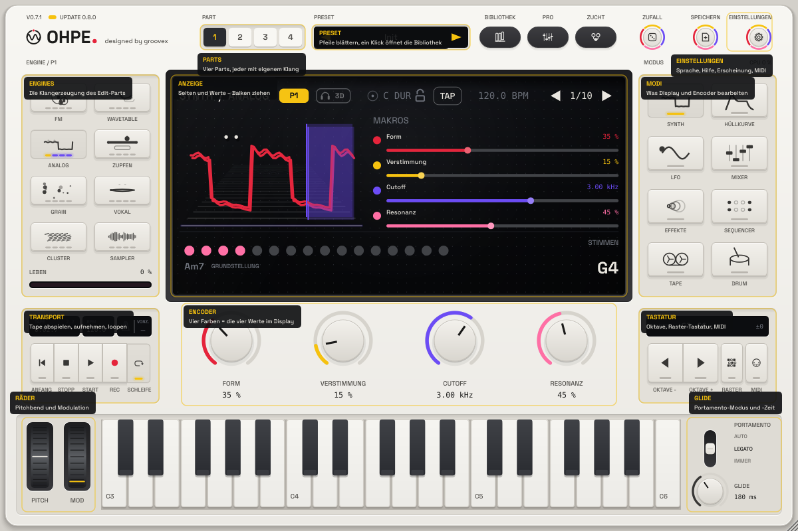
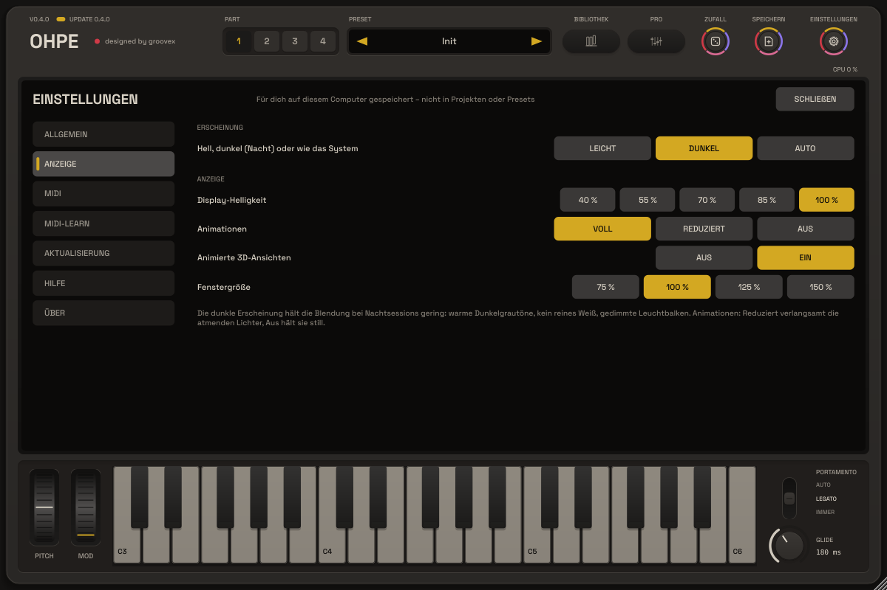
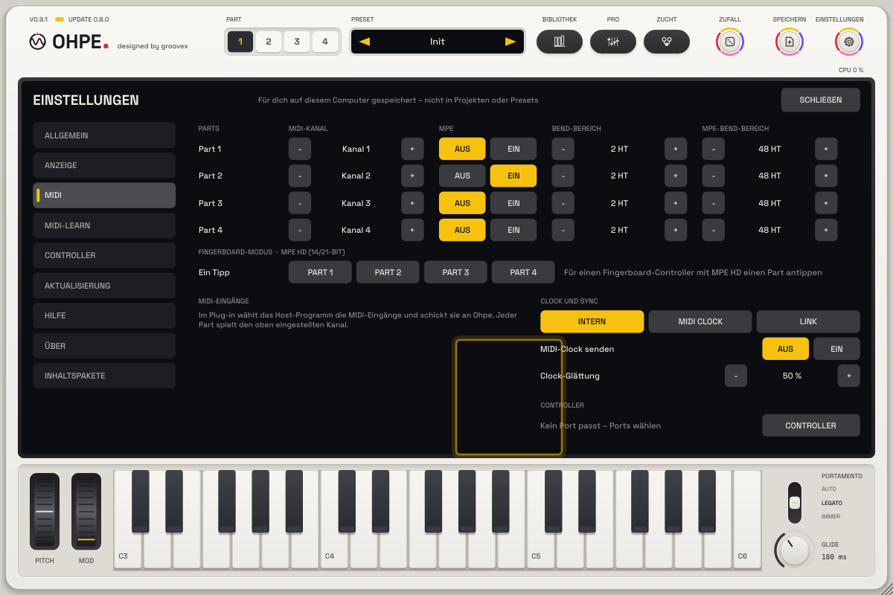
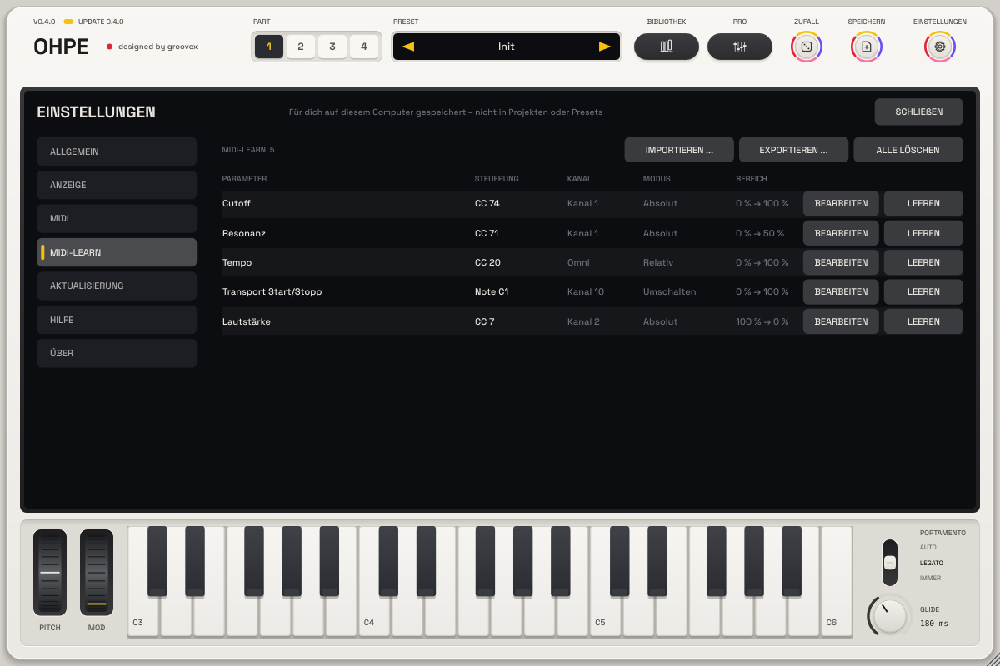
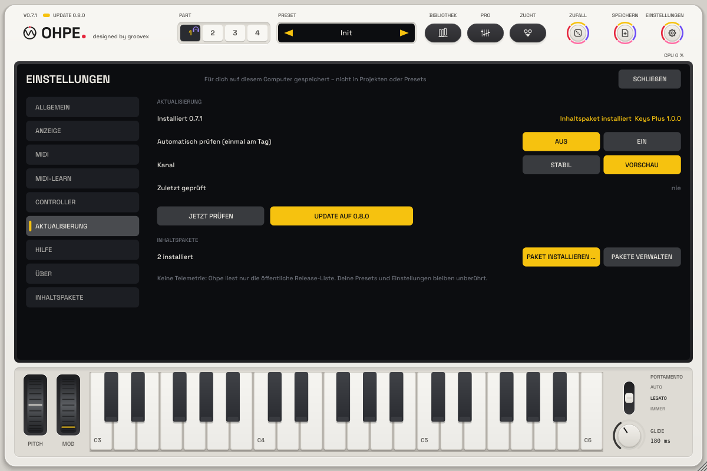
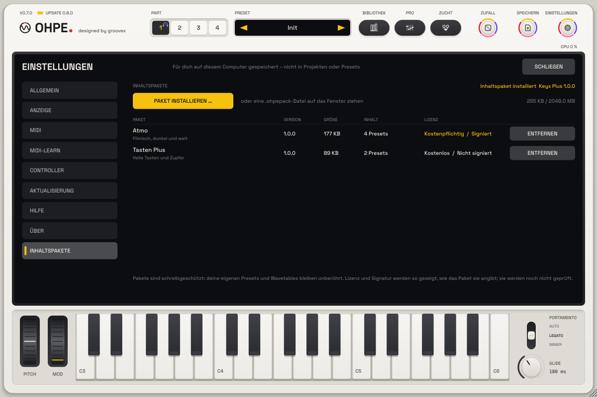
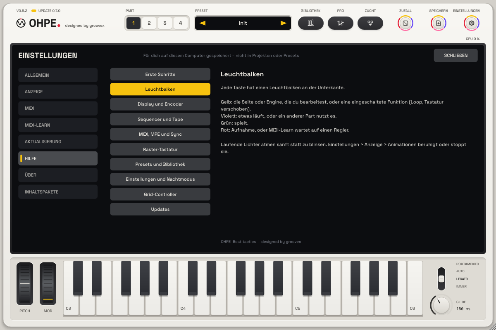
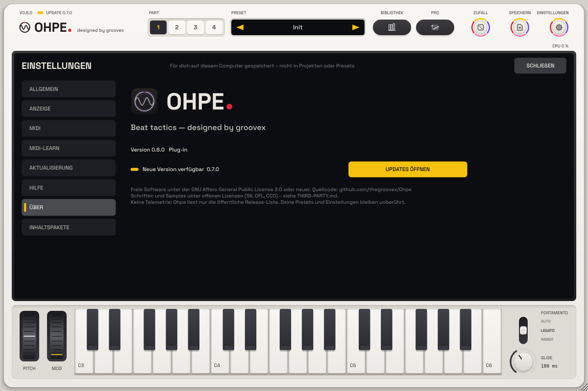

# Einstellungen

Eine Einstellungsansicht für die Standalone-App und das Plug-in. Öffnen mit der **Zahnrad-Taste** rechts in der
Kopfzeile, über das Fenstermenü der Standalone-App (**Einstellungen ...**) oder mit einem Klick auf den Schriftzug für
die Seite **Über**. **Esc** schließt sie, **↑ / ↓** wechseln die Reiter.

Die Einstellungen werden **für dich auf diesem Computer** gespeichert – nicht in Projekten, Sessions oder Presets – und
gelten für jedes geöffnete Ohpe (alle offenen Plug-in-Fenster folgen sofort). Datei: `Settings/settings.json` im
Ohpe-Benutzerordner (macOS `~/Library/Application Support/groovex/Ohpe`, Windows `%APPDATA%\groovex\Ohpe`, Linux
`~/.config/groovex/Ohpe`; `OHPE_DATA_DIR` ersetzt ihn). Der Updater hält seine Einstellungen daneben in `update.json`.
Keine Einstellung ist ein Host-Parameter: nichts davon wird automatisiert oder ändert den Klang eines Projekts.

## Allgemein

| Einstellung | Auswahl |
| --- | --- |
| Sprache | **System** (folgt dem Betriebssystem), **English**, **Deutsch**. Die Sprachumschaltung früherer Versionen ist hierher umgezogen. |
| Tooltips | Ein / Aus – Erklärungen an Tasten, Encodern, Leuchtbalken und Display |
| Hilfe-Overlay | Ein / Aus (auch **F1**) – Namen und Kurzerklärungen über jedem Bereich der Platte; Klicks gehen an die Bedienelemente durch |
| Hilfeseiten | öffnet den Reiter **Hilfe** |

## Anzeige

| Einstellung | Auswahl |
| --- | --- |
| Erscheinung | **Hell** (mattes warmes Weiß), **Dunkel** (Nachtmodus), **Auto** (folgt der hellen / dunklen Darstellung des Systems) |
| Display-Helligkeit | 40 – 100 % – dimmt das Display für dunkle Räume |
| Animationen | **Voll**, **Reduziert** (langsameres Atmen der Lichter und 3D-Puls), **Aus** (laufende Lichter stehen still, voll an) |
| Animierte 3D-Grafik | die bewegten Grafiken des Displays (derselbe Schalter wie im Grafik-Menü des Displays) |
| Fenstergröße | 75 / 100 / 125 / 150 % – die Größe, mit der ein neues Fenster öffnet (die Ecke lässt sich weiter ziehen) |

Der **Nachtmodus** umfasst das ganze Instrument – Gehäuse, Tasten, Display, Profiansicht, Bibliothek, Update-Ansicht und
die Einstellungen selbst. Er nutzt warme Dunkelgrautöne, nie reines Weiß; Akzente und Leuchtbalken sind gedimmt. Jede
Textfarbe hält mindestens 4,5 : 1 Kontrast zu ihrem Hintergrund (von den Tests geprüft).

## MIDI

- **Parts**: MIDI-Kanal (Omni oder 1 – 16), MPE ein / aus, Bend-Bereich und MPE-Bend-Bereich jedes Parts.
- **MIDI-Eingänge**: in der Standalone-App jeder MIDI-Eingang mit Ein / Aus und ein Knopf zu den Audio-Einstellungen; im
  Plug-in wählt der Host die Eingänge.
- **Clock und Sync**: Quelle Intern / MIDI-Clock / Link, MIDI-Clock senden, Clock-Glättung.
- **Controller** (Standalone-App, p46): Profil Aus / **Grid-Controller (Profil 1)**, MIDI-Eingang und -Ausgang des
  Controllers, Touch-Strip Bend / Mod und **Ansicht** – der virtuelle Controller (seine Displayzeilen, Pad-Lichter und
  letzten Nachrichten) anstelle der Part-Tabelle. Gespeichert in `settings.json`, ab Werk aus – siehe
  [Grid-Controller](CONTROLLER.md).

Das sind die bestehenden Parameter (`pN.midich`, `pN.mpe`, `pN.bend`, `pN.mpe.bend`, `sync.*`) – sie hier zu ändern ist
dasselbe wie überall sonst: der Host erfährt es, sie bleiben automatisierbar und MIDI-zuweisbar und werden mit dem Projekt
gespeichert.

## MIDI-Learn

Alle Zuweisungen in einer Liste: Parameter, Regler (CC oder Note), Kanal, Modus und Bereich. **BEARBEITEN** öffnet ein
Menü – Kanal (Omni, 1 – 16), Modus (Absolut, Umschalten, Relativ), Bereich (voll, umgekehrt, untere Hälfte, obere Hälfte),
**Neu lernen** (die alte Zuweisung wird entfernt, MIDI-Learn wartet auf einen neuen Regler) und **Löschen**. **LÖSCHEN**
entfernt eine Zuweisung, **ALLE LÖSCHEN** alle. **IMPORTIEREN ... / EXPORTIEREN ...** lesen und schreiben MIDI-Map-Dateien
(`.ohpemidi`). Neue Zuweisungen entstehen mit MIDI-Learn: Rechtsklick auf Encoder, Taste oder Rad. Die Map wird mit dem
Projekt gespeichert.

## Updates

Die Einstellungen des [Updaters](AKTUALISIERUNG.md): tägliche automatische Prüfung (aus, bis eingeschaltet), Kanal
Stabil / Vorschau, letzte Prüfung, **JETZT PRÜFEN** und die Update-Ansicht. Darunter: **Inhaltspakete** – wie viele
installiert sind, **PAKET INSTALLIEREN …** (Dateidialog für `.ohpepack`-Dateien) und **PAKETE VERWALTEN**.

## Inhaltspakete

Die Paketverwaltung (ein Reiter nach Über): **PAKET INSTALLIEREN …**, der belegte Platz und jedes installierte Paket mit
Version, Größe, Inhalt, Lizenz und Signatur (angezeigt, nicht geprüft) sowie **ENTFERNEN** (zweimal klicken). Eine
`.ohpepack`-Datei auf das Fenster ziehen installiert sie ebenfalls. Siehe [Inhaltspakete](INHALTSPAKETE.md).

## Hilfe

Hilfeseiten auf Deutsch und Englisch: erste Schritte, Leuchtbalken, Display und Encoder, Sequencer und Tape, MIDI / MPE /
Sync, die Raster-Tastatur (Anordnungen, Formen, MPE – die ganze Anleitung steht in [Harmonie](HARMONIE.md#die-raster-tastatur)),
Presets, Einstellungen und Nachtmodus, Updates. Ist die Raster-Tastatur zu sehen, zeigt das Hilfe-Overlay über der
Tastatur eine Zeile mit ihren Schritten.

## Über

Oben das App-Symbol und der Schriftzug, darunter Version und Format (Standalone-App / Plug-in), der Update-Stand mit **JETZT PRÜFEN** (oder **UPDATES ÖFFNEN**, wenn eine
neuere Version angeboten wird), die Projektzeile, Lizenz (AGPL-3.0-or-later) und Quellcode.

## Für Entwickler

`SettingsView::addExtraPage (nameEn, nameDe, component)` fügt einen Reiter für eine andere Funktion hinzu; ihre
Komponente erscheint im Inhaltsbereich. Andere Funktionen dürfen eigene Schlüssel in `settings.json` ablegen – unbekannte
Schlüssel bleiben erhalten.
