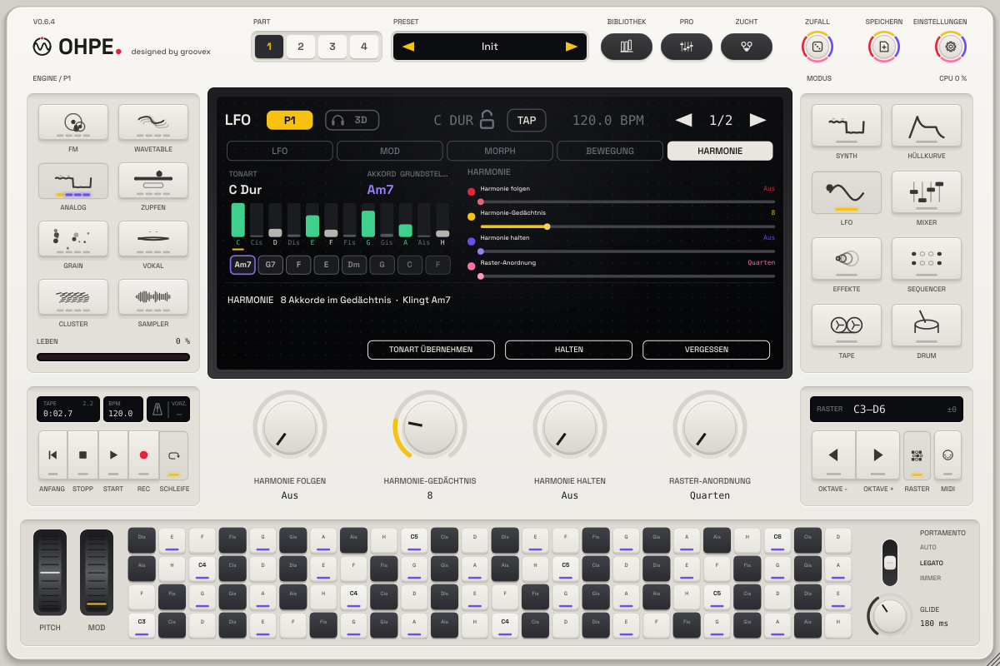

# Harmonie-Hirn

*Deutsch · English: [../en/HARMONY.md](../en/HARMONY.md)*

Ohpe hört zu, was du spielst, und führt ein **Skalen- und Akkord-Gedächtnis für alle vier Parts** – das
*Harmonie-Hirn*. Spiele Akkorde auf einem Part (Tasten, MIDI, ein Sequenzer, der Arpeggiator), und die anderen
Parts können ihnen **folgen**: ein Bass, der nur Akkordtöne trifft, eine Melodie, die die Tonart nicht verlässt, ein
Arpeggio, das mit deinen Wechseln mitgeht – ohne eine Tonart von Hand einzustellen. Eine **isomorphe
Raster-Tastatur** mit MPE spielt es vom Bildschirm.

## Was das Hirn hört und behält

* **Wer gehört wird**: jede Note, die einen Part erreicht, dessen *Folgen* auf **Aus** steht – die führenden Parts.
  Folgende Parts werden nicht gehört (keine Rückkopplung). Das Drumkit wird nicht gehört.
* **Akkord**: Sobald zwei oder mehr verschiedene Töne gehalten werden, benennt das Hirn den Akkord – Dur, Moll,
  vermindert, übermäßig, sus2, sus4, maj7, m7, 7 oder eine leere Quinte; der tiefste Ton entscheidet zwischen zwei
  Lesarten (A–C–E über A ist *Am*). Ein Akkord zählt, wenn er 40 ms stand (die Töne eines gespielten Akkords kommen
  nacheinander). Er **bleibt im Gedächtnis**, wenn du loslässt, bis zum nächsten Akkord. Lässt du einen Ton eines
  Dreiklangs los, bleibt der Akkord.
* **Tonart**: Ein Tonklassen-Gedächtnis sammelt jede Note (ihren Anschlag und wie lange sie gehalten wird) und
  verblasst mit einer Halbwertszeit von **Gedächtnis** Takten (1 – 32, ab Werk 8). Das Hirn wählt die passendste Dur-
  oder Molltonart; eine andere Tonart muss deutlich gewinnen, bevor es wechselt. Solange nichts gehört wurde, ist die
  Tonart die globale **Tonart / Skala** (`key.root`, `key.scale`).
* **Verlauf**: die letzten acht Akkorde, der neueste zuerst.

## Folgen

Jeder Part hat **Folgen** (`pN.harmony.follow`):

| Folgen | Die Noten des Parts … |
|---|---|
| **Aus** | … spielen wie bisher (und werden vom Hirn gehört) – neutral, ab Werk |
| **Skala** | … rasten auf den nächsten Ton der gemerkten Tonart |
| **Akkord** | … rasten auf den nächsten Ton des gemerkten Akkords (vor dem ersten Akkord: der Tonika-Dreiklang) |
| **Grundton** | … rasten auf den Grundton des Akkords (in jeder Oktave) |

Gerastet wird auf den nächsten Ton (bei Gleichstand nach unten) – Live-Tasten, Host-MIDI und alle Sequenzer gleich.
Der Ein-Finger-**Akkord** des Parts funktioniert weiter und baut seinen Akkord in der gemerkten Tonart. Noten eines
Parts mit **MPE** behalten ihre Tonhöhe (Ausdruck je Note); dort hilft das Raster-Layout *In Tonart*.

## Bedienelemente

| Element | ID | Wirkung |
|---|---|---|
| **Folgen** (je Part) | `pN.harmony.follow` | Aus / Skala / Akkord / Grundton |
| **Gedächtnis** | `harmony.memory` | Halbwertszeit des Tonart-Gedächtnisses in Takten (1 – 32) |
| **Halten** | `harmony.hold` | friert das Gedächtnis ein: Neue Noten ändern weder Akkord noch Tonart |
| **Tonart übernehmen** | `harmony.take` | Auslöser: schreibt die gemerkte Tonart in die globale Tonart / Skala |
| **Vergessen** | `harmony.clear` | Auslöser: vergisst Tonart, Akkord und Verlauf |
| **Raster-Anordnung** | `harmony.kb.layout` | Quarten / Terzen / Ganztöne / In Tonart |

Alle sind Host-Parameter: automatisierbar und per MIDI-Learn zuweisbar (Rechtsklick). Das Gedächtnis (Tonart,
Akkord, Verlauf, Tonklassen-Gewichte) wird in Projekten und im Plug-in-Zustand gespeichert; Part-Presets tragen
*Folgen* weder mit noch ändern sie es.

## Die Harmonie-Ansicht

LFO-Modus, fünfter Reiter **Harmonie**: die gemerkte **Tonart** und der **Akkord** (er leuchtet beim Wechsel auf),
zwölf Balken für das Tonklassen-Gedächtnis ab dem Grundton der Tonart (Tonart-Töne hell, andere gedämpft,
**Akkordtöne violett**, **gehaltene Töne grün**, der Grundton **gelb** markiert) und die **Verlaufs**-Chips. Die
Leiste sagt, was das Hirn tut und ob der Edit-Part folgt. Softkeys: **Tonart übernehmen**, **Halten**,
**Vergessen**. Regler: Folgen (Edit-Part), Gedächtnis, Halten, Raster-Anordnung.

## Die Raster-Tastatur

Die Taste **RASTER** (rechts neben der Tastatur-Anzeige, gelber Balken, solange sie an ist) tauscht die
Klaviertasten gegen ein Raster aus 4 × 24 Feldern. Auf einem isomorphen Raster hat jeder Akkord und jede Skala
**in jeder Tonart dieselbe Form** – eine Form einmal lernen, überall hin verschieben.

| Anordnung | Nach rechts | Nach oben |
|---|---|---|
| **Quarten** | +1 Halbton | +5 (eine Quarte) |
| **Terzen** | +1 | +4 (eine große Terz) |
| **Ganztöne** | +2 | +5 |
| **In Tonart** | +1 Stufe der gemerkten Tonart | +3 Stufen (eine Quarte) – nur Tonart-Töne |

Tonart-Töne sind helle Felder, andere graphit; **Akkordtöne** tragen einen **violetten** Balken, der Grundton der
Tonart steht mit Oktave da, ein gedrücktes Feld sinkt mit rotem Balken ein. **OKTAVE −/+** verschiebt das Raster
wie die Klaviatur; die Anzeige zeigt seinen Umfang. Wo du ein Feld triffst, bestimmt die Anschlagstärke (weiter oben
= lauter).

Es spielt den **Edit-Part**. Ist für ihn **MPE** an, bekommt jede Berührung ihren eigenen Mitgliedskanal (2 – 16):
**seitlich schieben** biegt die Note (ein Feld = der Schritt der Anordnung, skaliert mit dem MPE-Bend-Bereich des
Parts), **hoch / runter** sendet Slide (CC 74), Touch- oder Stift-**Druck** sendet Druck. Mehrere Finger auf einem
Touchscreen spielen mehrere Noten, jede mit eigenem Ausdruck. Ohne MPE spielen die Noten auf dem Kanal des Parts
(durch Skala, Akkord und Folgen).

## Modulation

Drei Matrix-Quellen (in jedem Part derselbe Wert):

| # | Quelle | Bereich | |
|---|---|---|---|
| 27 | **Akkord-Grundton** | 0 … 1 | der Grundton des Akkords, C = 0 … H = 1 |
| 28 | **Akkordwechsel** | 0 … 1 | 1 bei jedem neuen Akkord, verblasst in etwa 0,3 s – ein Filter-Akzent bei jedem Wechsel |
| 29 | **Spannung** | 0 … 1 | Anteil der gehaltenen Töne außerhalb der Tonart (geglättet) |
