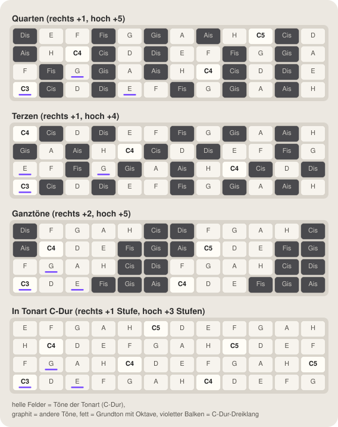
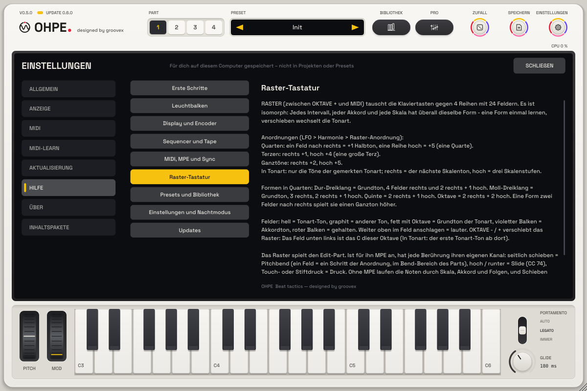
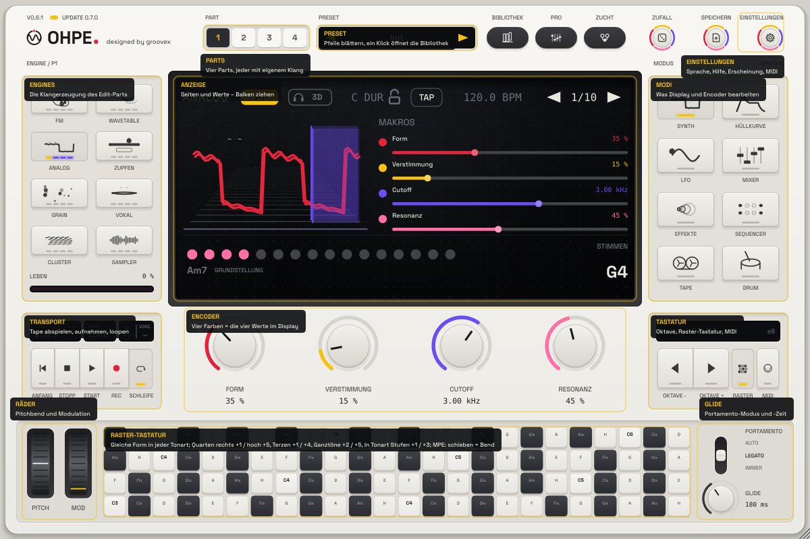

# Harmonie-Hirn

*Deutsch · English: [../en/HARMONY.md](../en/HARMONY.md)*


Ohpe hört zu, was du spielst, und führt ein **Skalen- und Akkord-Gedächtnis für alle vier Parts** – das
*Harmonie-Hirn*. Spiele Akkorde auf einem Part (Tasten, MIDI, ein Sequenzer, der Arpeggiator), und die anderen
Parts können ihnen **folgen**: ein Bass, der nur Akkordtöne trifft, eine Melodie, die die Tonart nicht verlässt, ein
Arpeggio, das mit deinen Wechseln mitgeht – ohne eine Tonart von Hand einzustellen. Eine **isomorphe
Raster-Tastatur** mit MPE spielt es vom Bildschirm.

## Was das Hirn hört und behält

* **Wer gehört wird**: jede Note, die einen Part erreicht, dessen *Folgen* auf **Aus** steht – die führenden Parts.
  Folgende Parts werden nicht gehört (keine Rückkopplung). Das Drumkit wird nicht gehört.
* **Akkord**: Sobald zwei oder mehr verschiedene Töne gehalten werden, benennt das Hirn den Akkord – Dur, Moll,
  vermindert, übermäßig, sus2, sus4, maj7, m7, 7 oder eine leere Quinte; der tiefste Ton entscheidet zwischen zwei
  Lesarten (A–C–E über A ist *Am*). Ein Akkord zählt, wenn er 40 ms stand (die Töne eines gespielten Akkords kommen
  nacheinander). Er **bleibt im Gedächtnis**, wenn du loslässt, bis zum nächsten Akkord. Lässt du einen Ton eines
  Dreiklangs los, bleibt der Akkord.
* **Tonart**: Ein Tonklassen-Gedächtnis sammelt jede Note (ihren Anschlag und wie lange sie gehalten wird) und
  verblasst mit einer Halbwertszeit von **Gedächtnis** Takten (1 – 32, ab Werk 8). Das Hirn wählt die passendste Dur-
  oder Molltonart; eine andere Tonart muss deutlich gewinnen, bevor es wechselt. Solange nichts gehört wurde, ist die
  Tonart die globale **Tonart / Skala** (`key.root`, `key.scale`).
* **Verlauf**: die letzten acht Akkorde, der neueste zuerst.

## Folgen

Jeder Part hat **Folgen** (`harmony.pN.follow`):

| Folgen | Die Noten des Parts … |
|---|---|
| **Aus** | … spielen wie bisher (und werden vom Hirn gehört) – neutral, ab Werk |
| **Skala** | … rasten auf den nächsten Ton der gemerkten Tonart |
| **Akkord** | … rasten auf den nächsten Ton des gemerkten Akkords (vor dem ersten Akkord: der Tonika-Dreiklang) |
| **Grundton** | … rasten auf den Grundton des Akkords (in jeder Oktave) |

Gerastet wird auf den nächsten Ton (bei Gleichstand nach unten) – Live-Tasten, Host-MIDI und alle Sequenzer gleich.
Der Ein-Finger-**Akkord** des Parts funktioniert weiter und baut seinen Akkord in der gemerkten Tonart. Noten eines
Parts mit **MPE** behalten ihre Tonhöhe (Ausdruck je Note); dort hilft das Raster mit *Nur Tonart*.

## Bedienelemente

| Element | ID | Wirkung |
|---|---|---|
| **Folgen** (je Part) | `harmony.pN.follow` | Aus / Skala / Akkord / Grundton |
| **Gedächtnis** | `harmony.memory` | Halbwertszeit des Tonart-Gedächtnisses in Takten (1 – 32) |
| **Halten** | `harmony.hold` | friert das Gedächtnis ein: Neue Noten ändern weder Akkord noch Tonart |
| **Tonart übernehmen** | `harmony.take` | Auslöser: schreibt die gemerkte Tonart in die globale Tonart / Skala |
| **Vergessen** | `harmony.clear` | Auslöser: vergisst Tonart, Akkord und Verlauf |
| **Raster-Anordnung** | `harmony.kb.layout` | Quarten / Terzen / Ganztöne / Sequenziell |
| **Raster nur Tonart** | `harmony.kb.inkey` | aus = Chromatisch (alle Töne; Töne außerhalb der Tonart dunkel, aber spielbar), an = Nur Tonart |
| **Raster C fest** | `harmony.kb.fixed` | aus (ab Werk) = das Feld unten links ist der Grundton der Tonart, an = es ist C |

Alle sind Host-Parameter: automatisierbar und per MIDI-Learn zuweisbar (Rechtsklick). Das Gedächtnis (Tonart,
Akkord, Verlauf, Tonklassen-Gewichte) wird in Projekten und im Plug-in-Zustand gespeichert; Part-Presets tragen
*Folgen* weder mit noch ändern sie es.

## Die Harmonie-Ansicht

LFO-Modus, fünfter Reiter **Harmonie**: die gemerkte **Tonart** und der **Akkord** (er leuchtet beim Wechsel auf),
zwölf Balken für das Tonklassen-Gedächtnis ab dem Grundton der Tonart (Tonart-Töne hell, andere gedämpft,
**Akkordtöne violett**, **gehaltene Töne grün**, der Grundton **gelb** markiert) und die **Verlaufs**-Chips. Die
Leiste sagt, was das Hirn tut und ob der Edit-Part folgt. Softkeys: **Tonart übernehmen**, **Halten**,
**Vergessen**. Regler: Seite *Harmonie* = Folgen (Edit-Part), Gedächtnis, Halten, Raster-Anordnung; Seite *Raster* =
Raster-Anordnung, Nur Tonart / Chromatisch, C fest.

## Akkordnamen und die Tonart (p45)

Solange Töne klingen, zeigt **Akkord** in der Ansicht den Akkord, den sie bilden – alle Parts zusammen, mit den Tönen,
die folgende Parts und Ein-Finger-Akkorde dazugeben – mit der vollen Benennung der Stimmen-Zeile des Displays: Sexten,
Septakkorde (auch ohne Quinte), m7b5, dim7, sus, add9, Nonen und **Slash-Akkorde** für Umkehrungen (*D/F#*) oder einen
fremden Bass (*C/D*); die Legende nennt die Stellung (*1. Umkehrung*). Klingt nichts, steht dort wie bisher der
gemerkte Akkord. Die Statuszeile ergänzt *Klingt F#m7*. Noten- und Akkordnamen folgen der globalen Tonart: b-Tonarten
mit b (*Bb* bzw. deutsch *B*, *Eb*), Kreuz-Tonarten mit # (*F#*, *C#*), deutsch *H* / *B*. **In Tonart** (in der
Kopfzeile des Displays, siehe [Tonart, Akkord und In Tonart](BEDIENUNG.md#tonart-akkord-und-in-tonart-p45)) nutzt
dieselbe globale Tonart; ein folgender Part (Folgen Skala / Akkord / Grundton) folgt wie bisher dem Hirn und
übergeht das Einrasten von In Tonart (Weiße Tasten legt seine Tasten trotzdem zuerst um).

## Die Raster-Tastatur



Die Taste **RASTER** (zwischen OKTAVE + und MIDI, gelber Balken, solange sie an ist) tauscht die Klaviertasten gegen
ein Raster aus **4 Reihen × 24 Feldern**. Es ist eine **isomorphe** Tastatur. Dieser Abschnitt erklärt sie von Grund
auf – an Musiktheorie brauchst du nur das Zählen von Halbtönen.

### Die Idee: eine Form, jede Tonart

Auf dem Klavier sehen C-Dur und D-Dur verschieden aus: andere weiße und schwarze Tasten, eine andere Handhaltung.
Auf einem isomorphen Raster liegt jedes Feld immer gleich weit von seinen Nachbarn: ein Schritt nach **rechts** ist
immer dasselbe Intervall, ein Schritt nach **oben** ebenso. Darum ist ein **Intervall, ein Akkord oder eine Skala eine
Form**, und die Form bleibt gleich, wenn du sie verschiebst. Lerne die Form eines Dur-Akkords einmal, und du spielst
jeden Dur-Akkord, indem du dieselbe Form woanders hinlegst. Verschieben heißt **transponieren**.

Zwei Begriffe für unten: Ein **Halbton** ist der kleinste Schritt (C → Cis, die nächste Klaviertaste); ein
**Intervall** ist der Abstand zweier Töne in Halbtönen (große Terz = 4, Quinte = 7, Oktave = 12).

### Einschalten

* **RASTER** zeigt das Raster an Stelle der Klaviertasten; noch einmal drücken zeigt wieder das Klavier. Ohpe merkt
  sich, was zu sehen war.
* Es spielt den **Edit-Part** (den mit den Part-Tasten gewählten) und wechselt mit, wenn du einen anderen Part wählst.
* **OKTAVE − / +** verschieben es wie die Klaviatur: Das Feld unten links ist der **Grundton der Tonart** in der
  untersten Klavier-Oktave (ab Werk C3; C0 … C7) – mit **C fest** das C dieser Oktave. Die Anzeige zeigt `RASTER` und
  den tiefsten und höchsten Ton des Rasters.
* Drei Parameter stellen es ein, alle global (für alle Parts gleich), automatisierbar und per MIDI steuerbar:
  **Raster-Anordnung** (`harmony.kb.layout`), **Raster nur Tonart** (`harmony.kb.inkey`) und **Raster C fest**
  (`harmony.kb.fixed`). Am Bildschirm: LFO-Modus, Ansicht **Harmonie**, Regler-Seite *Raster* (die Anordnung neben den
  beiden Schaltern).
* Raster ausblenden, Part oder Oktave wechseln lässt alle gehaltenen Felder los (keine hängenden Noten).

### Die Felder lesen

| Feld | Bedeutet |
|---|---|
| hell | ein Ton der **Tonart**, die sich das Harmonie-Hirn merkt (solange es nichts gehört hat: die globale Tonart / Skala) |
| graphit | ein Ton außerhalb der Tonart |
| fetter Name mit Oktave (z. B. **C3**) | der **Grundton** der Tonart |
| violetter Balken | ein Ton des **Akkords**, den sich das Hirn merkt |
| eingesunken, roter Balken | ein Feld, das du hältst |

Die Notennamen folgen der Sprache: Cis / H auf Deutsch, C# / B auf Englisch. **Wo** du ein Feld triffst, bestimmt die
Anschlagstärke: der untere Rand spielt leise (Velocity 56), der obere Rand voll (127).

### Die vier Anordnungen

Die Schritte, genau wie der Code sie rechnet (Reihe 1 = unterste Reihe, Spalte 1 = links). **Chromatisch** zählt
Halbtöne, **Nur Tonart** zählt Stufen der Skala der Tonart (siehe unten):

| Anordnung | Chromatisch: rechts / hoch | Nur Tonart: rechts / hoch | Umfang (chromatisch, Werks-Oktave, Tonart C) |
|---|---|---|---|
| **Quarten** (ab Werk) | +1 / +5 Halbtöne (eine Quarte) | +1 / +3 Skalenstufen | C3 – D6 |
| **Terzen** | +1 / +4 Halbtöne (eine große Terz) | +1 / +2 Skalenstufen (eine Terz) | C3 – H5 |
| **Ganztöne** | +2 / +5 Halbtöne | +1 / +3 Skalenstufen (jede Skalenstufe ist etwa ein Ganzton, Nur Tonart spielt also wie Quarten) | C3 – Cis8 |
| **Sequenziell** | +1 / +8 Halbtöne: fortlaufende Reihen zu acht | +1 / +8 Skalenstufen | C3 – H6 |

**Sequenziell** – die acht Pads einer Reihe gehen in der Reihe darüber weiter, wie beim Lesen einer Seite: das letzte
Feld einer Reihe + 1 ist das erste Feld der nächsten. Jeder Ton ist leicht zu finden, Akkordformen ändern sich aber von
Reihe zu Reihe.

### Nur Tonart oder Chromatisch (jede Anordnung)

**Raster nur Tonart** (`harmony.kb.inkey`) wirkt in jeder Anordnung:

* **Chromatisch** (aus, ab Werk): alle Töne. Töne außerhalb der Tonart sind **dunkel, aber spielbar**; mit **Scale
  Lock** sind sie auf den Pads auch stumm (auf dem Bildschirm rasten sie wie jeder Ton ein).
* **Nur Tonart** (an): nur die Töne der Tonart, ein „falscher" Ton ist nicht möglich. Ein Feld nach rechts ist der
  nächste Ton der Skala, eine Reihe nach oben überall gleich viele **Skalenstufen** (Quarten 3, Terzen 2, Sequenziell
  8). In einer siebentönigen Tonart sind drei Stufen eine Quarte, nur von der vierten Stufe aus ein Tritonus (in C-Dur
  F → H).
* Eine chromatische Skala spielt Nur Tonart wie Chromatisch. Wechselt das Hirn die Tonart, beschriftet sich das Raster
  sofort neu.
* Die frühere Anordnung *In Tonart* ist jetzt **Quarten + Nur Tonart**; Projekte und Presets damit öffnen so.

### Grundton fest oder C fest

**Raster C fest** (`harmony.kb.fixed`):

* **Aus (ab Werk)**: Das Feld unten links ist der **Grundton der Tonart in der Kopfzeile des Displays** (Tonart, oder
  die des Hosts), alle Reihen liegen relativ dazu. Es bleibt beim Spielen liegen, auch wenn die gemerkte Tonart des
  Harmonie-Hirns wandert (sie bestimmt weiter, welche Töne Nur Tonart spielt und wie die Felder leuchten).
  Eine Akkordform spielt darum in **jeder Tonart** dieselbe Akkordstufe – einmal in C lernen, in Fis spielen, ohne die
  Hand zu bewegen.
* **An**: Das Feld unten links ist **C** (Nur Tonart: der erste Tonart-Ton auf oder über C) – wie in früheren Versionen.
* **OKTAVE − / +** verschiebt das Raster in beiden Fällen um eine Oktave.

Quarten + Nur Tonart in C-Dur (unten links ist C, mit und ohne C fest):

```
4 | E4     F4     G4     A4     H4     C5     D5     E5
3 | H3     C4     D4     E4     F4     G4     A4     H4
2 | F3     G3     A3     H3     C4     D4     E4     F4
1 | C3     D3     E3     F3     G3     A3     H3     C4
  +--------------------------------------------------------
    1      2      3      4      5      6      7      8
```

Terzen + Nur Tonart und Sequenziell (chromatisch), C-Dur:

```
4 | H3     C4     D4     E4     F4     G4     A4     H4
3 | G3     A3     H3     C4     D4     E4     F4     G4
2 | E3     F3     G3     A3     H3     C4     D4     E4
1 | C3     D3     E3     F3     G3     A3     H3     C4
  +--------------------------------------------------------
    1      2      3      4      5      6      7      8
```

```
4 | C5     Cis5   D5     Dis5   E5     F5     Fis5   G5
3 | E4     F4     Fis4   G4     Gis4   A4     Ais4   H4
2 | Gis3   A3     Ais3   H3     C4     Cis4   D4     Dis4
1 | C3     Cis3   D3     Dis3   E3     F3     Fis3   G3
  +--------------------------------------------------------
    1      2      3      4      5      6      7      8
```

Die chromatischen Bilder unten zeigen die Anordnungen in der Tonart C (Grundton C, C fest ändert dort nichts).

**Quarten** – wie die tiefen Saiten von Bass oder Gitarre: Jede Reihe beginnt eine Quarte über der darunter.

```
4 | Dis4    E4     F4    Fis4    G4    Gis4    A4    Ais4
3 | Ais3    H3     C4    Cis4    D4    Dis4    E4     F4
2 |  F3    Fis3    G3    Gis3    A3    Ais3    H3     C4
1 |  C3    Cis3    D3    Dis3    E3     F3    Fis3    G3
  +--------------------------------------------------------
      1      2      3      4      5      6      7      8   
```

**Terzen** – Reihen eine große Terz auseinander: kompakte Akkorde, kleine Griffe.

```
4 |  C4    Cis4    D4    Dis4    E4     F4    Fis4    G4
3 | Gis3    A3    Ais3    H3     C4    Cis4    D4    Dis4
2 |  E3     F3    Fis3    G3    Gis3    A3    Ais3    H3
1 |  C3    Cis3    D3    Dis3    E3     F3    Fis3    G3
  +--------------------------------------------------------
      1      2      3      4      5      6      7      8   
```

**Ganztöne** – zwei Halbtöne pro Feld; jede Reihe für sich ist eine Ganztonleiter, die nächste Reihe (eine Quarte
höher) hält die anderen sechs Töne. Großer Umfang auf wenig Platz.

```
4 | Dis4    F4     G4     A4     H4    Cis5   Dis5    F5
3 | Ais3    C4     D4     E4    Fis4   Gis4   Ais4    C5
2 |  F3     G3     A3     H3    Cis4   Dis4    F4     G4
1 |  C3     D3     E3    Fis3   Gis3   Ais3    C4     D4
  +--------------------------------------------------------
      1      2      3      4      5      6      7      8   
```

### Beispiele zum Nachspielen

Die Bilder zeigen die unteren linken 4 × 8 Felder in der Werks-Oktave (Tonart C-Dur); Felder in `[ ]` werden
gedrückt. Jede Form funktioniert überall auf dem Raster – läuft sie über einen Rand, nimm dieselbe Form an anderer
Stelle oder verschiebe die Oktave.

**Dur-Dreiklang (C – E – G).** Quarten: Grundton, vier Felder rechts (die Terz), dazwischen eine Reihe höher (die
Quinte).

```
4 | Dis4    E4     F4    Fis4    G4    Gis4    A4    Ais4
3 | Ais3    H3     C4    Cis4    D4    Dis4    E4     F4
2 |  F3    Fis3   [G3]   Gis3    A3    Ais3    H3     C4
1 | [C3]   Cis3    D3    Dis3   [E3]    F3    Fis3    G3
  +--------------------------------------------------------
      1      2      3      4      5      6      7      8   
```

Derselbe Akkord hat eine zweite Form: Terz eine Reihe höher und ein Feld links, Quinte eine Reihe höher und zwei
rechts (hier F – A – C):

```
4 | Dis4    E4     F4    Fis4    G4    Gis4    A4    Ais4
3 | Ais3    H3     C4    Cis4    D4    Dis4    E4     F4
2 |  F3    Fis3    G3    Gis3   [A3]   Ais3    H3    [C4]
1 |  C3    Cis3    D3    Dis3    E3    [F3]   Fis3    G3
  +--------------------------------------------------------
      1      2      3      4      5      6      7      8   
```

**Moll-Dreiklang (C – Es – G).** Nur die Terz wandert: ein Feld links der großen Terz (drei Felder rechts vom
Grundton).

```
4 | Dis4    E4     F4    Fis4    G4    Gis4    A4    Ais4
3 | Ais3    H3     C4    Cis4    D4    Dis4    E4     F4
2 |  F3    Fis3   [G3]   Gis3    A3    Ais3    H3     C4
1 | [C3]   Cis3    D3   [Dis3]   E3     F3    Fis3    G3
  +--------------------------------------------------------
      1      2      3      4      5      6      7      8   
```

**Powerchord / Quinte (C – G – C).** Grundton, eine Reihe höher und zwei rechts (die Quinte), das Feld darüber (die
Oktave).

```
4 | Dis4    E4     F4    Fis4    G4    Gis4    A4    Ais4
3 | Ais3    H3    [C4]   Cis4    D4    Dis4    E4     F4
2 |  F3    Fis3   [G3]   Gis3    A3    Ais3    H3     C4
1 | [C3]   Cis3    D3    Dis3    E3     F3    Fis3    G3
  +--------------------------------------------------------
      1      2      3      4      5      6      7      8   
```

**Oktave (C3 → C4).** In Quarten immer **zwei Reihen hoch, zwei Felder rechts**:

```
4 | Dis4    E4     F4    Fis4    G4    Gis4    A4    Ais4
3 | Ais3    H3    [C4]   Cis4    D4    Dis4    E4     F4
2 |  F3    Fis3    G3    Gis3    A3    Ais3    H3     C4
1 | [C3]   Cis3    D3    Dis3    E3     F3    Fis3    G3
  +--------------------------------------------------------
      1      2      3      4      5      6      7      8   
```

**Dur-Tonleiter (C D E F G A H C).** Drei Töne pro Reihe, ein Muster, das sich wiederholt:

```
4 | Dis4    E4     F4    Fis4    G4    Gis4    A4    Ais4
3 | Ais3   [H3]   [C4]   Cis4    D4    Dis4    E4     F4
2 | [F3]   Fis3   [G3]   Gis3   [A3]   Ais3    H3     C4
1 | [C3]   Cis3   [D3]   Dis3   [E3]    F3    Fis3    G3
  +--------------------------------------------------------
      1      2      3      4      5      6      7      8   
```

**Transponieren.** Verschieb die ganze Form: zwei Felder rechts = zwei Halbtöne höher. Aus C-Dur wird D-Dur (D – Fis –
A) mit denselben Fingern:

```
4 | Dis4    E4     F4    Fis4    G4    Gis4    A4    Ais4
3 | Ais3    H3     C4    Cis4    D4    Dis4    E4     F4
2 |  F3    Fis3    G3    Gis3   [A3]   Ais3    H3     C4
1 |  C3    Cis3   [D3]   Dis3    E3     F3   [Fis3]   G3
  +--------------------------------------------------------
      1      2      3      4      5      6      7      8   
```

Eine Reihe höher transponiert um das Intervall der Reihe (in Quarten eine Quarte: C-Dur → F-Dur).

**Dieselben Akkorde in den anderen Anordnungen** (Abstand als *Felder rechts, Reihen hoch* vom Grundton; negativ =
links):

| Form | Quarten | Terzen | Ganztöne | Quarten + Nur Tonart |
|---|---|---|---|---|
| Dur-Dreiklang | Terz (4, 0) oder (−1, 1), Quinte (2, 1) | Terz (0, 1), Quinte (3, 1) | Terz (2, 0), Quinte (1, 1) | Terz (2, 0), Quinte (1, 1) – Dur oder Moll, wie die Tonart es will |
| Moll-Dreiklang | Terz (3, 0) oder (−2, 1), Quinte (2, 1) | Terz (3, 0) oder (−1, 1), Quinte (3, 1) | Terz (−1, 1), Quinte (1, 1) | dieselbe Form wie oben |
| Quinte | (2, 1) | (3, 1) | (1, 1) | (1, 1) – vermindert von der 7. Stufe |
| Oktave | (2, 2) | (0, 3) oder (4, 2) | (1, 2) | (1, 2) |

Terzen, Dur-Dreiklang (C – E – G) und Moll-Dreiklang (C – Es – G):

```
4 |  C4    Cis4    D4    Dis4    E4     F4    Fis4    G4
3 | Gis3    A3    Ais3    H3     C4    Cis4    D4    Dis4
2 | [E3]    F3    Fis3   [G3]   Gis3    A3    Ais3    H3
1 | [C3]   Cis3    D3    Dis3    E3     F3    Fis3    G3
  +--------------------------------------------------------
      1      2      3      4      5      6      7      8   
```

```
4 |  C4    Cis4    D4    Dis4    E4     F4    Fis4    G4
3 | Gis3    A3    Ais3    H3     C4    Cis4    D4    Dis4
2 |  E3     F3    Fis3   [G3]   Gis3    A3    Ais3    H3
1 | [C3]   Cis3    D3   [Dis3]   E3     F3    Fis3    G3
  +--------------------------------------------------------
      1      2      3      4      5      6      7      8   
```

Ganztöne, Dur-Dreiklang (C – E – G) und Moll-Dreiklang (D – F – A):

```
4 | Dis4    F4     G4     A4     H4    Cis5   Dis5    F5
3 | Ais3    C4     D4     E4    Fis4   Gis4   Ais4    C5
2 |  F3    [G3]    A3     H3    Cis4   Dis4    F4     G4
1 | [C3]    D3    [E3]   Fis3   Gis3   Ais3    C4     D4
  +--------------------------------------------------------
      1      2      3      4      5      6      7      8   
```

```
4 | Dis4    F4     G4     A4     H4    Cis5   Dis5    F5
3 | Ais3    C4     D4     E4    Fis4   Gis4   Ais4    C5
2 | [F3]    G3    [A3]    H3    Cis4   Dis4    F4     G4
1 |  C3    [D3]    E3    Fis3   Gis3   Ais3    C4     D4
  +--------------------------------------------------------
      1      2      3      4      5      6      7      8   
```

Quarten + Nur Tonart: Die Tonleiter ist einfach eine Reihe von links nach rechts, und **eine** Dreiklang-Form spielt jeden Akkord
der Tonart: ab C ist es C-Dur, ein Feld nach rechts D-Moll (D – F – A) – Dur oder Moll entscheidet die Tonart.

```
4 |  E4     F4     G4     A4     H4     C5     D5     E5
3 |  H3     C4     D4     E4     F4     G4     A4     H4
2 |  F3    [G3]    A3     H3     C4     D4     E4     F4
1 | [C3]    D3    [E3]    F3     G3     A3     H3     C4
  +--------------------------------------------------------
      1      2      3      4      5      6      7      8   
```

```
4 |  E4     F4     G4     A4     H4     C5     D5     E5
3 |  H3     C4     D4     E4     F4     G4     A4     H4
2 |  F3     G3    [A3]    H3     C4     D4     E4     F4
1 |  C3    [D3]    E3    [F3]    G3     A3     H3     C4
  +--------------------------------------------------------
      1      2      3      4      5      6      7      8   
```

## Akkord-Leitfaden: Akkorde auf dem Raster spielen

Dieser Leitfaden nutzt die einfachste Spielweise: **Quarten + Nur Tonart, C fest aus** (Nur Tonart einschalten;
Quarten und C fest aus sind ab Werk eingestellt). Das Feld unten links ist immer der Grundton der Tonart, darum spielt
jede Form unten in jeder Tonart dieselbe Akkordstufe. Versätze sind *Felder nach rechts, Reihen nach oben* ab dem
Grundton-Feld des Akkords; die Bilder zeigen C-Dur (und a-Moll) in der Werks-Oktave, Felder in `[ ]` werden gedrückt.
Dieselben Formen gelten auf dem Bildschirm-Raster und auf den Pads des Grid-Controllers (seine vier unteren Reihen sind
die Reihen des Bildschirms).

**Dreiklang – Grundton, 2 rechts, 1 rechts + 1 hoch.** Dur oder Moll entscheidet die Tonart: auf dem Grundton einer
Dur-Tonart ein Dur-Dreiklang, auf dem Grundton einer Moll-Tonart ein Moll-Dreiklang.

```
4 | E4     F4     G4     A4     H4     C5     D5     E5
3 | H3     C4     D4     E4     F4     G4     A4     H4
2 | F3    [G3]    A3     H3     C4     D4     E4     F4
1 |[C3]    D3    [E3]    F3     G3     A3     H3     C4
  +--------------------------------------------------------
    1      2      3      4      5      6      7      8
```

```
4 | C5     D5     E5     F5     G5     A5     H5     C6
3 | G4     A4     H4     C5     D5     E5     F5     G5
2 | D4    [E4]    F4     G4     A4     H4     C5     D5
1 |[A3]    H3    [C4]    D4     E4     F4     G4     A4
  +--------------------------------------------------------
    1      2      3      4      5      6      7      8
```

**Jeder Akkord der Tonart mit einer Form.** Ein Feld nach rechts spielt die Form den nächsten Akkord der Tonart – in
C-Dur: C, Dm, Em, F, G, Am, Hdim. Hier Dm:

```
4 | E4     F4     G4     A4     H4     C5     D5     E5
3 | H3     C4     D4     E4     F4     G4     A4     H4
2 | F3     G3    [A3]    H3     C4     D4     E4     F4
1 | C3    [D3]    E3    [F3]    G3     A3     H3     C4
  +--------------------------------------------------------
    1      2      3      4      5      6      7      8
```

**Septakkord – Dreiklang + 3 rechts + 1 hoch.** Maj7 auf der 1. und 4. Stufe, Dominant-7 auf der 5., m7 auf der 2., 3.
und 6., m7b5 auf der 7. – wieder entscheidet die Tonart.

```
4 | E4     F4     G4     A4     H4     C5     D5     E5
3 | H3     C4     D4     E4     F4     G4     A4     H4
2 | F3    [G3]    A3    [H3]    C4     D4     E4     F4
1 |[C3]    D3    [E3]    F3     G3     A3     H3     C4
  +--------------------------------------------------------
    1      2      3      4      5      6      7      8
```

**Umkehrungen** – ein anderer Ton im Bass, derselbe Akkord. Erste Umkehrung (Terz im Bass): 2 rechts, 1 rechts + 1 hoch,
4 rechts + 1 hoch. Zweite Umkehrung (Quinte im Bass): 1 rechts + 1 hoch, 4 rechts + 1 hoch, 3 rechts + 2 hoch.

```
4 | E4     F4     G4     A4     H4     C5     D5     E5
3 | H3     C4     D4     E4     F4     G4     A4     H4
2 | F3    [G3]    A3     H3    [C4]    D4     E4     F4
1 | C3     D3    [E3]    F3     G3     A3     H3     C4
  +--------------------------------------------------------
    1      2      3      4      5      6      7      8
```

```
4 | E4     F4     G4     A4     H4     C5     D5     E5
3 | H3     C4     D4    [E4]    F4     G4     A4     H4
2 | F3    [G3]    A3     H3    [C4]    D4     E4     F4
1 | C3     D3     E3     F3     G3     A3     H3     C4
  +--------------------------------------------------------
    1      2      3      4      5      6      7      8
```

**Powerchord – Grundton, 1 rechts + 1 hoch (Quinte), das Feld darüber (Oktave).** In Nur Tonart ist die Quinte von
der 7. Stufe vermindert (H – F in C-Dur); chromatisch gespielt ist sie überall rein.

```
4 | E4     F4     G4     A4     H4     C5     D5     E5
3 | H3    [C4]    D4     E4     F4     G4     A4     H4
2 | F3    [G3]    A3     H3     C4     D4     E4     F4
1 |[C3]    D3     E3     F3     G3     A3     H3     C4
  +--------------------------------------------------------
    1      2      3      4      5      6      7      8
```

**Oktave – 1 rechts + 2 hoch** (auch 4 rechts + 1 hoch oder 7 rechts).

```
4 | E4     F4     G4     A4     H4     C5     D5     E5
3 | H3    [C4]    D4     E4     F4     G4     A4     H4
2 | F3     G3     A3     H3     C4     D4     E4     F4
1 |[C3]    D3     E3     F3     G3     A3     H3     C4
  +--------------------------------------------------------
    1      2      3      4      5      6      7      8
```

**Chromatische Formen (Quarten, Nur Tonart aus).** Jeder Akkordtyp hat seine feste Form; die Tonart ändert sie nicht:

| Akkord | Versätze ab dem Grundton |
|---|---|
| Dur | (4, 0), (2, 1) |
| Moll | (3, 0), (2, 1) |
| Dominant-7 | (4, 0), (2, 1), (0, 2) |
| Maj7 | (4, 0), (2, 1), (1, 2) |

```
4 | Dis4   E4     F4     Fis4   G4     Gis4   A4     Ais4
3 | Ais3   H3     C4     Cis4   D4     Dis4   E4     F4
2 | F3     Fis3  [G3]    Gis3   A3     Ais3   H3     C4
1 |[C3]    Cis3   D3     Dis3  [E3]    F3     Fis3   G3
  +--------------------------------------------------------
    1      2      3      4      5      6      7      8
```

```
4 | Dis4   E4     F4     Fis4   G4     Gis4   A4     Ais4
3 | Ais3   H3     C4     Cis4   D4     Dis4   E4     F4
2 | F3     Fis3  [G3]    Gis3   A3     Ais3   H3     C4
1 |[C3]    Cis3   D3    [Dis3]  E3     F3     Fis3   G3
  +--------------------------------------------------------
    1      2      3      4      5      6      7      8
```

```
4 | Dis4   E4     F4     Fis4   G4     Gis4   A4     Ais4
3 |[Ais3]  H3     C4     Cis4   D4     Dis4   E4     F4
2 | F3     Fis3  [G3]    Gis3   A3     Ais3   H3     C4
1 |[C3]    Cis3   D3     Dis3  [E3]    F3     Fis3   G3
  +--------------------------------------------------------
    1      2      3      4      5      6      7      8
```

```
4 | Dis4   E4     F4     Fis4   G4     Gis4   A4     Ais4
3 | Ais3  [H3]    C4     Cis4   D4     Dis4   E4     F4
2 | F3     Fis3  [G3]    Gis3   A3     Ais3   H3     C4
1 |[C3]    Cis3   D3     Dis3  [E3]    F3     Fis3   G3
  +--------------------------------------------------------
    1      2      3      4      5      6      7      8
```

**Hören, was du spielst.** Solange Töne klingen, benennen die Harmonie-Ansicht und die Stimmen-Zeile des Displays den
Akkord live (Septakkorde, Umkehrungen als Slash-Akkorde, siehe [Akkordnamen und die Tonart](#akkordnamen-und-die-tonart-p45));
das **Akkord-Gedächtnis** des Hirns markiert die Töne des gemerkten Akkords mit einem violetten Balken auf dem
Bildschirm und gedimmt grün auf den Pads – so findest du die Töne des nächsten Akkords leicht. Die Bilder werden aus
dem Code der Anordnungen erzeugt (`tools/docs/grid_diagrams.py`).

### Spielen mit MPE

Was das Raster sendet, hängt davon ab, ob für den Edit-Part **MPE** an ist (`pN.mpe`, siehe [MIDI](MIDI.md#mpe-midi-polyphonic-expression)).

**MPE an** – jede Berührung (Maus oder Finger, bis zu 10 gleichzeitig) ist eine eigene Note mit eigenem Ausdruck:

* Jede Berührung bekommt einen freien **Mitgliedskanal** (2 – 16, reihum). Sie beginnt mit Bend in der Mitte und
  Slide auf 64.
* **Seitlich schieben = Pitchbend** nur dieser Note. Der Bend folgt den Feldern: eine Feldbreite biegt um den Schritt
  der Anordnung nach rechts – 1 Halbton in Quarten und Terzen, 2 in Ganztönen, etwa 1,7 (12 / 7) mit Nur Tonart. Er
  geht als 14-Bit-Pitchbend hinaus, skaliert mit dem **MPE-Bend-Bereich** des Parts (`pN.mpe.bend`, ab Werk 48
  Halbtöne), und endet am Ende dieses Bereichs. Die Note bleibt die angeschlagene; Loslassen beendet sie.
* **Hoch / runter = Slide** (CC 74, Mitte 64): anderthalb Feldhöhen nach oben erreichen 127, nach unten 0. Der Part
  schickt es an sein Klangfarben-Ziel (`pN.mpe.timbre`).
* **Druck** (von einem druckempfindlichen Touchscreen oder Stift; eine Maus hat keinen) geht als Kanaldruck auf dem
  Kanal der Note hinaus und wirkt auf das Druck-Ziel des Parts (`pN.mpe.press`).
* MPE-Noten behalten ihre Tonhöhe: Skala, Akkord und Folgen rasten sie nicht.

**MPE aus** – die Noten spielen auf dem MIDI-Kanal des Parts und laufen durch den Part wie die Klaviertasten (Skala,
Ein-Finger-Akkord, Folgen, der Arpeggiator, wenn er diesen Part spielt). Schieben bewirkt nichts; es gibt keinen
Ausdruck je Note.

In beiden Fällen hört das Harmonie-Hirn die Noten des Rasters (sie formen die gemerkte Tonart und den Akkord). Wie die
Klaviertasten geht das Raster nicht an den MIDI-Ausgang.

### Hilfe in der App

**Einstellungen > Hilfe > Raster-Tastatur** fasst diese Seite zusammen (Anordnungen, Nur Tonart / Chromatisch, C fest, Akkordformen, Felder, MPE). Mit dem
**Hilfe-Overlay** (Einstellungen > Allgemein oder **F1**) und sichtbarem Raster nennt eine Zeile über der Tastatur die
Schritte jeder Anordnung.





### Auf einem Grid-Controller

**Grid-Controller (Profil 1)** (Standalone-App und Plug-in, Einstellungen > Controller) bringt dieses Raster auf einen
externen 8 × 8-Pad-Controller: **dieselben Anordnungen** (Scales kurz drücken schaltet sie weiter; Scales halten zeigt
Anordnung, Nur Tonart / Chromatisch, C fest, Grundton und Skala im Display, die oberen Tasten wählen), **derselbe Ton**
für dieselbe Spalte und Reihe ab demselben Feld unten links (die vier unteren Pad-Reihen sind die vier Reihen des
Bildschirm-Rasters), **dieselbe Tonart** mit **Scale Lock** (andere Töne dunkel und stumm), der Grundton leuchtet
**bernstein**, Tonart-Töne **gelb**, Akkordtöne **grün (gedimmt)**, gehaltene Pads **grün**, und **Oktave − / +**
verschiebt Pads und Bildschirm-Raster gemeinsam. Anschlag und Druck spielen den Edit-Part (MPE: ein Mitgliedskanal je
Pad). Details: [Grid-Controller](CONTROLLER.md).

## Modulation

Drei Matrix-Quellen (in jedem Part derselbe Wert):

| # | Quelle | Bereich | |
|---|---|---|---|
| 29 | **Akkord-Grundton** | 0 … 1 | der Grundton des Akkords, C = 0 … H = 1 |
| 30 | **Akkordwechsel** | 0 … 1 | 1 bei jedem neuen Akkord, verblasst in etwa 0,3 s – ein Filter-Akzent bei jedem Wechsel |
| 31 | **Spannung** | 0 … 1 | Anteil der gehaltenen Töne außerhalb der Tonart (geglättet) |
