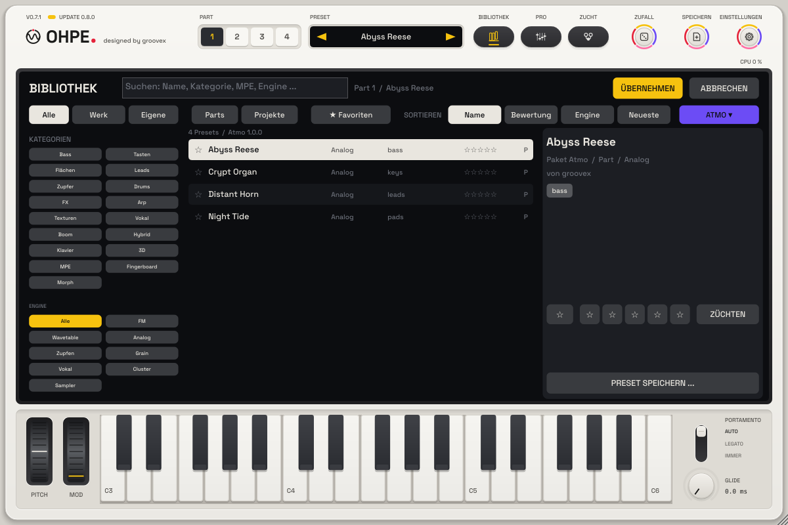

# Inhaltspakete

Ohpe – designed by groovex. English: [Content packs](../en/CONTENT-PACKS.md)

Ein Inhaltspaket bringt neue Klänge in Ohpe, ohne neue Programmversion: heute Preset-Sammlungen, als Nächstes
Wavetable-Bänke. Ein Paket ist eine Datei mit der Endung **`.ohpepack`**. Pakete sind schreibgeschützt – deine eigenen
Presets, Wavetables, Bounces und Einstellungen bleiben unberührt.


## Ein Paket installieren

* **Einstellungen › Inhaltspakete › PAKET INSTALLIEREN …** (auch unter **Einstellungen › Aktualisierung** und im Menü
  **PAKETE** der Bibliothek) öffnet einen Dateidialog für `.ohpepack`-Dateien, oder
* eine `.ohpepack`-Datei irgendwo auf das Ohpe-Fenster **ziehen**.

Das Display meldet, wenn das Paket installiert ist oder warum nicht. Wird eine neuere Version eines installierten
Pakets installiert, bleibt die alte als Sicherung (ein Schritt zurück, wie bei Paketen aus der Aktualisierung).

Bevor sich etwas ändert, prüft Ohpe das Paket:

| Prüfung | Wenn sie scheitert |
|---|---|
| jeder Pfad bleibt im Paket (kein `..`, keine absoluten Pfade, keine Links) | das ganze Paket wird abgelehnt |
| `pack.json` ist da und gültig (ID, Version, Art, Namen) | abgelehnt |
| jede Datei hat ihre SHA-256 in `pack.json`, und jede gelistete Datei ist da | abgelehnt – „Eine Datei des Inhaltspakets ist beschädigt (Prüfsumme)“ |
| das Paket passt in die Größengrenzen seiner Art und in die 2 GB Platz für alle Pakete | abgelehnt |
| `minApp` des Pakets ist nicht neuer als dieses Ohpe | abgelehnt – „Dieses Paket braucht ein neueres Ohpe“ |

Das Paket wird zuerst in einen Zwischenordner entpackt und ersetzt die installierte Version erst, wenn jede Datei die
Prüfung bestanden hat – eine gescheiterte Installation lässt alles, wie es war.

## Pakete verwalten

**Einstellungen › Inhaltspakete** zeigt jedes installierte Paket: Name, Version, Größe auf der Platte, Inhalt, Lizenz
und Signatur sowie **ENTFERNEN** (zweimal klicken: der Chip fragt erst *ENTFERNEN?*). Die Zeile über der Liste zeigt,
wie viel vom Platz für Pakete belegt ist.

In der **Bibliothek** öffnet der Chip **PAKETE** (rechtes Ende der Filterzeile) ein Menü: *Alle Presets*, ein Eintrag
je installiertem Paket (zeigt nur dessen Presets), *Paket installieren …* und *Pakete verwalten …*. Paket-Presets tragen
ein **P** in der Liste und den Paketnamen in den Details.



## Lizenz und Signatur

`pack.json` kann eine Lizenz nennen (`free` oder `paid`, mit Produkt-ID) und eine Signatur tragen (Ed25519 über das
kanonische `pack.json` des Pakets). Ohpe zeigt beides in der Paketliste (*Kostenlos / Kostenpflichtig*, *Signiert /
Nicht signiert*), **prüft und erzwingt es aber noch nicht** – es gibt keinen Shop und keine Online-Freischaltung. Die
Schnittstelle für eine spätere Freischaltung ist vorbereitet (`update::PackGate`); heute ist jedes Paket erlaubt.

## Presets mit Paketinhalten

Ein Preset kann mit einer Referenz `"<Paket>/<Element>"` auf Inhalte eines Pakets zeigen – zum Beispiel ist die
Wavetable `atmo/glass-choir` die Datei `wavetables/glass-choir.wav` im Paket `atmo`. Solche Referenzen werden nie ins
Preset kopiert. Fehlt das Paket, meldet Ohpe **„Inhaltspaket fehlt – unter Einstellungen › Aktualisierung
installieren“** mit der ID des Pakets; der Part spielt sein eingebautes Material, bis das Paket installiert und das
Preset erneut geladen ist.

## Pakete bauen

`tools/pack/make_ohpepack.py` baut und prüft Pakete (Python 3, keine Zusatzmodule):

```
python3 tools/pack/make_ohpepack.py build packs/atmo --out out        # out/atmo-1.0.0.ohpepack
python3 tools/pack/make_ohpepack.py check out/atmo-1.0.0.ohpepack
python3 tools/pack/make_ohpepack.py canonical out/atmo-1.0.0.ohpepack  # die Bytes, die eine Signatur abdeckt
```

Ein Paketordner enthält `pack.json` und die Inhalte in `files/` (oder im Ordner der Art neben `pack.json`). Das genaue
Format steht in [packaging/content/README.de.md](../../packaging/content/README.de.md).

## Wo Pakete liegen

`<Benutzerdaten>/groovex/Ohpe/Content/<Paket-ID>/` (macOS: `~/Library/Application Support/groovex/Ohpe/Content`,
Windows: `%APPDATA%\groovex\Ohpe\Content`, Linux: `~/.config/groovex/Ohpe/Content`), die installierten Versionen in
`Content/installed.json`, die Sicherungen in `Content/.backup/`. `OHPE_DATA_DIR` verlegt den ganzen Datenordner.
