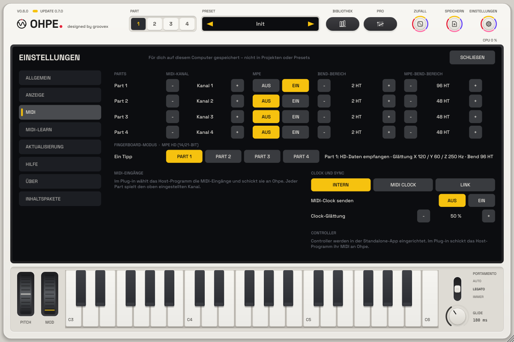

# MIDI-Leitfaden

*Deutsch · English: [docs/en/MIDI.md](../en/MIDI.md)*

Dieser Leitfaden beschreibt, wie Ohpe MIDI empfängt und sendet: Kanäle pro Part, MPE,
MIDI-Clock, Host-Sync und Link. Das Zuweisen von Controllern zu Parametern (MIDI-Learn) steht im
Hauptbuch.

## Kanäle und Parts

Jeder Part hat einen eigenen **MIDI-Kanal** (`pN.midich`): Part 1 hört auf Kanal 1, Part 2 auf
Kanal 2 usw. `0` bedeutet **Omni** (alle Kanäle). Ein Controller auf Kanal 3 spielt also Part 3;
mehrere Parts auf demselben Kanal werden geschichtet. Die Bildschirm-Tastatur spielt auf Kanal 1.

**Kanal 10 spielt das Drum-Kit.** Omni-Parts ignorieren ihn; ein Part auf Kanal 10 (oder im
MPE-Modus) hört ihn zusätzlich, geschichtet mit dem Kit.

Die Sequencer sprechen ihren Part direkt an (ihren *Ziel-Part*), unabhängig von dessen Kanal.

| Nachricht | Wirkung |
|---|---|
| Note an / aus | spielt den Part (über Skalen-/Akkord-Modus und Arpeggiator, wenn aktiv) |
| Pitchbend | verstimmt den Part (Bereich `pN.bend`) |
| CC 5 | Portamento-Zeit (0.6): ersetzt die Glide-Zeit des Parts (0 … 2 s), bis sich `pN.glide` selbst ändert |
| CC 64 | Haltepedal |
| CC 65 | Portamento aus (< 64) / an (≥ 64, Standard) (0.6) |
| CC 74 | Timbre (Ziel `pN.mpe.timbre`) für alle Noten des Parts |
| Kanal-Aftertouch | Druck (Ziel `pN.mpe.press`, Menge `pN.mpe.pressamt`) für alle Noten des Parts |
| Polyphoner Aftertouch | Druck (gleiches Ziel, gleiche Menge) für diese eine Note (0.8 dokumentiert; ging schon immer) |
| CC 120 / 123 | Klang aus / alle Noten aus |
| Zugewiesene CCs und Noten | ändern ihren Parameter (MIDI-Learn) und spielen nicht |

## MPE (MIDI Polyphonic Expression)

Mit **MPE** (`pN.mpe`) spielt ein Part von einem MPE-Controller (untere Zone: Master-Kanal 1,
Member-Kanäle 2–16). Der Part hört dann auf alle Kanäle, und jede Note behält ihren eigenen
Ausdruck:

* **Pitchbend pro Note** auf dem Member-Kanal, Bereich `pN.mpe.bend` (Standard 48 Halbtöne,
  wie im MPE-Standard). Pitchbend auf dem Master-Kanal verstimmt den ganzen Part.
* **Druck** (Kanal-Aftertouch auf dem Member-Kanal oder polyphoner Aftertouch) geht zum
  **Druck-Ziel** (`pN.mpe.press`, Standard *Pegel*).
* **Timbre** (CC 74 auf dem Member-Kanal, Mitte 64) geht zum **Timbre-Ziel**
  (`pN.mpe.timbre`, Standard *Klangfarbe*).

Ziele: *Aus*, *Klangfarbe* (Helligkeit der Engine: Filter-Cutoff bei Analog, Wavetable, Cluster,
Grain und Sampler, Helligkeit bei Pluck, Modulationsindex bei FM), *Pegel* (bis +6 dB),
*LFO-Tiefe* (Vibrato / Tremolo pro Note), *Panorama* und seit 0.8:

| Ziel | Was es bewegt |
|---|---|
| *Cutoff* | Filter / Klang der Engine, ±3 Oktaven (Pluck: Helligkeit) |
| *Position* | Wavetable-Position, Grain-Position (± halber Bereich) |
| *FM-Index* | Index der FM-Engine, FM-Menge der Wavetable |
| *Grain-Dichte* | Grains pro Sekunde, ±2 Oktaven |
| *Drive* | Analog-Drive, Sättigung pro Note in Wavetable, längeres Ausklingen in Pluck |
| *Vibrato* | Vibrato pro Note (5,5 Hz, bis ±½ Halbton) |
| *Formant* | Formant-Verschiebung bei Vocal (±12 Halbtöne), Warp bei Wavetable |
| *Layer-Mischung* | Verhältnis von Haupt-Engine und Layer-Engine (für den ganzen Part: der letzte Wert) |

**Mengen (0.8).** `pN.mpe.pressamt` und `pN.mpe.timbreamt` (−1 … +1, Standard +1) skalieren, was
Druck und Timbre bewirken; eine negative Menge kehrt es um (Druck schließt das Filter, Timbre unter
der Mitte öffnet es).

**Glättung und Slides (0.8).** Pitchbends pro Note gleiten über `pN.mpe.slide` (0 … 1 s) zum neuen
Wert – mindestens 2 ms, damit grob gestufte Controller nie „zippern“. Eine Note, die mit einem
Bend beginnt, startet auf dieser Tonhöhe (sie gleitet nicht hinein). Druck und Timbre gleiten über
`pN.mpe.smooth` (0 … 0,5 s, 0 = sofort, wie vor 0.8).

**Portamento und Poly-Glide** arbeiten wie ohne MPE: eine neue Note gleitet von der vorigen
(Glide-Einstellungen des Parts), ihr eigener Pitchbend kommt obendrauf.

**Glide-Druck (p32).** `pN.glide.press` (*Part N Glide-Druck*, −1 … +1, Standard 0) lässt den Druck die
Glide-Zeit verändern. Als Druck zählt der größere Wert aus Kanal-Aftertouch und dem eigenen Druck der
neuesten Note (polyphoner Aftertouch oder MPE). Ein positiver Wert macht das Gleiten langsamer, je fester
man drückt (Zeit × (1 + 3 × Wert × Druck), bei +1 und vollem Druck bis zu viermal so lang); ein negativer
Wert macht es schneller (Zeit × (1 + Wert × Druck); bei −1 und vollem Druck springt die Tonhöhe).
Er wirkt auf die *Glide*-Zeit und die Portamento-Zeit von CC 5 gleichermaßen, auf neue und auf laufende
Gleitvorgänge; CC 65 aus schaltet Glide weiterhin ab. Bei 0 oder ohne Druck gleitet alles genau wie
bisher. Der Regler steht in der Pro-Ansicht in der Gruppe **Glide** und gehört zu Part-Presets
(Schlüssel `glide.press`). Zum Verhältnis zu einem Ausdrucks-Aftertouch-Slot auf *Glide-Zeit* (skalieren vs. addieren; beides zusammen dehnt doppelt) siehe [Ausdruck](AUSDRUCK.md#ausdruck-und-glide-druck).

**Ohne MPE** gelten dieselben Ziele, Mengen und Glättung für Kanal-Aftertouch, polyphonen
Aftertouch und CC 74 auf dem Kanal des Parts – eine Aftertouch-Tastatur steuert sie also auch.

Stelle den Pitchbend-Bereich des Controllers auf denselben Wert wie `pN.mpe.bend`.

Werks-Presets mit dem Tag **MPE** (0.8, in der Bibliothek nach „MPE“ suchen) bringen Druck- und
Timbre-Zuordnungen, Mengen, Slide und Glättung mit, die zum Klang passen (z. B. öffnet Druck bei
Bässen das Filter oder gibt Drive dazu, Timbre fährt bei Flächen durch die Wavetable, Druck verdichtet
die Grain-Wolke). Sie schalten MPE nicht ein – das geschieht pro Part (`pN.mpe`), wenn ein
MPE-Controller spielt; mit einer Aftertouch-Tastatur wirkt die Druck-Zuordnung sofort.

## Fingerboard-Modus (MPE HD 14/21 Bit)

Für **Fingerboard-Controller mit durchgehender Spielfläche** – eine Fläche ohne Tasten, auf der der
Finger frei entlanggleitet (X = Tonhöhe), sich nach vorn und hinten bewegt (Y) und drückt (Z), meist
mit Pedal-Eingängen. Diese Controller senden MPE mit zusätzlicher Auflösung (**MPE HD**: 14 Bit Druck
und Y, 21 Bit Pitchbend) und immer Anschlagstärke 127. Ohpe empfängt all das; normales MPE
funktioniert genau wie bisher.

**Einrichtung**

1. Am Controller die Ausgabe **MPE HD** wählen (der hochauflösende MPE-Modus; normales MPE geht
   auch, mit 7 Bit Druck / Y und 14 Bit Bend).
2. In Ohpe **Einstellungen → MIDI** öffnen. Unter **Fingerboard-Modus · MPE HD (14/21-bit)** den
   gespielten Part antippen (*Part 1* … *Part 4*). Ein Tipp setzt: MPE ein, MPE-Bend-Bereich 96
   Halbtöne, Noten-Einsatz aus dem Druck, MPE HD Auto. Noch ein Tipp: zurück zu Anschlag und 48
   Halbtönen.
3. Spielen. Der Status neben den Knöpfen zeigt *HD-Daten empfangen*, sobald der Controller
   hochauflösende Werte sendet, dazu die gesendeten Glättungs-Grenzfrequenzen (X / Y / Z in Hz) und
   den Bend-Bereich.
4. Einen Klang wählen – die Presets mit dem Tag **Fingerboard** (in der Bibliothek nach
   "Fingerboard" suchen) sind dafür abgestimmt. Ein Part im Fingerboard-Modus behält seine
   Controller-Einstellung (MPE, Bend-Bereich, MPE HD, Einsatz), wenn ein anderer Klang geladen wird.

**Was der Controller in Ohpe macht**

| Controller | Ohpe |
|---|---|
| X – nach links / rechts gleiten | Tonhöhe pro Note, stufenlos über den ganzen Bereich (21 Bit Bend, 96 Halbtöne); eine Note beginnt genau auf der Tonhöhe, auf der der Finger aufsetzt |
| Y – vor / zurück | das **Timbre-Ziel** (`pN.mpe.timbre`) und die Matrix-Quelle *Slide (Klangfarbe)*, 14 Bit |
| Z – Druck | der **Pegel** der Note (Fingerboard-Modus: kein Druck = still, der Finger formt Einsatz und Anschwellen), das **Druck-Ziel** (`pN.mpe.press`) und die Matrix-Quelle *Notendruck*, 14 Bit |
| Pedale auf dem Master-Kanal | Sustain (CC 64) und Sostenuto (CC 66) halten alle Noten des Parts; andere Pedale / CCs (z. B. CC 4, CC 11) über MIDI-Learn, sie wirken auf den ganzen Part |

Die Matrix-Quelle **Taste + Bend** (p50) folgt der stufenlosen Position des Fingers (Tastatur-
Verfolgung inklusive des eigenen Bends der Note), z. B. um einen Klang weiter oben dunkler zu machen.

**Was empfangen wird**

* **CC 87 (LSB-Präfix).** Ein CC 87 auf einem Member-Kanal gibt dem *nächsten* Kanaldruck, CC 74
  oder Pitchbend auf diesem Kanal 7 untere Bits dazu: Druck und Y laufen 0x0000 … 0x3F80 (0x3F80 =
  voll), der Bend hat 21 Bit. Nachrichten ohne Präfix gelten als normale 7-/14-Bit-Werte – der
  Controller darf beides jederzeit mischen.
* **NRPN 100 / 101 / 102** (CC 99 = 0, CC 98 = 100 / 101 / 102, CC 6 = Wert): die Glättungs-
  Grenzfrequenz des Controllers für X / Y / Z in 2-Hz-Schritten (z. B. 60 = 120 Hz). Ohpe glättet
  damit jede Dimension jeder Note, statt mit *Ausdrucks-Glättung* / *Pro-Noten-Slide*. Solange noch
  nichts angekommen ist (MPE HD *Ein*, oder *Auto*, sobald HD-Daten kamen), nimmt Ohpe X 120 Hz,
  Y 60 Hz, Z 250 Hz.
* **RPN 0** (Bend-Bereich) auf einem Member-Kanal setzt den Bend-Bereich aller Member-Kanäle (diese
  Controller senden 96). **RPN 6** (MPE-Konfiguration) auf Kanal 1 oder 16 wählt die untere oder obere
  Zone.

**Einstellungen** (Part-Parameter, MIDI-zuweisbar; auf der MPE-Seite der Pro-Ansicht):

| Parameter | Wirkung |
|---|---|
| *MPE HD* (`pN.mpe.hd`) | *Auto* (Standard): feine Werte und Glättung werden genutzt, sobald sie ankommen – normales MPE klingt genau wie bisher. *Ein*: die Glättung läuft auch, bevor der Controller seine Grenzfrequenzen gesendet hat. *Aus*: CC 87 und die (N)RPNs werden ignoriert. |
| *Noten-Einsatz* (`pN.mpe.onset`) | *Anschlag* (Standard, wie bisher), *Druck* (Anschlag ignoriert; der Pegel folgt dem Druck, 0 = still), *Anschlag x Druck* (beides). |
| *Tonhöhen-Rundung* (`pN.mpe.round`) | *Aus* (Standard) = freies Gleiten. *Anfang*: eine Note beginnt auf dem nächsten Halbton (das Gleiten danach ist frei). *Fortlaufend*: die Tonhöhe wird zusätzlich zum nächsten Halbton gezogen, solange der Finger stillhält. |
| *Rundungszeit* (`pN.mpe.round.time`) | wie schnell die fortlaufende Rundung zieht (0,01 … 1 s, Standard 0,15 s). |
| *Druckkurve* (`pN.mpe.pcurve`) | −1 … +1, 0 = linear. Rechts: leichte Berührung bleibt leise; links: spricht früh an. |

Mit *Anschlag* als Einsatz spielt ein Fingerboard-Controller jede Note mit voller Stärke – *Druck*
wählen (das macht der Fingerboard-Modus-Knopf). Portamento und Part-Glide addieren sich zum Gleiten
und arbeiten nie dagegen; für freies Gleiten *Glide* auf 0 lassen (wie in den Fingerboard-Presets).

## Tonart und In Tonart

Die Tonart (`key.root`, `key.scale`) und In Tonart (`key.lock`, `key.lock.mode`) sind Host-Parameter: MIDI-Learn über
die Tonart-Anzeige in der Kopfzeile des Displays (Klick › MIDI-Learn, oder Rechtsklick auf das Schloss), z. B. ein
Fußschalter für In Tonart oder ein Encoder (relativ) für den Grundton. Mit In Tonart rasten eingehende Töne jedes
Kanals, der einen Part erreicht, auf die Tonart (bzw. bei *Weiße Tasten* spielen die weißen Tasten die Tonart; schwarze
Tasten sind stumm). MPE-Parts behalten ihre Tonhöhe. Hosts geben einem Plug-in keine Tonart mit: sie wird in Ohpe
eingestellt (oder automatisiert). Siehe [Tonart, Akkord und In Tonart](BEDIENUNG.md#tonart-akkord-und-in-tonart-p45).

## Tempo und Transport

| Situation | Transport-Quelle |
|---|---|
| Plug-in im Host | immer der Host: Tempo und Position (ppq), samplegenau |
| Standalone, `sync.src` = Intern | Ohpes eigene Clock (`tempo`, Start mit `seq.run`) |
| Standalone, `sync.src` = MIDI-Clock | eine externe MIDI-Clock an einem aktiven MIDI-Eingang |
| Standalone, `sync.src` = Link | die Link-Session im lokalen Netzwerk |

In jedem Fall starten und stoppen die Sequencer mit **Sequencer Start** (`seq.run`) – im Host
laufen sie, solange der Host spielt *und* `seq.run` an ist.

**Transport-Tasten vom Controller (p11).** Einen Taster auf *Transport Start/Stopp* (`tape.tx.play`),
*Transport Aufnahme* (`tape.tx.rec`), *Transport Stopp* (`tape.tx.stop`), *Transport Schleife*
(`tape.tx.loop`), *Tape Start/Stopp* (`tape.tx.tplay`), *Bearbeitungsspur aufnahmebereit*
(`tape.tx.arm`) oder *Tape zum Anfang* (`tape.edit.rtz`) legen: Rechtsklick auf die Taste in Ohpe oder
MIDI → *Fernsteuerung*. Sie lösen beim Drücken aus (CC ≥ 64), wie die Tasten am Gehäuse; siehe
[Band-Transport](BAND-MISCHER-FX.md#transport). p38: *Tape Spur löschen* (`tape.edit.clear`) leert die
Bearbeitungsspur sofort (rückgängig machbar); *Tape alles löschen* (`tape.edit.clearall`) öffnet die Rückfrage
auf dem Bildschirm und löscht erst nach der Bestätigung. p42: *Tape Loop-Start setzen* (`tape.edit.loopin`) /
*Tape Loop-Ende setzen* (`tape.edit.loopout`) setzen die Schleife am Abspielkopf (im Raster von *Tape Loop-Raster*,
`tape.loopsnap`; das Ende schaltet die Schleife ein), *Tape Loop halbieren* / *verdoppeln* (`tape.edit.loophalf`,
`tape.edit.loopdouble`), *Tape Loop rückgängig* / *wiederherstellen* (`tape.edit.loopundo`, `tape.edit.loopredo`) –
zwei Taster auf Start / Ende legen und Schleifen von Hand spielen; siehe
[Schleife setzen](BAND-MISCHER-FX.md#schleife-setzen-p42).

**Räder auf dem Bildschirm (p14).** PITCH- und MOD-Rad links der Klaviatur senden Pitchbend und das
Modulationsrad (CC 1) auf dem Kanal des bearbeiteten Parts, wie die Bildschirm-Klaviatur. Pitchbend und
CC 1 vom Gerät erreichen die Parts wie bisher direkt. Die Räder sind außerdem Host-Parameter
(`perf.bend`, `perf.mod`): Rechtsklick auf ein Rad, um einen Fader oder ein Controller-Rad zuzuordnen.

### Host-Sync (Plug-in)

Ohpe liest in jedem Block Tempo und Song-Position des Hosts und setzt jeden Schritt genau auf
das Sample, an dem die Zeitachse des Hosts ihn erreicht – bei jedem Tempo und jeder
Puffergröße. Loops und Sprünge im Host setzen jeden Sequencer auf den richtigen Schritt (im
Song-Modus auf das richtige Pattern).

### MIDI-Clock empfangen

Mit `sync.src` = **MIDI-Clock** folgt Ohpe 24 Clock-Ticks pro Viertelnote sowie *Start*,
*Stop*, *Continue* und *Song Position Pointer*. Das Tempo wird über die letzten Ticks gemittelt,
die Position sanft an jeden Tick herangezogen; **Clock-Glättung** (`sync.smooth`) bestimmt, wie
stark: kleine Werte reagieren sofort, große ignorieren zitternde Clocks (USB, Funk). Ein
einzelner fehlender oder doppelter Tick wird ignoriert, ein echter Tempowechsel nach wenigen
Ticks übernommen.

### MIDI senden (Standalone)

Den **MIDI-Ausgang** wählst du unter *Sync & MIDI …* im Menü der Standalone-App.

* **MIDI-Clock senden** (`sync.clockout`): 24 Ticks pro Viertelnote, solange der Transport
  läuft, *Start* (oder *Song Position* + *Continue* beim Start mitten im Song), *Stop*.
* **Sequencer-Noten senden** (`sync.notesout`): die Noten aller Sequencer, jeweils auf dem
  MIDI-Kanal ihres Parts – so spielen Ohpes Sequencer externe Instrumente.

### Link (Standalone)

Die Standalone-App kann einer **Link**-Session beitreten (Ableton Link, eine Drittanbieter-
Bibliothek, siehe [THIRD-PARTY.md](../../THIRD-PARTY.md)) – mit anderen Apps im selben Netzwerk.
Mit `sync.src` = **Link** übernimmt der Transport Tempo und Beat-Phase der Session; Ohpes Takte
liegen auf denen aller anderen. Ändert man Ohpes Tempo, ändert sich das Session-Tempo. Start und
Stop bleiben lokal. Link ist eine Build-Option (`-DOHPE_WITH_LINK=ON`, Standard an); das Plug-in
folgt immer seinem Host.

### Grid-Controller (Standalone und Plug-in)

Ein 8 × 8-Pad-Controller mit vierzeiligem Display kann die Raster-Tastatur spielen und die gezeigte Seite bedienen –
**Grid-Controller (Profil 1)** und seine Ports unter Einstellungen > MIDI > Controller wählen. Sein Port wird aus den
normalen MIDI-Eingängen genommen. Im Plug-in öffnet Ohpe den User-Port des Controllers selbst (eine Instanz zur
Zeit) – diesen Port in der DAW für Spuren und Fernsteuerung ausschalten. Siehe [Grid-Controller](CONTROLLER.md).

## Einstellungen im Überblick

| ID | Bereich | Standard |
|---|---|---|
| `pN.midich` | 0 (Omni) … 16 | N |
| `pN.mpe` | aus / an | aus |
| `pN.mpe.bend` | 0 … 96 Halbtöne | 48 |
| `pN.mpe.press`, `pN.mpe.timbre` | Aus, Klangfarbe, Pegel, LFO-Tiefe, Panorama, Cutoff, Position, FM-Index, Grain-Dichte, Drive, Vibrato, Formant, Layer-Mischung | Pegel, Klangfarbe |
| `pN.mpe.pressamt`, `pN.mpe.timbreamt` (0.8) | −1 … +1 | +1 |
| `pN.mpe.smooth` (0.8) | 0 … 0,5 s | 0 |
| `pN.mpe.slide` (0.8) | 0 … 1 s (mindestens 2 ms) | 0 |
| `sync.src` | Intern, MIDI-Clock, Link | Intern |
| `sync.smooth` | 0 … 1 | 0,5 |
| `sync.clockout`, `sync.notesout` | aus / an | aus |
