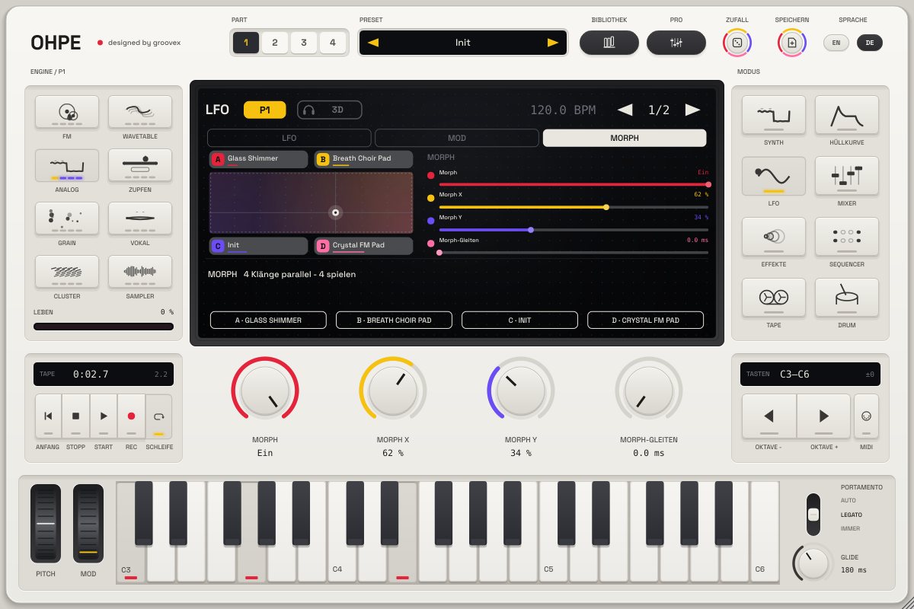

# Morph-Raum

*Deutsch · English: [../en/MORPH.md](../en/MORPH.md)*

Jeder Part hat ein **Morph-Pad**: ein XY-Feld, dessen vier Ecken je einen **vollständigen Klang** halten – Engine,
Hüllkurven, Filter, Modulationsmatrix, FX-Rack, 3D-Stufe, alles, was ein Part-Preset speichert. Bewegst du die
Position über das Pad, mischen sich die vier Klänge – weich, gleich laut, auch zwischen **verschiedenen Engines**.
Spielen lässt es sich mit der Maus, der Automation des Hosts, einem MIDI-Controller, der Modulationsmatrix, dem
Modulationsrad oder mit Druck und Slide eines MPE-Keyboards.

## Ecken

| Ecke | Position |
|---|---|
| **A** | oben links (x = 0, y = 1) |
| **B** | oben rechts (x = 1, y = 1) |
| **C** | unten links (x = 0, y = 0) |
| **D** | unten rechts (x = 1, y = 0) |

Eine Ecke hält jeden **Klangparameter** des Parts (`pN.*`) – außer dem Morph-Block selbst und dem MIDI-Routing des
Parts (MIDI-Kanal, Skala / Akkord, die MPE-Schalter), die bleiben beim Part. Eine **leere Ecke** steht für den
**eigenen Klang** des Parts – die Parameter, wie du sie mit den Reglern bearbeitest. Schon eine belegte Ecke ergibt
also einen Morph zwischen deinem Klang und einem anderen; vier belegte Ecken einen Morph über vier Klänge.

Belegt wird eine Ecke in der **Morph**-Ansicht (LFO-Modus, dritter Reiter): Klicke auf ein Ecken-Schild auf dem Pad
oder auf eine der Softkeys **A … D**:

| Menü | Ergebnis |
|---|---|
| **Aktueller Klang** | der Klang des Edit-Parts, wie er gerade ist (die Ecke heißt wie das geladene Preset) |
| **Preset ▸** | jedes Part-Preset der Bibliothek (nach Kategorie) – nur in die Ecke geladen, der Part behält seinen Klang |
| **Ecke leeren** | die Ecke steht wieder für den eigenen Klang des Parts |
| **Alle Ecken leeren** | alle vier |

Wer eine Ecke belegt, schaltet den Morph ein. Die Schilder zeigen den Namen der Ecke und als dünnen Balken in der
Farbe der Ecke ihren Anteil am Klang in diesem Moment.

## Wie die Klänge gemischt werden

Die Position gibt jeder Ecke ein Gewicht (bilinear: A = (1 − x) · y, B = x · y, C = (1 − x)(1 − y),
D = x (1 − y); zusammen immer 100 %).

* **Gleicher Aufbau – die Parameter werden interpoliert.** Ecken, deren diskrete Einstellungen übereinstimmen
  (gleiche Engine, gleiche Layer-Engine, derselbe Effekt in jedem Rack-Slot, derselbe Filtertyp, LFO-Formen,
  Routings …), sind ein Klang: jeder stufenlose Parameter wandert zwischen den Werten der Ecken. Ohpe interpoliert
  in normierten Einheiten, ein Cutoff oder eine Zeit bewegt sich also gleichmäßig in Oktaven / Verhältnissen, nicht
  in Hz. Ein Klang kostet keine zusätzliche Rechenleistung.
* **Anderer Aufbau – die Klänge spielen parallel.** Ecken, die sich in einer diskreten Einstellung unterscheiden
  (andere Engine, anderer Effekt, anderer Filtertyp …), spielen als parallele Klänge („Spuren“), die mit
  **leistungsgleichen** Pegeln (√Gewicht) überblendet werden: Die Lautstärke bleibt über das ganze Pad gleich,
  nichts schaltet hart um, und ein Engine-Wechsel knackt nie. Jede Spur ist ein vollständiger Part (Engine, Rack,
  3D-Stufe); ein Pad mit vier Engines kostet in der Mitte also bis zu vier Parts Rechenleistung. Eine Spur, deren
  Gewicht 0,1 s lang null war, rechnet nicht mehr; kommt die Position zurück, startet sie wieder mit den Tasten,
  die du hältst.
* Auf dem Pad verbinden **durchgezogene Kanten** Ecken, die ihre Parameter morphen, **gepunktete Kanten** Ecken,
  die als parallele Klänge überblendet werden.
* **Auf einer Ecke ist der Klang genau diese Ecke** – jeder Parameter hat den Wert der Ecke, Bit für Bit.

## Die Position bewegen

| Bedienung | Parameter / Quelle |
|---|---|
| Das Pad (ziehen) | `pN.morph.x`, `pN.morph.y` – automatisierbar, **MIDI-lernbar** (Rechtsklick auf das Pad oder einen Regler) |
| Regler (Seite *Morph*) | Morph ein, X, Y, Gleiten |
| **X-Steuerung / Y-Steuerung** (Seite *Steuerung*) | Aus, Druck (Kanal- oder MPE-Druck), Slide (MPE / CC 74, Mitte = 0, ± halbes Pad), Modulationsrad – zu X / Y addiert |
| Modulationsmatrix | Ziele **Morph X**, **Morph Y** (73, 74): jede Quelle bewegt das Pad, z. B. LFO 2 → Morph X für einen sich entwickelnden Klang |
| Gleiten | `pN.morph.glide` 0 … 2 s – die Position folgt jeder Änderung weich (auch gestuften MIDI-CCs) |

Die geglättete Position ist auch eine **Quelle der Matrix**: **Morph X**, **Morph Y** (21, 22, 0 … 1) – so kann das
Pad alles andere mitsteuern (eine Effektmischung, die 3D-Entfernung …). Routings des eigenen Klangs, die das Pad
selbst bewegen, bleiben aktiv, egal was die Ecken enthalten.

Typisch mit MPE: *Y-Steuerung = Druck*, *X-Steuerung = Slide* – fester drücken bewegt nach oben, nach vorn gleiten
nach rechts, jede Note des Parts folgt.

## Presets und Projekte

* Ein **Part-Preset** speichert die Ecken des Parts in einem optionalen Block `"morph"`; lädst du es in einen
  beliebigen Part, kommen die Ecken mit, ein Preset ohne den Block leert sie ([PRESETS.md](PRESETS.md#morph-block)).
* **Projekte** und der Plug-in-Zustand behalten die Ecken aller vier Parts.
* Die **Werks-Bibliothek** hat vier Morph-Presets (Tag *Morph*). Sie starten in Ecke C (dem eigenen Klang des
  Parts); das Modulationsrad bewegt nach rechts, Druck nach oben:

| Preset | Ecken | Spuren |
|---|---|---|
| Morph Strings Filter | ein analoges Streicher-Ensemble in vier Formen (offen, kantig, Grundklang, langsam und dunkel) | 1 – reiner Parameter-Morph |
| Morph Four Worlds | Glass Shimmer (Wavetable), Breath Choir Pad (Vokal), Warm Strings (Analog), Crystal FM Pad (FM) | 4 |
| Morph Keys and Bells | FM Vibes, Glass Keys, Digital EP, Dream Tine | mehrere (verschiedene Engines) |
| Morph Bass Shapes | Growl FM Bass, Classic Reese, Round Sub, Acid Line | mehrere (verschiedene Engines) |

## Hinweise

* Ist der Morph an, spielt der Part den Morph: Die Regler bearbeiten weiterhin den eigenen Klang des Parts, den du
  in den leeren Ecken hörst. Um eine Ecke zu ändern: dorthin fahren, bearbeiten und ihr **Aktueller Klang** neu
  zuweisen.
* Eigene Samples in einem Sampler- / Grain-Part spielen in der eigenen Spur des Parts; parallele Spuren nutzen die
  Werks-Instrumente, die ihre Ecke wählt.
* Parameter-Locks des Step-Sequencers haben auf ihrem Schritt Vorrang vor dem Morph.
* Parameter: [PARAMETERS.md](../PARAMETERS.md#morph-space-p16).
