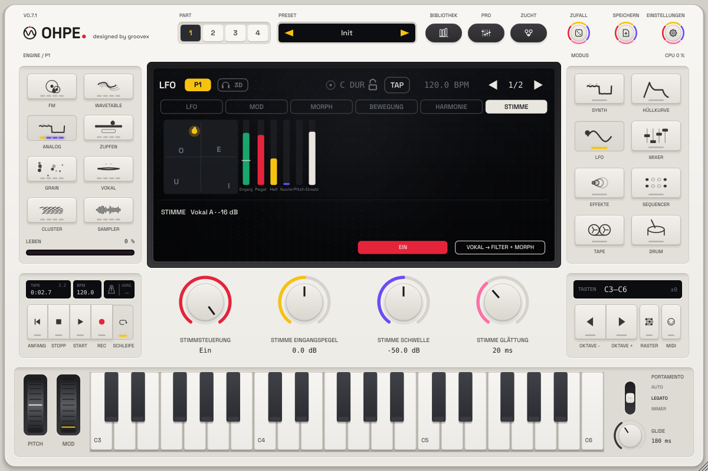

# Stimmsteuerung – Stimme führt Klang

*Ohpe – designed by groovex*

Sing, summ, sprich oder flüstere in einen Audio-Eingang, und deine Stimme bewegt den Klang. Die Stimmsteuerung ist
**kein Vocoder**: Die Stimme ist in Ohpe nie zu hören, sie moduliert nur. Sie wird in Echtzeit in sieben
Modulationsquellen zerlegt, die überall in der [Modulationsmatrix](MODULATION.md) wirken.

## Eingang anschließen

| Wo | Wie |
|---|---|
| Standalone-App | **Einstellungen > Audio**, **Eingangsgerät** (anfangs keins). macOS fragt einmal nach dem Mikrofon; der Text erklärt, wofür. *Kein Eingang* schließt es wieder. |
| Plug-in (VST3 / AU) | Ohpes optionaler Stereo-Eingangsbus – derselbe, den Tape und Bounce nutzen – ist der Stimmeingang. Im Host den Eingang oder Sidechain des Instruments einschalten (z. B. eine Mikrofonspur oder einen Gesangsbus auf Ohpes Sidechain-Eingang legen). Er bleibt aus, bis der Host ihn einschaltet; bestehende Projekte und Layouts bleiben unverändert. |

Kein Eingang = alle Quellen ruhen bei 0; ein Preset oder eine Zuweisung damit klingt genau wie programmiert.

## Die Quellen

| Nr. | Quelle | Bereich | Folgt |
|---|---|---|---|
| 34 | **Stimme Pegel** | 0 … 1 | wie laut du über der Schwelle bist (1 bei etwa −6 dBFS) |
| 35 | **Vokal X** | −1 … +1 | hinten (U, O) bis vorne (I, E) – der zweite Formant |
| 36 | **Vokal Y** | −1 … +1 | geschlossen (I, U) bis offen (A) – der erste Formant |
| 37 | **Stimme Helligkeit** | 0 … 1 | wie viel der Stimme oberhalb von etwa 2 kHz liegt |
| 38 | **Stimme Rauschanteil** | 0 … 1 | Konsonanten: s, sch, f, t hoch, gesungene Vokale niedrig |
| 39 | **Stimme Tonhöhe** | 0 … 1 | der gesungene Ton, C2 … C6 (nur mit *Tonhöhe erkennen*) |
| 40 | **Stimme Einsatz** | 0 … 1 | ein kurzer Impuls bei jeder neuen Silbe oder jedem Anschlag (klingt in etwa 80 ms ab) |

Der Vokal kommt aus den Formanten der Stimme (lineare Prädiktion über ein 16-ms-Fenster, alle 2,7 ms neu): Die
Analyse folgt der Stimme mit etwa **8 ms** plus der eingestellten Glättung. Die Vokalkarte ist auf mittlere
Erwachsenen-Formanten abgestimmt; höhere Stimmen landen trotzdem auf der richtigen Seite. Nach etwa 0,4 s Pause
gleiten Vokal, Helligkeit, Rauschanteil und Tonhöhe zurück auf 0.

## Die Ansicht Stimme (LFO-Modus)

**LFO > Stimme** zeigt die Vokalkarte – A E I O U an ihren Plätzen, dein Vokal als gelber Punkt (grau, solange du
schweigst) – und die Eingangsanzeige mit der Schwelle als weiße Linie, daneben kleine Balken für Pegel, Helligkeit,
Rauschanteil, Tonhöhe und Einsatz. Die Zeile darunter sagt, was die Stimmsteuerung hört (Vokal und Pegel, *Hört zu*
unter der Schwelle oder *Kein Eingang*).

| Encoder | Parameter | Bereich | Standard |
|---|---|---|---|
| Stimme 1 | **Stimmsteuerung** (`voice.on`) | Aus / Ein | Ein |
| Stimme 2 | **Eingangspegel** (`voice.gain`) | −24 … +24 dB | 0 dB |
| Stimme 3 | **Schwelle** (`voice.gate`) | −80 … −20 dBFS | −50 dBFS |
| Stimme 4 | **Glättung** (`voice.smooth`) | 1 … 250 ms | 20 ms |
| Optionen 1 | **Tonhöhe erkennen** (`voice.pitch`) | Aus / Ein | Aus |
| Optionen 2 | **Abhören** (`voice.monitor`) | Aus / Ein | **Aus** – den Eingang auf dem Hauptausgang hören; mit Lautsprechern aus lassen (Rückkopplung) |

Softkeys: **Ein** schaltet die Stimmsteuerung, **Vokal → Filter + Morph** ist die Schnellzuweisung für den Edit-Part
(unten). Alle Parameter sind automatisierbar und per MIDI lernbar; sie gehören zu deinem Aufbau und werden nicht in
Presets oder Projekten gespeichert.

## Schnellzuweisung: Vokal → Filter + Morph

Ein Druck (oder der per MIDI lernbare Auslöser `pN.voice.map`) schreibt drei Zuweisungen in die Matrix des
Edit-Parts: **Vokal Y → Klangfarbe** (+40 %: offene Vokale öffnen das Filter), **Vokal X → Morph X** und
**Vokal Y → Morph Y** (je +50 %: dein Vokal wandert über das [Morph-Pad](MORPH-RAUM.md) – den Morph-Raum des Parts
einschalten, um es zu hören). Vorhandene Zuweisungen bleiben; ein zweiter Druck setzt nur die drei Mengen zurück; ist
die Matrix voll, bleibt sie unberührt (das Display sagt es).

## Werks-Presets

Drei Part-Presets beginnen mit **Voice** im Namen (in der Bibliothek nach „Voice" suchen). Ohne Eingang sind es fertige Klänge:

| Preset | Ohne Eingang | Mit deiner Stimme |
|---|---|---|
| **Voice Vowel Lead** | ein klarer Vokal-Lead mit Vibrato | dein Vokal bewegt seinen Vokal, Helligkeit öffnet ihn, Silben drücken nach |
| **Voice Filter Pad** | ein warmes Puls-Pad | offene Vokale öffnen das Filter, der Pegel macht es lebendig, der Vokal verteilt es im Panorama |
| **Voice Wah Bass** | ein runder sprechender Bass | Vokale fahren die Formant-Tabelle, Konsonanten beißen |

## Tipps

* Die Schwelle knapp über das Raumrauschen stellen: Der Punkt soll nur beim Singen gelb werden.
* Längere Glättung (60 – 120 ms) lässt Vokalfahrten gleiten; 5 – 10 ms folgen schnellem Sprechen.
* Stimme Einsatz als *Via* einer Hüllkurve oder als Pegel-Zuweisung lässt rhythmische Silben den Part spielen.
* Kopfhörer nutzen oder **Abhören** aus lassen – Ohpe muss sich nie selbst hören.
