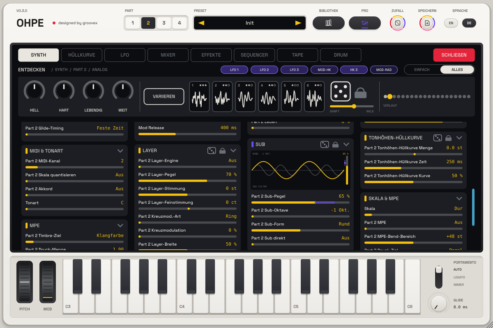

# SUB-Ebene (p31)

[English](../en/SUB.md)

Jeder Part hat eine **SUB-Ebene**: einen Suboszillator unter jeder Stimme der Engine des Parts, eine oder zwei
Oktaven unter der gespielten Note – für mehr Tiefe, ohne den Klang darüber zu verändern. Sie liegt im Synth-Modus auf
einer eigenen Reglerseite **Sub** (nach Glide und Tonhöhen-Hüllkurve) und in der Profiansicht als Karte **Sub**.

| Regler | Parameter | Was er tut |
|---|---|---|
| Pegel | `pN.sub.level` | 0 = aus (der Part klingt genau wie ohne SUB-Ebene) … 100 % |
| Oktave | `pN.sub.oct` | −1 Okt. oder −2 Okt. unter der Stimme |
| Form | `pN.sub.shape` | **Sinus** (rein, am tiefsten), **Rund** (ein abgerundetes Dreieck: etwas wärmer, noch sauber), **Rechteck** (ein weiches Rechteck: hohl, mehr Druck) |
| Direkt | `pN.sub.direct` | Aus: der Sub läuft durch das Filter der Engine (Analog, Wavetable). An: er kommt nach dem Filter dazu und bleibt auch bei geschlossenem Filter voll |

## Verhalten

* **An die Stimme gekoppelt.** Der Sub folgt genau der Tonhöhe, die die Stimme spielt – Note, Glide, Pitch-Bend,
  Tonhöhen-Hüllkurve, Matrix-Tonhöhe, MPE-Bends und der langsamen Drift von *Leben*. Seine Phase wird aus den
  Schwingungen der Stimme abgeleitet und beginnt mit jeder Note, er schwebt also nie gegen die Stimme.
* **Sauber.** Alle drei Formen sind bandbegrenzt: Sinus und Rund haben keine Kanten; das Rechteck ist ein weiches
  Rechteck, dessen Kanten mit steigender Tonhöhe weicher werden – auch die obersten Tasten erzeugen keine hörbaren
  Aliasing-Produkte.
* **Mono.** Der Sub ist auf beiden Kanälen dasselbe Signal – nie im Panorama verschoben, keine Stereobreite, sicher
  für Club-Anlagen und Vinyl. (Das *Bass-Mono* des Parts bleibt für alles andere da.)
* **Pegelsicher.** Er folgt der Amp-Hüllkurve und der Anschlagstärke der Stimme; Pegeländerungen laufen Sample für
  Sample (keine Treppenstufen). Bei 100 % ist ein Sinus-Sub etwa so laut wie eine Stimme der Engine.
* **Nur die Haupt-Engine.** Die Layer-Engine des Parts hat keinen eigenen Sub (eine SUB-Ebene pro Part).

## Engines

| Engine | SUB-Ebene | Durch das Filter (Direkt aus) |
|---|---|---|
| Analog | ja | ja – in das Ladder- / State-Variable-Filter (mit Drive) |
| Wavetable | ja | ja – in das Klangfilter |
| FM | ja | immer direkt (kein Stimmenfilter) |
| Pluck | ja | immer direkt (nach der Saite) |
| Cluster | ja | immer direkt (nach dem Stapel) |
| Grain | ja | immer direkt, auf der gespielten Taste |
| Vokal | ja | immer direkt (nach der Stimme) |
| Sampler | ja | immer direkt, auf der gespielten Taste (gestimmt für Samples auf ihrer Grundtaste) |
| Drum-Kit | nein – Pads haben keine Tastatur-Tonhöhe | – |

Analog und Wavetable haben zusätzlich ihren eigenen Engine-Sub (ein Sinus eine Oktave tiefer, ein Makro der Engine);
die SUB-Ebene ist davon unabhängig und bringt die Oktavwahl, die Formen und den direkten Weg dazu.

## Bild (Profiansicht)

Die Karte zeigt die Stimme als dünne graue Welle und darunter den Sub in Gelb – seine Form, seine Oktave (eine
Sub-Schwingung auf zwei oder vier Schwingungen der Stimme) und seinen Pegel; der kleine Fader rechts ist der Pegel,
ein violetter Streifen zeigt, was die Modulationsmatrix bewegt. **Ziehen** hoch / runter = Pegel, schnelles
**Wischen** = Form, **Klick** auf die Oktav-Beschriftung = die andere Oktave, Klick auf *INS FILTER / DIREKT* = der
Weg, **Mausrad** = Pegel, Doppelklick = aus.

## Modulation und MIDI

Die Modulationsmatrix hat das Ziel **Sub-Pegel** (85, Schlüssel `sublevel`): eine Hüllkurve, die Anschlagstärke oder
ein Makro können den Sub einblenden. Jeder SUB-Parameter ist per MIDI Learn zuweisbar (Rechtsklick) und Teil von
Part-Presets und Projekten.
