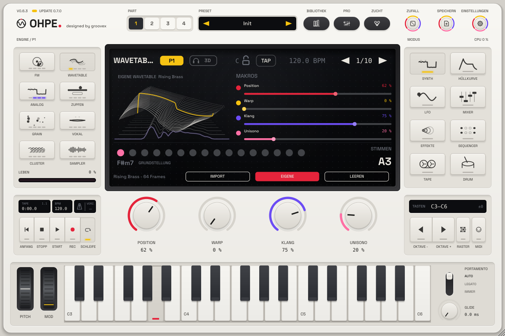

# Wavetable-Engine

*Deutsch · English: [../../en/engines/wavetable.md](../../en/engines/wavetable.md)*

Wavetable spielt eine Tabelle aus acht Einzelzyklen (Frames) und gleitet stufenlos zwischen ihnen.
Sechs Tabellen sind eingebaut (beim Start von Ohpe berechnet, keine Sampledateien): **Klassisch**
(Sinus → Dreieck → Sägezahn → Rechteck → schmaler werdender Puls), **Harmonisch** (ein additiver
Obertonaufbau, der von Frame zu Frame wächst), **Formant** (vokalartig a – e – i – o – u),
**Digital** (dünne, kammartige Spektren), **Glas** (glockenartige Obertöne) und **Körnig**
(geräuschhafte Spektren, die heller werden).

Jede Tabelle liegt in bandbegrenzten Kopien vor, eine pro Oktave; die Engine blendet je nach Ton
und Stärke der Phasenverbiegung zwischen ihnen über, so bleiben auch hohe Töne frei von Aliasing.
**Warp** ist eine weiche Phasenverzerrung (*Biegen*: eine Ausbuchtung pro Zyklus, *Drehen*: zwei),
die die Welle heller macht, ohne Spiegelfrequenzen zu erzeugen; deshalb nimmt sie in den obersten
Oktaven ab. Drei Unisono-Oszillatoren, ein Sub-Sinus und ein resonanzfähiger Tiefpass ergänzen
die Stimme.

| Regler | Parameter | Bereich | Wirkung |
|---|---|---|---|
| 1 | Position | 0–1 | Position in der Tabelle (Frame-Überblendung) |
| 2 | Warp | 0–1 | Stärke der Phasenverzerrung |
| 3 | Klang | 0–1 | Tiefpass-Cutoff (≈ 40 Hz – 20 kHz); Mod-Hüllkurve und LFO *Klangfarbe* bewegen ihn |
| 4 | Unisono | 0–1 | zwei verstimmte Seitenoszillatoren, Verstimmung und Stereobreite |
| – | Tabelle | Liste | Klassisch, Harmonisch, Formant, Digital, Glas, Körnig |
| – | Warp-Art | Liste | Biegen, Drehen |
| – | Hüllk. > Position | −1 – +1 | wie weit die Mod-Hüllkurve die Position verschiebt |
| – | Resonanz | 0–1 | Filterresonanz |
| – | Sub | 0–1 | Sinus eine Oktave tiefer |
| – | Key-Tracking | 0–1 | Cutoff folgt der Tastatur |
| – | Unisono-Stimmen (0.8) | 1–8 | 3 = die klassische Mitte + zwei Seiten; 1, 2, 4 … 8 = gleichmäßig gespreizter Stapel (Reese, Supersaw) |
| – | Unisono-Breite (0.8) | 0–1 | Stereobreite des Stapels (nicht bei den klassischen drei) |
| – | FM-Menge (0.8) | 0–1 | Phasenmodulation der Tabelle durch einen Sinus (Growls, metallische Kanten); blendet bei den höchsten Tönen aus, damit nichts spiegelt |
| – | FM-Verhältnis (0.8) | 0,25–8 | Frequenz des FM-Sinus relativ zur Note |
| – | LFO > Position (0.8) | −1 – +1 | der Part-LFO bewegt die Tabellenposition (langsame Scans, sprechende Growls) |
| – | Hüllk. > FM (0.8) | −1 – +1 | die Mod-Hüllkurve gibt FM dazu (oder nimmt sie weg) |

Parameter-IDs: `p1.wavetable.pos`, `.warp`, `.tone`, `.unison`, `.table`, `.warpmode`, `.envpos`,
`.reso`, `.sub`, `.keytrack`, 0.8: `.univoices`, `.uniwidth`, `.fm`, `.fmratio`, `.lfopos`, `.envfm`.

**Bass mit breitem Stapel (0.8):** der Stapel spreizt auch den Tiefbass – *Bass mono* des Parts
(`pN.monobass`, z. B. 150 Hz) oder einen *Stereobreite*-Slot mit *Mono unter* setzen, damit der Bass
monotauglich bleibt.

**Ausgangspunkte:** Fläche – Formant, Position 0,3, Hüllk. > Position 0,4, langsamer Amp-Attack;
Bass – Klassisch, Position 0,45, Unisono 0, Sub 0,5, Klang 0,5; heller Lead – Digital, Warp 0,4,
Unisono 0,5.

## Eigene Wavetables: Klang zu Wavetable (p20)

Auf der Synth-Seite der Wavetable-Engine zeigt das Display drei Softkeys: **IMPORT**, **EIGENE** und
**LEEREN**. Einen Klang (WAV, AIFF, FLAC, Ogg) oder eine Wavetable-Datei auf das Instrument ziehen oder
**IMPORT** drücken:

| IMPORT-Menü | Was es tut |
|---|---|
| Audio- oder Wavetable-Datei … | Dateiauswahl (Klänge, Single-Cycle-Sätze, Ohpe-Tabellen `.ohpewt`) |
| Von Tape-Spur › 1 … 8 | analysiert den aufgenommenen Teil einer Tape-Spur (bis 30 s) |
| Eingang aufnehmen › 2 / 4 / 8 s | nimmt den Audioeingang (mono) auf und analysiert ihn |
| Bibliothek › … | lädt eine Tabelle aus der eigenen Wavetable-Bibliothek |
| Inhaltspakete › Paket › … | nutzt eine Tabelle einer installierten Wavetable-Bank (schreibgeschützt, Wavetable-Engine) |
| Frames › 8 … 256 | wie viele Frames die Analyse schneidet (Standard 64) |
| Glättung › Aus / Leicht / Mittel / Stark | spektrale Glättung über benachbarte Frames |
| Import abbrechen | während ein Import läuft |

**So wird ein Klang zur Tabelle.** Die Analyse läuft in einem eigenen Thread – der Ton reißt nie ab.
Sie bestimmt die Tonhöhe, schneidet an gleichmäßig verteilten Stellen genau eine Periode heraus
(periodensynchrones Schneiden; das Ende jeder Periode wird in die vorige übergeblendet, damit der
Zyklus ohne Knacken schleift), rechnet jede Periode auf 2048 Samples um, dreht jeden Frame so, dass
sein Grundton als steigender Sinus beginnt (Phasenausrichtung: benachbarte Frames morphen ohne
Auslöschung), glättet auf Wunsch die Spektren über die Frames, entfernt Gleichanteil, normalisiert
jeden Frame und baut die bandbegrenzten Mip-Stufen (eine pro Oktave, wie bei den eingebauten
Tabellen) – eine eigene Tabelle erzeugt also keine Spiegelfrequenzen. Klänge ohne klare Tonhöhe werden
in Fenster von 2048 Samples geschnitten. *Position* fährt dann vom Anfang (0) bis zum Ende (1) durch
den Klang.

**Wavetable-Dateien.** Eine WAV-/AIFF-/FLAC-Datei aus Single-Cycles wird so gelesen, wie sie ist:
2048 Samples pro Frame (Dateilänge ein Vielfaches von 2048, bis 256 Frames) oder die Frame-Größe aus
einem `clm `-Chunk bzw. aus gleichmäßig verteilten Cue-Punkten (andere Größen werden auf 2048
umgerechnet). Ohpes eigenes Format `.ohpewt` enthält die Frames (und die Formantspuren für die
Vokal-Engine).

**Bibliothek, Presets, Projekte.** Jeder analysierte Klang und jeder importierte Satz wird in der
eigenen Wavetable-Bibliothek gespeichert – `…/groovex/Ohpe/Wavetables` im Anwendungsdaten-Ordner
(macOS: `~/Library/Application Support/groovex/Ohpe/Wavetables`); die Umgebungsvariable
`OHPE_WAVETABLE_DIR` wählt einen anderen Ordner. Part-Presets (Block `"usertables"`), Projekte und der
Plug-in-Zustand (Abschnitt `"usertables"`) verweisen über den Pfad, dann über den Dateinamen in der
Bibliothek auf die Tabelle und enthalten bei Tabellen bis 64 Frames eine eingebettete Kopie. Fehlt
alles, spielt der Part seine eingebaute Tabelle und das Display meldet es – sonst ändert sich nichts.

**Wavetable-Bänke (Inhaltspakete).** Ein installiertes [Inhaltspaket](../INHALTSPAKETE.md) der Art `wavetables` bringt
seine Tabellen (`wavetables/*.wav`, Single-Cycle-Sets, gelesen wie ein importierter Satz) ins Menü unter
**Inhaltspakete › <Paket>**. Sie sind schreibgeschützt: nichts wird in die eigene Bibliothek kopiert, und Presets /
Projekte speichern nur die Referenz `"<Paket>/<Tabelle>"` (`{"name": "Glass Choir", "content": "glass/glass-choir",
"frames": 64}`), nie die Tabelle. Beim Laden wird die Referenz wieder aufgelöst; fehlt das Paket, meldet das Display
**„Inhaltspaket fehlt – unter Einstellungen › Aktualisierung installieren“** mit der ID des Pakets, und der Part
spielt seine eingebaute Tabelle. Die Statuszeile nennt das Paket einer Pakettabelle.

**EIGENE** schaltet zwischen der eigenen und der eingebauten *Tabelle* um (Host-Parameter
`pN.usertable.wt`, MIDI-lernbar; ein Import schaltet ihn ein). **LEEREN** entfernt die eigene Tabelle
des Parts. Das Display zeigt den Frame-Stapel, den Frame an der aktuellen Position gelb; während ein
Import läuft, einen Fortschrittsbalken.
