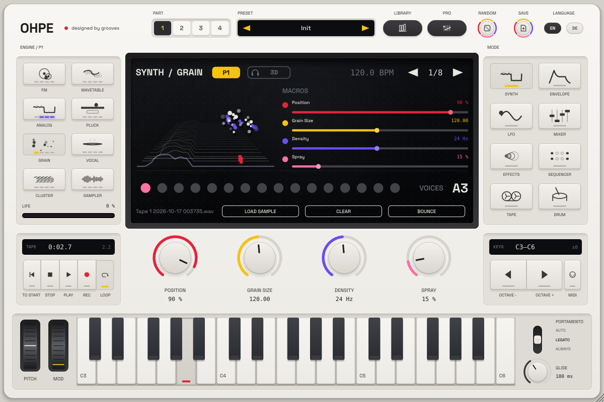

# Bounce to engine

*English · Deutsch: [../de/BOUNCE-INS-INSTRUMENT.md](../de/BOUNCE-INS-INSTRUMENT.md)*

**Bounce** moves audio from the tape or the live input into the **Grain** or **Sampler** engine of a part with one
button – resample a jam, turn a recorded phrase into a playable instrument, or freeze a few bars of a guitar into a
granular pad. By default the bounce becomes an **endless loop**: its end flows into its start without a click, so a
held key sustains it forever.

## One button

| Where | What happens |
|---|---|
| **BOUNCE** on the tape page (soft key) | bounces at once with the bounce settings (default: the edit track into the Grain engine of the edit part, endless loop). While the input records, the key lights and a second press finishes the recording early |
| **BOUNCE** on the Grain / Sampler page | a menu: *Edit track*, *Tape 1 … 8* (empty tracks are greyed), *Tape Mix*, *Input (n bars)*, the input length and *Endless loop*. Choosing a source bounces into the engine you are looking at |
| MIDI / automation: `bounce.go` | bounces with the bounce settings into the edit part (MIDI learn in the MIDI menu, *Remote controls*) |

The part switches to the target engine, the bounce replaces its sample (the factory instrument choice stays and comes
back when you clear the sample) and the display reports what happened, e.g. *Bounced to Grain: Tape 2 · 4.0 s ·
endless loop*. Undo is simple: **Clear** on the engine page goes back to the built-in sound, or load another sample.

## Sources

| Source | Material |
|---|---|
| **Edit track** | the tape page's edit track (*Track* / `tape.edit.track`) |
| **Tape 1 … 8** | one track |
| **Tape Mix** | all eight tracks summed (raw track audio, before the mixer) |
| **Input** | records 1, 2, 4 or 8 bars of the audio input at the current tempo (at most 60 s), then bounces |

From the tape, a bounce takes the **recorded part of the track** (from the start to the last sound) – or, while the
tape **loop** is on, exactly the **loop range** (*Loop In* … *Loop Out*). That is the quickest way to an endless loop
in time: set a loop of one or two bars, switch the loop on, press BOUNCE. At most 60 seconds are bounced.

The live input needs the audio input enabled (standalone: *Audio Settings*; plug-in: the host's input routing); with
silence nothing is bounced and the display says so.

## Endless loop or one-shot

| Mode (`bounce.loop`) | Preparation | Grain | Sampler |
|---|---|---|---|
| **Endless loop** (default) | the last 50 ms (at most a quarter) are cross-faded into the first 50 ms with an equal-power curve and removed, so the last frame flows into the first. Normalised to -1 dBFS | grains wrap across the seam: position, scan and spray run round and round the loop without stopping at an end | forward loop over the whole bounce (*Loop* = Forward, *Start* 0): a held note sustains the loop for as long as the key |
| **One-shot** | silence at both ends trimmed, 3 ms fades, normalised to -1 dBFS (at most +24 dB) | grains stay inside the sample (as with any loaded file) | no loop: the bounce plays once |

In the Sampler, **C4** plays the bounce at its original pitch and speed; other keys transpose it. In the Grain engine
the note transposes the grains the same way around C4.

## Where the bounces go

Every bounce is stored as a 24-bit WAV in the bounce library:

| System | Folder |
|---|---|
| macOS | `~/Library/Application Support/groovex/Ohpe/Bounces` |
| Windows | `%APPDATA%\groovex\Ohpe\Bounces` |
| Linux | `~/.config/groovex/Ohpe/Bounces` |

The environment variable `OHPE_BOUNCE_DIR` overrides the folder. File names are the source and the time
(`Tape 2 2026-10-17 141502.wav`). The engines keep the file's path, so the session and project presets reload the bounce
like any loaded sample. An endless loop carries a sample loop chunk: Ohpe recognises it when the file is loaded again
(also via **Load sample**) and other samplers can loop it too. If the folder cannot be written, the bounce still plays
– for this session only, which the message tells you.

## Parameters

Appended after the character macros (`p4.char.wide`), 5 IDs, not part of presets. See
[PARAMETERS.md](../PARAMETERS.md#bounce-to-engine-p23).

| ID | Name | Values |
|---|---|---|
| `bounce.src` | Bounce Source | Edit Track, Tape 1 … 8, Tape Mix, Input |
| `bounce.to` | Bounce Target | Grain, Sampler |
| `bounce.loop` | Endless Loop | on / off (default on) |
| `bounce.len` | Input Length | 1, 2, 4, 8 bars (default 4) |
| `bounce.go` | Bounce | trigger |

The settings are on the tape page's fifth encoder page (**Bounce**) and in the pro view of the tape mode. Bouncing is
a one-off action, so it has no modulation-matrix targets; the bounced material is modulated through the engines'
own targets (grain position, scan, sampler start …).
