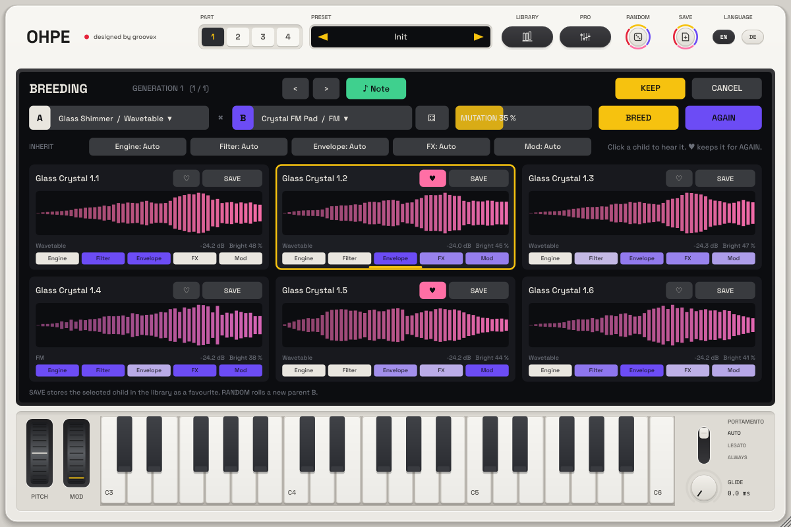

# Preset breeding

*English · Deutsch: [../de/ZUCHT.md](../de/ZUCHT.md)*

**Breeding** crosses two sounds and lets you pick the best of their children: choose two parents (your current
sound, any part preset of the library, a child of an earlier brood, or a roll of the die), set how much the
children may **mutate**, and press **BREED**. Six children appear; click one to hear it, give the good ones a
**heart** and press **AGAIN** – the next generation descends from the kept ones. Every generation stays in a
history with undo / redo, and **SAVE** stores a child in the library as a favourite.

## Opening the breeding view

| How | Result |
|---|---|
| Hold **RANDOM** (half a second) or right-click it | opens the breeding view; parent A = the current sound |
| **BREED** in the library's details (part presets) | closes the library (your sound comes back), opens the breeding view with A = the current sound and B = that preset and breeds at once |
| MIDI: `lib.breed` | opens / closes the view (MIDI learn in the MIDI menu, *Remote controls*) |
| MIDI: `lib.breed.go` / `lib.breed.next` | breed again / hear the next child |

The view lies on the plate like the library. **Keep** (Enter) closes it with the child you listened to last;
**Cancel** (Esc) brings back the sound from before the view opened. While the view is open, a short press of
**RANDOM** rolls a new parent B and breeds, and **SAVE** saves the selected child.

## Parents, mutation, generations

| Control | Function |
|---|---|
| **A** / **B** chips | menu: *Current sound*, *Random preset*, *Selected child*, *Preset ▸* (part presets by category; favourites marked with a heart) |
| Die | a random part preset of the library becomes parent B |
| **MUTATION** | drag: 0 % = the children are pure crosses of the parents (every value lies between the parents' values), 100 % = wild |
| **BREED** | a new brood of six from A and B |
| **AGAIN** | the next generation: two or more kept children are crossed with each other (every pair in turn), one kept child is mutated (at least 10 %), no kept child = the parents again |
| ‹ / › | undo / redo a generation (a new brood after undo drops the redo branch); the last 24 generations are kept |
| ♪ NOTE | each click on a child plays a short C (on / off) |
| **INHERIT** chips | per group (Engine, Filter, Envelope, FX, Mod): *Auto* (a random choice per child), *A*, *B* or *Mix* |

## The children

Each tile shows the child's name (the parents' first words and generation.child), a **waveform thumbnail**
coloured by its **brightness** (violet = dark, rose = middle, yellow = bright), its level and brightness, its
engine (with the layer engine of a hybrid) and an **inheritance strip**: one segment per group, white = from A,
violet = from B, in between = blended. The selected child has a yellow frame and light bar (green while its note
plays). Right-click a tile: *Listen*, *Keep*, *Make parent A / B*, *Save to the library*.

A saved child is an ordinary part preset (tag "Bred", a comment naming its parents) and is marked as a
favourite, so the library's *Favourites* filter finds it at once.

## How a child is made

A sound is treated as a **genome**: every parameter of the part, sorted into groups.

| Group | Parameters |
|---|---|
| **Engine** | engine choice, layer, the engines' own sound parameters, mono bass |
| **Filter** | cutoff, resonance, filter type, tone / brightness, drive, key tracking of the engines |
| **Envelope** | amp, mod and third envelope, pitch envelope, glide, velocity |
| **FX** | the six rack slots (types and parameters), the 3D stage |
| **Mod** | LFOs, the 16 matrix routings, macros, MPE amounts, life |
| Level | volume, part gain, layer level: blended, never mutated, then level-matched |
| Fixed | tuning, voices, pitch-bend range, MIDI channel, scale / chord, MPE switches, morph block: from parent A |

* **Crossover**: per group the child takes A, B or a blend (one blend position per group, in the parameters'
  own curve, so a frequency blends musically). Choices and switches are never interpolated – they come from one
  parent; whole numbers are rounded.
* **Coherent across engines**: an engine's parameters come from the parent that plays that engine; an effect's
  parameters come from the parent whose slot holds that effect; a matrix routing (source, via, target, curve,
  amount) travels as a unit unless both parents wire it alike. Two parents on **different engines**: the child
  plays the engine of one; when the Engine group blends, it may keep the other engine as its **layer** (a hybrid,
  at a moderate layer level, no cross-modulation).
* **Mutation**: small Gaussian steps on continuous parameters (inside 2 … 98 % of their range), rare steps on
  choices and whole numbers, very rarely another effect type (above 50 %). Never mutated: the engine and sample
  choice, the routing wiring, levels. Resonance, feedback, drive and gain-like parameters cannot rise more than
  a small step above the louder parent.
* **Level match**: every child is rendered offline (a private engine core on a worker thread, C4 + G4 for 0.7 s);
  its part gain is set so it plays as loud as its parents (at most 6 dB louder than its blended gain, any
  amount quieter), with the peak below -1.5 dBFS. The same render gives the thumbnail and the brightness.
* **Deterministic**: every random choice comes from Ohpe's own number generator; a seed gives the same brood on
  every platform.

The breeding session – parents, generations, kept children, the group choices – is saved with the project
(plug-in state, section `"breed"`). The breeding core (`src/core/breed`) is engine-agnostic: it reads only the
parameter descriptions, so new engines and effects breed without changes.
