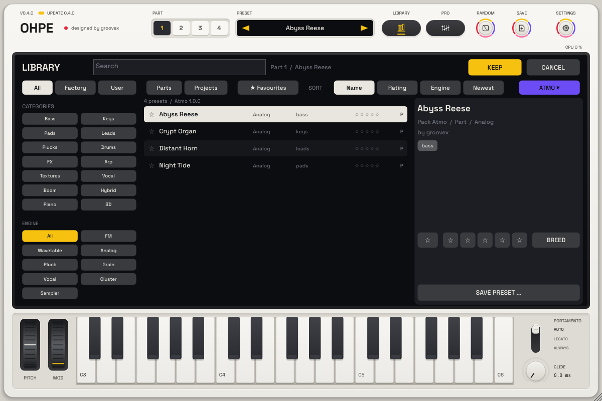

# Content packs

Ohpe – designed by groovex. Deutsch: [Inhaltspakete](../de/INHALTSPAKETE.md)

A content pack adds sounds to Ohpe without a new version of the program: preset collections (kind `presets`) and
wavetable banks (kind `wavetables`: single-cycle sets for the Wavetable engine, listed read-only in its table menu
under **Content packs** – see [Wavetable](engines/wavetable.md)). A pack is one file ending in **`.ohpepack`**. Packs are read-only – your own presets, wavetables, bounces and
settings are never touched.


## Installing a pack

* **Settings › Content packs › INSTALL PACK …** (also on **Settings › Updates** and in the library's **PACKS** menu)
  opens a file dialog for `.ohpepack` files, or
* **drop** an `.ohpepack` file anywhere on the Ohpe window.

The display says when the pack is installed or why it was not. Installing a newer version of an installed pack keeps
the old one as a backup (one step of rollback, as with packs from the updater).

Before anything changes, Ohpe checks the pack:

| Check | When it fails |
|---|---|
| every path stays inside the pack (no `..`, no absolute paths, no links) | the pack is refused as a whole |
| `pack.json` is there and valid (id, version, kind, names) | refused |
| every file has its SHA-256 in `pack.json`, and every listed file is there | refused – "A file of the content pack is damaged (checksum)" |
| the pack fits the size limits of its kind and the 2 GB room for all packs | refused |
| the pack's `minApp` is not newer than this Ohpe | refused – "This pack needs a newer Ohpe" |

The pack is unpacked into a staging folder first and only replaces the installed version when every file passed – a
failed install leaves everything as it was.

## Managing packs

**Settings › Content packs** lists every installed pack: name, version, size on disk, what it holds, license and
signature, and **REMOVE** (click twice: the chip asks *REMOVE?* first). The line above the list shows how much of the
room for packs is used.

In the **library**, the **PACKS** chip (right end of the filter row) opens a menu: *All presets*, one entry per
installed pack (shows only that pack's presets), *Install pack …* and *Manage packs …*. Pack presets carry a **P** in
the list and the pack's name in the details.



## License and signature

`pack.json` may name a license (`free` or `paid`, with a product id) and carry a signature (Ed25519 over the pack's
canonical `pack.json`). Ohpe shows both in the pack list (*Free / Paid*, *Signed / Unsigned*) but **does not check or
enforce them yet** – there is no shop and no online activation. The interface for a later unlock is in place
(`update::PackGate`); today every pack is allowed.

## Presets that use pack content

A preset can point at content of a pack by a reference `"<pack>/<item>"` – for example the wavetable
`atmo/glass-choir` is `wavetables/glass-choir.wav` in the pack `atmo`. Such references are never copied into the
preset. When the pack is not installed, Ohpe says **"Content pack missing – install it in Settings › Updates"** with
the pack's id; the part plays its built-in material until the pack is installed and the preset is loaded again.

## Building packs

`tools/pack/make_ohpepack.py` builds and checks packs (Python 3, no extra modules):

```
python3 tools/pack/make_ohpepack.py build packs/atmo --out out        # out/atmo-1.0.0.ohpepack
python3 tools/pack/make_ohpepack.py check out/atmo-1.0.0.ohpepack
python3 tools/pack/make_ohpepack.py canonical out/atmo-1.0.0.ohpepack  # the bytes a signature covers
```

A pack folder holds `pack.json` and the content in `files/` (or the kind folder next to `pack.json`). The exact format
is in [packaging/content/README.md](../../packaging/content/README.md).

## Where packs live

`<user data>/groovex/Ohpe/Content/<pack id>/` (macOS: `~/Library/Application Support/groovex/Ohpe/Content`, Windows:
`%APPDATA%\groovex\Ohpe\Content`, Linux: `~/.config/groovex/Ohpe/Content`), the installed versions in
`Content/installed.json`, the backups in `Content/.backup/`. `OHPE_DATA_DIR` moves the whole data folder.
