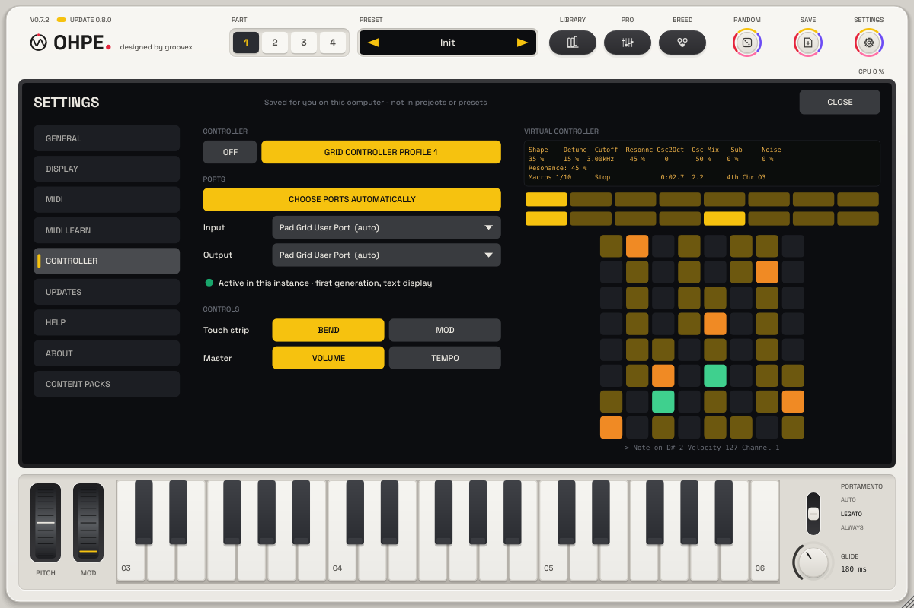
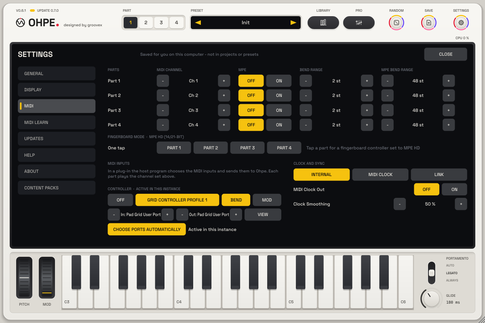

# Grid controller (profile 1)

Ohpe (the standalone app and, since p49, the plug-in) can be played and edited from an external **8 × 8 pad grid controller with a four-line
character display**: 64 pads with velocity and pressure, 8 touch-sensitive encoders and a master encoder, two rows
of 8 buttons under the display, transport and navigation buttons and a touch strip. In Ohpe this is
**Grid-Controller (Profil 1)** / **Grid controller profile 1**.

The pads play exactly like the on-screen [grid keyboard](HARMONY.md#the-grid-keyboard): same layouts, same notes,
same colours for root and key notes – what you learn on one works on the other.

## Setting it up

1. Connect the controller and start the Ohpe **standalone app** (for the plug-in see [In a plug-in](#in-a-plug-in)).
2. **Settings > MIDI > Controller**: choose **Grid controller profile 1**.
3. **In** / **Out**: step to the controller's MIDI ports (usually its first port for both; if the display stays
   empty, try its other port). The legend shows **Connected** once both ports are open.
4. **Bend / Mod**: what the touch strip does.
5. **View** shows the *virtual controller*: the four display lines, the 64 pad lights and the last MIDI messages –
   handy to check what the controller should show.

In the standalone app nothing is detected automatically; the choice is saved per user in `settings.json` (never in projects or presets)
and the controller is reopened at the next start. When it is unplugged the lights and display stop; when it comes
back, Ohpe reconnects within a second and sends everything again. Ohpe switches the controller's port off in the
plain MIDI input list so its pads don't play twice. The profile is **off by default**.

## In a plug-in

Since p49 the controller also works inside the **plug-in** (VST3 / AU in a DAW). The controller has two modes: in
its usual mode it talks to the DAW; in its **User mode** (the controller's *User* button) it hands its pads, display
and lights to whatever program opens its *user port*. Ohpe opens that port itself – past the host – with the full
display, pad colours, pressure, encoders (with touch), touch strip and buttons, exactly as in the standalone app.

1. **In the DAW**: in its MIDI preferences, switch the controller's *user port* (often called *… User Port*, on
   Windows *MIDIIN2 (…)* / *MIDIOUT2 (…)*) **off for tracks and remote** (input and output), so the DAW releases it
   and the pads don't play twice. Leave the controller's main port as it is.
2. **In Ohpe**: **Settings > MIDI > Controller**: choose **Grid controller profile 1**.
3. **Choose ports automatically** (on by default) picks the input and output whose names match the pattern
   (`User; MIDIIN2; MIDIOUT2` – any part found in a port name; editable as `"pattern"` under `"controller"` in
   `settings.json`). Switch it off and step **In** / **Out** to choose the ports yourself (stepping a port switches
   it off).
4. Switch the controller to its **User mode**. The legend shows **Active in this instance** once both ports are open.

**One instance at a time.** Only one Ohpe of the DAW can hold the controller: the one whose window you **opened or
clicked last**. The others show **Active in another instance** and a **Take over here** button; when the holding
instance is removed, the next one takes over. The holding instance keeps the controller while its window is
**closed** (the encoders keep the last page, the part, mode and transport buttons work). After loading a project,
open the window of the instance you want to play once – until then no instance holds the controller.

**Port in use.** On Windows a MIDI port can be open in only one program. If the DAW still holds the user port, the
legend shows **Port in use - free it in the host**; free the port in the DAW's MIDI preferences – Ohpe tries again
every second, and also reconnects when the controller is unplugged and plugged in again. MIDI from the host keeps
working in parallel. Closing the instance or switching the profile off clears the display and the lights.

## Display

| Line | Shows |
|---|---|
| 1 | names of the parameters on the 8 encoders (two over each display segment) |
| 2 | their values |
| 3 | preset · part and engine · tempo · key (and **Lock** with Scale Lock) – while an encoder is touched: its full name and value |
| 4 | page (e.g. *Filter 2/5*) · transport (Play / Stop / REC / Count-in, *Click* with the metronome) · tape position · pad mode, grid layout and octave |

Umlauts are written as ae / oe / ue (the display has no umlauts).

## Encoders

* **Encoders 1 – 8**: the parameters of the shown page and the next one – encoders 1 – 4 are the four screen encoders,
  5 – 8 the page after it (in the order of the pages on screen). Hold **Select** (or Shift) for fine steps.
* **Master encoder**: master volume; **Master** button switches it to the tempo.
* **Tempo encoder**: tempo (1 BPM per step, Shift / Select 0.1).

## Pads

The second button row, keys 5 – 8 (or **Note** / **Session**), chooses the pad mode:

| Mode | Pads |
|---|---|
| **Keys** | the on-screen grid keyboard on 8 × 8 pads |
| **Pads** | the four performance pads (stutter, tape stop, sweep, freeze) – one 4 × 4 quarter each, held = on |
| **Drum** | the 24 drum pads on the three bottom rows |
| **Steps** | steps 1 – 16 of the step sequencer on the two top rows (top row 1 – 8); the six rows below play like Keys |

### Keys – the grid keyboard on the pads

* **Same layout** as *Grid Layout* (`harmony.kb.layout`): **Fourths** (right +1, up +5), **Thirds** (+1 / +4),
  **Whole Tones** (+2 / +5) or **In Key** (scale steps of the key, three steps per row – only key notes).
  The **Scales** button steps through the layouts.
* **Same mapping**: pad (column, row) plays the note of the screen grid's cell at the same column and row, from the
  same lowest C. The four lower pad rows are exactly the screen grid's four rows; the upper four continue it.
* **Same key**: the key the grid shows (the remembered key – the set key until anything was heard). With **Scale
  Lock** (Shift + Scales) the other notes stay dark and silent; In Key has only key notes anyway.
* **Colours**: the key's root **amber**, key notes **yellow (dim)**, tones of the remembered chord **green (dim)**,
  held pads **green**, other notes dark (graphite on screen).
* **Octave − / +** moves pads, screen keyboard and screen grid together (the bottom-left pad is the C of that octave;
  In Key: the first key note from there).
* **Velocity and pressure** play the **edit part**. With MPE on for the part each pad gets its own member channel
  and pressure is that note's pressure; without MPE the notes go through scale, chord and follow and pressure is
  sent as poly aftertouch of the part.

## Buttons

| Button | Action |
|---|---|
| first row under the display | the eight mode keys in screen order, Synth to Drum (lit like the screen keys) |
| second row 1 – 4 | parts 1 – 4 |
| second row 5 – 8 | pad mode Keys / Pads / Drum / Steps |
| ◀ / ▶ | page − / + |
| ▲ / ▼ | previous / next preset |
| Octave − / + | octave of the keyboard, the grid and the pads |
| Play | play / stop (Shift: tape play / stop) |
| Record | record (Shift: arm the edit track) |
| Stop | stop (Shift: to the start) |
| Repeat | tape loop on / off |
| Metronome | metronome on / off (Shift: count-in Off / 1 bar / 2 bars) |
| Tap Tempo | tap the tempo |
| Undo | tape undo (Shift: redo) |
| Scales | next grid layout (Shift: Scale Lock) |
| Master | master encoder: volume ↔ tempo |
| Shift / Select | modifiers (Select: fine encoder steps) |

## Touch strip

**Bend**: pitch bend of the edit part (the screen's pitch wheel follows), back to the middle when you let go.
**Mod**: the mod wheel.

## Notes

* No new host parameters: the controller only changes existing parameters (host notified, automatable as before).
* Own implementation of the controller's publicly documented MIDI / display protocol; Ohpe contains no third-party code.
