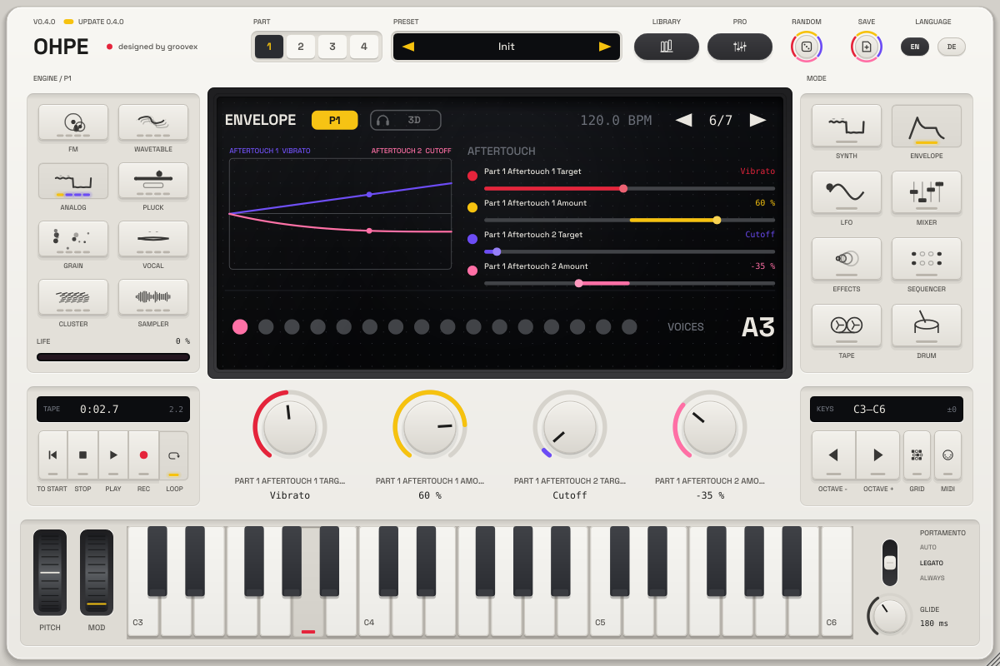

# Expressive playing – velocity and aftertouch (p33)

[Deutsch](../de/AUSDRUCK.md)

Every part has a small **Expression** page: how hard you play (**velocity**) and how hard you press a held key
(**aftertouch**) each move up to **two musical functions** – with an amount and a curve. It is the quick way to make a
sound respond to your hands, without building routings in the modulation matrix.

## Where it is

* **Envelope** mode, the last three pages: **Velocity** (target 1, amount 1, target 2, amount 2), **Aftertouch** (the
  same) and **Expression Curves** (velocity curve 1 / 2, aftertouch curve 1 / 2). The display shows the response of
  each slot as a line (left = soft / no pressure, right = hard / full pressure) and a dot that follows what you play.
* **Pro view** (Synth): the group **Expression** with all twelve controls.
* Everything is a host parameter and MIDI-mappable: `pN.expr.vel.dst1` … `pN.expr.at.curve2`
  ([PARAMETERS.md](../PARAMETERS.md#p33--expressive-playing)).

## Sources

| Source | What it reads |
|---|---|
| Velocity | the note's velocity, per voice (every note of a chord its own) |
| Aftertouch | channel pressure, poly aftertouch and MPE pressure alike – per voice where the controller sends it per note. Held channel pressure also applies to new notes. |

## Functions

| Function | What it moves |
|---|---|
| Cutoff | the engine's filter / tone (Analog: cutoff; Wavetable, Grain, Sampler, Cluster: tone; Pluck: brightness; Vocal: formant; FM: the BRIGHT character) |
| Resonance | the filter resonance (Analog, Wavetable, Cluster; Pluck: body) |
| Level | the level of each voice |
| Timbre | the engine's own brightness per voice (see [Timbre](MODULATION.md#targets)) |
| Amp Attack / Amp Decay / Amp Release | the amplitude envelope (e.g. softer notes swell in slower) |
| Mod Env Amount | how strongly the mod envelope works |
| LFO Rate / LFO Depth | the part's LFO |
| Vibrato | a 5.5 Hz vibrato on the pitch – ±1 semitone at 100 % (independent of the LFO settings) |
| Glide Time | the portamento time (on top of the Glide parameter or a CC 5 time) |
| FM Amount | FM index (FM), FM amount (Wavetable) |
| Position | wavetable / grain position, vowel (Vocal), sample start, pick position |
| Grain Spray | grain spray (Grain), jitter (Vocal), drift (Cluster), else the ALIVE character |
| Morph X / Morph Y | the [morph pad](MORPH.md) |
| Drive | Analog drive, FM feedback, Pluck excitation, Vocal tension, else the HARD character |
| FX Mix | the mix of the part's first FX rack slot |
| Sub Level | the sub oscillator (the part's SUB layer once it exists, else the Analog / Wavetable sub) |
| Pan | the pan of each voice |
| Pitch | the pitch of each voice (±12 semitones at 100 %) |
| Life | the part's [life](USER-INTERFACE.md#life) amount |

A function the active engine does not have stays silent there (e.g. Resonance on FM).

## Amount and curve

* **Amount** −100 … +100 %: how far the function moves at full velocity / pressure, in its full range (a cutoff
  moves in octaves). Negative amounts move it the other way (harder = darker, more pressure = shorter attack …).
  **0 % (the default) does nothing** – the sound is exactly as without the page.
* **Curve**: Linear, Exponential (only strong playing really moves it), Logarithmic (already a light touch moves it),
  S-Curve, Steps.

## Defaults and factory sounds

The slots start on musical choices so that turning up an amount is all it takes: velocity 1 → Cutoff, velocity 2 →
Amp Attack, aftertouch 1 → Vibrato, aftertouch 2 → Cutoff – all at 0 %.

Factory sounds with glide (portamento) use **aftertouch → Glide Time** with a positive amount: **more pressure =
a longer, slower glide**. Leaning into a key while you play legato turns a tight slide into a slow, vocal swoop, and
a light touch keeps the line tight. (A longer glide under pressure felt more natural than the other way round: the
pressure is usually already there when the next note starts, so the glide stretches exactly when you are pushing
into the phrase.)

## Expression and Glide Pressure

There are two ways to let aftertouch shape the glide, and they add up if both are used:

- **Glide Pressure** (`pN.glide.press`, pro view **Glide** group, see [MIDI](MIDI.md#mpe-midi-polyphonic-expression))
  *scales* the glide time: up to 4× longer at full pressure (positive) or down to no glide (negative). It needs no
  slot and keeps the ratio to the Glide parameter or CC 5 time.
- **Expression → Glide Time** (an aftertouch slot here) *adds* time through the modulation matrix, with its own amount
  and curve, and can sit alongside a second aftertouch function.

When both are set, the Expression offset is added first and Glide Pressure then scales the result, so the glide is
stretched twice. Each gliding factory sound uses exactly one of them (currently the Expression slot; a test checks
this); for your own sounds pick one, or use both on purpose.

## How it works

Each of the four slots is one more routing of the part's [modulation matrix](MODULATION.md) – same sources, curves,
scaling and smoothing as the 16 routings of the Mod view (source Velocity or Note Pressure, the Vibrato source for
Vibrato). The matrix gained the source **Vibrato (5.5 Hz)** (32) and the targets **Glide Time**, **Amp Attack**,
**Amp Decay** and **Amp Release** (86 – 89), usable in the Mod view as well.
