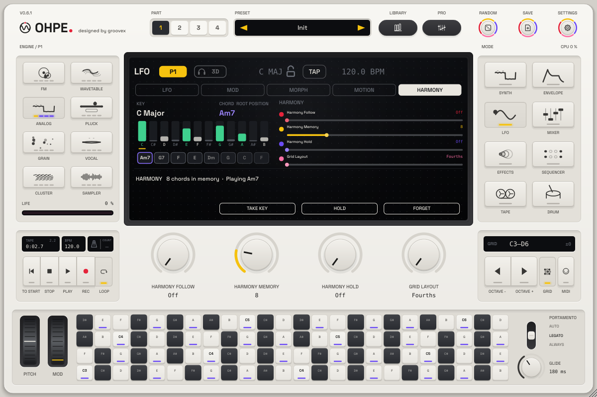
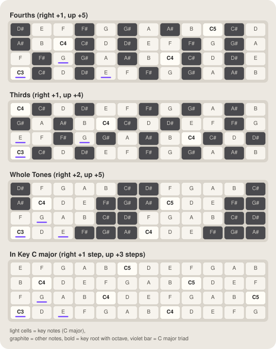
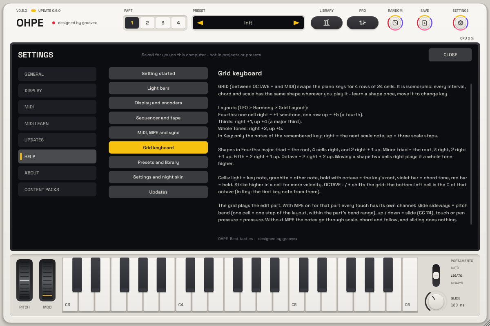
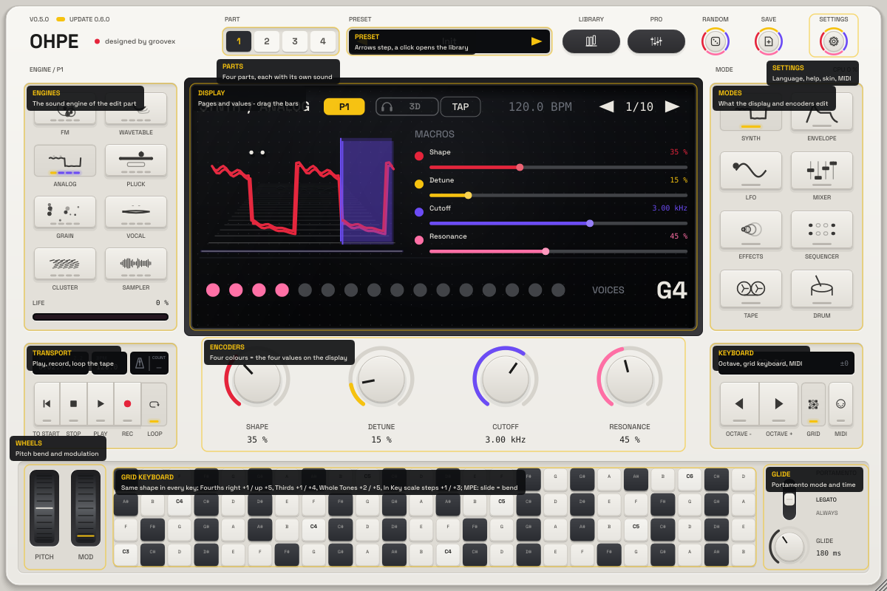

# Harmony brain

*English · Deutsch: [../de/HARMONIE.md](../de/HARMONIE.md)*



Ohpe listens to what you play and keeps a **scale and chord memory shared by all four parts** – the *harmony
brain*. Play chords on one part (keys, MIDI, a sequencer, the arpeggiator) and the other parts can **follow** them:
a bass that only hits chord tones, a lead that cannot leave the key, an arpeggio that moves with your changes –
without setting a key by hand. An **isomorphic grid keyboard** with MPE plays it from the screen.

## What the brain hears and remembers

* **Who is heard**: every note that reaches a part whose *Follow* is **Off** – the leading parts. Parts that follow
  are not heard (no feedback). The drum kit is not heard.
* **Chord**: as soon as two or more different notes are held, the brain names the chord – major, minor, diminished,
  augmented, sus2, sus4, maj7, m7, 7 or a bare fifth; the lowest note decides between two readings (A–C–E over A is
  *Am*). A chord counts once it stood for 40 ms (the notes of a played chord arrive one by one). It **stays in
  memory** after you let go, until the next chord. Letting go of one note of a triad keeps the chord.
* **Key**: a pitch-class memory gathers every note (its start and how long it is held) and fades with a half-life of
  **Memory** bars (1 – 32, default 8). The brain picks the major or minor key that fits best; another key must win
  clearly before it switches. Until anything was heard, the key is the global **Key / Scale** (`key.root`,
  `key.scale`).
* **History**: the last eight chords, newest first.

## Follow

Each part has **Follow** (`harmony.pN.follow`):

| Follow | The part's notes … |
|---|---|
| **Off** | … play as before (and are heard by the brain) – neutral, the default |
| **Scale** | … snap to the nearest note of the remembered key |
| **Chord** | … snap to the nearest tone of the remembered chord (before any chord: the key's tonic triad) |
| **Root** | … snap to the chord's root (any octave) |

Snapping uses the nearest note (a tie goes down) – live keys, host MIDI and all sequencers alike. The part's
one-finger **Chord** still works and builds its chord in the remembered key. Notes of a part with **MPE** on keep
their pitch (per-note expression); use the grid's *In Key* layout there.

## Controls

| Control | ID | What it does |
|---|---|---|
| **Follow** (per part) | `harmony.pN.follow` | Off / Scale / Chord / Root |
| **Memory** | `harmony.memory` | half-life of the key memory in bars (1 – 32) |
| **Hold** | `harmony.hold` | freezes the memory: new notes change neither chord nor key |
| **Take Key** | `harmony.take` | trigger: writes the remembered key into the global Key / Scale |
| **Forget** | `harmony.clear` | trigger: forgets key, chord, history |
| **Grid Layout** | `harmony.kb.layout` | Fourths / Thirds / Whole Tones / In Key |

All are host parameters: automatable and MIDI-learnable (right-click). The memory (key, chord, history, pitch-class
weights) is stored in projects and the plug-in state; part presets neither carry nor change *Follow*.

## The Harmony view

LFO mode, fifth tab **Harmony**: the remembered **key** and **chord** (the chord glows when it changes), twelve bars
for the pitch-class memory starting at the key's root (key notes light, other notes dim, **chord tones violet**,
**held notes green**, the root marked **yellow**) and the **history** chips. The strip says what the brain does and
whether the edit part follows. Soft keys: **Take Key**, **Hold**, **Forget**. Encoders: Follow (edit part), Memory,
Hold, Grid Layout.

## The grid keyboard



The **GRID** key (between OCTAVE + and MIDI, yellow bar while on) swaps the piano keys for a grid of **4 rows ×
24 cells**. It is an **isomorphic** keyboard. This section explains it from scratch – no music theory needed
beyond counting semitones.

### The idea: one shape, every key

On a piano, C major and D major look different: different white and black keys, different hand shapes. On an
isomorphic grid every cell is a fixed number of semitones away from its neighbours – one step **right** is always
the same interval, one step **up** is always the same interval. So an **interval, a chord or a scale is a shape**,
and the shape does not change when you move it. Learn the shape of a major chord once and you can play every major
chord by putting the same shape somewhere else. Moving a shape is **transposing**.

Two words used below: a **semitone** is the smallest step (C → C#, the next piano key); an **interval** is the
distance between two notes in semitones (a major third = 4, a fifth = 7, an octave = 12).

### Switching it on

* **GRID** shows the grid in place of the piano keys; press it again for the piano. Ohpe remembers which one was
  shown.
* It plays the **edit part** (the part selected with the part keys) and follows when you choose another part.
* **OCTAVE − / +** shift it like the piano: the bottom-left cell is the C of the piano's lowest octave (C3 by default;
  C0 … C7). The readout shows `GRID` and the grid's lowest and highest note.
* The layout is the parameter **Grid Layout** (`harmony.kb.layout`): LFO mode, view **Harmony**, encoder page
  *Harmony*. Like every parameter it can be automated and MIDI-mapped. It is global (the same for all parts).
* Hiding the grid, switching part or octave releases every held cell (no hanging notes).

### Reading the cells

| Cell | Means |
|---|---|
| light | a note of the **key** the harmony brain remembers (before it has heard anything: the global Key / Scale) |
| graphite | a note outside the key |
| bold name with octave (e.g. **C3**) | the key's **root** |
| violet bar | a note of the **chord** the brain remembers |
| sunk, red bar | a cell you are holding |

Note names follow the language: C# / B in English, Cis / H in German. **Where** you strike a cell sets the velocity:
the lower edge plays softly (velocity 56), the upper edge at full strength (127).

### The four layouts

The steps, exactly as the code computes them (row 1 = bottom row, column 1 = left):

| Layout | One cell right | One row up | Range at the default octave |
|---|---|---|---|
| **Fourths** (default) | +1 semitone | +5 semitones (a fourth) | C3 – D6 |
| **Thirds** | +1 semitone | +4 semitones (a major third) | C3 – B5 |
| **Whole Tones** | +2 semitones (a whole tone) | +5 semitones (a fourth) | C3 – C#8 |
| **In Key** | +1 step of the key's scale | +3 steps of the scale | C3 – G7 (C major) |

**Fourths** – like the lower strings of a bass or guitar: each row starts a fourth above the one below.

```
4 |  D#4    E4     F4     F#4    G4     G#4    A4     A#4
3 |  A#3    B3     C4     C#4    D4     D#4    E4     F4
2 |  F3     F#3    G3     G#3    A3     A#3    B3     C4
1 |  C3     C#3    D3     D#3    E3     F3     F#3    G3
  +--------------------------------------------------------
      1      2      3      4      5      6      7      8   
```

**Thirds** – rows a major third apart: compact chords, small hand spans.

```
4 |  C4     C#4    D4     D#4    E4     F4     F#4    G4
3 |  G#3    A3     A#3    B3     C4     C#4    D4     D#4
2 |  E3     F3     F#3    G3     G#3    A3     A#3    B3
1 |  C3     C#3    D3     D#3    E3     F3     F#3    G3
  +--------------------------------------------------------
      1      2      3      4      5      6      7      8   
```

**Whole Tones** – two semitones per cell; each row alone is a whole-tone scale, the next row (a fourth up) holds the
other six notes. Wide range in little space.

```
4 |  D#4    F4     G4     A4     B4     C#5    D#5    F5
3 |  A#3    C4     D4     E4     F#4    G#4    A#4    C5
2 |  F3     G3     A3     B3     C#4    D#4    F4     G4
1 |  C3     D3     E3     F#3    G#3    A#3    C4     D4
  +--------------------------------------------------------
      1      2      3      4      5      6      7      8   
```

**In Key** – only the notes of the remembered key, so you cannot play a "wrong" note. One cell right is the next
note of the scale, one row up is three scale steps. Details that follow from the code:

* The bottom-left cell is the **first key note at or above the C** of the octave (in D major: C#3), so the root is
  not always in the corner – look for the bold cell.
* In a seven-note key three steps are a **fourth** everywhere except from the fourth degree, where it is a tritone
  (in C major F → B). In a five-note key (pentatonic) three steps span more than a fourth.
* If the key's scale is *Chromatic*, In Key falls back to semitones: +1 right, +3 up (a minor third).
* When the brain moves to a new key the grid relabels at once; In Key cells then play the new key's notes.

```
4 |  E4     F4     G4     A4     B4     C5     D5     E5
3 |  B3     C4     D4     E4     F4     G4     A4     B4
2 |  F3     G3     A3     B3     C4     D4     E4     F4
1 |  C3     D3     E3     F3     G3     A3     B3     C4
  +--------------------------------------------------------
      1      2      3      4      5      6      7      8   
```

### Worked examples

The diagrams show the bottom-left 4 × 8 cells at the default octave (key C major); cells in `[ ]` are the ones to
press. Every shape works anywhere on the grid – if it runs off an edge, use the same shape somewhere else or shift
the octave.

**Major triad (C – E – G).** Fourths: root, four cells right (the third), and between them one row up (the fifth).

```
4 |  D#4    E4     F4     F#4    G4     G#4    A4     A#4
3 |  A#3    B3     C4     C#4    D4     D#4    E4     F4
2 |  F3     F#3   [G3]    G#3    A3     A#3    B3     C4
1 | [C3]    C#3    D3     D#3   [E3]    F3     F#3    G3
  +--------------------------------------------------------
      1      2      3      4      5      6      7      8   
```

The same chord has a second shape: third one row up and one cell left, fifth one row up and two right (here F – A – C):

```
4 |  D#4    E4     F4     F#4    G4     G#4    A4     A#4
3 |  A#3    B3     C4     C#4    D4     D#4    E4     F4
2 |  F3     F#3    G3     G#3   [A3]    A#3    B3    [C4]
1 |  C3     C#3    D3     D#3    E3    [F3]    F#3    G3
  +--------------------------------------------------------
      1      2      3      4      5      6      7      8   
```

**Minor triad (C – Eb – G).** Only the third moves: one cell left of the major third (three cells right of the root).

```
4 |  D#4    E4     F4     F#4    G4     G#4    A4     A#4
3 |  A#3    B3     C4     C#4    D4     D#4    E4     F4
2 |  F3     F#3   [G3]    G#3    A3     A#3    B3     C4
1 | [C3]    C#3    D3    [D#3]   E3     F3     F#3    G3
  +--------------------------------------------------------
      1      2      3      4      5      6      7      8   
```

**Power chord / fifth (C – G – C).** Root, one row up and two right (the fifth), the cell above that (the octave).

```
4 |  D#4    E4     F4     F#4    G4     G#4    A4     A#4
3 |  A#3    B3    [C4]    C#4    D4     D#4    E4     F4
2 |  F3     F#3   [G3]    G#3    A3     A#3    B3     C4
1 | [C3]    C#3    D3     D#3    E3     F3     F#3    G3
  +--------------------------------------------------------
      1      2      3      4      5      6      7      8   
```

**Octave (C3 → C4).** In Fourths always **two rows up, two cells right**:

```
4 |  D#4    E4     F4     F#4    G4     G#4    A4     A#4
3 |  A#3    B3    [C4]    C#4    D4     D#4    E4     F4
2 |  F3     F#3    G3     G#3    A3     A#3    B3     C4
1 | [C3]    C#3    D3     D#3    E3     F3     F#3    G3
  +--------------------------------------------------------
      1      2      3      4      5      6      7      8   
```

**Major scale (C D E F G A B C).** Three notes per row, a pattern that repeats:

```
4 |  D#4    E4     F4     F#4    G4     G#4    A4     A#4
3 |  A#3   [B3]   [C4]    C#4    D4     D#4    E4     F4
2 | [F3]    F#3   [G3]    G#3   [A3]    A#3    B3     C4
1 | [C3]    C#3   [D3]    D#3   [E3]    F3     F#3    G3
  +--------------------------------------------------------
      1      2      3      4      5      6      7      8   
```

**Transposing.** Move the whole shape: two cells right = two semitones up. C major becomes D major (D – F# – A) with
the same fingers:

```
4 |  D#4    E4     F4     F#4    G4     G#4    A4     A#4
3 |  A#3    B3     C4     C#4    D4     D#4    E4     F4
2 |  F3     F#3    G3     G#3   [A3]    A#3    B3     C4
1 |  C3     C#3   [D3]    D#3    E3     F3    [F#3]   G3
  +--------------------------------------------------------
      1      2      3      4      5      6      7      8   
```

One row up transposes by the row's interval (a fourth in Fourths: C major → F major).

**The same chords in the other layouts** (offsets as *cells right, rows up* from the root; negative = left):

| Shape | Fourths | Thirds | Whole Tones | In Key |
|---|---|---|---|---|
| major triad | 3rd (4, 0) or (−1, 1), 5th (2, 1) | 3rd (0, 1), 5th (3, 1) | 3rd (2, 0), 5th (1, 1) | 3rd (2, 0), 5th (1, 1) – major or minor as the key decides |
| minor triad | 3rd (3, 0) or (−2, 1), 5th (2, 1) | 3rd (3, 0) or (−1, 1), 5th (3, 1) | 3rd (−1, 1), 5th (1, 1) | same shape as above |
| fifth | (2, 1) | (3, 1) | (1, 1) | (1, 1) – diminished from the 7th degree |
| octave | (2, 2) | (0, 3) or (4, 2) | (1, 2) | (1, 2) |

Thirds, major triad (C – E – G) and minor triad (C – Eb – G):

```
4 |  C4     C#4    D4     D#4    E4     F4     F#4    G4
3 |  G#3    A3     A#3    B3     C4     C#4    D4     D#4
2 | [E3]    F3     F#3   [G3]    G#3    A3     A#3    B3
1 | [C3]    C#3    D3     D#3    E3     F3     F#3    G3
  +--------------------------------------------------------
      1      2      3      4      5      6      7      8   
```

```
4 |  C4     C#4    D4     D#4    E4     F4     F#4    G4
3 |  G#3    A3     A#3    B3     C4     C#4    D4     D#4
2 |  E3     F3     F#3   [G3]    G#3    A3     A#3    B3
1 | [C3]    C#3    D3    [D#3]   E3     F3     F#3    G3
  +--------------------------------------------------------
      1      2      3      4      5      6      7      8   
```

Whole Tones, major triad (C – E – G) and minor triad (D – F – A):

```
4 |  D#4    F4     G4     A4     B4     C#5    D#5    F5
3 |  A#3    C4     D4     E4     F#4    G#4    A#4    C5
2 |  F3    [G3]    A3     B3     C#4    D#4    F4     G4
1 | [C3]    D3    [E3]    F#3    G#3    A#3    C4     D4
  +--------------------------------------------------------
      1      2      3      4      5      6      7      8   
```

```
4 |  D#4    F4     G4     A4     B4     C#5    D#5    F5
3 |  A#3    C4     D4     E4     F#4    G#4    A#4    C5
2 | [F3]    G3    [A3]    B3     C#4    D#4    F4     G4
1 |  C3    [D3]    E3     F#3    G#3    A#3    C4     D4
  +--------------------------------------------------------
      1      2      3      4      5      6      7      8   
```

In Key, the scale is simply a row from left to right, and **one** triad shape plays every chord of the key: from C
it is C major, moved one cell right it is D minor (D – F – A) – the key decides major or minor.

```
4 |  E4     F4     G4     A4     B4     C5     D5     E5
3 |  B3     C4     D4     E4     F4     G4     A4     B4
2 |  F3    [G3]    A3     B3     C4     D4     E4     F4
1 | [C3]    D3    [E3]    F3     G3     A3     B3     C4
  +--------------------------------------------------------
      1      2      3      4      5      6      7      8   
```

```
4 |  E4     F4     G4     A4     B4     C5     D5     E5
3 |  B3     C4     D4     E4     F4     G4     A4     B4
2 |  F3     G3    [A3]    B3     C4     D4     E4     F4
1 |  C3    [D3]    E3    [F3]    G3     A3     B3     C4
  +--------------------------------------------------------
      1      2      3      4      5      6      7      8   
```

### Playing with MPE

What the grid sends depends on whether the edit part has **MPE** on (`pN.mpe`, see [MIDI](MIDI.md#mpe-midi-polyphonic-expression)).

**MPE on** – every touch (mouse or finger, up to 10 at once) is its own note with its own expression:

* Each touch gets a free **member channel** (2 – 16, in turn). It starts with the bend centred and slide at 64.
* **Slide sideways = pitch bend** of that note only. The bend follows the cells: one cell's width bends by the
  layout's step to the right – 1 semitone in Fourths and Thirds, 2 in Whole Tones, about 1.7 (12 / 7) in In Key. It
  is sent as 14-bit pitch bend scaled to the part's **MPE bend range** (`pN.mpe.bend`, default 48 semitones) and
  stops at the end of that range. The note stays the note you struck; letting go ends it.
* **Up / down = slide** (CC 74, centre 64): one and a half cell heights up reach 127, down reach 0. The part sends it to
  its timbre target (`pN.mpe.timbre`).
* **Pressure** (from a pressure-sensitive touch screen or pen; a mouse has none) is sent as channel pressure on the
  note's channel and goes to the part's pressure target (`pN.mpe.press`).
* MPE notes keep their pitch: they are not snapped by Scale, Chord or Follow.

**MPE off** – the notes play on the part's MIDI channel and go through the part like the piano keys (scale, one-finger
chord, Follow, the arpeggiator when it plays this part). Sliding does nothing; there is no per-note expression.

In both cases the harmony brain hears the grid's notes (they shape the remembered key and chord). Like the piano
keys, the grid is not sent to the MIDI output.

### Help in the app

**Settings > Help > Grid keyboard** sums this page up (layouts, shapes, cells, MPE). With the **help overlay** on
(Settings > General, or **F1**) and the grid shown, a line over the keyboard names the steps of every layout.





### Later: the same layouts on a grid controller

A planned controller profile (**Profile 1**) will let an external pad grid play exactly like the on-screen grid:

* **the same layouts** – Fourths, Thirds, Whole Tones and In Key, with the same steps right and up, so every shape on
  this page works there too;
* **key / scale lock** – In Key plays only key notes; the other layouts can show the key on the pads;
* **the same mapping** – a pad plays the note of the cell at the same column and row, from the same lowest C;
* **the same colours** – root, key notes, other notes, chord tones and pressed pads lit like the cells here;
* **octave / shift** – buttons on the controller move it like OCTAVE − / +.

Until then the on-screen grid is the reference: what you learn here carries over unchanged.

### On a grid controller

**Grid controller profile 1** (standalone app, Settings > MIDI > Controller) puts this grid on an external 8 × 8 pad
controller: the **same layouts** (the Scales button steps through them), the **same note** for the same column and row
from the same lowest C (the pads' four lower rows are the screen grid's four rows), the **same key** with **Scale Lock**
(other notes dark and silent), the root lit **amber**, key notes **yellow**, chord tones **green (dim)**, held pads
**green**, and **Octave − / +** moving pads and screen grid together. Velocity and pressure play the edit part (MPE: a
member channel per pad). Details: [Grid controller](CONTROLLER.md).

## Modulation

Three matrix sources (the same value in every part):

| # | Source | Range | |
|---|---|---|---|
| 29 | **Chord Root** | 0 … 1 | the chord's root, C = 0 … B = 1 |
| 30 | **Chord Change** | 0 … 1 | 1 at every new chord, fades in about 0.3 s – a filter accent on each change |
| 31 | **Tension** | 0 … 1 | share of held notes outside the key (smoothed) |
