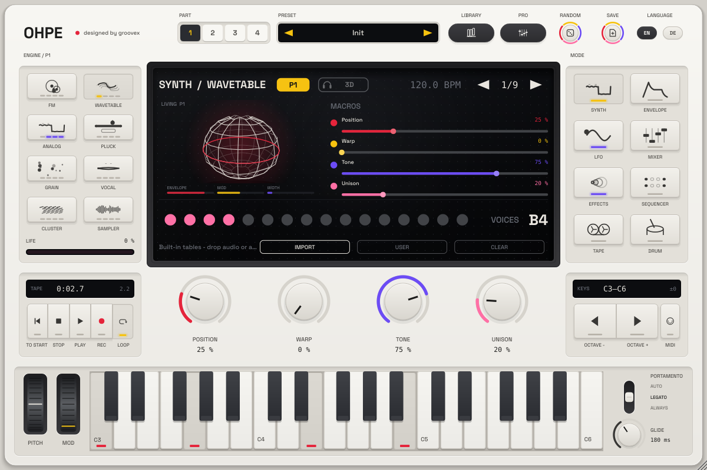

# Living display (p26)

The fifth display view, **Living object**, shows the sound as a 3D object in the left half of the display. It
listens to what shapes the sound right now and lets you see it at a glance:

| What moves | What it means |
|---|---|
| **Size, glow** | the amp envelope of the newest note and the level – the object swells on the attack, holds on the sustain and shrinks on the release |
| **Squash / stretch upright** | LFO 1 |
| **A twisting waist** | LFO 2 |
| **Tilt** | LFO 3 |
| **Ripples on the surface** | the mod envelope and how much the modulation matrix moves right now (more depth = faster ripples, faster turning) |
| **Width** | the stereo width of the signal (the side share): mono is round, wide sounds stretch to the left and right |
| **Two lobes** | the channels drift out of phase (correlation below about 0.2) – the object pinches into a left and a right half: a warning for mono playback |

An LFO only moves the object as much as it is used: the part LFO by its depth, LFO 2 / 3 by the routings of the
matrix that take them as source or *via*. A free-running LFO that drives nothing leaves the object still.

The equator ring wears the part's colour (P1 red, P2 yellow, P3 violet, P4 pink). Three small bars under the object
read out **Envelope**, **Mod** and **Width**. When the sound has faded the object settles into a still sphere
(*Play to wake it*).

## Choosing it

Click the left half of the display to cycle the views (*Character → Stereo scope → Spectrum terrain → 3D space →
Living object*) or right-click it and choose **Living object**. The view is saved with the project.

* **Synth** pages and the other part pages: the edit part (its envelopes, LFOs, matrix and its own signal after its
  FX rack), labelled *P1*–*P4*.
* **Mixer**: the master signal for the stereo picture (labelled *Master*), the edit part for the modulation.
* The Mid/Side scope still takes over by itself on Mid/Side slot pages; the tape page keeps its transport.

**Animated 3D visuals** off (view menu): the object stops turning and follows the sound without smoothing.

## Light on the CPU

The object is a small mesh (9 rings x 28 points) drawn as three strokes. The display repaints only the object's own
rectangle (and its readouts), and only while it moves: a resting object costs nothing – the rest of the display is
not repainted for it. The values come from the core's lock-free UI feedback and the scope tap; nothing waits or
allocates on the audio thread.

The object has no host parameters of its own – it is a view; everything it shows (envelopes, LFOs, matrix, width) is
automatable and MIDI-learnable where it is set.
