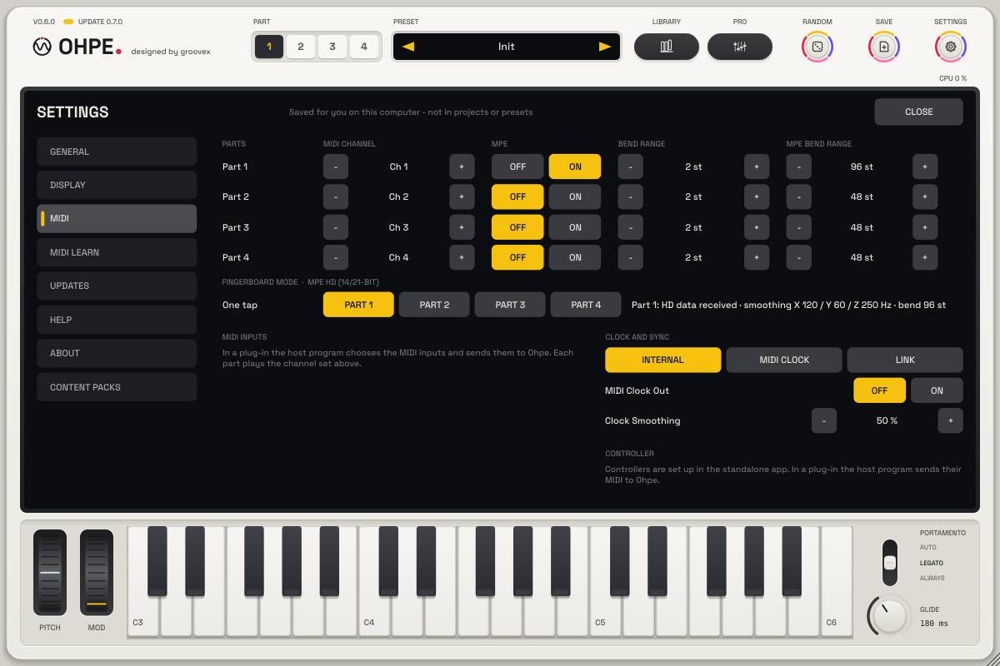

# MIDI guide

*English · Deutsch: [docs/de/MIDI.md](../de/MIDI.md)*

This guide covers how Ohpe receives and sends MIDI: channels per part, MPE, MIDI clock, host
sync and Link. Mapping controllers to parameters (MIDI learn) is described in the main manual.

## Channels and parts

Every part has its own **MIDI channel** (`pN.midich`): part 1 listens to channel 1, part 2 to
channel 2 and so on. `0` means **omni** (all channels). A controller on channel 3 therefore
plays part 3; set several parts to the same channel to layer them. The on-screen keyboard plays
on channel 1.

**Channel 10 plays the drum kit.** Omni parts ignore it; a part set to channel 10 (or in MPE
mode) hears it as well, layered with the kit.

The sequencers address their part directly (their *target part*), whatever its channel.

| Message | Effect |
|---|---|
| Note on / off | plays the part (through scale / chord mode and the arpeggiator, if active) |
| Pitch bend | bends the part (range `pN.bend`) |
| CC 5 | portamento time (0.6): overrides the part's Glide time (0 … 2 s) until `pN.glide` itself changes |
| CC 64 | sustain |
| CC 65 | portamento off (< 64) / on (≥ 64, the default) (0.6) |
| CC 74 | timbre (target `pN.mpe.timbre`) for all notes of the part |
| Channel pressure | pressure (target `pN.mpe.press`, amount `pN.mpe.pressamt`) for all notes of the part |
| Polyphonic aftertouch | pressure (same target and amount) for that one note (0.8: documented; it always worked) |
| CC 120 / 123 | all sound off / all notes off |
| Mapped CCs and notes | change their parameter (MIDI learn) and do not play |

## MPE (MIDI Polyphonic Expression)

Switch on **MPE** (`pN.mpe`) for a part to play it from an MPE controller (lower zone: master
channel 1, member channels 2–16). The part then listens to all channels, and every note keeps
its own expression:

* **Per-note pitch bend** on the member channel, range `pN.mpe.bend` (default 48 semitones,
  the MPE standard). Pitch bend on the master channel bends the whole part.
* **Pressure** (channel pressure on the member channel, or polyphonic aftertouch) goes to the
  **pressure target** (`pN.mpe.press`, default *Level*).
* **Timbre** (CC 74 on the member channel, centre 64) goes to the **timbre target**
  (`pN.mpe.timbre`, default *Timbre*).

Targets: *Off*, *Timbre* (the engine's brightness: filter cutoff in Analog, Wavetable, Cluster,
Grain and Sampler, brightness in Pluck, modulation index in FM), *Level* (up to +6 dB), *LFO Depth*
(adds vibrato / tremolo per note), *Pan*, and since 0.8:

| Target | What it moves |
|---|---|
| *Cutoff* | filter / tone of the engine, ±3 octaves (Pluck: brightness) |
| *Position* | Wavetable position, Grain position (±half the range) |
| *FM Index* | FM engine index, Wavetable FM amount |
| *Grain Density* | grains per second, ±2 octaves |
| *Drive* | Analog drive, a per-note saturation in Wavetable, a longer ring in Pluck |
| *Vibrato* | a per-note vibrato (5.5 Hz, up to ±½ semitone) |
| *Formant* | Vocal formant shift (±12 semitones), Wavetable warp |
| *Layer Blend* | the balance between the main engine and the layer engine (part-wide: the latest value) |

**Amounts (0.8).** `pN.mpe.pressamt` and `pN.mpe.timbreamt` (−1 … +1, default +1) scale what
pressure and timbre do; a negative amount turns it round (pressure closes the filter, timbre
below the centre opens it).

**Smoothing and slides (0.8).** Per-note pitch bends glide to their new value over
`pN.mpe.slide` (0 … 1 s) – at least 2 ms, so a controller sending coarse steps never zippers. A
note started with a bend starts at that pitch (it does not slide in). Pressure and timbre glide
over `pN.mpe.smooth` (0 … 0.5 s, 0 = at once, as before 0.8).

**Portamento and poly glide** work as without MPE: a new note glides from the previous one (part
glide settings), its own per-note bend is added on top.

**Pressure glide (p32).** `pN.glide.press` (*Part N Glide Pressure*, −1 … +1, default 0) lets the
pressure change the glide time. The pressure is the larger of the channel pressure and the newest
note's own pressure (polyphonic aftertouch or MPE). A positive amount makes the glide slower the harder
you press (time × (1 + 3 × amount × pressure), up to four times as long at +1 and full pressure); a
negative amount makes it faster (time × (1 + amount × pressure); at −1 and full pressure the pitch jumps).
It scales the *Glide* time and the CC 5 portamento time alike and acts on new glides and on glides that
are running; CC 65 off still switches glide off. At 0, or without pressure, the glide is exactly as
before. It is in the pro view's **Glide** group and part of part presets (key `glide.press`). For how it relates to an Expression aftertouch slot on *Glide Time* (scaling vs. adding; both together stretch twice) see [Expressive playing](EXPRESSION.md#expression-and-glide-pressure).

**Without MPE** the same targets, amounts and smoothing apply to channel pressure, polyphonic
aftertouch and CC 74 on the part's channel, so an aftertouch keyboard drives them too.

Set your controller's pitch-bend range to the same value as `pN.mpe.bend`.

Factory presets tagged **MPE** (0.8, search "MPE" in the library) come with pressure / timbre
mappings, amounts, slide and smoothing that suit the sound (e.g. pressure opens the filter or adds
drive on basses, timbre scans the wavetable on pads, pressure thickens the grain cloud). They do not
switch MPE on – do that for the part (`pN.mpe`) when you play from an MPE controller; with an
aftertouch keyboard the pressure mapping works right away.

## Fingerboard mode (MPE HD 14/21-bit)

For **continuous-surface fingerboard controllers** – a playing surface without keys where the finger
slides freely along it (X = pitch), moves forward and back (Y) and presses (Z), usually with pedal
inputs. These controllers send MPE with extra resolution (**MPE HD**: 14-bit pressure and Y, 21-bit
pitch bend) and always send note velocity 127. Ohpe receives all of it; plain MPE keeps working
exactly as before.

**Setup**

1. On the controller, choose its **MPE HD** output (the high-resolution MPE mode; plain MPE works
   too, with 7-bit pressure / Y and 14-bit bend).
2. In Ohpe open **Settings → MIDI**. Under **Fingerboard mode · MPE HD (14/21-bit)** tap the part
   you play (*Part 1* … *Part 4*). One tap sets: MPE on, MPE bend range 96 semitones, note onset
   from pressure, MPE HD Auto. Tap again to go back to velocity onset and 48 semitones.
3. Play. The status next to the buttons shows *HD data received* as soon as the controller sends
   high-resolution values, and the smoothing cutoffs (X / Y / Z in Hz) and bend range it sent.
4. Pick a sound – the presets tagged **Fingerboard** (search "Fingerboard" in the library) are tuned
   for it. A part in Fingerboard mode keeps its controller setup (MPE, bend range, MPE HD, onset)
   when you load another sound.

**What the controller does in Ohpe**

| Controller | Ohpe |
|---|---|
| X – slide left / right | per-note pitch, continuous over the whole range (21-bit bend, 96 semitones); a note starts exactly at the pitch where the finger lands |
| Y – forward / back | the **timbre target** (`pN.mpe.timbre`) and the matrix source *Slide (Timbre)*, 14-bit |
| Z – pressure | the note's **level** (Fingerboard mode: no pressure = silent, the finger shapes the attack and the swell), the **pressure target** (`pN.mpe.press`) and the matrix source *Note Pressure*, 14-bit |
| Pedals on the master channel | sustain (CC 64) and sostenuto (CC 66) hold every note of the part; other pedals / CCs (e.g. CC 4, CC 11) work through MIDI Learn and act on the whole part |

The matrix source **Key + Bend** (p50) follows the continuous position of the finger (key track
including the note's own bend), e.g. to darken a sound further up the surface.

**What is received**

* **CC 87 (LSB prefix).** A CC 87 on a member channel adds 7 low bits to the *next* channel
  pressure, CC 74 or pitch bend on that channel: pressure and Y run 0x0000 … 0x3F80 (0x3F80 =
  full), the bend has 21 bits. Messages without the prefix are read as plain 7-bit / 14-bit values –
  the controller may mix both at any time.
* **NRPN 100 / 101 / 102** (CC 99 = 0, CC 98 = 100 / 101 / 102, CC 6 = value): the controller's
  smoothing cutoff for X / Y / Z in 2 Hz steps (e.g. 60 = 120 Hz). Ohpe smooths each dimension of
  every note with it, instead of *Expression Smoothing* / *Per-Note Slide*. Before anything arrives
  (MPE HD *On*, or *Auto* once HD data came in) Ohpe uses X 120 Hz, Y 60 Hz, Z 250 Hz.
* **RPN 0** (bend range) on a member channel sets the bend range of all member channels (these
  controllers send 96). **RPN 6** (MPE configuration message) on channel 1 or 16 selects the lower
  or upper zone.

**Settings** (part parameters, MIDI-mappable; on the MPE page of the pro view):

| Parameter | What it does |
|---|---|
| *MPE HD* (`pN.mpe.hd`) | *Auto* (default): fine values and smoothing are used as soon as they arrive – plain MPE sounds exactly as before. *On*: the smoothing also runs before the controller sent its cutoffs. *Off*: CC 87 and the (N)RPNs are ignored. |
| *Note Onset* (`pN.mpe.onset`) | *Velocity* (default, as before), *Pressure* (velocity ignored; the level follows the pressure, 0 = silent), *Velocity x Pressure* (both). |
| *Pitch Rounding* (`pN.mpe.round`) | *Off* (default) = free slides. *Initial*: a note starts on the nearest semitone (the slide after it is free). *Continuous*: the pitch is also pulled to the nearest semitone while the finger holds still. |
| *Rounding Time* (`pN.mpe.round.time`) | how fast continuous rounding pulls (0.01 … 1 s, default 0.15 s). |
| *Pressure Curve* (`pN.mpe.pcurve`) | −1 … +1, 0 = linear. Right: a light touch stays soft; left: it speaks early. |

*Velocity* onset with a fingerboard controller plays every note at full velocity – choose
*Pressure* (the Fingerboard mode button does). Portamento and the part glide add to the slide and
never fight it; for free slides keep *Glide* at 0 (the Fingerboard presets do).

## Key and Scale Lock

The key (`key.root`, `key.scale`) and Scale Lock (`key.lock`, `key.lock.mode`) are host parameters: MIDI learn them
from the key readout on the display header (click › MIDI Learn, or right-click on the padlock), e.g. a footswitch for
Scale Lock or an encoder (relative) for the root. With Scale Lock on, incoming notes from any channel that reaches a
part snap to the key (or, in *White Keys*, the white keys play the key; black keys are silent). MPE parts keep their
pitch. Hosts pass no key to a plug-in: the key is set in Ohpe (or automated). See
[Key, chord and Scale Lock](USER-INTERFACE.md#key-chord-and-scale-lock-p45).

## Tempo and transport

| Situation | Transport source |
|---|---|
| Plug-in in a host | always the host: tempo and position (ppq), sample-accurate |
| Standalone, `sync.src` = Internal | Ohpe's own clock (`tempo`, start with `seq.run`) |
| Standalone, `sync.src` = MIDI Clock | an external MIDI clock on any enabled MIDI input |
| Standalone, `sync.src` = Link | the Link session on the local network |

In every case the sequencers start and stop with **Sequencer Run** (`seq.run`) – in a host they
run while the host plays *and* `seq.run` is on.

**Transport keys from a controller (p11).** Map a button to *Transport Play/Stop* (`tape.tx.play`),
*Transport Record* (`tape.tx.rec`), *Transport Stop* (`tape.tx.stop`), *Transport Loop*
(`tape.tx.loop`), *Tape Play/Stop* (`tape.tx.tplay`), *Arm Edit Track* (`tape.tx.arm`) or *Tape
Return to Zero* (`tape.edit.rtz`): right-click the key on Ohpe, or MIDI → *Remote controls*. They fire
on a press (CC ≥ 64), like the keys on the body; see
[tape transport](TAPE-MIXER-FX.md#transport). p38: *Tape Clear Track* (`tape.edit.clear`) empties the edit
track at once (undoable); *Tape Clear All* (`tape.edit.clearall`) opens the confirmation on the screen and
clears only when it is confirmed. p42: *Tape Set Loop In* (`tape.edit.loopin`) / *Tape Set Loop Out*
(`tape.edit.loopout`) set the loop at the playhead (on the grid of *Tape Loop Snap*, `tape.loopsnap`; loop out switches
the loop on), *Tape Loop Half* / *Double* (`tape.edit.loophalf`, `tape.edit.loopdouble`), *Tape Loop Undo* / *Redo*
(`tape.edit.loopundo`, `tape.edit.loopredo`) – map two buttons to set in / out and play loops by hand; see
[Setting the loop](TAPE-MIXER-FX.md#setting-the-loop-p42).

**On-screen wheels (p14).** The PITCH and MOD wheels left of the keyboard send pitch bend and the mod
wheel (CC 1) on the edit part's channel, like the on-screen keyboard. Hardware pitch bend and CC 1 reach
the parts directly as before. The wheels are also host parameters (`perf.bend`, `perf.mod`): right-click
a wheel to map a fader or a controller wheel to it.

### Host sync (plug-in)

Ohpe reads the host's tempo and song position every block and places every step at the exact
sample where the host's timeline reaches it, for any tempo and buffer size. Loops and jumps
in the host land every sequencer on the right step (and in song mode on the right pattern).

### MIDI clock in

With `sync.src` = **MIDI Clock** Ohpe follows 24 clock ticks per quarter note, *Start*,
*Stop*, *Continue* and *Song Position Pointer*. The tempo is averaged over recent ticks and the
position is pulled gently towards each tick; **Clock Smoothing** (`sync.smooth`) sets how much:
low values react at once, high values ignore jittery clocks (USB, wireless). A single missing or
doubled tick is ignored; a real tempo change is picked up within a few ticks.

### MIDI out (standalone)

Choose a **MIDI output** under *Sync & MIDI …* in the standalone menu.

* **Send MIDI clock** (`sync.clockout`): 24 ticks per quarter note while the transport runs,
  *Start* (or *Song Position* + *Continue* when starting mid-song), *Stop*.
* **Send sequencer notes** (`sync.notesout`): the notes of all sequencers, each on its part's
  MIDI channel – to play external instruments from Ohpe's sequencers.

### Link (standalone)

Ohpe's standalone app can join a **Link** session (Ableton Link, a third-party library, see
[THIRD-PARTY.md](../../THIRD-PARTY.md)) with other apps on the same network. With `sync.src` =
**Link** the transport takes tempo and beat phase from the session, so Ohpe's bars line up with
everybody else's. Changing Ohpe's tempo changes the session tempo. Start and stop remain local.
Link is a build option (`-DOHPE_WITH_LINK=ON`, default on); the plug-in always follows its host.

### Grid controller (standalone)

An 8 × 8 pad controller with a four-line display can play the grid keyboard and edit the shown page – choose
**Grid controller profile 1** and its ports in Settings > MIDI > Controller. Its port is taken out of the plain MIDI
inputs. See [Grid controller](CONTROLLER.md).

## Settings at a glance

| ID | Range | Default |
|---|---|---|
| `pN.midich` | 0 (omni) … 16 | N |
| `pN.mpe` | off / on | off |
| `pN.mpe.bend` | 0 … 96 semitones | 48 |
| `pN.mpe.press`, `pN.mpe.timbre` | Off, Timbre, Level, LFO Depth, Pan, Cutoff, Position, FM Index, Grain Density, Drive, Vibrato, Formant, Layer Blend | Level, Timbre |
| `pN.mpe.pressamt`, `pN.mpe.timbreamt` (0.8) | −1 … +1 | +1 |
| `pN.mpe.smooth` (0.8) | 0 … 0.5 s | 0 |
| `pN.mpe.slide` (0.8) | 0 … 1 s (at least 2 ms) | 0 |
| `sync.src` | Internal, MIDI Clock, Link | Internal |
| `sync.smooth` | 0 … 1 | 0.5 |
| `sync.clockout`, `sync.notesout` | off / on | off |
