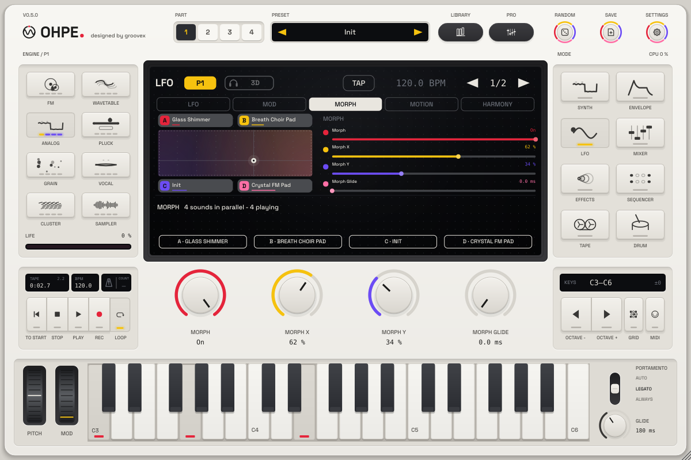

# Morph space

*English · Deutsch: [../de/MORPH-RAUM.md](../de/MORPH-RAUM.md)*

Every part has a **morph pad**: an XY field whose four corners each hold a **complete sound** – engine,
envelopes, filter, modulation matrix, FX rack, 3D stage, everything a part preset stores. Moving the position
across the pad blends the four sounds, smoothly, at even loudness, also between **different engines**. Play it
with the mouse, the host's automation, a MIDI controller, the modulation matrix, the mod wheel or the pressure
and slide of an MPE keyboard.

## Corners

| Corner | Position |
|---|---|
| **A** | top left (x = 0, y = 1) |
| **B** | top right (x = 1, y = 1) |
| **C** | bottom left (x = 0, y = 0) |
| **D** | bottom right (x = 1, y = 0) |

A corner keeps every **sound parameter** of the part (`pN.*`), except the morph block itself and the part's
MIDI routing (MIDI channel, scale / chord, the MPE switches), which stay the part's own. An **empty corner**
stands for the part's **own sound** – the parameters as you edit them with the encoders. So one assigned corner
already makes a morph between your sound and another one; four assigned corners make a four-way morph.

Assign a corner in the **Morph** view (LFO mode, third tab): click a corner chip on the pad or one of the soft
keys **A … D**:

| Menu | Result |
|---|---|
| **Current sound** | the edit part's sound as it is now (the corner is named after the loaded preset) |
| **Preset ▸** | any part preset of the library (by category) – loaded into the corner only, the part keeps its sound |
| **Clear corner** | the corner stands for the part's own sound again |
| **Clear all corners** | all four |

Assigning a corner switches the morph on. The chips show the corner's name and, as a thin bar in the corner's
colour, its share of the sound right now.

## How the sounds are blended

The position gives each corner a weight (bilinear: A = (1 − x) · y, B = x · y, C = (1 − x)(1 − y),
D = x (1 − y); together always 100 %).

* **Same structure – parameters are interpolated.** Corners whose discrete settings agree (same engine, same
  layer engine, the same effect in each rack slot, the same filter type, LFO shapes, routings …) are one
  sound: every continuous parameter moves between the corner values. Ohpe interpolates in normalised units, so
  a cutoff or a time moves evenly in octaves / ratios, not in Hz. One sound costs no extra CPU.
* **Different structure – the sounds play in parallel.** Corners that differ in a discrete setting (another
  engine, another effect, another filter type …) play as parallel sounds ("lanes") that are cross-faded with
  **equal-power** gains (√weight): the loudness stays even across the pad, nothing switches abruptly, and a
  changed engine never clicks. Each lane is a full part (engine, rack, 3D stage), so a pad with four different
  engines in the middle costs up to four parts of CPU; a lane whose weight has been zero for 0.1 s stops
  rendering, and when the position comes back it starts again with the keys you hold.
* On the pad, **solid edges** join corners that morph their parameters, **dotted edges** corners that
  cross-fade as parallel sounds.
* **On a corner the sound is exactly that corner** – every parameter has the corner's value, bit for bit.

## Moving the position

| Control | Parameter / source |
|---|---|
| The pad (drag) | `pN.morph.x`, `pN.morph.y` – host-automatable, **MIDI-learnable** (right-click the pad or an encoder) |
| Encoders (page *Morph*) | Morph on, X, Y, Glide |
| **X Control / Y Control** (page *Control*) | Off, Pressure (channel or MPE pressure), Slide (MPE / CC 74, centre = 0, ±half the pad), Mod Wheel – added to X / Y |
| Modulation matrix | targets **Morph X**, **Morph Y** (73, 74): any source moves the pad, e.g. LFO 2 → Morph X for an evolving sound |
| Glide | `pN.morph.glide` 0 … 2 s – the position follows every change smoothly (also stepped MIDI CCs) |

The glided position is also a **matrix source**: **Morph X**, **Morph Y** (21, 22, 0 … 1), so the pad can drive
anything else as well (an effect mix, the 3D distance …). Routings of the part's own sound that move the pad
itself stay active whatever the corners hold.

A typical MPE setup: *Y Control = Pressure*, *X Control = Slide* – press harder to move up, slide forward to
move right, every note of the part follows.

## Presets and projects

* A **part preset** stores the part's corners in an optional `"morph"` block; loading it into any part brings
  the corners along, a preset without the block clears them ([PRESETS.md](PRESETS.md#morph-block)).
* **Projects** and the plug-in state keep the corners of all four parts.
* The **factory bank** has seven morph presets (tag *Morph*; four of them are described below). They start in corner C (the part's own sound);
  the mod wheel moves right, pressure moves up:

| Preset | Corners | Lanes |
|---|---|---|
| Morph Strings Filter | one analog string ensemble in four shapes (open, edged, home, slow and dark) | 1 – pure parameter morph |
| Morph Four Worlds | Glass Shimmer (wavetable), Breath Choir Pad (vocal), Warm Strings (analog), Crystal FM Pad (FM) | 4 |
| Morph Keys and Bells | FM Vibes, Glass Keys, Digital EP, Dream Tine | several (different engines) |
| Morph Bass Shapes | Growl FM Bass, Classic Reese, Round Sub, Acid Line | several (different engines) |

## Notes

* With the morph on, the part plays the morph: the encoders still edit the part's own sound, which you hear in
  the empty corners. To change a corner, play it, edit, and assign **Current sound** to it again.
* User samples loaded into a Sampler / Grain part play in the part's own lane; parallel lanes use the factory
  instruments their corner selects.
* Parameter locks of the step sequencer win over the morph on their step.
* Parameters: [PARAMETERS.md](../PARAMETERS.md#morph-space-p16).
