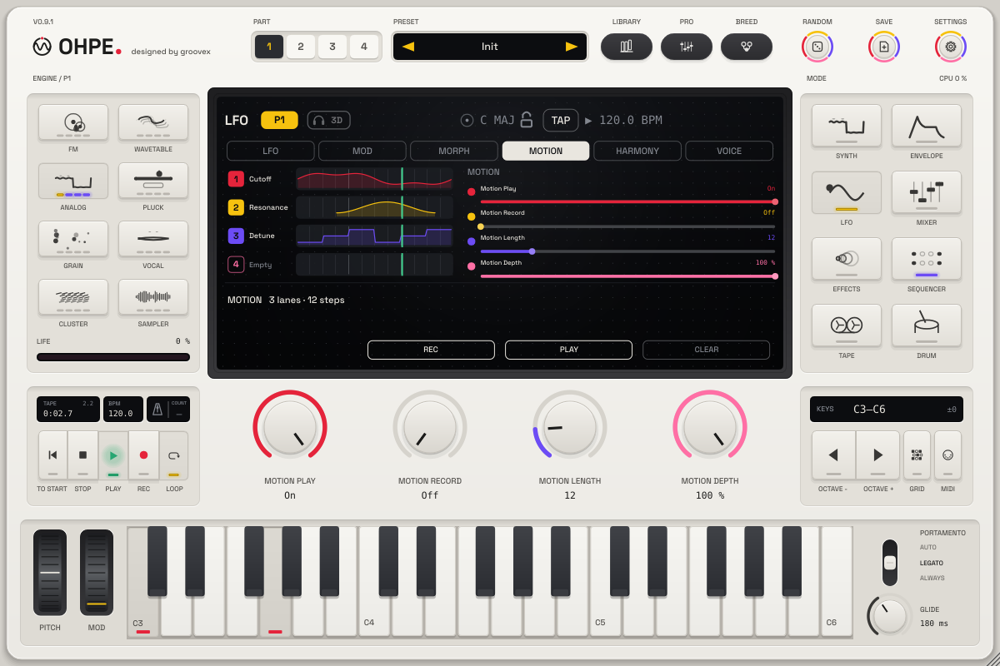

# Motion recorder

*English · Deutsch: [../de/BEWEGUNG.md](../de/BEWEGUNG.md)*

Every part has a **motion recorder**: turn its knobs while the transport runs and Ohpe records the movements as
**looping lanes** – a filter sweep, a resonance swell, a stepped detune – and plays them back in time with the
music. The loop has its **own length** (1 – 64 sixteenths), so a 5-step lane against a 16-step pattern drifts
around the bar and comes back together after five bars: polymetric movement without any programming.

## Recording

1. LFO mode, fourth tab **Motion** (the edit part's four lanes).
2. Press the soft key **Rec** (or turn encoder 2) – the lane rows wait, the playhead turns red once the transport runs.
3. Press **PLAY** and turn any knob of the part: the first **continuous** parameter you touch takes lane 1, the next
   one lane 2 … up to four lanes. While you hold or move a knob, its lane follows you (the row lights red) and you
   hear the knob; let go and the lane plays what you recorded.
4. Touch the same knob again later to **overdub**: only the part of the loop you touch is replaced.
5. Press **Rec** again to stop recording – **Play** stays on (it switches on with the first recording you play back).

Gaps between two screen updates are bridged smoothly. Choice, switch and whole-number parameters (engine, filter
type, voices …), the motion settings themselves and the part's MIDI setup are never recorded. When many parameters
change at once (loading a preset, a breeding step) nothing is recorded.

## Playing

| Control | What it does |
|---|---|
| **Play** (`pN.motion.on`) | loops the lanes with the transport (also on while recording) |
| **Rec** (`pN.motion.rec`) | records touches into the lanes |
| **Length** (`pN.motion.len`) | loop length in sixteenths, 1 – 64 (eight points per sixteenth); all lanes of the part share it. A shorter loop plays the start of the recording, a longer one plays the knob where nothing was recorded – nothing is lost |
| **Depth** (`pN.motion.amt`) | 0 = the knob's own value, 1 = the recorded movement; in between the movement is scaled towards the knob |
| **Clear** (soft key, or `pN.motion.clear`) | clears the part's four lanes |

All five are host parameters: automate them, or map them to a MIDI controller (right-click → MIDI learn) –
e.g. a footswitch on Rec.

A lane lays its value over the parameter **while the transport runs**; it sits below the step sequencer's
locks (a locked step wins) and above the knob, and the [modulation matrix](MODULATION.md) still moves the
parameter around it. The knob on screen and the host automation keep their own value. With the transport
stopped, Play off or nothing recorded, the part sounds exactly as without the recorder.

## Modulation sources

The four lanes are also sources of the [modulation matrix](MODULATION.md): **Motion 1 … Motion 4** (0 … 1, the
recorded value at the play position, 0 where nothing is recorded or the transport stops). Record one gesture and
let it move other targets too – the pan, an FX mix, the morph position.

## Storage

The lanes belong to the **project**: they are saved with the plug-in state and with project presets. Part presets
neither carry nor reset the motion settings – load another sound into a part and its lanes keep moving the new
sound's parameters. Morph corners and preset breeding ignore the motion block.

## The Motion view

Four rows, one per lane: the lane number in its encoder colour, the parameter's name (or *Empty*), and the lane with
a sixteenth grid over the loop (beats brighter), the recorded movement as a filled curve, and the playhead –
green while playing, red while recording. A lane being touched has a breathing red rim. The strip below says what
the recorder does right now. Soft keys: **Rec**, **Play**, **Clear**; encoders: Play, Rec, Length, Depth.
