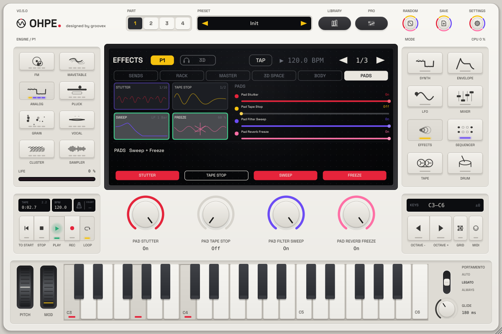

# Performance pads

*English · Deutsch: [../de/PERFORMANCE-PADS.md](../de/PERFORMANCE-PADS.md)*

Four **performance pads** throw effects on the whole main mix – the moves you reach for in a live set, a build-up or
a break: a **stutter**, a **tape stop**, a **filter sweep** and a **reverb freeze**. Hold a pad and it plays; let go
and the mix comes back. The pads lock to the beat: a pad you press waits for the next grid line of **Quantise**
while the transport runs, so a stutter always catches a clean slice.

## The pads

| Pad | What it does | Settings |
|---|---|---|
| **Stutter** | from the grid line, catches one slice of the mix and repeats it while held | *Stutter Length*: 1/4, 1/8, 1/16, 1/32, 1/8T, 1/16T |
| **Tape Stop** | the mix slows to a standstill – pitch and speed fall together like a stopping tape; silent once stopped | *Tape Stop Time*: 1/8, 1/4, 1/2, 1 bar, 2 bars |
| **Sweep** | a resonant low-pass closes (to ~150 Hz) or a high-pass opens (to ~8 kHz) over the sweep time; on release it sweeps back in a quarter of that time | *Sweep Filter* (low-pass / high-pass), *Sweep Time* (1/8 … 4 bars), *Sweep Resonance* |
| **Freeze** | throws the next quarter second of the mix into a reverb and holds it endlessly while held, under the dry mix that plays on; on release the wash decays in about three seconds | *Freeze Level* |

The pads stack: stutter → tape stop → sweep → freeze. A frozen wash under a closing low-pass, a stutter that then
tape-stops – all at once is fine.

## Playing them

1. **Effects** mode, sixth tab **Pads**.
2. **Press and hold** a pad on the display: it plays while you hold it. A violet blinking rim means it waits for the
   grid; green means it plays.
3. **Shift-click** a pad, or press its **soft key**, to latch it; again to release.
4. **Right-click** a pad for MIDI learn: map it to a button on your controller (button pressed = pad on).

**Quantise** (Off, 1/16, 1/8, 1/4, 1/2, 1 bar; default 1/16) sets the grid. With the transport stopped, or
Quantise Off, a pad engages at once. Letting go is always immediate, with a short fade. Times follow the tempo.

## Where they sit

The pads work on the **main mix** in the master chain: after the master FX rack, before the master compressor,
tape saturation and limiter – the limiter keeps a resonant sweep or a dense freeze in check. Channels routed to the
aux outputs are not affected. With no pad held and nothing ringing, the mix passes untouched.

## Automation, MIDI, modulation

Every pad and setting is a host parameter (`pads.*`, see [PARAMETERS.md](../PARAMETERS.md#performance-pads-p25)):
automate the throws in your DAW or map them by MIDI learn. The modulation matrix gains two sources – **Pad Sweep**
(the sweep position, 0 … 1) and **Pads Held** (1 while any pad plays) – so a part can, say, open its own filter
against the master sweep or duck its reverb send while a pad is held.

The four pads themselves are performance: project presets keep the settings but not whether a pad was held.
