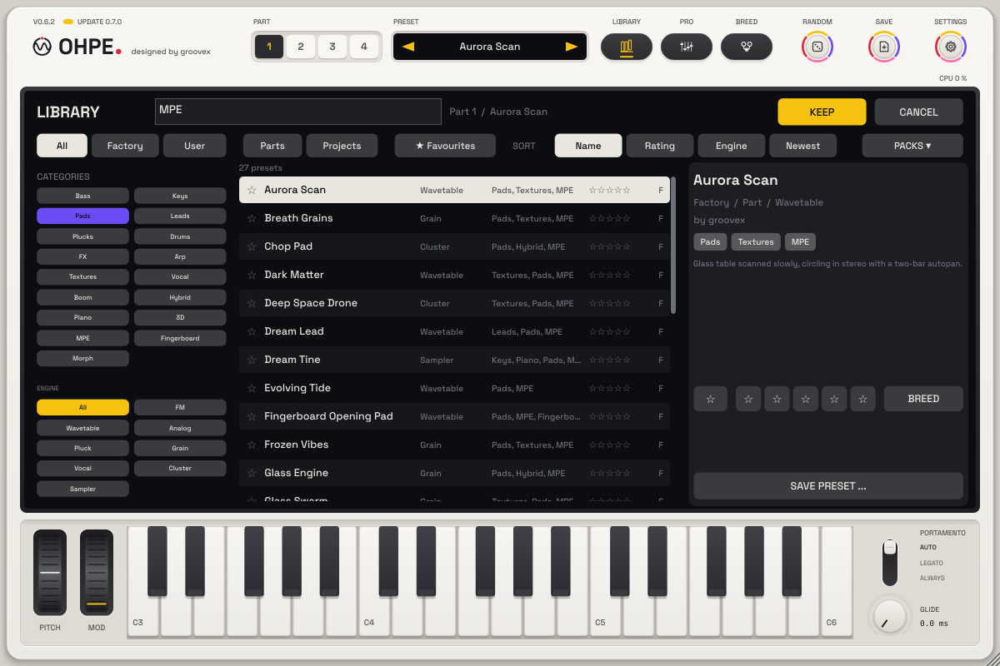

# Preset library

*English · Deutsch: [../de/PRESETS.md](../de/PRESETS.md)*




## Using the library

Press **LIBRARY** (top of the instrument) to open the library. It covers the keys and the display;
the keyboard stays playable, so you can audition sounds while you browse.

| Area | What it does |
|---|---|
| **Categories** (left) | Bass, Keys, Pads, Leads, Plucks, Drums, FX, Arp, Textures, Vocal, Boom (0.6: deep tuned kicks and sub basses), Hybrid (0.8: two engines in one sound), Piano (0.8: acoustic and electric pianos). Select one or several: the list shows presets that carry **any** of the selected tags. |
| **Engine** (left) | Only presets for one engine (or *All*). |
| **Quick chips** (left, under the categories) | **MPE**, **Fingerboard**, **Morph** (p54): presets that carry **all** of the selected chips. Combined with the categories, *Pads* + *MPE* shows the MPE pads. Only chips that some preset uses are shown. |
| **Search** (top) | p54: every word must match (AND) one of: name, author, comment, category and tags (English and German, also singular and other spellings: *Pad*, *Fläche*, *Flaeche*, *Flache*), the tags **MPE**, **Fingerboard** (also *MPE-HD*) and **Morph**, engine (id, English and German name), content pack (id and name, or *pack*), bank (*factory* / *werk*, *user* / *eigene*), kind (*part*, *project* / *projekt*), *favourite* / *favorit* and the rating (`***` = at least three stars, `5star`). Case and umlauts do not matter. Examples: `MPE`, `bass mpe`, `fläche fm`, `favorit ***`. The search works together with all chips. |
| **All / Factory / User** | Which bank: the built-in factory presets, your own presets, or both. |
| **Parts / Projects** | Only part presets (one sound) or only project presets (the whole instrument). |
| **★ Favourites** | Only presets you marked as favourite. |
| **Sort** | By name, rating (best first), engine or newest. |
| **List** | Selecting a preset **loads it at once** (preview) into the edit part – part presets into the part chosen with the part selector, project presets replace everything. Click the star on the left to mark a favourite, click the stars on the right to rate (click the same star again to clear). Arrow keys move through the list. |
| **Details** (right) | Name, bank, kind, engine, author, tags, comment, favourite and rating. User presets can be deleted (moved to the trash). |
| **Keep / Cancel** | *Keep* (or Enter, or a double-click on a preset) closes the library with the preset loaded. *Cancel* (or Esc) restores the sound you had before the library was opened. |

The **preset strip** next to the part selector shows the preset loaded last into the **edit part**:
every part remembers its own preset, so switching parts (part selector, MIDI, grid controller part
buttons) switches the name too – on the strip, in the library and on the controller display. A
project preset names all four parts; a part with nothing loaded shows "Init". Its arrows load the
previous / next preset of the library's current list (with its filters and sort order) into the edit
part, starting from that part's preset; a click on the name opens the library.

### First start

A new Ohpe – the first start of the app, or a new plug-in instance in a song – starts with the
**first factory preset of the library** (the built-in bank in the library's default order, by
name), not with a blank "Init" sound: a part preset is loaded into all four parts (each keeps its
MIDI channel), a project preset would replace everything. The preset strip shows its name; tape
and sequencers are empty. A saved session – the host's song, the standalone app's last session or
a loaded state file – restores itself instead, together with the names of the presets that were
loaded (one per part; a session from version 0.6.1 or older gives its one name to every part). In the standalone app, *Audio Settings … › Reset to default state* returns to this start.

### Saving

*Save preset …* opens the save panel: name, author (remembered), tags (categories plus your own
tags, comma separated) and what to save – **This part** (the edit part's sound) or **Whole project**
(every part, drum kit, mixer, effects, sequencer patterns and settings). The panel starts with the
name and tags of the loaded preset, so an edited sound keeps its categories.

If one of your presets already has that name, Ohpe asks: **Replace** overwrites it (favourite and
rating stay), **Keep both** saves the new one as "Name 2" (or the next free number), **Cancel** goes
back to the panel. Factory presets are never overwritten.

After saving, the new preset is selected in the list. If a filter would hide it (a category, the
engine, the search text, favourites, the Factory bank), the filters are cleared and the list shows
**User**. The line above the list confirms the save – or says which folder could not be written.

User presets are files in the user folder, so you can copy, share and back them up:

| System | User folder |
|---|---|
| macOS | `~/Library/Application Support/groovex/Ohpe/Presets` |
| Windows | `%APPDATA%\groovex\Ohpe\Presets` |
| Linux | `~/.config/groovex/Ohpe/Presets` |

Part presets go to `Parts/`, project presets to `Projects/`; sub-folders are scanned too. The
environment variable `OHPE_PRESET_DIR` points Ohpe at another folder. Favourites, ratings and the
author name are kept in `library.json` in the same folder. You can also drop a `.ohpepreset` file
onto the instrument to load it.

### MIDI

Three remote-control parameters make the library playable from a controller (right-click the
LIBRARY key, or *MIDI → Remote controls*, then *MIDI Learn*):

| Parameter | ID | Action |
|---|---|---|
| Library | `lib.open` | opens / closes the library |
| Previous Preset | `lib.prev` | loads the previous preset of the current list |
| Next Preset | `lib.next` | loads the next preset of the current list |
| Edit Part | `ui.part` | selects the edit part 1–4 (where part presets load) |

A trigger fires when its control goes to "on" (CC value 64 or more, or a note); pressing and
releasing a button sends one step.

## File format (version 2)

A preset is one UTF-8 JSON file with the extension `.ohpepreset`:

```json
{
  "format": "ohpe-preset",
  "version": 2,
  "kind": "part",
  "name": "Glass Keys",
  "author": "groovex",
  "tags": ["Keys", "Plucks", "bright"],
  "engine": "fm",
  "comment": "",
  "params": { "engine": 0, "fm.algo": 2, "fm.index": 0.45, "amp.d": 1.2 },
  "arp": { "on": 1, "mode": 2, "oct": 2, "gate": 0.5, "rate": 2, "latch": 1 },
  "sections": { }
}
```

| Field | Meaning |
|---|---|
| `format` | always `"ohpe-preset"` |
| `version` | `2`. Version-1 files (written by `state::savePreset`, without `kind` / `tags` / `engine`, with a `prefix` field) load as part presets. |
| `kind` | `"part"` – one part's sound; `"project"` – the whole instrument. Missing = part. |
| `name`, `author`, `comment` | text (UTF-8) |
| `tags` | list of strings. The **categories** `Bass`, `Keys`, `Pads`, `Leads`, `Plucks`, `Drums`, `FX`, `Arp`, `Textures`, `Vocal`, `Boom` (0.6), `Hybrid`, `Piano` (0.8) are fixed English keys (append-only; the UI translates them). Any other string is a free tag. A preset may carry several. |
| `engine` | engine ID of a part preset (`fm`, `wavetable`, `analog`, `pluck`, `grain`, `vocal`, `cluster`, `sampler`); for a project the engine of part 1. Used by the engine filter. Derived from `params.engine` when missing. |
| `params` | parameter values as **plain values** (the unit shown on the display: Hz, seconds, dB …). Part presets use IDs **without** the part prefix (`"analog.cutoff"`, not `"p1.analog.cutoff"`), so they load into any part. Project presets use full IDs. |
| `arp` | part presets only, optional (0.7): arpeggiator settings that travel with the sound – see [Arp block](#arp-block). |
| `sections` | project presets only: `"sequencer"` (step patterns, chain, parameter locks), `"orbit"` (Orbit steps) and optionally `"samples"` (paths of loaded sample files). |

Rules when loading:

* Parameters of the part (or, for a project, of the instrument) that the preset does **not** list
  return to their defaults – presets may be sparse.
* Unknown IDs are ignored, so presets from newer versions load in older ones and vice versa.
* A part preset keeps the part's MIDI channel (`pN.midich`, a setup value). Since 0.8 every part has
  an FX slot, so a part preset's effect loads into any part (before 0.8 only part 1 had one).
* Project presets neither save nor load the remote controls (`lib.*`, `ui.*`, `tape.edit.*`) and
  the sync setup (`sync.*`). The MIDI map and the tape audio are never part of a preset.
* Loading a preset never adds, removes or reorders parameters (tested).

### Arp block

The arpeggiator is global (`seq.arp.*`, one arp that plays one part). A **part** preset can carry
the arp settings that belong to its sound in an optional `"arp"` object:

| Key | Parameter | Values |
|---|---|---|
| `on` | `seq.arp.on` | `1` (default when the block is there) or `0`; `true` / `false` work too |
| `mode` | `seq.arp.mode` | `0` Up, `1` Down, `2` Up/Down, `3` Random, `4` As Played, `5` Chord |
| `oct` | `seq.arp.oct` | octaves `1`–`4` |
| `gate` | `seq.arp.gate` | `0.05`–`1.0` (note length as part of a step) |
| `rate` | `seq.arp.rate` | `0` 1/4, `1` 1/8, `2` 1/16, `3` 1/32, `4` 1/4T, `5` 1/8T, `6` 1/16T, `7` 1/32T, `8` 1/4., `9` 1/8., `10` 1/16. |
| `latch` | `seq.arp.latch` | read for compatibility but **not applied** (since 0.9 fix batch p28): Latch is the player's setting, off by default; *Save preset* no longer writes it |

What happens when a part preset loads into part *N*:

* **With an arp block:** the arpeggiator switches on and plays part *N* (`seq.arp.on` = 1,
  `seq.arp.part` = *N*) with the listed settings; keys the block does not list return to their
  defaults. There is no `part` key – the target is always the part the preset loads into. Like
  every other parameter change of a preset load, this is one change the host sees (automation /
  undo in hosts that record it).
* **Without an arp block:** the arpeggiator is left alone – with one exception: if a preset's arp
  block switched the arp on for part *N* and nobody has changed the arp since, loading a preset
  without arp block into part *N* switches the arp off again (its settings stay). An arp you set up
  by hand, an arp you changed after loading, or an arp playing another part is never touched. Ohpe
  remembers which preset switched the arp on only until the instrument is closed; in a reopened
  project the arp counts as set by hand.
* Project presets carry the arp in their `params` (`seq.arp.*`); an `"arp"` block there is ignored.
* *Save preset → This part* writes the arp block when the arp is on and plays that part, so a saved
  arp sound loads with its arp.

The factory Arp presets play while you hold keys and stop when you let go. To keep an arpeggio
running hands-free, switch *Latch* on on the sequencer page (`seq.arp.latch`, MIDI-mappable): then
the next key or chord pressed with no key held starts a new one.

### Morph block

A **part** preset can carry the corners of the part's [morph pad](MORPH.md) in an optional `"morph"` object
(p16):

```json
"morph": { "corners": [ { "name": "Glass Shimmer", "params": { "engine": 1, "wavetable.pos": 0.4 } },
                        { "name": "Breath Choir Pad", "params": { "engine": 5 } },
                        null,
                        { "name": "Crystal FM Pad", "params": { "engine": 0 } } ] }
```

* Four entries, corners A (top left), B (top right), C (bottom left), D (bottom right); `null` = the corner
  stands for the part's own sound.
* `params` like the preset's own `params`: local IDs without the part prefix, plain values, sparse (missing =
  default). The morph block (`morph.*`) and the MIDI routing (`midich`, `quant`, `chord`, `mpe`, `mpe.bend`,
  `mpe.press`, `mpe.timbre`) are not part of a corner.
* Loading a part preset into part *N* sets part *N*'s corners from the block; a part preset **without** the block
  clears them. *Save preset → This part* writes the block when a corner is assigned.
* Projects and the plug-in state keep the corners of all parts in the section `"morph"`
  (`{"version": 1, "parts": [ {"corners": [...]}, ... ]}`).

### Factory bank

The factory presets are the `*.ohpepreset` files in
[`resources/presets/factory/`](../../resources/presets/factory). They are embedded into the
plug-in and the app as binary data (CMake target `ohpe_presets`, namespace `OhpePresets`) and are
read-only. To add or replace factory sounds, put files there and re-run CMake – nothing else needs
to change. The test *"library: the factory bank is embedded and every factory preset is valid"*
checks that every factory preset parses, uses only categories as tags and only existing parameter
IDs.

The factory bank holds 282 part presets and 14 project presets (0.8: 120 new part presets and four new projects; the free tag **MPE** marks presets with MPE / aftertouch mappings, see [MIDI.md](MIDI.md)) – see
[FACTORY-SOUNDS.md](FACTORY-SOUNDS.md). They are generated by `tools/presets/make_factory.py`; the
plug-in test *"factory sounds: every factory preset renders cleanly …"* renders each of them and
checks level, peaks and spectrum.
