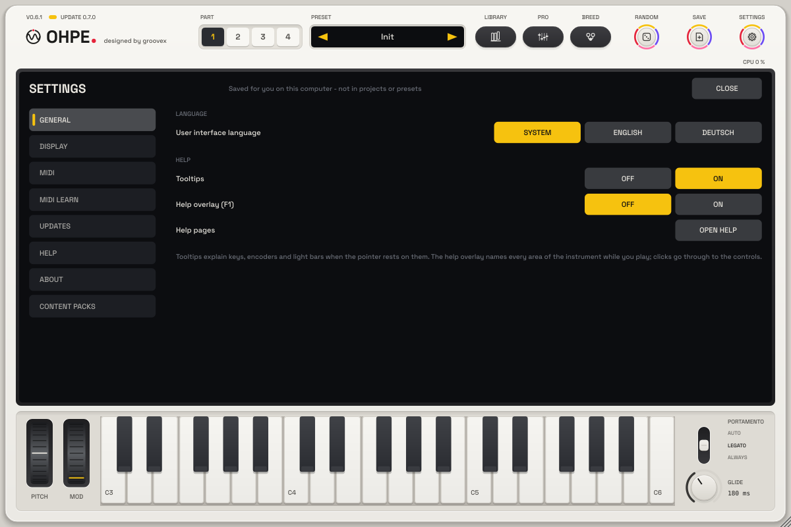
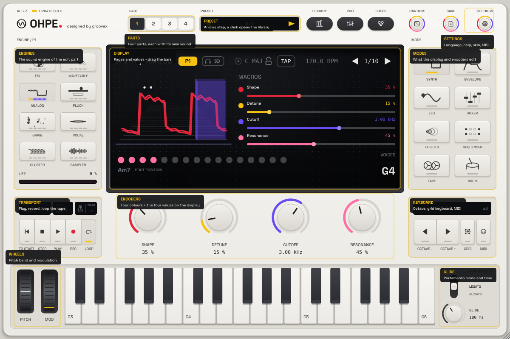
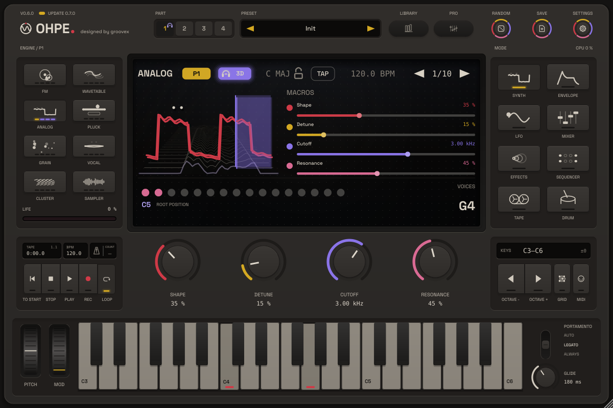
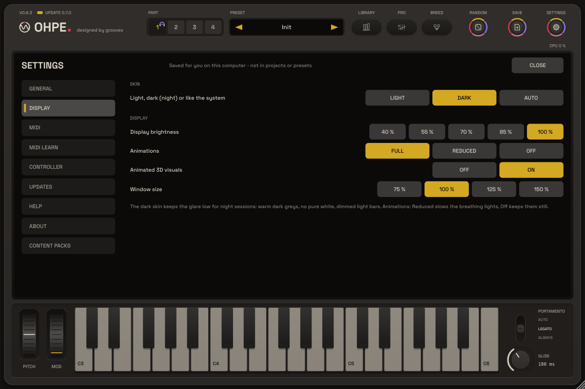
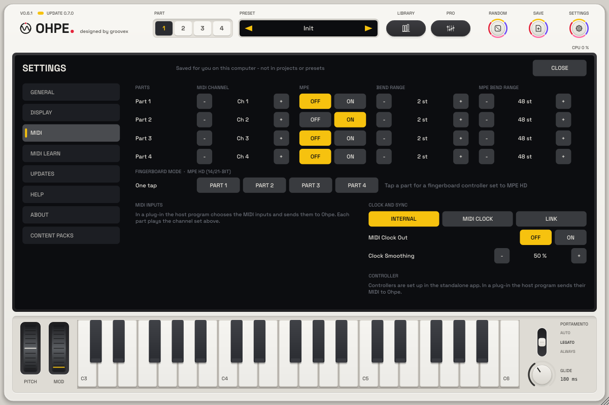
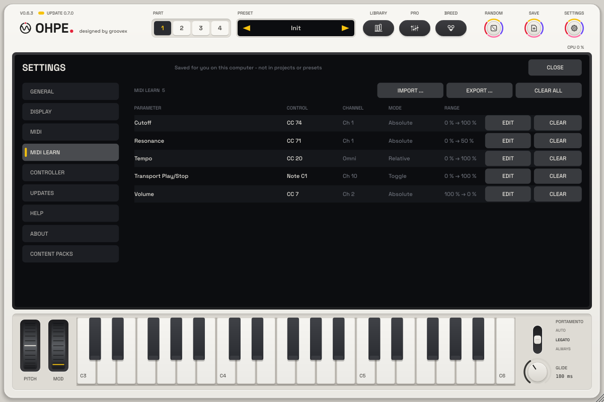
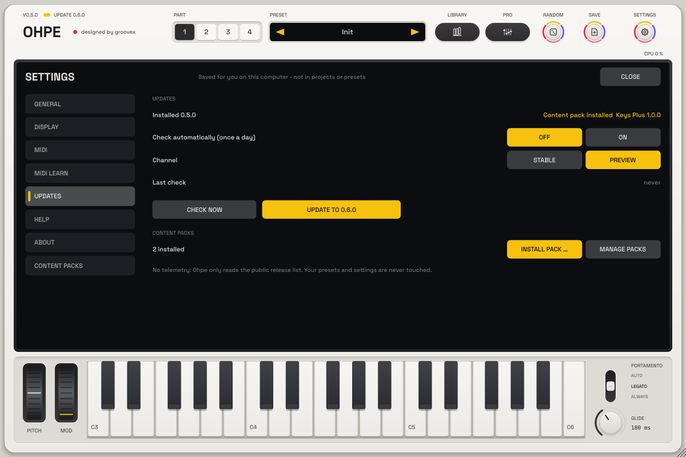
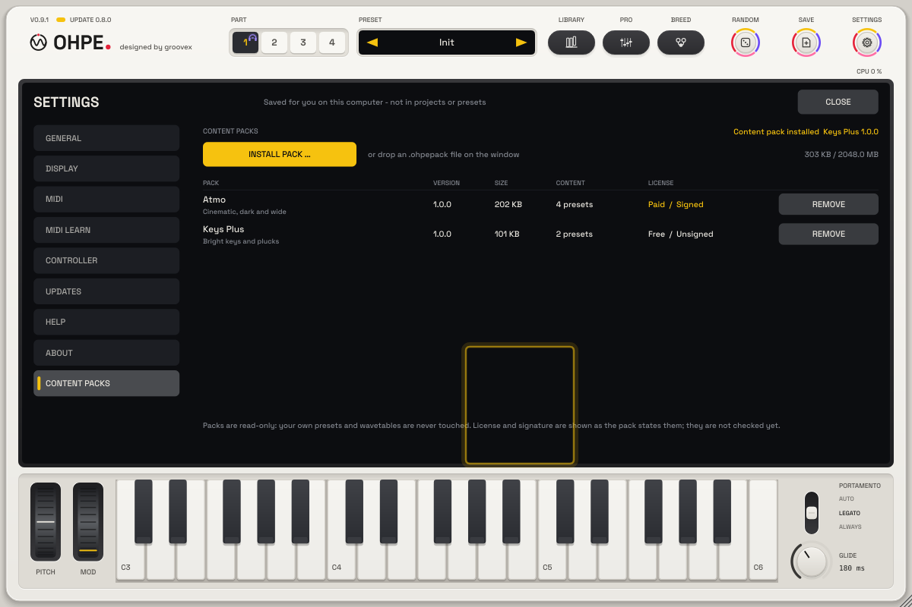
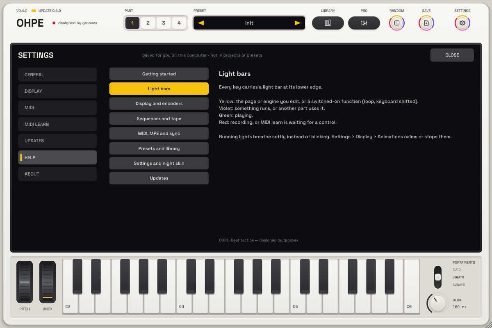
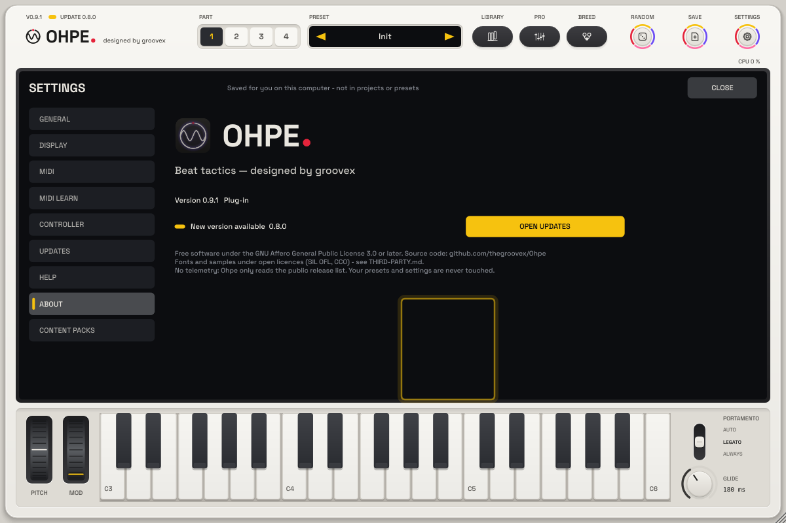

# Settings

One settings view for the standalone app and the plug-in. Open it with the **gear key** at the right of the header,
from the standalone window's menu (**Settings ...**), or click the wordmark for the **About** page. **Esc** closes it,
**↑ / ↓** switch the tabs.

Settings are saved **for you on this computer** – not in projects, sessions or presets – and apply to every Ohpe you
open (all open plug-in windows follow at once). File: `Settings/settings.json` in the Ohpe user folder (macOS
`~/Library/Application Support/groovex/Ohpe`, Windows `%APPDATA%\groovex\Ohpe`, Linux `~/.config/groovex/Ohpe`;
`OHPE_DATA_DIR` overrides it). The updater keeps its own settings next to it in `update.json`. None of the settings is
a host parameter: nothing here is automated or changes the sound of a project.

## General

| Setting | Choices |
| --- | --- |
| Language | **System** (follows the operating system), **English**, **Deutsch**. The language pills of earlier versions moved here. |
| Tooltips | On / Off – explanations on keys, encoders, light bars and the display |
| Help overlay | On / Off (also **F1**) – names and one-line explanations over every area of the plate; clicks go through to the controls |
| Help pages | opens the **Help** tab |

## Display

| Setting | Choices |
| --- | --- |
| Skin | **Light** (matte warm white), **Dark** (night skin), **Auto** (follows the system's light / dark appearance) |
| Display brightness | 40 – 100 % – dims the display for dark rooms |
| Animations | **Full**, **Reduced** (slower breathing lights and 3D pulse), **Off** (running lights stand still, fully lit) |
| Animated 3D visuals | the moving visuals of the display (same switch as in the display's visual menu) |
| Window size | 75 / 100 / 125 / 150 % – the size a new window opens with (you can still drag the corner) |

The **night skin** covers the whole instrument – housing, keys, display, pro view, library, update view and the settings
themselves. It uses warm dark greys, never pure white; the accents and light bars are dimmed. Every text colour keeps a
contrast of at least 4.5 : 1 to its background (checked by the tests).

## MIDI

- **Parts**: MIDI channel (Omni or 1 – 16), MPE on / off, bend range and MPE bend range of each part.
- **MIDI inputs**: in the standalone app every MIDI input with On / Off and a button to the audio settings; in a plug-in the
  host chooses the inputs.
- **Clock and sync**: source Internal / MIDI clock / Link, MIDI clock out, clock smoothing.

These are the existing parameters (`pN.midich`, `pN.mpe`, `pN.bend`, `pN.mpe.bend`, `sync.*`) – changing them here is the
same as anywhere else: the host is notified, they stay automatable and MIDI-mappable and are saved with the project.

## MIDI learn

Every mapping in one list: parameter, control (CC or note), channel, mode and range. **EDIT** opens a menu – channel (Omni,
1 – 16), mode (Absolute, Toggle, Relative), range (full, inverted, lower half, upper half), **Learn again** (the old mapping
is removed and MIDI learn waits for a new control) and **Clear**. **CLEAR** removes one mapping, **CLEAR ALL** all of them.
**IMPORT ... / EXPORT ...** read and write MIDI map files (`.ohpemidi`). New mappings come from MIDI learn: right-click an
encoder, key or wheel. The map is saved with the project.

## Updates

The settings of the [updater](UPDATES.md): daily automatic check (off until switched on), channel Stable / Preview, last
check, **CHECK NOW** and the update view. Below them: **Content packs** – how many are installed, **INSTALL PACK …**
(file dialog for `.ohpepack` files) and **MANAGE PACKS**.

## Content packs

The pack manager (a tab after About): **INSTALL PACK …**, the room the packs use, and every installed pack with
version, size, content, license and signature (shown, not checked) and **REMOVE** (click twice). Dropping an
`.ohpepack` file on the window installs it too. See [Content packs](CONTENT-PACKS.md).

## Help

Help pages in English and German: getting started, light bars, display and encoders, sequencer and tape, MIDI / MPE /
sync, presets, settings and the night skin, updates.

## About

Version and format (standalone app / plug-in), the update status with **CHECK NOW** (or **OPEN UPDATES** when a newer
version is on offer), the project line, licence (AGPL-3.0-or-later) and source code.

## For developers

`SettingsView::addExtraPage (nameEn, nameDe, component)` adds a tab for another feature; its component is shown in the
content area. Other features may keep their own keys in `settings.json` – unknown keys are preserved.
