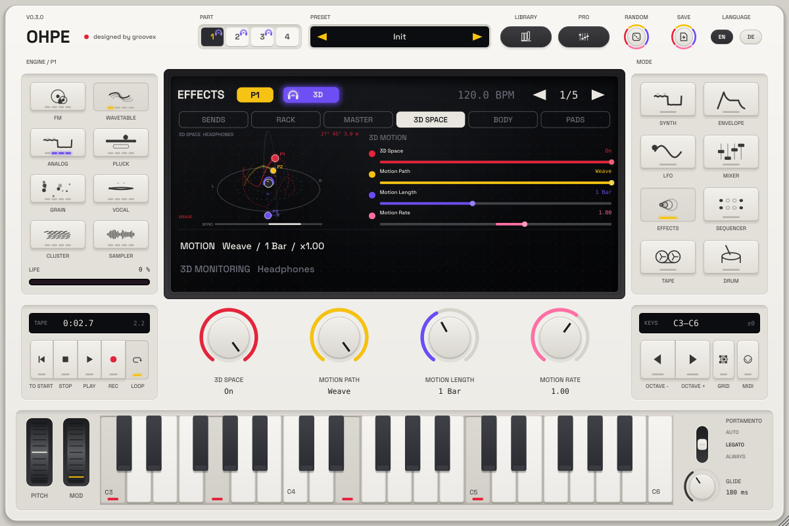

# 3D Space – binaural motion (1.0)

*English · Deutsch: [../de/RAUM.md](../de/RAUM.md)*

Every part can leave the stereo line and move **around your head**: in front, to the sides, behind
you, above you, near and far – with motion paths that run in time with the song. On headphones Ohpe
renders the part **binaurally**: your ears receive the time and level differences, the head shadow and
the ear's direction cues of a real source at that place. On speakers the same scene is rendered without
binaural colouration and stays fully mono-compatible.

## Quick start

1. Press **Effects**, then the **3D Space** tab of the display (or click the **3D** badge in the display
   header).
2. Turn **Space** on (encoder 1, first page). The part now sits in front of you, 1.5 m away.
3. Choose a **Motion Path** (encoder 2) and its **Motion Length** (encoder 3) – e.g. *Circle* over
   *2 Bars*. Press Play: the dot of the part flies around the head in the display.
4. Put on headphones. **3D Monitoring** (last page) must be on *Headphones* for binaural sound.

Or load one of the presets with the **3D** tag in the library – they carry a headphones pictogram.

## The 3D badge and the headphones pictogram

| Where | Lit (ultraviolet, pulsing) | Outlined yellow, speakers | Dim |
|---|---|---|---|
| Display header, after the part badge: headphones pictogram + **3D** | the edit part plays binaural 3D (Space on or a *Space 3D* rack slot, monitoring on Headphones) | 3D is on, monitoring is on Speakers | the part does not use 3D |
| Part selector 1–4 (top) | the same per part, a small headphones pictogram in the corner | a small speakers pictogram | nothing |
| Library list | presets tagged **3D** show the headphones pictogram after their name; the category chip **3D** lists them | | |

Hover the badge for the tooltip (*Binaural 3D – best with headphones*); click it to open the 3D Space
view of the edit part.

## The display: head-centred 3D view

You look over the listener's shoulder: the head in the middle (wearing headphones while you monitor
binaurally, two speakers in front of it on speaker monitoring), the floor rings at 1 m, 5 m and 40 m,
the ring 45° up, the front / back arc. Every part with 3D on is a dot in its colour (part 1 red, 2 yellow,
3 ultraviolet, 4 rose) with a fading **trail** and a **drop line** to the floor that shows the height.
Nearer dots are larger; the glow follows the level. Top right: the edit part's azimuth, elevation and
distance. The thin bar at the bottom is the **master correlation** (red = out of phase, see *Mono
compatibility*). The view drifts slowly and follows the mouse a little (parallax; off with *Animated 3D
visuals*).

The same view can be the display's left picture in any mode: click the picture to cycle *Character →
Stereo scope → Spectrum terrain → 3D space*, or right-click → *3D space*. A *Space 3D* rack slot shows its
own source in the strip below the rack.

## Parameters – the part's stage `pN.space.*`

The stage sits at the very end of the part: engine → FX rack → bass mono → **3D** → mixer. Space off is an
exact bypass (every older sound plays bit-identically); switching crossfades over 20 ms.

| Page | Parameter | Range | What it does |
|---|---|---|---|
| 3D Motion | Space | off / on | the stage |
| | Motion Path | Off, Circle, Figure-8, Fly-By, Random Orbit, Pendulum, Spiral Up, Ping-Pong F/B, Swarm, Whisper, Distance Walk, Over the Head, Weave | see below |
| | Motion Length | 1/16 … 32 Bars, 1/4. | one cycle of the path, in time with the song |
| | Motion Rate | ×−4 … ×4 (default ×1) | multiplies the speed; negative = backwards, 0 = stopped. At exactly ×1 the motion locks to the song position (it repeats identically on every playback) |
| 3D Position | Azimuth | −180 … 180° | direction (0 = front, +90 = right, ±180 = behind); rotates the whole path |
| | Elevation | −60 … 90° | height; tilts the whole path |
| | Distance | 0.2 … 40 m | base distance (the path scales from it) |
| | Source Spread | 0 … 180° | how far apart the left and right channel of the part are placed (0 = a point source) |
| Motion Shape | Motion Size | 0 … 100 % | how big the path is (per path, see below) |
| | Motion Phase | 0 … 360° | offset of the path – give two parts the same path half a cycle apart |
| | Motion Glide | 5 ms … 2 s | smoothing of every position change (automation, modulation, jumps) |
| | Doppler | 0 … 100 % | pitch shift of moving sources (the distance becomes a delay; 0 = no delay at all) |
| Room & Distance | Room | 0 … 100 % | early reflections of a room that move with the source, plus a short diffuse tail – they put the sound outside your head |
| | Room Size | 0 … 100 % | from a small room (4 m) to a hall (30 m) |
| | Air Absorption | 0 … 100 % | far sources lose their highs |
| | Distance Rolloff | 0 … 100 % | how much quieter far sources get (100 % = inverse distance law; 1.5 m plays at the input level) |
| Monitoring | Mono Below | 40 … 300 Hz | everything below stays **mono and unspatialised** (Linkwitz-Riley crossover, default 120 Hz) – the sub never moves |
| | 3D Monitoring (`space.out`, global) | Headphones, Speakers | binaural rendering or speaker rendering for every 3D part and rack slot |
| | Mono Check (`space.monocheck`, global) | off / on | folds the main output to mono – listen for what speakers in mono would play |

*3D Monitoring* and *Mono Check* belong to the listener: project presets neither save nor change them.

### Motion paths

| Path | Movement (one cycle) | Motion Size |
|---|---|---|
| Circle | a full orbit around the head | tilts the orbit's plane (0 = level, 100 % = 60°: it rises on one side and dips on the other) |
| Figure-8 | a lying eight: wide left / right sweeps crossing in front, rising and falling | width of the sweep (30 … 180°) |
| Fly-By | a straight line passing in front, left → right and back, slowest at the far ends | length of the line (2 … 12 × the distance) – with Doppler the classic fly-by |
| Random Orbit | a smooth random path, four new points per cycle (every part its own) | how far it wanders (direction, height, distance) |
| Pendulum | swings from in front over your head to behind you and back | how far it swings (100 % = front to back) |
| Spiral Up | climbs from below ear height to above your head in 1–4 turns, then drops back | number of turns |
| Ping-Pong F/B | jumps from in front to behind you and back, in time: each half cycle opens with a quick move on the beat, then the sound holds. Front → back passes up on the right, back → front up on the left | how snappy (0 = a smooth swing over the whole half, 100 % = a short hop in the first 30 %) |
| Swarm | a flutter around the front: twelve small random jumps per cycle on top of a slow random drift – like a bee or a cloud of sparks (every part its own, never repeats exactly) | how wide it flutters and drifts (direction, height, distance) |
| Whisper | very close behind your head (0.4 m at the default distance), lingering and nearest at one ear, then the other – the near-field level difference makes it intimate. Lower *Distance* for an even closer whisper | how far round to the front it reaches at the ears |
| Distance Walk | walks off straight ahead into the distance and comes back, swaying a little left and right – level, air absorption and Doppler change on the way | how far (2 … 16 × the distance; nearest 0.35 ×) |
| Over the Head | a vertical circle through both ears: above your head → right ear → underneath → left ear | tilts the circle's top forward (0 = straight through the ears, 100 % = 45°) |
| Weave | a full orbit that weaves up and down three times per turn and comes a little closer at its low points | height of the waves (10 … 40°) and their depth |

The six paths from Ping-Pong F/B on were added later; they sit at the end of the list, so sounds and
automation saved with the older paths keep their path.

**In the 3D view** the edit part's path is drawn ahead of its dot as a faint dotted curve – one whole cycle
(for Swarm and Random Orbit: the next cycle from now) – so you see the shape of a path, its size and its
orientation before a note plays. The path's name sits bottom left.

Azimuth and Elevation rotate every path: a Pendulum at azimuth 90° swings left over right.

## Modulation and MPE

The modulation matrix (LFO mode → Mod) moves **Azimuth, Elevation, Distance, Motion Path Rate** and
**Motion Path Phase** of the part's stage (targets 67 – 71, [MODULATION.md](MODULATION.md)). With an MPE
controller or poly aftertouch:

* **Slide (Timbre) → Elevation**: sliding up lifts the sound above your head;
* **Note Pressure → Distance** with a negative amount: pressing harder pulls the sound closer;
* an LFO on *Motion Path Rate* makes an orbit accelerate and slow down; a macro on *Azimuth* turns the
  whole scene.

The modulation uses the newest note (one position per part). Every 3D factory preset has Slide →
Elevation and Pressure → Distance routed.

## Space 3D as a rack effect

The FX rack has the type **Space 3D** (DE *3D-Raum*, type 22) in every slot of the part racks and the
master rack, with the same parameters (`pN.fxK.space3d.*`, `mfxK.space3d.*`). Use it to place a single
effect return, or the whole master, in the room. Its *FX Param 1 – 4* targets are Azimuth, Elevation,
Distance and Motion Rate. Keep the slot's mix at 100 % (the dry signal is not delayed like the 3D one).

## Mono compatibility and the low end

* The band below *Mono Below* is summed to mono and never spatialised – basses keep a centred, solid sub
  while their mid range moves (all 3D bass presets use 150 – 180 Hz).
* **Speakers**: amplitude panning without any time differences – the mono fold loses at most 3 dB
  anywhere on the circle (tested).
* **Headphones**: binaural signals contain small time differences between the ears. They fold to mono
  without hollow combing (straight ahead the ears are identical; to the side the far ear is much
  quieter), but check important mixes with **Mono Check** and the correlation bar.

## How it works

Ohpe uses its **own parametric model** of the head and ears – no measured head-related data set is
included or needed:

* **Spherical head**: interaural time difference (Woodworth's formula, 0.65 ms at 90°) through
  fractional, cubic-interpolated delay lines, and a first-order head-shadow filter per ear whose
  coefficients glide sample by sample;
* **Ear cues**: two pinna notches that rise from about 6 kHz to 11 kHz with elevation, directional bands
  for front (presence), behind (pinna shadow, 1 kHz band) and above (8 kHz band), a shoulder reflection,
  and a near-field level difference below 1 m;
* **Distance**: level rolloff, air absorption, a distance delay that makes the Doppler shift (its speed is
  limited, so the pitch never bends more than about ±12 %);
* **Room**: six image-source reflections of a shoebox room that follow the source, rendered with their own
  directions, into a small four-line diffuse tail;
* **Stereo sources**: the part's mid signal is a point source, its side signal a pair of sources
  *Source Spread* apart, so mono material never comb-filters.

Everything is interpolated – positions glide, delays ramp per sample, filters update every 16 samples – so
moving sources stay click-free (tests sweep, jump and switch while measuring the second difference of the
output). CPU: about 1.3 % of one core per stage at 48 kHz on the build machine; four part stages plus eight
rack instances stay well within the real-time budget (measured by the core tests).

## Tips for bass music

* Neurofunk / dubstep basses: a short path (*Circle* or *Figure-8*, 1 – 2 bars) with a small distance
  (1.2 – 1.5 m), little room and *Mono Below* 150 – 180 Hz: the growl moves, the sub punches mono.
* Atmospheres: *Random Orbit* over 8 – 16 bars, distance 3 – 5 m, Room 35 – 50 %, Spread 70 – 90°.
* Risers: *Spiral Up* over the riser's length; fly-bys: *Fly-By* with Doppler 100 %.
* Two parts with the same path and Motion Phase 0° / 180° chase each other around the head.
