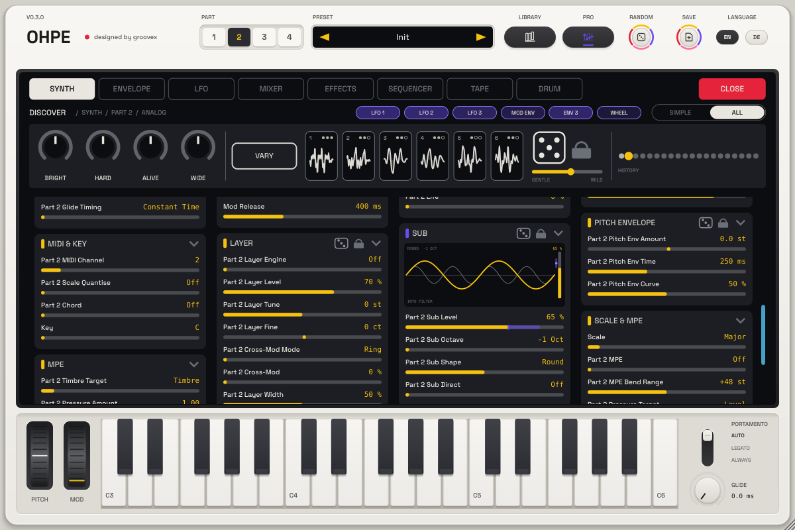

# SUB layer (p31)

[Deutsch](../de/SUB-EBENE.md)

Every part has a **SUB layer**: one sub oscillator under every voice of the part's engine, one or two octaves below
the played note, to dial in extra low end without changing the sound above it. It sits on the Synth mode's own
encoder page **Sub** (after Glide and Pitch Envelope) and in the pro view as the card **Sub**.

| Control | Parameter | What it does |
|---|---|---|
| Level | `pN.sub.level` | 0 = off (the part sounds exactly as without the SUB layer) … 100 % |
| Octave | `pN.sub.oct` | −1 Oct or −2 Oct below the voice |
| Shape | `pN.sub.shape` | **Sine** (pure, deepest), **Round** (a rounded triangle: a little warmer, still clean), **Square** (a soft square: hollow, more push) |
| Direct | `pN.sub.direct` | Off: the sub goes through the engine's filter (Analog, Wavetable). On: it is added after the filter and stays full under a closed filter |

## How it behaves

* **Locked to the voice.** The sub follows exactly the pitch the voice plays – the note, glide, pitch bend, the pitch
  envelope, matrix pitch, MPE bends and the slow drift of *Life*. Its phase is derived from the voice's own cycles and
  starts with every note, so it never beats against the voice.
* **Clean.** All three shapes are band-limited: Sine and Round have no edges; Square is a soft square whose edges
  soften as the pitch rises, so even the top keys alias no audible products.
* **Mono.** The sub is the same signal on both channels – never panned, no stereo width, safe for club systems and
  vinyl. (The part's *Bass Mono* stays available for everything else.)
* **Level-safe.** It rides on the voice's amp envelope and velocity; changing the level ramps sample by sample (no
  zipper steps). At 100 % a sine sub is about as loud as one voice of the engine.
* **Main engine only.** The part's layer engine has no sub of its own (one SUB layer per part).

## Engines

| Engine | SUB layer | Through the filter (Direct off) |
|---|---|---|
| Analog | yes | yes – into the ladder / state-variable filter (drive included) |
| Wavetable | yes | yes – into the tone filter |
| FM | yes | always direct (no voice filter) |
| Pluck | yes | always direct (after the string) |
| Cluster | yes | always direct (after the stack) |
| Grain | yes | always direct, at the played key |
| Vocal | yes | always direct (after the voice) |
| Sampler | yes | always direct, at the played key (tuned for samples at their root key) |
| Drum kit | no – pads have no keyboard pitch | – |

Analog and Wavetable also have their own engine sub (a sine one octave down, a macro of the engine); the SUB layer is
independent of it and adds the octave choice, the shapes and the direct path.

## Picture (pro view)

The card shows the voice as a thin grey wave and the sub under it in yellow – its shape, its octave (one sub cycle
for every two or four voice cycles) and its level; the small fader on the right is the level, a violet strip shows
what the modulation matrix moves. **Drag** up / down = level, a quick **swipe** = shape, a **click** on the octave
caption = the other octave, a click on *INTO FILTER / DIRECT* = the route, **wheel** = level, double-click = off.

## Modulation and MIDI

The modulation matrix has the target **Sub Level** (85, key `sublevel`): an envelope, velocity or a macro can
bring the sub in. Every SUB parameter is MIDI-learnable (right-click) and part of part presets and projects.
