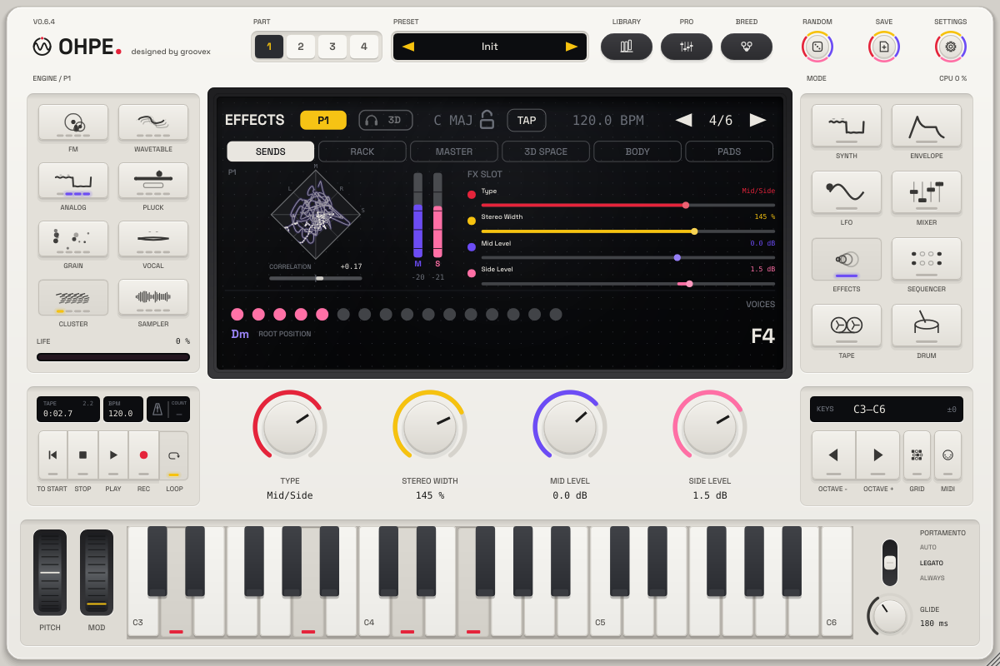

# Tape machine, mixer dynamics and FX rack

*English · Deutsch: [../de/BAND-MISCHER-FX.md](../de/BAND-MISCHER-FX.md) · parameter tables:
[../PARAMETERS.md](../PARAMETERS.md)*

Ohpe 0.2 adds an eight-track tape machine, dynamics in the mixer, an effect slot for the
part, a stereo audio input in the plug-in and an offline bounce of the tape to WAV files.

```
 input bus ─┐                  ┌─ tape track 1..8 ─┬─ mixer channel (source "tape N") ─┐
 part 1 ─ FX slot ─┬───────────┤   (record from    │                                    ├─ master
 (parts 2-4, drum) │           │   input / part)   └─ direct out → Out 1..8            │
                   └─ mixer channel 1 ─────────────────────────────────────────────────┘
 channel: source → EQ → compressor-lite → fader / pan → Main or Out N (+ sends A / B)
 master:  sum + returns → compressor → tape saturation → volume → low-pass → limiter (ceiling) → Main
```

## Tape machine

**Eight stereo tracks**, one shared transport. The tape is 10 minutes long by default; the
length (10 s … 60 min) is a setting of the session (`TapeMachine::setLengthSeconds`, stored in
the `tape` section of the state), not a parameter. Memory is only used where audio was
recorded (blocks of 4096 frames), so a long, empty tape costs almost nothing.

| What | How |
|---|---|
| Play / record | `tape.play`, `tape.rec` (punch in / out while playing). Recording needs at least one armed track (`tape.trN.arm`). |
| Source per track | `tape.trN.src`: Input (plug-in input bus), Part 1–4, Drum. |
| Overdub / replace | `tape.overdub` on: the new take is added; off: it replaces what was there (and the old material is not heard while it is replaced). |
| Monitoring | an armed track with source *Input* plays the input through the track (so it can be heard and routed); parts are heard on their own mixer channels. |
| Varispeed | `tape.speed` 0.5 … 2.0 (1.0 in the middle of the control), glides smoothly while rolling, 4-point interpolation. Pitch follows the speed. |
| Reverse | `tape.reverse` – the playhead runs backwards; at the start (or end) of the tape it stops and stays silent. |
| Loop | `tape.loop`, `tape.loopin`, `tape.loopout` (seconds, whole frames). |
| Locate | `TapeMachine::locate (seconds)` (applied at the next audio block). |
| Character | `tape.sat` (soft saturation, gentle top-end loss), `tape.wow`, `tape.flutter` (speed modulation shared by all tracks, as on one transport), `tape.hiss`. All at 0 = exact, untouched playback. |
| Track level | `tape.trN.level` (dB). |
| Direct out | `tape.trN.out`: *Mixer only* or Out 1–8. The track then also plays on that output (after level and character); if that output is not enabled, it plays on Main. Mixer channels can select tape tracks as source as well (channels 6–8 start on tracks 1–3). |

### Editing

All edits work on one track, take times in seconds (or frames), and are one undo step each:

| Edit | Result |
|---|---|
| **lift** (start, end) | copies the range to the clipboard and leaves silence |
| **cut** (start, end) | copies the range to the clipboard and closes the gap (later audio moves earlier) |
| **drop** (at) | puts the clipboard at `at`, over what is there |
| **splice** (at) | inserts the clipboard at `at`, later audio moves later (the tape end cuts it off) |
| clear track / clear all | silence (undoable) |

**Undo / redo are unlimited.** One recording pass (from pressing record to releasing it) is one
step. A new edit after undo drops the redo steps. Edits are refused (return `false`) while
recording.

### How it works (real time)

* Each track is a page table of 4096-frame blocks; empty pages are silence.
* The audio thread never allocates: the message thread keeps a pool of 256 empty blocks filled
  (`housekeeping()`, called by the plug-in at 20 Hz) and hands them over through a wait-free queue.
* Committed blocks are frozen. Recording into a frozen block first copies it into a fresh one
  (copy-on-write), so every undo state stays intact. Undo states share all unchanged blocks and
  all unchanged tracks; one step costs a page list for each changed track plus the blocks that
  really changed.
* Edits and undo swap page tables on the message thread under a two-flag exclusion: the message
  thread waits until the audio thread is outside the tape (at most one block); the audio thread
  never waits – during the few milliseconds of an edit the tape is silent.
* If recording ever runs out of fresh blocks, the samples are dropped and counted (`dropouts()`),
  never allocated on the audio thread.

## Mixer dynamics

* **Compressor-lite** per channel (`mix.chN.comp`, 0 = off): one knob sets threshold
  (−4 … −30 dB), ratio (1.5 … 6) and half of the make-up gain; after the EQ, before the fader.
* **Master compressor** (`mix.master.comp` on / off, threshold, ratio, attack, release,
  make-up), stereo-linked, soft knee.
* **Master tape saturation** (`mix.master.tapesat`, 0 = off).
* **Master low-pass** (0.6, `mix.master.lowpass`, 500 Hz … 20 kHz, 12 dB/octave; 20 kHz = off): after
  the volume, before the limiter – darkens the whole mix, e.g. 4–5 kHz for lo-fi.
* **Limiter** (`mix.master.limit`) with an adjustable **ceiling** (`mix.master.ceiling`,
  default −0.3 dBFS as in 0.1).
* Gain reduction is readable for meters: `Mixer::gainReduction (channel)`, master = 8.
* **Delay sync** (0.5, `fxa.delay.sync`): Off, 1/16, 1/8T, 1/8, 1/4T, 1/8., 1/4, 1/4., 1/2. Any
  setting but Off sets the send delay's time from the tempo (host, Link or internal) and overrides
  `fxa.delay.time` (at most 2 s).

With every new control at its default the mixer is bit-identical to 0.1.

## FX slot of the part

`p1.fx.type`: Off, Chorus, Phaser, Bitcrush, Filter Drive, Delay, Reverb, Hyper, Distortion, Flanger, Compressor, Multiband, EQ, Filter, Echo, Hall (0.7), Mid/Side (0.7) – an insert effect
between part 1 and the mixer (and in front of the tape when a track records part 1). Each
effect keeps its own parameters (`p1.fx.chorus.rate` …); chorus, phaser, bitcrush and filter
drive have their own mix control, delay and reverb get one from the slot
(`p1.fx.delay.mix`, `p1.fx.reverb.mix`). *Off* is an exact bypass. Since 0.7 this slot is slot 1
of the part's FX rack (below).

## FX rack (0.7)

Every part has an **FX rack of six serial slots**, the master a rack of four:

```
 part ─ FX 1 ─ FX 2 ─ FX 3 ─ FX 4 ─ FX 5 ─ FX 6 ─▶ mixer channel / tape
 master: sum + returns ─ MFX 1 ─ MFX 2 ─ MFX 3 ─ MFX 4 ─ compressor ─ tape saturation ─ volume ─ low-pass ─ limiter
```

* Slot 1 is the FX slot above (`pN.fx.*`), slots 2 – 6 are `pN.fx2.*` … `pN.fx6.*`, the master
  slots `mfx1.*` … `mfx4.*`. Every slot has the same type list and its own parameter block per
  type (`p1.fx3.chorus.rate`), so two slots can hold the same effect with different settings.
* Per slot: **Mix** (`pN.fxK.mix`, dry / wet of the whole slot, 100 % = the effect's own output)
  and **Bypass** (`pN.fxK.bypass`). Mix and bypass glide over 10 ms – no clicks when switching.
* **Order:** the slots run 1, 2, … ; moving a slot rewrites the parameters of the slots in
  between (type, mix, bypass and every block), so the order is part of the preset, undoable and
  automatable like any other value.
* **Compatibility:** 0.6 presets and projects load into slot 1 unchanged and sound bit-identical
  (slot mix 100 %, the other slots Off). An empty or bypassed slot is an exact bypass.
* **Real time:** slot 1 has every type ready at once (as before). Slots 2 – 6 and the master slots
  allocate an effect's memory only when that type is first chosen (the plug-in does this within
  a moment on the message thread; until then the slot passes the signal dry).
* Host names tell the slots apart: "P2 FX3 Chorus Rate", "Master FX 1 Delay Mix" (the 0.2 slot of
  part 1 keeps its names).
* The modulation matrix can move each slot's mix and four parameters of its effect – for the
  0.2 types the first four, for the rack types the four listed below as *Mod 1–4*
  ([MODULATION.md](MODULATION.md)).
* On screen: the **Rack** and **Master** views of the Effects mode
  ([USER-INTERFACE.md](USER-INTERFACE.md#fx-rack-views-07)).

### Rack effect types

Besides the six 0.2 types every slot offers nine rack types. Everything that sweeps (cutoffs, times,
gains, drive) glides sample by sample, so automation and modulation never zipper; the nonlinear
stages run oversampled.

| Type | What it does | Parameters | Mod 1–4 |
|---|---|---|---|
| **Hyper** | unison widener: up to seven slowly drifting, detuned copies across the stereo field, then a *dimension* stage of cross-fed short delays; *Retrigger* restarts the motion with every note | rate, detune, voices, spread, dimension, retrigger, mix | rate, detune, spread, dimension |
| **Distortion** | eight modes – tube, soft clip, hard clip, diode, linear fold, sine fold, asymmetric, downsample – with bias, a pre-filter (low / band / high-pass) and a post tone control | mode, drive, bias, pre-filter, pre-filter freq, tone, output, mix | drive, bias, pre-filter freq, tone |
| **Flanger** | stereo flanger, free or tempo-synced, positive or negative feedback | rate, sync, depth, delay, feedback, stereo, mix | rate, depth, delay, feedback |
| **Compressor** | stereo-linked compressor with soft knee and makeup gain; *mix* gives parallel compression | threshold, ratio, attack, release, knee, makeup, mix | threshold, ratio, attack, makeup |
| **Multiband** | three bands with upward and downward compression; at depth 0 the crossovers sum flat | depth, upward, downward, time, low / mid / high gain, low / high split, output, mix | depth, low, mid, high gain |
| **EQ** | low shelf, three bells, high shelf | frequencies, gains, Q, output | band 1 freq / gain, band 2 freq / gain |
| **Filter** | low-pass / high-pass 12 or 24 dB, band-pass, notch, comb + / −, vowel formant; drive in front; the cutoff glides in octaves | type, cutoff, resonance, drive, mix | cutoff, resonance, drive, mix |
| **Echo** | stereo, ping-pong or tap delay (right tap at a ratio of the left), free or synced, filtered feedback | mode, sync, time, ratio, feedback, low cut, high cut, width, mix | feedback, time (free), high cut, width |
| **Hall** | plate or hall reverb: input diffusion and an eight-line feedback network with gentle modulation | mode, size, decay, damping, pre-delay, width, mix | size, decay, damping, pre-delay |

IDs, ranges and defaults: [PARAMETERS.md](../PARAMETERS.md#07--rack-effect-types--effekttypen-des-racks).

### Mid/Side stereo (0.7)

**Mid/Side** (type 16, appended to the type list after the nine 0.7 rack types) works on the stereo image. It is available in every
slot of every rack – the six slots of each part and the four master slots – with its own parameter
block per slot (`p1.fx.midside.width`, `p2.fx4.midside.width`, `mfx1.midside.width` …). It splits the
signal into mid M = (L + R) / 2 and side S = (L − R) / 2, shapes both and puts them back together:

| Parameter (`<slot>.midside.*`) | Range | What it does |
|---|---|---|
| Stereo Width `width` | 0 … 200 % | side × width: 0 % = mono, 100 % = unchanged, 200 % = twice as wide |
| Mid Level `mid` / Side Level `side` | −24 … +12 dB | level of M and of S |
| Balance `balance` | −100 … +100 % | left / right balance |
| Bass Mono `bassmono` + Mono Below `monofreq` | on / off, 40 … 500 Hz | removes the side below the frequency (24 dB/oct.): tight, mono-safe lows, wide highs |
| Micro-Shift `haas` + Shift Time `haastime` | 0 … 100 %, 1 … 30 ms | adds the mid, delayed by a few milliseconds, to the side: wider without changing the mono sum |
| Mid Tilt `midtilt` / Side Tilt `sidetilt` | −6 … +6 dB | a tilt EQ each for M and S around 650 Hz (+ = brighter, − = darker) |

* **Mono-safe:** width, side level, bass mono, side tilt and micro-shift only touch S, and S cancels
  in the mono sum L + R = 2 M – folding to mono never loses or colours the mid.
* **Clean:** all gains glide (20 ms), so turning the encoders or modulating never clicks; no
  allocation after the slot is prepared. With every parameter at its default (width 100 %, 0 dB,
  balance centre, bass mono off, micro-shift 0) the effect passes the signal **bit-identically**.
* **Modulation:** the matrix targets *FX k Param 1–4* are width, mid level, side level and balance.
* **In the master rack** (`mfx1` … `mfx4`, before the master compressor and limiter) it shapes the
  whole mix: *Bass Mono* keeps the low end of the mix centred, *Width* narrows or widens it.
* While the encoders show a Mid/Side slot the display shows the **stereo scope** of that part after
  its rack, or of the master output for a master slot (goniometer, correlation, M / S levels; see
  [USER-INTERFACE.md](USER-INTERFACE.md)).



## Audio input (plug-in)

The plug-in has one audio input bus, **"Input"** (stereo or mono), off by default so that hosts
see a plain instrument. Enable it in the host (side-chain / input routing) to record external
audio with track source *Input*. The standalone app does not open an input device yet (that
needs a microphone permission entry in the app bundle; planned).

## Bounce / export

`tapeio::bounce (core, options)` (`src/plugin/TapeIO.h`, message thread) renders offline,
faster than real time, while the live audio keeps running:

* a private copy of the instrument with the current parameters and the committed tape content,
  from the start of the tape to the end of the content plus a tail (default 2 s), speed 1
  forward, no recording, sequencer stopped;
* `<name> Master.wav` – the Main bus (channels routed to Out 1–8 are not in it);
* `<name> Track 1.wav` … `Track 8.wav` – the eight tracks after level and tape character,
  before the mixer, all the same length so they line up in any editor;
* 24-bit stereo WAV at the current sample rate. Errors come back localised (`BounceResult`).

## Tape audio in sessions

The plug-in state stays the 0.1 JSON document; when the tape holds audio, the state continues
after a zero byte with the tape audio: a small header (`OHPETAPE`, version, sample rate, length)
and every block that holds audio as float32 (lossless, little-endian). Silent blocks are not
stored. A session is therefore self-contained – nothing breaks when a project is moved or
archived – at a cost of about 23 MB per stereo track-minute of recorded audio (bounce long
takes to WAV if a host struggles with large states). Not stored: the undo history, the
clipboard, and a take that is still recording at the moment the host saves. A state without
tape audio (0.1, or an empty tape) loads with an empty tape. Ohpe 0.1 cannot read states that
contain tape audio.

## Tests

`tests/core/TapeTests.cpp` (sample-exact record / playback across blocks, part sources,
overdub / replace, varispeed pitch ratio, reverse, loop, lift / cut / drop / splice against a
reference with undo / redo, edits refused while recording, tape character, persistence, shared
content, direct outs and multi-out fallback through the core, state section),
`tests/core/FxTests.cpp` (effects finite at extremes, tails decay, mix 0 / Off bypass, compressor
gain reduction, mixer dynamics and ceiling, bit-identical defaults, FX slot in the core),
`tests/core/AllocationTests.cpp` (no heap allocation in `Core::process()` with tape recording,
every FX type and the dynamics on), `tests/plugin/TapeExportTests.cpp` (input bus layouts,
recording from the input bus, tape audio in get / setStateInformation, bounce file format and
content), `tests/core/StereoTests.cpp` (0.7: Mid/Side width 100 % = bit-exact bypass, width 0 =
mono, bass mono below the frequency, micro-shift mono-compatible, no NaN at extremes; scope FIFO
order / overflow / threads; correlation and spectrum; parameter blocks in every rack slot and MIDI
learn; Mid/Side in a part rack and the master rack inside the core), `tests/plugin/StereoDisplayTests.cpp`
(scope on Mid/Side slot pages of parts and master, views, animation setting, headless rendering of
every mode).
