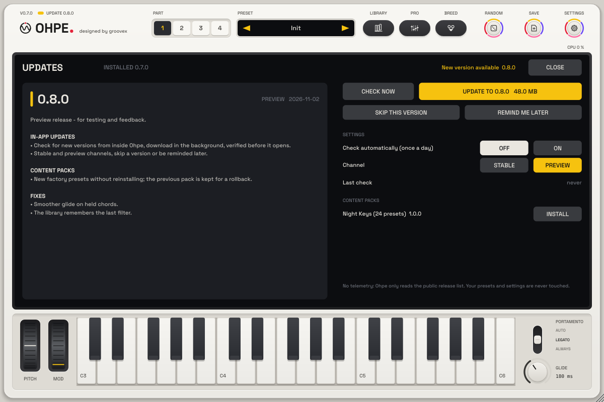

# Updates from inside Ohpe

Ohpe can find, download and open a new version itself – in the standalone app and in the plug-in. Factory content
(preset and sample packs) can be added the same way without reinstalling.

## Opening the update view

Click the **version legend** above the wordmark (e.g. `V0.9.0`) or the wordmark itself. When a newer version is on
offer, the legend shows a small **yellow light bar** and `UPDATE 0.8.0`. **Esc** or **CLOSE** closes the view;
opening the library, the pro view or the breeding view closes it too.

## What it shows

| Area | Content |
|---|---|
| Top row | installed version, the last result (yellow = something to act on, red = an error) |
| Left | the version on offer: number, channel, date and its **release notes in the UI language** (scroll with the wheel) |
| **CHECK NOW** | looks for a new version now |
| **UPDATE TO x.y.z** | downloads the installer for your system in the background; a **violet** bar shows the progress, **CANCEL** pauses it |
| **INSTALL** | after the download: opens the verified installer (macOS installer image; Windows archives are shown in Explorer) |
| **SKIP THIS VERSION** | this version is not offered again – a newer one is |
| **REMIND ME LATER** | the automatic check keeps quiet about this version for three days |
| Settings | **Check automatically (once a day)** – off until you switch it on; **Channel** Stable / Preview; last check |
| Content packs | factory preset / sample packs of the release: **INSTALL**, **UPDATE**, **ROLL BACK** |
| **PREVIOUS VERSION** | downloads the newest release older than yours (rollback) – installed the same way |

## How it works

* **Where it looks.** Ohpe reads the public release list of the project on GitHub. No account, no telemetry: nothing
  about you, your system or your music is sent. Without a connection the view says so; nothing else happens. A server
  that answers with an error (rate limit, maintenance) or with something that is not a release list is reported as
  such – never as "up to date". Redirects are followed (at most 8); a request that gets no answer gives up after 15 s.
* **When.** Only when you press CHECK NOW – or, if you switch it on, automatically **at most once a day** while an Ohpe
  window is open, and **never while the transport or the tape is running**.
* **Channels.** *Stable* offers releases only; *Preview* also offers pre-releases. Builds before 1.0 start on Preview.
* **Download.** The download runs on its own thread. A broken connection is retried with growing pauses and the
  download **continues where it stopped** (also after a restart of Ohpe). A connection that stops delivering data
  (no byte for twice the 15 s timeout) is dropped and continued in a new one, so a download never hangs; CANCEL
  pauses it at once. If the server keeps breaking off without getting further, the download stops with an error.
* **Verification.** Every file is checked against the **SHA-256 checksum** published with the release (and its size).
  A file that fails the check is **deleted and never opened**. The check is repeated right before INSTALL opens it.
  Code signature / notarisation checks follow once the installers are signed. **Size limits:** a download larger than
  2 GB (declared or while it streams) and a release list or manifest larger than 4 MB are refused.
* **Installing.** The standalone offers to quit so the installer can replace the program. In a plug-in host Ohpe asks
  you to save the project and quit the host before the installer continues.

## Content packs

A release can offer content packs (factory presets, samples). INSTALL downloads the pack, verifies it and unpacks it
into its own folder; its presets appear in the library next to the factory bank (read-only). Installing a newer
version keeps the previous one as a backup – **ROLL BACK** brings it back (one step). Every path inside a pack is
checked to stay in the pack's folder; a pack that tries to write elsewhere is refused as a whole.

**Your presets, user wavetables, bounces and settings are never touched** – they live in other folders.

Packs you have as a file (`.ohpepack`) are installed with **INSTALL PACK …** or by dropping them on the window, and
managed (version, size, remove) on **Settings › Content packs** – see [Content packs](CONTENT-PACKS.md).

## Files

| What | Where (inside the user data folder `groovex/Ohpe`) |
|---|---|
| Update settings (per user, not per project) | `Settings/update.json` |
| Downloads (partial files end in `.part`) | `Updates/` |
| Content packs, their registry and backups | `Content/<pack>/`, `Content/installed.json`, `Content/.backup/` |

The user data folder is `~/Library/Application Support/groovex/Ohpe` on macOS, `%APPDATA%\groovex\Ohpe` on Windows and
`~/.config/groovex/Ohpe` on Linux. The environment variable `OHPE_DATA_DIR` moves it (portable setups, tests).

The updater is not a sound control: it has no host parameters and no MIDI mapping.

## For maintainers: publishing an update

The `release-assets` workflow (run it with the release tag and the CI run id) attaches the installers and writes
`ohpe-update.json` with `tools/update/make_manifest.py`: every asset with platform, kind, size and SHA-256, the
release text split at its `## English` / `## Deutsch` headings, and the content packs of `packaging/content/<id>/`
(a `pack.json` with `id`, `version`, `kind`, `name.en`, `name.de`, `minApp`, and a `files/` folder). Releases without a
manifest still work: Ohpe reads their text and `SHA256SUMS.txt`. **Only free packs are listed:** a pack whose
`pack.json` has any `license` other than `free` (object or plain string) is skipped before it is read, and pack files
that were not built from a free pack folder are never listed.

**Tests.** `tests/plugin/UpdaterE2ETests.cpp` runs the updater end to end against a local HTTP mock server (release
list, manifests, checksums, installers, packs; broken connections, ignored ranges, stalls, errors, redirects, malformed
answers); `tests/tools/test_make_manifest.py` (part of `scripts/ci/pack-tools-smoke.sh`) checks the manifest generator.

See also: [installing on macOS](INSTALL.md) · [playing the interface](USER-INTERFACE.md) · [presets](PRESETS.md).
