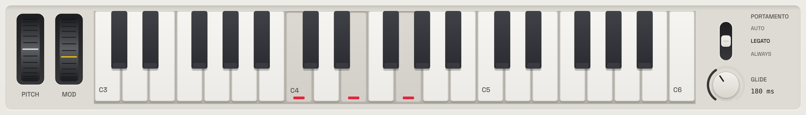
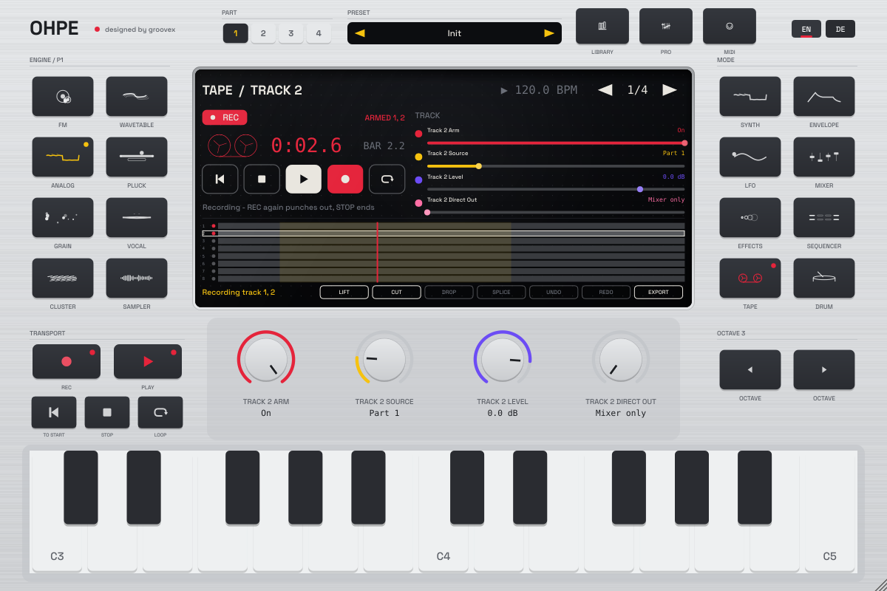
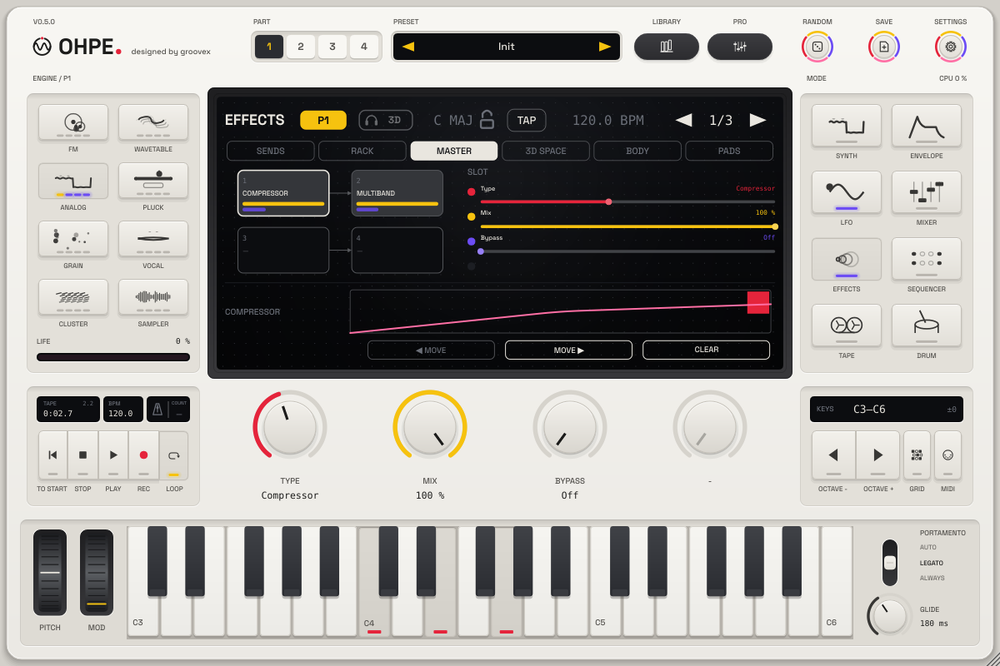

# Playing the interface

*English · Deutsch: [../de/BEDIENUNG.md](../de/BEDIENUNG.md)*

Ohpe's surface (p14): engine keys (left), the display (centre), mode keys (right), four encoders below the
display, the **TRANSPORT** keys and **MIDI** (bottom left), the **OCTAVE** keys (bottom right) and the
keyboard row – **PITCH** and **MOD** wheels, a three-octave keyboard, **glide** mode and time. The header
holds the **part selector**, the **preset strip**, the **LIBRARY** and **PRO** keys, **RANDOM** and **SAVE**,
and EN / DE. Every function can be reached with the mouse and – through MIDI learn – from a controller.

## Keyboard row: wheels, keyboard, glide

| Control | What it does |
|---|---|
| **PITCH** wheel | pitch bend for the edit part (its MIDI channel, like the on-screen keyboard); range = the part's *Bend Range*. Drag up / down; it springs back to the centre when you let go. |
| **MOD** wheel | the mod wheel (CC 1): a source in the [modulation matrix](MODULATION.md). Stays where you leave it; double-click = 0. |
| Keyboard | three octaves (C3–C6 by default); **OCTAVE −/+** moves it. |
| **AUTO / LEGATO / ALWAYS** | glide mode of the edit part: *Auto* glides while the previous note still sounds, *Legato* only while another key is held, *Always* from every previous note. |
| **GLIDE** | glide time of the edit part (0 = off). |

Both wheels are host parameters (*Pitch Wheel* `perf.bend`, *Mod Wheel* `perf.mod`): right-click for MIDI
learn, Shift / Cmd / Ctrl for fine control. They are performance controls, not part of presets.

## RANDOM and SAVE

**RANDOM** gives the edit part's engine new sound values (its Synth pages; level, tuning, voices and the
sample stay). **SAVE** opens the library's save panel for the edit part.

## Display: drag the bars

The four rows on the display show what the four encoders control. The rows are controls too:

| Action | Result |
|---|---|
| Drag a row (right or up = more) | changes the value relative to where it was |
| Click on the bar | jumps to that position, then keep dragging |
| **Shift**, **Cmd** (macOS) or **Ctrl** while dragging | fine control: a tenth of the speed. You can press or release the key during a drag; the value never jumps. |
| Double-click | back to the default value |
| Right-click | MIDI Learn / clear mapping / reset |

The encoders behave the same: drag (fine with Shift / Cmd / Ctrl held at the start of the drag),
double-click resets, right-click opens MIDI learn. The small caption above the rows names the page
(*Macros*, *Amp Envelope*, *Track* …); the arrows in the header turn the pages.

## Display views: character, stereo scope, spectrum terrain

The display is built in layers like a real instrument screen: the dot grid lies behind the deep
glass, the values float in front of it, the character casts a faint shadow and the glass itself
carries a soft inner shadow and sheen. When you move the mouse over the display the back layers
shift a little against the front (parallax).

The left half of the display shows one of three **views** – click it to cycle, right-click for the
view menu:

| View | What it shows |
|---|---|
| **Character** (default) | the animated character of the engine / mode. On the Synth and Mixer pages it stands on a slowly moving **spectrum terrain** of its sound (the edit part, the master). |
| **Stereo scope** | the master output: goniometer (mid up, side across, L upper left, R upper right), correlation meter (−1 … +1; red = out of phase) and the **M** / **S** level bars. |
| **Spectrum terrain** | the master spectrum as a perspective landscape: new rows rise at the front and recede to the horizon. It comes to rest when the sound stops. |

The **stereo scope appears by itself** whenever the encoders show a **Mid/Side** effect in an FX rack
slot: in a part's rack it shows that part after its rack (marked *P1*–*P4*), in the master rack
(*MFX 1*–*MFX 4*) the master output (marked *Master*). The M and S bars use the colours of the
*Mid Level* and *Side Level* encoders. In the rack view of the FX page the strip below the effect
chain shows the stereo scope when a Mid/Side slot is selected there.

**Animated 3D visuals** (view menu) switches the terrain and the parallax off – the display then
stays still, the scope keeps working. The setting belongs to the computer (it applies to every
project); the chosen view is saved with the project. The visuals read the sound through a
lock-free buffer: nothing waits or allocates on the audio thread, the analysis runs on the screen
at 30 frames per second.

## Parts

Ohpe has four parts, each with its own engine and sound. The **part selector** (1–4, header)
chooses the **edit part**: the engine keys, Synth, Envelope, LFO and the FX slot pages, the
library (part presets load there) and the on-screen keyboard (it plays on the part's MIDI channel)
follow it. The display shows the edit part as a yellow badge (P1–P4). MIDI: *Edit Part* (`ui.part`).

**Synth mode** (0.6): after the engine's own pages come two pages every engine shares – **Glide**
(time, mode, timing, poly glide) and **Pitch Envelope** (amount, time, curve, voices). See
[SEQUENCERS.md](SEQUENCERS.md#portamento-and-pitch-envelope-06).

## Samples for the Sampler and Grain engines

With the Sampler or Grain engine on the edit part, the display shows **Load sample** and
**Clear** and the name of the loaded file. You can also **drag an audio file** (WAV, AIFF, FLAC,
Ogg) from your file manager onto the instrument: it goes to the edit part's Grain engine when Grain
is selected, otherwise to its Sampler (the part switches to the Sampler). Each part has its own
samples. Sample paths are saved with the project.

## Pro view

**PRO** opens the pro view: **every parameter of the current mode at once**, in groups – in Synth
mode the engine's macros and all its other parameters plus envelopes, LFO, pitch and MIDI of the
part; in Tape mode the transport, loop, tape character and all eight tracks; in Drum mode the kit and
all 24 pads. The tabs on top switch the mode. Each parameter is a bar: drag it (fine with Shift /
Cmd / Ctrl), click to jump, double-click to reset, right-click for MIDI learn. The layout uses as
many columns as the window is wide – make the window bigger to see more at once – and scrolls when
a mode has more parameters than fit.

## Sequencer views and parameter locks

In Sequencer mode the tabs on the display choose the view: **Step**, **Euclid**, **Arp**,
**Orbit** and **Sync**. Euclid and Orbit draw their rings / lanes; Arp and Sync show a summary line.

Step view:

* **Click** a step to switch it on or off (the four tabs on the left choose steps 1–16 … 49–64).
* **Shift-click** (or right-click) a step to **select it for editing**. The display shows
  *LOCK STEP n* and the encoders edit the step: **Note, Velocity, Gate, Probability** (page 1) and
  **Ratchet** (page 2).
* While a step is selected, switch to any other mode (Synth, Envelope, LFO, Mixer, Effects, Drum)
  and turn an encoder or drag a bar: the value is **locked on that step** instead of changing the
  parameter. Locked values show a square marker on the display and on the encoder. A step holds up
  to four locks; double-click a locked value to remove that lock.
* Steps with locks show small marks along their top edge (one per lock); the selected step is
  outlined.
* **Clear locks** removes all locks of the step; **Done**, a click on the *LOCK* badge, Esc or a
  second Shift-click ends the editing.

## Transport keys

The **TRANSPORT** keys in the bottom-left panel (REC, PLAY, STOP / TO START, LOOP, next to MIDI) work on every page:

| Key | Action |
|---|---|
| **REC** (red) | one-touch record on the tape: arms the selected track when no track is armed, switches recording on and starts the tape. Pressed while recording: punch out (the tape keeps playing). Lit while recording ready, blinking while it records. |
| **PLAY** | starts / stops the sequencer and the tape together (*Play starts tape*, on by default; off: PLAY runs the sequencer alone) |
| **\|◀** | tape back to the start |
| **STOP** | stops tape, recording and sequencer; pressed again while stopped: back to the start |
| **LOOP** | tape loop on / off; without a loop range it loops what is recorded (or four bars) |

While the tape runs, every page shows **● REC 0:12.3** (blinking) or **▶ TAPE 0:12.3** in the display
header. In the standalone app: **Space** = PLAY, **R** = REC, **Enter / Home** = to the start, **L** =
loop (in a plug-in the host keeps its own keys). Right-click any transport key (or a button on the
tape page) for MIDI learn – every transport function has a trigger, see [MIDI](MIDI.md).

## Tape page

The left half of the display is the **transport panel**: the state (**● REC** blinking, *REC READY*,
*PLAY*, *STOP*), the armed tracks, the time and bar.beat, the reels (they turn with the tape) and five
buttons – **|◀ · ■ · ▶ · ● · LOOP** – plus one line that says what to do next (*Pick a track, press
REC*). Below: the eight tracks with their content, the play position (red while recording), the loop
region (yellow) and the **arm dots** – click a dot to arm or disarm the track, click a lane to select it.

Encoder pages:

| Page | Encoders |
|---|---|
| Track | Arm, Source (input, part 1–4, drum), Level, Direct out of the selected track |
| Transport | Overdub, Speed (varispeed 0.5–2×), Reverse, Play starts tape |
| Loop | Loop on/off, Loop in, Loop out |
| Tape character | Saturation, Wow, Flutter, Hiss |

Soft keys on the display:

| Key | Action |
|---|---|
| **Lift** | copies loop in … loop out of the selected track to the clipboard and leaves silence |
| **Cut** | moves loop in … loop out of the selected track to the clipboard and closes the gap (later audio moves earlier) |
| **Drop** | places the clipboard at the play position (overwrites) |
| **Splice** | inserts the clipboard at the play position (the rest moves back) |
| **Undo / Redo** | unlimited undo of recordings and edits |
| **Export** | renders master + the eight tracks as **24-bit WAV** files into a folder you choose (offline, faster than real time; the live audio is not interrupted) |

The line left of the soft keys shows the loop range that Lift and Cut use. Every tape edit is
MIDI-mappable: *Tape Edit Track* (`tape.edit.track`), *Tape Lift / Cut / Drop / Splice / Undo / Redo /
Return to Zero* (`tape.edit.*`). Short guide: [first recording in 30 seconds](TAPE-MIXER-FX.md#first-recording-in-30-seconds).

## Drum kit page

The Drum mode shows all 24 pads. Click a pad to play and select it; the encoders edit it – model,
tune, decay, tone (page 1), level, pan, choke group, source (page 2) and the kit's volume and base
note (page 3). **Load** puts an audio file on the selected pad (or drag a file onto a pad),
**Clear** returns the pad to its factory sound.

## Mod view (modulation matrix, 0.7)

In **LFO** mode the tabs on the display switch between **LFO** (LFO 1, as before) and **Mod**, the
[modulation matrix](MODULATION.md) of the edit part. The Mod view lists all **16 routings** in two
columns: source → target, a bar for the amount (to the right = positive, to the left = negative) and
the routing's live value. Targets on an engine or an effect show the real parameter name ("Cutoff",
"FX2 Hyper Detune"), so you see what moves without counting slots. Below the list a **trace** draws
the value of the selected routing over the last three seconds.

| Action | Result |
|---|---|
| Click a routing in the list | selects it; the encoders edit it |
| **◀ Mod** / **Mod ▶** (soft keys) | previous / next routing |
| **Clear** (soft key) | sets the selected routing back to Off (source, via, target, amount, curve) |
| Page arrows | turn the encoder pages |

Encoder pages of the Mod view: **source, via, target, amount** of the selected routing · **curve**
and the **sequencer lane** · **macros 1–4** · **LFO 2** (rate, sync, shape, depth / mode, phase,
fade) · **LFO 3** (the same) · **envelope 3** (delay, attack, hold, decay / sustain, release).
Everything is in the pro view too (LFO tab).

**Modulation rings.** Wherever a parameter is the target of a routing – on the encoders and on the
display rows of any page – a thin second ring (encoder) or line above the bar (display row) shows
the **reach** of all its routings around the set value, and a dot or tick shows the **live
position** while notes play. Turn the encoder to move the centre; the reach moves with it.

## FX rack views (0.7)

In **Effects** mode the tabs switch between **Sends** (as before), **Rack** – the six slots of the
edit part's [FX rack](TAPE-MIXER-FX.md#fx-rack-07) – and **Master**, the four slots of the master
rack. The chain shows every slot as a block in signal order: effect name, mix bar, output level,
**BYPASS** when bypassed; empty slots are dimmed. The selected slot is outlined, and the lower half of
the display shows **what its effect does**: the transfer curve of the distortion, the response of the
EQ and the filter, the static curve and live gain reduction of the compressor, the gain of each band
of the multiband, the motion of the modulated effects.

| Action | Result |
|---|---|
| Click a block | selects the slot; the encoders edit it |
| Drag a block onto another one | moves the slot there (the others close up); undoable, part of the preset |
| **◀ Move** / **Move ▶** (soft keys) | moves the selected slot one place earlier / later |
| **Clear** (soft key) | empties the slot (type Off) |

Encoder pages of a slot: **type, mix, bypass** · then the parameters of its effect, four per page.
While an effect chosen for the first time is being prepared, the display says *Preparing effect…*
(a moment; the slot passes the sound dry meanwhile).

## Keys and shortcuts

| Key | Action |
|---|---|
| Esc | closes the library (cancel) or the pro view, or ends step editing |
| Space (standalone) | PLAY / stop |
| R (standalone) | REC: record on the tape / punch out |
| Enter or Home (standalone) | tape to the start |
| L (standalone) | tape loop on / off |
| Enter (library) | keep the selected preset and close |
| ↑ / ↓ (library) | previous / next preset in the list |

See also: [preset library](PRESETS.md) · [sequencers](SEQUENCERS.md) · [tape, mixer and effects](TAPE-MIXER-FX.md) · [MIDI](MIDI.md).
