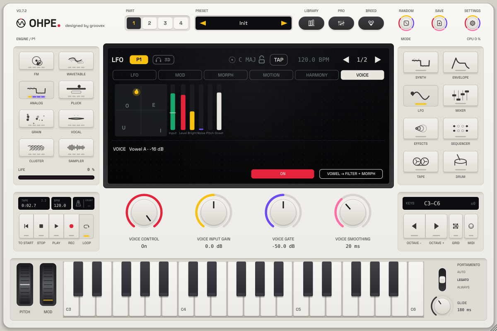

# Voice Control

*Ohpe – designed by groovex*

Sing, hum, talk or whisper into an audio input and your voice moves the sound. Voice Control is **not a vocoder**: the
voice is never heard through Ohpe, it only modulates. It is analysed in real time into seven modulation sources that go
anywhere in the [modulation matrix](MODULATION.md).

## Connect an input

| Where | How |
|---|---|
| Standalone app | **Settings > Audio**, **Input device** (none by default). macOS asks once for the microphone; the text explains why. Choose *No input* to close it again. |
| Plug-in (VST3 / AU) | Ohpe's optional stereo input bus – the one the tape and bounce already use – is the voice input. Enable the instrument's input or sidechain in the host (e.g. route a microphone track or a vocal bus to Ohpe's sidechain input). It stays off until the host enables it, so existing projects and layouts are unchanged. |

No input connected = every source rests at 0, so a preset or routing that uses them plays exactly as programmed.

## The sources

| # | Source | Range | What it follows |
|---|---|---|---|
| 34 | **Voice Level** | 0 … 1 | how loud you are above the gate (1 at about −6 dBFS) |
| 35 | **Vowel X** | −1 … +1 | back (U, O) to front (I, E) – the second formant |
| 36 | **Vowel Y** | −1 … +1 | closed (I, U) to open (A) – the first formant |
| 37 | **Voice Brightness** | 0 … 1 | how much of the voice lies above about 2 kHz |
| 38 | **Voice Noisiness** | 0 … 1 | consonants: s, sh, f, t are high, sung vowels low |
| 39 | **Voice Pitch** | 0 … 1 | the sung note, C2 … C6 (only with *Pitch Tracking* on) |
| 40 | **Voice Onset** | 0 … 1 | a short trigger at every new syllable or attack (fades in about 80 ms) |

The vowel is found from the voice's formants (linear prediction on a 16 ms window, updated every 2.7 ms): the analysis
lags the voice by about **8 ms** plus the smoothing you set. The vowel map is tuned to adult average formants; higher
voices still land on the right side of the map. After a pause of about 0.4 s the vowel, brightness, noisiness and
pitch glide home to 0.

## The Voice view (LFO mode)

**LFO > Voice** shows the vowel map – A E I O U at their places, your vowel as a yellow dot (grey while you are
silent) – and the input meter with the gate as a white line, then small bars for level, brightness, noisiness, pitch
and onset. The line under it says what Voice Control hears (vowel and level, *Listening* below the gate, or *No input*).

| Encoder | Parameter | Range | Default |
|---|---|---|---|
| Voice 1 | **Voice Control** (`voice.on`) | Off / On | On |
| Voice 2 | **Input Gain** (`voice.gain`) | −24 … +24 dB | 0 dB |
| Voice 3 | **Gate** (`voice.gate`) | −80 … −20 dBFS | −50 dBFS |
| Voice 4 | **Smoothing** (`voice.smooth`) | 1 … 250 ms | 20 ms |
| Options 1 | **Pitch Tracking** (`voice.pitch`) | Off / On | Off |
| Options 2 | **Monitor** (`voice.monitor`) | Off / On | **Off** – hear the input on the main output; keep it off with speakers (feedback) |

Soft keys: **On** switches Voice Control, **Vowel → Filter + Morph** is the quick mapping for the edit part (below).
All parameters are host-automatable and MIDI-learnable; they belong to your setup and are not stored in presets or
projects.

## Quick mapping: Vowel → Filter + Morph

One press (or the MIDI-learnable trigger `pN.voice.map`) writes three routings into the edit part's matrix:
**Vowel Y → Timbre** (+40 %: open vowels open the filter), **Vowel X → Morph X** and **Vowel Y → Morph Y** (+50 %
each: your vowel walks the [morph pad](MORPH.md) – switch the part's morph space on to hear it). Existing routings
are kept; pressing again only resets the three amounts; a full matrix is left alone (the display says so).

## Factory presets

Three part presets carry the tag **Voice** (search "Voice" in the library). Without an input they are complete sounds:

| Preset | Without input | With your voice |
|---|---|---|
| **Voice Vowel Lead** | a clean vowel lead with vibrato | your vowel moves its vowel, brightness opens it, syllables lean in |
| **Voice Filter Pad** | a warm pulse pad | open vowels open the filter, level brings it alive, the vowel pans it |
| **Voice Wah Bass** | a round talking bass | vowels sweep the formant table, consonants bite |

## Tips

* Start with the gate just above the room noise: the dot should turn yellow only when you sing.
* A longer smoothing (60 – 120 ms) makes vowel sweeps glide; 5 – 10 ms follows fast talking.
* Voice Onset as *via* of an envelope or as a Level routing makes rhythmic syllables play the part.
* Use headphones or keep **Monitor** off – Ohpe never needs to hear itself.
