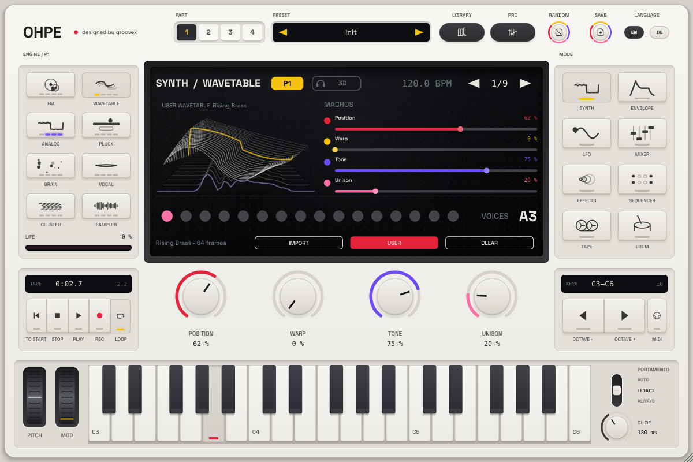

# Wavetable engine

*English · Deutsch: [../../de/engines/wavetable.md](../../de/engines/wavetable.md)*

Wavetable plays through a table of eight single-cycle frames and glides smoothly between them.
Six tables are built in (generated when Ohpe starts, no sample files): **Classic** (sine →
triangle → saw → square → narrowing pulse), **Harmonic** (an additive stack that grows frame by
frame), **Formant** (vowel-like a – e – i – o – u), **Digital** (sparse, comb-like spectra),
**Glass** (bell-like overtones) and **Grit** (seeded noisy spectra that get brighter).

Every table is stored as a set of band-limited copies, one per octave; the engine crossfades
between them depending on the note and on how much the phase is warped, so high notes stay free
of aliasing. **Warp** is a smooth phase distortion (*Bend*: one bulge per cycle, *Twist*: two),
which brightens the wave without adding foldover; it eases off over the top octaves for that
reason. Three unison oscillators, a sub sine and a resonant low-pass complete the voice.

| Encoder | Parameter | Range | What it does |
|---|---|---|---|
| 1 | Position | 0–1 | position in the table (frame morph) |
| 2 | Warp | 0–1 | phase distortion depth |
| 3 | Tone | 0–1 | low-pass cutoff (≈ 40 Hz – 20 kHz); mod envelope and LFO *Timbre* move it |
| 4 | Unison | 0–1 | adds two detuned side oscillators, detune and stereo width |
| – | Table | list | Classic, Harmonic, Formant, Digital, Glass, Grit |
| – | Warp Mode | list | Bend, Twist |
| – | Env > Position | −1 – +1 | how far the mod envelope sweeps the position |
| – | Resonance | 0–1 | filter resonance |
| – | Sub | 0–1 | sine one octave below |
| – | Key Track | 0–1 | cutoff follows the keyboard |
| – | Unison Voices (0.8) | 1–8 | 3 = the classic centre + two sides; 1, 2, 4 … 8 = an evenly spread stack (reese, supersaw) |
| – | Unison Width (0.8) | 0–1 | stereo spread of the stack (not used by the classic three) |
| – | FM Amount (0.8) | 0–1 | phase modulation of the table by a sine (growls, metallic edges); fades out on the top notes so it never aliases |
| – | FM Ratio (0.8) | 0.25–8 | frequency of the FM sine relative to the note |
| – | LFO > Position (0.8) | −1 – +1 | the part LFO moves the table position (slow scans, talking growls) |
| – | Env > FM (0.8) | −1 – +1 | the mod envelope adds (or removes) FM |

Parameter IDs: `p1.wavetable.pos`, `.warp`, `.tone`, `.unison`, `.table`, `.warpmode`, `.envpos`,
`.reso`, `.sub`, `.keytrack`, 0.8: `.univoices`, `.uniwidth`, `.fm`, `.fmratio`, `.lfopos`, `.envfm`.

**Bass with a wide stack (0.8):** the stack spreads the low end too – set the part's *Bass Mono*
(`pN.monobass`, e.g. 150 Hz) or a *Width* slot with *Mono Below* to keep the bass mono-safe.

**Starting points:** pad – Formant, Position 0.3, Env > Position 0.4, slow amp attack; bass –
Classic, Position 0.45, Unison 0, Sub 0.5, Tone 0.5; bright lead – Digital, Warp 0.4, Unison 0.5.

## User wavetables: audio to wavetable (p20)

On the Synth page of the Wavetable engine the display shows three soft keys: **IMPORT**, **USER** and
**CLEAR**. Drag a sound (WAV, AIFF, FLAC, Ogg) or a wavetable file onto the instrument, or press
**IMPORT**:

| IMPORT menu | What it does |
|---|---|
| Audio or wavetable file … | file chooser (sounds, single-cycle sets, Ohpe tables `.ohpewt`) |
| From tape track › 1 … 8 | analyses the recorded part of a tape track (up to 30 s) |
| Record input › 2 / 4 / 8 s | records the audio input (mono), then analyses it |
| Library › … | loads a table from the user wavetable library |
| Frames › 8 … 256 | how many frames the analysis cuts (default 64) |
| Smoothing › Off / Light / Medium / Strong | spectral smoothing across neighbouring frames |
| Cancel import | while an import runs |

**How a sound becomes a table.** The analysis runs on a worker thread – the audio never stops. It finds
the pitch of the sound, then cuts exactly one period at evenly spaced points through the sound
(period-synchronous slicing; the end of each period is crossfaded into the one before it, so the
cycle loops without a click), resamples each period to 2048 samples, turns every frame so its
fundamental starts as a rising sine (phase alignment: neighbouring frames morph without
cancellation), optionally smooths the spectra across frames, removes DC, normalises every frame and
builds the band-limited mip levels (one per octave, like the built-in tables), so a user table never
aliases. Sounds without a clear pitch are cut into 2048-sample windows. *Position* then scans
through the sound from its start (0) to its end (1).

**Wavetable files.** A WAV / AIFF / FLAC file that is a set of single cycles is read as it is: 2048
samples per frame (the file length is a multiple of 2048, up to 256 frames), or the frame size of a
`clm ` chunk or of evenly spaced cue points (other sizes are resampled to 2048). Ohpe's own format
`.ohpewt` keeps the frames (and the formant tracks for the Vocal engine).

**Library, presets, projects.** Every analysed sound and imported set is saved into the user
wavetable library – `…/groovex/Ohpe/Wavetables` in the user application data folder (macOS:
`~/Library/Application Support/groovex/Ohpe/Wavetables`); the environment variable
`OHPE_WAVETABLE_DIR` sets another folder. Part presets (block `"usertables"`), projects and the
plug-in state (section `"usertables"`) refer to the table by its path, then by its file name in the
library, and carry an embedded copy for tables up to 64 frames. When none of these is found the
part plays its built-in table and the display says so – nothing else changes.

**USER** switches between the user table and the built-in *Table* (host parameter
`pN.usertable.wt`, MIDI-learnable; an import switches it on). **CLEAR** removes the part's user
table. The display shows the frame stack, the frame at the current position lit in yellow; while an
import runs, a progress bar.
